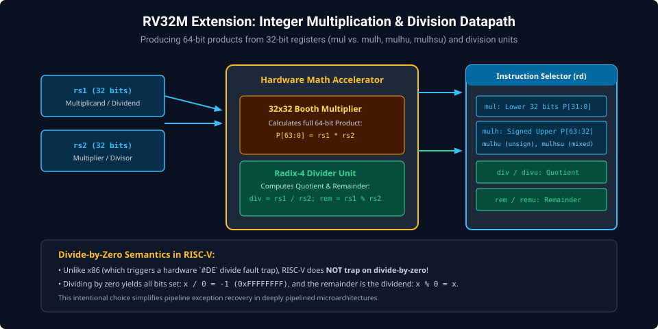
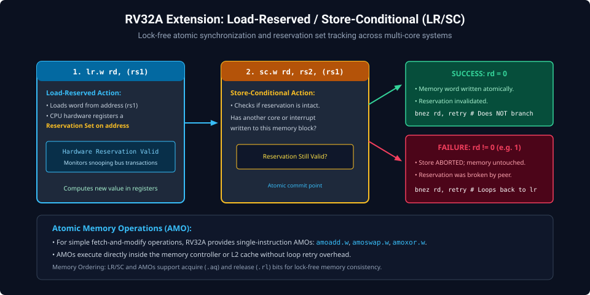
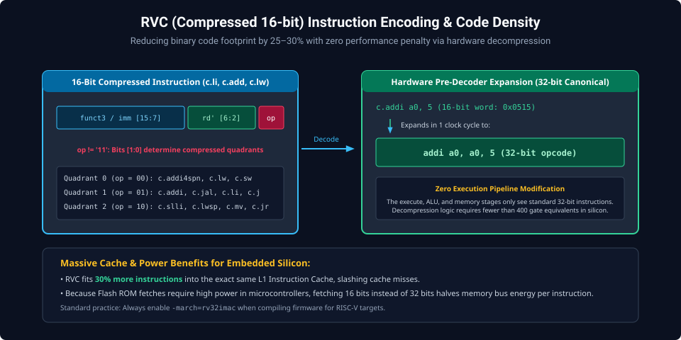

# Chapter 6: Standard Extensions: Multiply/Divide (M), Atomics (A), Compressed (C) & Floating-Point (F/D)

RISC-V's modularity allows processors to incorporate standardized hardware coprocessors and execution pipelines to dramatically accelerate mathematical computation, multiprocessing synchronization, and code density.

---

## 6.1 The 'M' Extension: Integer Multiplication & Division

The RV32M extension introduces 8 hardware instructions for 32-bit signed and unsigned multiplication and division:



### Multiplication Instructions

- **`mul rd, rs1, rs2`**: Returns lower 32 bits of 64-bit product ($P[31:0]$).
- **`mulh rd, rs1, rs2`**: Returns upper 32 bits ($P[63:32]$) treating both operands as **signed**.
- **`mulhu rd, rs1, rs2`**: Returns upper 32 bits treating both operands as **unsigned**.
- **`mulhsu rd, rs1, rs2`**: Returns upper 32 bits treating `rs1` as signed and `rs2` as unsigned (used for multi-word precision math).

### Division & Remainder Instructions

- **`div rd, rs1, rs2`** / **`divu`**: Signed / Unsigned integer quotient ($\lfloor \text{rs1} / \text{rs2} \rfloor$).
- **`rem rd, rs1, rs2`** / **`remu`**: Signed / Unsigned integer remainder ($\text{rs1} \pmod{\text{rs2}}$).

---

## 6.2 The 'A' Extension: Atomic Memory Operations (AMOs) & LR/SC

Multicore systems require hardware-level atomic synchronization to implement mutex locks, semaphores, and lock-free data structures.



### Load-Reserved / Store-Conditional (`lr.w` & `sc.w`)

- **`lr.w rd, (rs1)`**: Loads word from address `rs1` and registers a hardware reservation set on that memory block.
- **`sc.w rd, rs2, (rs1)`**: Stores `rs2` to `rs1` ONLY if the reservation set remains valid (no other core or interrupt has written to that address). Writes $0$ to `rd` on success, or non-zero ($1$) on failure.

### Spinlock Mutex Implementation

```assembly
# Acquire Spinlock (Address in a0)
acquire_lock:
    li   t0, 1           # 1 indicates locked
1:  lr.w t1, (a0)        # Read current lock state
    bnez t1, 1b          # If locked, spin wait
    sc.w t2, t0, (a0)    # Attempt to write 1
    bnez t2, 1b          # If store conditional failed, retry
    fence r, rw          # Memory barrier: acquire fence
    ret

# Release Spinlock
release_lock:
    fence rw, w          # Memory barrier: release fence
    sw   x0, 0(a0)       # Clear lock state to 0
    ret
```

---

## 6.3 The 'C' Extension: Compressed 16-Bit Instructions

The RV32C extension provides 16-bit encodings for the most frequently executed instructions, reducing program binary footprint by 25–30%.



- **Transparent Hardware Decompression**: RVC does not change the execution pipeline; instructions are decompressed into standard 32-bit instructions during instruction fetch.
- **Opcode Quadrants**: Bits `[1:0]` denote the compression quadrant: `00` (Quadrant 0), `01` (Quadrant 1), `10` (Quadrant 2). Bit pattern `11` is reserved for standard 32-bit instructions.

---

##### Copyright (c) 2026 squared-studio
