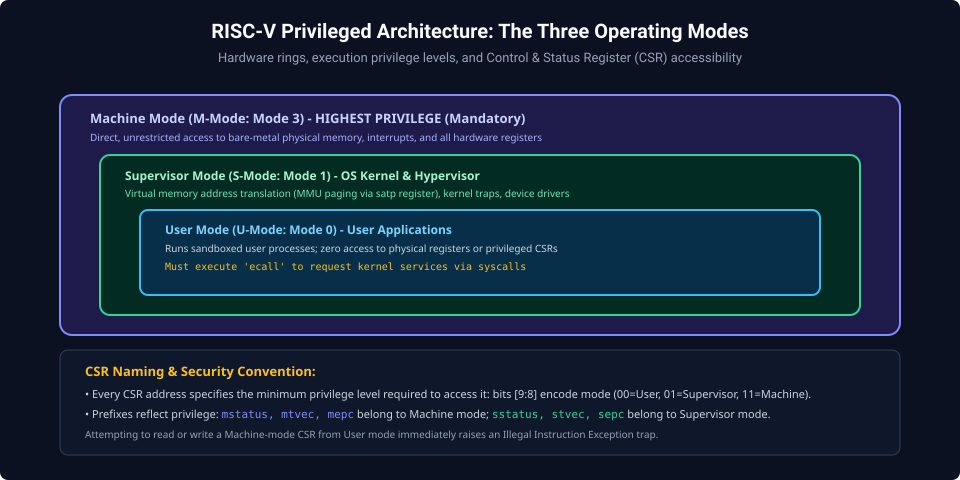
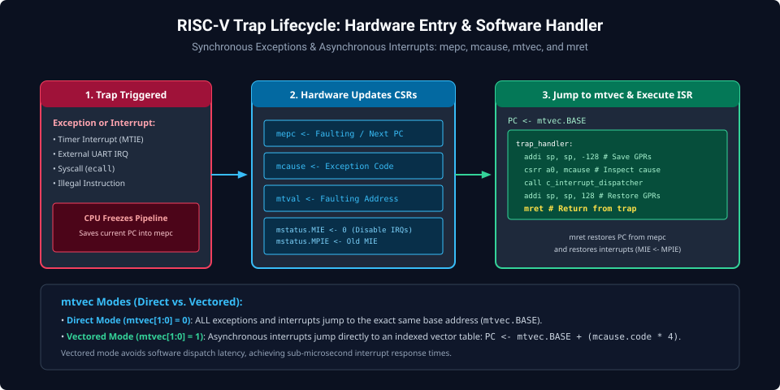
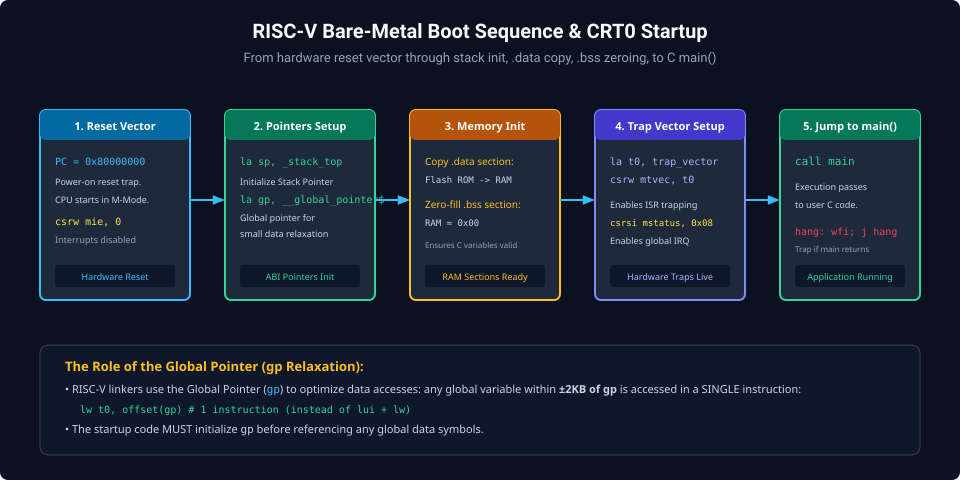

# Chapter 7: Privileged Architecture, CSRs, Traps, Interrupts & Bare-Metal Boot

Embedded systems, real-time operating systems, and bare-metal SoC firmware interact directly with hardware through the RISC-V Privileged Architecture. This chapter explores execution privilege modes, Control and Status Registers (CSRs), trap handling vectors, and low-level C runtime initialization (`crt0`).

---

## 7.1 RISC-V Privilege Modes

The RISC-V privileged specification defines three hardware execution privilege levels:



1. **Machine Mode (M-Mode: Mode 3)**:
   - Mandatory for all RISC-V chips.
   - Highest privilege level with direct, unrestricted access to physical memory, peripherals, and system control registers.
2. **Supervisor Mode (S-Mode: Mode 1)**:
   - Optional privilege level for POSIX/Linux operating systems.
   - Implements virtual memory page tables (`satp` register) and memory protection.
3. **User Mode (U-Mode: Mode 0)**:
   - Unprivileged mode for sandboxed application execution. Access to physical hardware requires invoking system calls via `ecall`.

---

## 7.2 Control and Status Registers (CSRs)

Hardware state is configured via a dedicated 12-bit CSR address space ($4096\text{ registers}$) manipulated using specialized atomic CSR instructions:

| Instruction    | Behavior                                  |
| :------------- | :---------------------------------------- |
| `csrr rd, csr` | Read CSR into `rd` (`csrrs rd, csr, x0`)  |
| `csrw csr, rs` | Write `rs` into CSR (`csrrw x0, csr, rs`) |
| `csrs csr, rs` | Set bits in CSR matching mask in `rs`     |
| `csrc csr, rs` | Clear bits in CSR matching mask in `rs`   |

### Key Machine-Mode CSRs

- **`mstatus`**: Machine Status Register (controls global interrupt enable bit `MIE`, prior privilege level `MPP`).
- **`mtvec`**: Machine Trap-Vector Base-Address Register.
- **`mepc`**: Machine Exception Program Counter (holds return address of interrupted code).
- **`mcause`**: Machine Cause Register (identifies exact reason for trap).
- **`mie` / `mip`**: Machine Interrupt Enable / Machine Interrupt Pending registers.

---

## 7.3 Trap Lifecycle: Exceptions & Interrupts

When an asynchronous interrupt (e.g., timer, UART) or synchronous exception (e.g., illegal instruction, misaligned access, `ecall`) occurs:



### Hardware Trap Sequence

1. Current instruction address is saved into `mepc`.
2. Cause code is written to `mcause`.
3. Global interrupts are disabled: `mstatus.MPIE = mstatus.MIE; mstatus.MIE = 0`.
4. Execution jumps to the address in `mtvec`.
5. Software ISR saves registers, handles the event, restores context, and executes `mret`.
6. The `mret` instruction restores `PC = mepc` and re-enables interrupts (`MIE = MPIE`).

---

## 7.4 Bare-Metal CRT0 Startup Code

Before jumping to C `main()`, bare-metal firmware executes a low-level initialization routine:



```assembly
# File: start.s (RISC-V CRT0 Startup)
    .section .init, "ax"
    .globl _start
_start:
    # 1. Disable all interrupts
    csrw mie, zero

    # 2. Initialize Stack Pointer and Global Pointer
    .option push
    .option norelax
    la   gp, __global_pointer$
    .option pop
    la   sp, _stack_top

    # 3. Clear BSS Segment (uninitialized global variables)
    la   t0, _sbss
    la   t1, _ebss
bss_clear_loop:
    bge  t0, t1, bss_done
    sw   zero, 0(t0)
    addi t0, t0, 4
    j    bss_clear_loop
bss_done:

    # 4. Copy Initialized Data from Flash to RAM
    la   t0, _sidata     # Flash ROM source address
    la   t1, _sdata      # RAM destination address
    la   t2, _edata      # RAM destination end
data_copy_loop:
    bge  t1, t2, data_done
    lw   t3, 0(t0)
    sw   t3, 0(t1)
    addi t0, t0, 4
    addi t1, t1, 4
    j    data_copy_loop
data_done:

    # 5. Configure Trap Vector Address
    la   t0, trap_handler
    csrw mtvec, t0

    # 6. Call C main()
    call main

    # 7. Infinite Trap if main returns
halt:
    wfi                  # Wait for interrupt (sleep CPU)
    j    halt
```

---

##### Copyright (c) 2026 squared-studio
