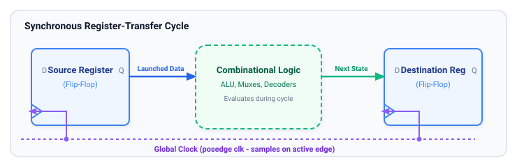
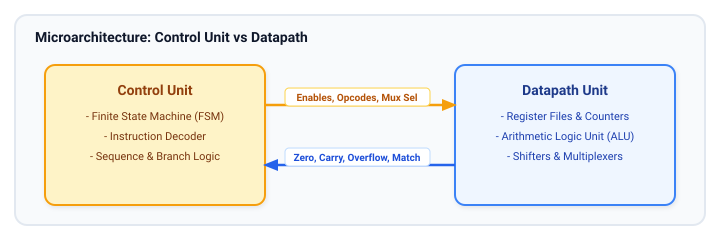
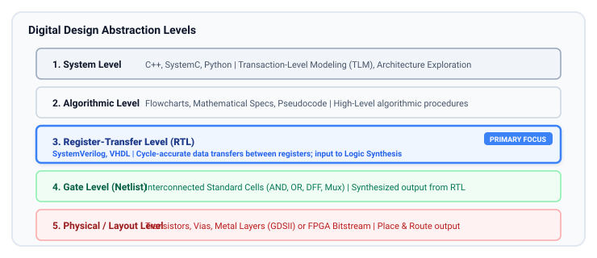
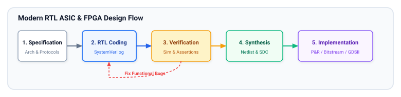

# Introduction to RTL Design

This chapter provides a foundational understanding of Register-Transfer Level (RTL) design, its significance in digital hardware development, and its place within the broader design flow. It sets the stage for the rest of the course by introducing key concepts, mental models, and terminology.

## Learning Goals

After completing this chapter, you should be able to:
- Explain what Register-Transfer Level (RTL) abstraction is and how it differs from gate-level and behavioral software models.
- Apply the RTL mental model: cycle-by-cycle evaluation, state separation, and datapath-control partitioning.
- Describe the complete digital design flow from specification down to physical FPGA bitstream or ASIC tape-out.
- Understand the role of logic synthesis, technology libraries, and constraints.
- Convert an algorithmic specification into a microarchitecture and synthesizable SystemVerilog RTL.

---

## What is RTL (Register-Transfer Level) Design?

RTL design is the standard abstraction level used to model digital circuits for synthesis into physical hardware:

- **Definition of RTL:** RTL describes a digital circuit in terms of the flow of digital signals between hardware registers, and the logical operations performed on those signals.
- **Focus on Registers and Data Transfer:** RTL design is centered around registers (memory elements, typically flip-flops) and combinational logic that transforms data as it moves between these registers across clock cycles.
- **Abstraction above Gate Level:** RTL is a higher level of abstraction than gate-level design. Instead of dealing with individual logic gates (AND, OR, NOT), RTL uses high-level arithmetic operators (`+`, `-`, `*`), control statements (`if-else`, `case`), and structured data types.
- **Synthesizable Behavioral Description:** RTL code describes *what* the hardware does on each clock cycle, allowing synthesis tools to optimize the gate-level implementation for area, speed, and power.



---

## How to Think at the RTL Level

Hardware execution is fundamentally different from sequential software programming:

- **Separate State from Logic:** A strong RTL description clearly distinguishes state-holding elements (registers, counters, memories) from combinational logic that computes next values.
- **Think in Clock Cycles:** Ask what values are sampled on this edge, what logic evaluates between edges, and what becomes visible on the next edge.
- **Model Datapath and Control Together:** Real designs combine datapath blocks (registers, ALUs, shifters, FIFOs) with control logic (enables, select signals, Finite State Machines). RTL is where those views integrate cleanly.
- **Describe Intent, Not Transistors:** The goal is to express behavior and structure that synthesis tools can efficiently map into standard cell libraries, FPGA LUTs, DSPs, and dedicated memory blocks.
- **Keep Hardware Cost in Mind:** Every register, multiplexer, comparator, and arithmetic operator has implications for silicon area, propagation delay, and power consumption.



---

## Abstraction Levels in Digital Design

Modern digital design spans multiple levels of abstraction, from conceptual software models down to physical transistors:



- **System Level:** Highest level, describes the overall system functionality and architecture, often using system-level languages or models (e.g., C++, SystemC, Python). Focus is on system partitioning, algorithm design, and high-level performance analysis.
- **Algorithmic Level:** Describes the algorithms and procedures that the hardware will execute. May be represented using flowcharts or pseudocode. Bridges the gap between system-level specifications and hardware implementation.
- **RTL (Register-Transfer Level):** The primary focus of digital hardware design. Describes the cycle-accurate data flow and operations between registers using hardware description languages like SystemVerilog. This is the golden reference level used for logic synthesis and functional sign-off.
- **Gate Level:** Represents the design in terms of interconnected logic gates and flip-flops. This netlist is the output of logic synthesis and is technology-dependent.
- **Physical Level:** Lowest hardware representation, describing physical geometries on silicon (standard cell layout, metal wire layers, vias) or FPGA routing matrices and bitstream configuration.

---

## Importance of RTL Design in ASIC and FPGA Development

### ASIC (Application-Specific Integrated Circuit) Development
- **Synthesis for ASICs:** RTL code is the primary input to ASIC logic synthesis tools (e.g., Synopsys Design Compiler, Cadence Genus). Synthesis translates RTL into a gate-level netlist optimized for target standard cell libraries (e.g., TSMC 7nm, Intel 18A).
- **Design Complexity Management:** RTL abstraction allows designers to manage the complexity of modern ASICs containing billions of transistors.
- **Verification Focus:** RTL is the level at which the vast majority of functional verification, linting, formal verification, and simulation takes place before committing to silicon tape-out.

### FPGA (Field-Programmable Gate Array) Development
- **Synthesis for FPGAs:** RTL is synthesized to target FPGA architectures (AMD/Xilinx Vivado, Intel Quartus Prime). Tools map RTL constructs into Configurable Logic Blocks (CLBs/ALMs), Look-Up Tables (LUTs), flip-flops, block RAMs, and DSP slices.
- **Rapid Prototyping and Flexibility:** RTL designs can be synthesized and loaded onto an FPGA in minutes or hours, allowing rapid prototyping, hardware-in-the-loop testing, and field reconfigurability.
- **IP Core Integration:** RTL provides the glue logic and bus infrastructure (AXI, AHB, APB, Wishbone) to integrate pre-verified IP cores (CPUs, PCIe, memory controllers).

---

## RTL Design Flow

The journey from idea to hardware silicon follows a disciplined engineering flow:



1. **Specification:** Clearly define functional requirements, interface protocols, throughput, latency, clock frequencies, power budgets, and physical constraints.
2. **Microarchitecture:** Partition the system into datapath blocks, pipeline stages, control FSMs, FIFOs, and interfaces. Document cycle-by-cycle timing diagrams.
3. **Design (RTL Coding):** Write clean, synthesizable SystemVerilog code following industry best practices (`always_comb`, `always_ff`, explicit bit widths, parameterized modules).
4. **Linting and Static Checks:** Run static linters (e.g., Verilator, SpyGlass) to catch unassigned signals, inferred latches, bit-width mismatches, and clock-domain crossing (CDC) issues before simulation.
5. **Functional Verification:** Verify functionality in simulation using SystemVerilog testbenches, assertions (SVA), constrained random testing, and functional coverage metrics.
6. **Synthesis:** Logic synthesis tools convert RTL into technology-specific gate netlists under timing constraints (SDC).
7. **Implementation (FPGA/ASIC):**
   - **FPGA:** Placement, routing, timing closure, and bitstream generation.
   - **ASIC:** Floorplanning, clock tree synthesis (CTS), place and route, DRC/LVS physical verification, parasitic extraction, and tape-out (GDSII/OASIS).

---

## From Microarchitecture to RTL: A Practical Example

To understand how to convert a microarchitecture into RTL, consider an **Accumulating Packet Counter with Valid-Ready Handshake**:

- **Specification:** When `valid_in` and `ready_out` are both asserted, add `data_in` to an internal accumulator. Provide a reset, an enable, and an overflow flag.
- **Microarchitecture:**
  - State element: Register `acc_reg` (32 bits) and overflow flag `ovf_reg`.
  - Combinational logic: Adder with carry detection and handshake detection (`handshake = valid_in & ready_out`).

```systemverilog
// accumulator.sv - Synthesizable RTL Example
module accumulator #(
    parameter int unsigned DATA_WIDTH = 16,
    parameter int unsigned ACC_WIDTH  = 32
) (
    input  logic                  clk,
    input  logic                  rst_n,      // Active-low asynchronous reset
    input  logic                  valid_in,   // Upstream data valid
    output logic                  ready_out,  // Downstream ready
    input  logic [DATA_WIDTH-1:0] data_in,
    output logic [ACC_WIDTH-1:0]  acc_out,
    output logic                  overflow
);
    // Internal registers
    logic [ACC_WIDTH-1:0] acc_q, acc_d;
    logic                 ovf_q, ovf_d;
    logic                 hs;

    // Handshake occurs when both valid and ready are high
    assign ready_out = 1'b1; // Always ready to receive in this simple design
    assign hs        = valid_in && ready_out;

    // Combinational next-state logic (always_comb)
    always_comb begin
        acc_d = acc_q;
        ovf_d = ovf_q;

        if (hs) begin
            {ovf_d, acc_d} = acc_q + data_in; // Detect 32-bit overflow
        end
    end

    // Sequential state update (always_ff)
    always_ff @(posedge clk or negedge rst_n) begin
        if (!rst_n) begin
            acc_q <= '0;
            ovf_q <= 1'b0;
        end else begin
            acc_q <= acc_d;
            ovf_q <= ovf_d;
        end
    end

    // Output assignments
    assign acc_out  = acc_q;
    assign overflow = ovf_q;

endmodule
```

---

## Learning Resources

### Key Books
- **"Digital Design and Computer Architecture"** by David Money Harris & Sarah L. Harris ([Book Link](https://www.elsevier.com/books/digital-design-and-computer-architecture-arm-edition/harris/978-0-12-800056-4)) — Chapter 1 provides an excellent introduction to digital abstraction levels.
- **"RTL Hardware Design Using VHDL and Verilog"** by Pong P. Chu — Outstanding explanation of the register-transfer level mindset and hardware inference.

### Recommended Web Resources
- [Nandland](https://nandland.com/) — Practical FPGA and digital design fundamentals with video explanations.
- [ASIC World](https://www.asic-world.com/) — Comprehensive tutorials on Verilog/SystemVerilog RTL and ASIC design flow.

---

## Exercises

### Exercise 1.1: Identify RTL Blocks in a System
Find or sketch the block diagram of a simple 32-bit RISC-V processor (single-cycle or multi-cycle):
1. Identify all state elements (Program Counter, Register File, Data Memory).
2. Trace the combinational datapath (ALU, Immediate Generator, Branch Comparators, Multiplexers).
3. Identify the control unit signals (ALUOp, RegWrite, MemRead, BranchTaken).

### Exercise 1.2: Cycle-by-Cycle RTL Trace
Given the `accumulator` module above:
- Assuming `rst_n` de-asserts at $t=0$, write out the values of `acc_q` and `ovf_q` across 5 clock cycles with the following input sequence on `data_in`: `16'h0010`, `16'h0020`, `16'h0030`, `16'hFFFF`, `16'h0001` (assume `valid_in = 1` for all cycles).
- Identify on which cycle `overflow` becomes asserted.

### Exercise 1.3: Algorithmic to RTL Conversion
Design a **Moving Average Filter** that receives an 8-bit stream of samples and outputs the average of the last 4 samples:
1. Identify how many registers are needed to store past history (a 4-deep shift register).
2. Write down the combinational calculation: $\text{Average} = (s_0 + s_1 + s_2 + s_3) \gg 2$.
3. Sketch the register-transfer diagram showing the shift registers and adder tree.

##### Copyright (c) 2026 squared-studio
