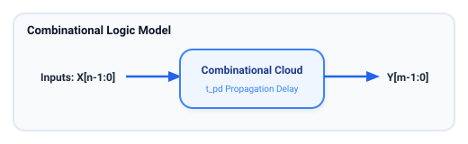
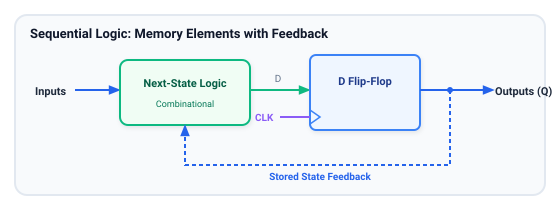
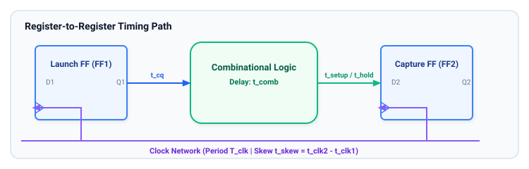
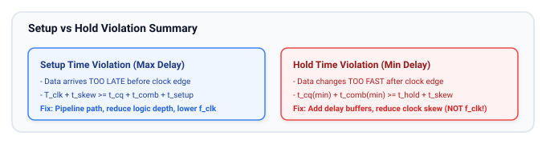

# Digital Design Fundamentals Review

This chapter revisits the essential building blocks of digital circuits, providing a solid foundation for understanding and creating RTL designs. It covers combinational and sequential logic, along with fundamental timing concepts that are crucial for synchronous digital design.

## Learning Goals

After completing this chapter, you should be able to:
- Contrast combinational logic (stateless, function of current inputs) with sequential logic (state-holding, memory elements).
- Understand why edge-triggered D flip-flops form the basis of synchronous digital design, while transparent latches are generally avoided.
- Analyze register-to-register timing paths and verify setup and hold constraints mathematically.
- Understand the physical meaning of clock-to-Q delay, combinational propagation delay, setup time, hold time, and clock skew.
- Implement foundational combinational circuits (multiplexers, priority encoders, adders) and sequential circuits (counters, shift registers) in synthesizable SystemVerilog.

---

## Combinational Logic

Combinational logic circuits have outputs that depend purely on the current values of their inputs. They contain no memory or feedback loops.



### Basic Gates & Boolean Algebra
- **Logic Gates:** AND, OR, NOT, NAND, NOR, XOR, XNOR. NAND and NOR gates are **universal gates**, meaning any Boolean function can be implemented using only NAND or only NOR gates.
- **De Morgan's Laws:**
  $$\overline{A \cdot B} = \overline{A} + \overline{B}$$
  $$\overline{A + B} = \overline{A} \cdot \overline{B}$$
- **Sum of Products (SOP) & Product of Sums (POS):** Standard canonical representations for logic functions.
- **Karnaugh Maps (K-maps):** A visual technique for simplifying Boolean expressions up to 4–6 variables by grouping adjacent powers of 2 ($1, 2, 4, 8, \dots$) minterms, taking advantage of "don't care" ($X$) conditions.

### Essential Combinational Building Blocks
- **Multiplexers (MUXes):** Selects one of $2^N$ data inputs using $N$ select bits. In RTL, multiplexers represent decision logic (such as `if-else`, ternary `? :`, or `case`).
- **Decoders:** Converts an $N$-bit binary input into one of $2^N$ active outputs. Used heavily in address decoding and instruction decode units.
- **Priority Encoders:** Converts $2^N$ input lines into an $N$-bit code representing the highest-priority active input. Crucial for interrupt controllers and arbiters.
- **Adders:**
  - **Half Adder:** Adds 2 bits: $\text{Sum} = A \oplus B$, $\text{Cout} = A \cdot B$.
  - **Full Adder:** Adds 3 bits (including Cin): $\text{Sum} = A \oplus B \oplus Cin$, $\text{Cout} = (A \cdot B) + (Cin \cdot (A \oplus B))$.
  - **Carry Lookahead Adder (CLA):** Speeds up multi-bit addition by computing Generate ($G_i = A_i \cdot B_i$) and Propagate ($P_i = A_i \oplus B_i$) signals in parallel.

### Synthesizable Combinational Example: Parameterized Priority Encoder
```systemverilog
// priority_encoder.sv - Synthesizable Combinational Logic
module priority_encoder #(
    parameter int unsigned REQ_WIDTH = 8
) (
    input  logic [REQ_WIDTH-1:0]         req_i,
    output logic [$clog2(REQ_WIDTH)-1:0] grant_idx_o,
    output logic                         valid_o
);
    always_comb begin
        grant_idx_o = '0;
        valid_o     = 1'b0;

        // Iterate through requests from highest to lowest index
        for (int i = REQ_WIDTH - 1; i >= 0; i--) begin
            if (req_i[i]) begin
                grant_idx_o = i[$clog2(REQ_WIDTH)-1:0];
                valid_o     = 1'b1;
                break; // Break out once highest priority is identified
            end
        end
    end
endmodule
```

---

## Sequential Logic

Sequential logic circuits have memory: their outputs depend on both current inputs and the circuit's past history (stored internal state).



### Latches vs. Flip-Flops
- **Transparent Latches:**
  - Level-sensitive: When Enable is asserted (high or low), the output continuously follows the input ($Q = D$). When Enable is de-asserted, the output holds its last state.
  - Vulnerable to glitches, timing loops, and race conditions. Generally avoided in modern synchronous RTL unless explicitly intended for ultra-low-power or custom memory designs.
- **Edge-Triggered Flip-Flops (DFF):**
  - Edge-triggered: Samples the data input $D$ precisely on the rising (or falling) edge of the clock signal and holds it stable throughout the rest of the cycle.
  - Forms the foundation of modern synchronous digital systems.

### Core Sequential Building Blocks
- **Registers:** An array of $N$ flip-flops sharing a common clock and reset line, used to store multi-bit data words.
- **Synchronous Counters:** Registers configured to increment, decrement, or load values on clock edges.
- **Shift Registers:** A cascade of flip-flops where data shifts by one position on each clock pulse. Common types include Serial-In Serial-Out (SISO), Serial-In Parallel-Out (SIPO), Parallel-In Parallel-Out (PIPO), and Parallel-In Parallel-Out (PIPO).

### Synthesizable Sequential Example: 8-bit Up/Down Loadable Counter
```systemverilog
// counter_updown.sv - Synthesizable Sequential Logic
module counter_updown #(
    parameter int unsigned WIDTH = 8
) (
    input  logic             clk,
    input  logic             rst_n,      // Active-low asynchronous reset
    input  logic             load_en,    // Synchronous load enable
    input  logic [WIDTH-1:0] load_data,  // Data to load
    input  logic             count_en,   // Count enable
    input  logic             up_down,    // 1 = Count Up, 0 = Count Down
    output logic [WIDTH-1:0] count_o
);
    always_ff @(posedge clk or negedge rst_n) begin
        if (!rst_n) begin
            count_o <= '0;
        end else if (load_en) begin
            count_o <= load_data;
        end else if (count_en) begin
            if (up_down)
                count_o <= count_o + 1'b1;
            else
                count_o <= count_o - 1'b1;
        end
    end
endmodule
```

---

## Synchronous Design Mindset

Synchronous digital design is governed by one golden principle: **All memory elements are triggered by a disciplined, common periodic clock signal.**

1. **Registers Define Time Boundaries:** Flip-flops partition continuous physical time into discrete clock cycles.
2. **Inputs are Sampled at Clock Edges:** Combinational outputs do not need to be glitch-free during the cycle; they only need to settle to a stable, valid level before the next sampling clock edge.
3. **Predictable Timing Closure:** Static Timing Analysis (STA) can analyze each register-to-register path independently.

---

## Timing Diagrams and Basic Timing Concepts

Digital signals do not change instantaneously. Physics imposes propagation delays and minimum stability windows.



### Essential Timing Parameters
- **Clock Period ($T_{clk}$):** The duration of one complete clock cycle ($T_{clk} = 1 / f_{clk}$).
- **Clock-to-Q Delay ($t_{cq}$):** The time required for the flip-flop output $Q$ to transition after the active clock edge occurs.
- **Combinational Delay ($t_{comb}$):** The propagation delay through the combinational gates and interconnect wires between two registers.
- **Setup Time ($t_{setup}$):** The minimum time the input data signal $D$ must be stable **before** the active clock edge.
- **Hold Time ($t_{hold}$):** The minimum time the input data signal $D$ must remain stable **after** the active clock edge.
- **Clock Skew ($t_{skew}$):** The arrival time difference of the same clock edge at two different flip-flops ($t_{skew} = t_{clk,capture} - t_{clk,launch}$).

---

## Register-to-Register Timing Intuition

### Setup Time Constraint (Maximum Delay Check)
The data launched by the source flip-flop must travel through the combinational logic and arrive at the destination flip-flop at least $t_{setup}$ before the next clock edge:

$$T_{clk} + t_{skew} \ge t_{cq(max)} + t_{comb(max)} + t_{setup}$$

Rewriting in terms of maximum clock frequency:

$$T_{clk} \ge t_{cq(max)} + t_{comb(max)} + t_{setup} - t_{skew}$$

$$\text{Setup Slack} = (T_{clk} + t_{skew}) - (t_{cq(max)} + t_{comb(max)} + t_{setup})$$

> **Setup Violation Remedy:** Decrease clock frequency (increase $T_{clk}$), pipeline long combinational paths into multiple stages, or optimize logic depth.

### Hold Time Constraint (Minimum Delay Check)
Data launched on the current clock edge must **not** race ahead and overwrite the previous data at the destination flip-flop before the destination flip-flop satisfies its hold time:

$$t_{cq(min)} + t_{comb(min)} \ge t_{hold} + t_{skew}$$

$$\text{Hold Slack} = (t_{cq(min)} + t_{comb(min)}) - (t_{hold} + t_{skew})$$

> [!WARNING]
> Notice that the **hold equation does not depend on the clock period $T_{clk}$**! You cannot fix a hold violation by slowing down the clock. Hold violations must be fixed by inserting buffer delays or minimizing clock skew.



---

## Learning Resources

### Textbooks
- **"Digital Design and Computer Architecture"** by David Money Harris & Sarah L. Harris — Chapter 2 (Combinational Logic) and Chapter 3 (Sequential Logic).
- **"Static Timing Analysis for Nanometer Designs: A Practical Approach"** by J. Bhasker & Rakesh Chadha — The industry gold standard for setup, hold, and clock skew analysis.

### Online Tutorials & Courses
- [Khan Academy: Electrical Engineering & Logic](https://www.khanacademy.org/computing/computer-science/digital-information)
- [Coursera: Digital Systems - From Logic Gates to Processors](https://www.coursera.org/courses?query=digital%20design)
- [VLSI Expert Group: Setup and Hold Time Explained](https://www.vlsiexpert.com/)

---

## Exercises

### Exercise 2.1: Timing Slack Calculation
A register-to-register path has the following timing parameters:
- Clock period $T_{clk} = 5.0\text{ ns}$ (200 MHz)
- Source flip-flop: $t_{cq(max)} = 0.6\text{ ns}$, $t_{cq(min)} = 0.3\text{ ns}$
- Destination flip-flop: $t_{setup} = 0.4\text{ ns}$, $t_{hold} = 0.2\text{ ns}$
- Clock skew: $t_{skew} = +0.1\text{ ns}$ (clock arrives 100 ps later at destination)
- Combinational logic path: $t_{comb(max)} = 3.8\text{ ns}$, $t_{comb(min)} = 0.05\text{ ns}$

**Questions:**
1. Calculate the setup slack. Does this path meet setup timing?
2. Calculate the hold slack. Does this path meet hold timing? If not, what minimum buffer delay must be inserted into the data path to resolve the violation?

### Exercise 2.2: Ripple Carry vs Carry Lookahead Adder
1. Implement a 4-bit Ripple Carry Adder in SystemVerilog using structural instantiation of 4 Full Adder instances.
2. Implement a 4-bit Carry Lookahead Adder in SystemVerilog using Generate ($G_i$) and Propagate ($P_i$) equations.
3. Compare the gate delay from $Cin$ to $Cout$ between the two implementations.

### Exercise 2.3: Synthesizable 8-bit Shift Register
Implement an 8-bit universal shift register in SystemVerilog with the following modes controlled by a 2-bit `mode` input:
- `2'b00`: Hold current value
- `2'b01`: Shift Right (MSB filled with `s_in`)
- `2'b10`: Shift Left (LSB filled with `s_in`)
- `2'b11`: Parallel Load (`d_in[7:0]`)

Include an active-low asynchronous reset `rst_n`.

##### Copyright (c) 2026 squared-studio
