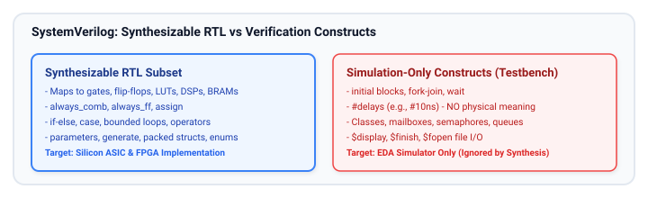
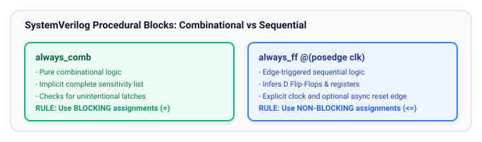
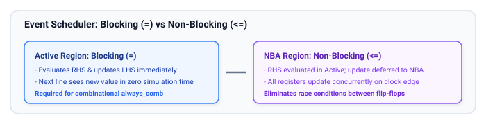
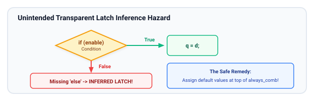

# RTL Coding Styles and Best Practices

This chapter covers the foundational rules and industry best practices for writing clean, synthesizable, high-performance, and maintainable Register-Transfer Level (RTL) code in SystemVerilog.

## Learning Goals

After completing this chapter, you should be able to:

- Distinguish between synthesizable SystemVerilog constructs (mapped to physical hardware) and non-synthesizable constructs (simulation and verification only).
- Apply the correct procedural blocks: `always_comb` for combinational logic, `always_ff` for sequential registers, and know why `always_latch` is avoided.
- Understand the simulation event queue and strictly apply non-blocking assignments (`<=`) in sequential logic and blocking assignments (`=`) in combinational logic.
- Prevent accidental latch inference using complete conditionals and default assignments.
- Design parameterized, reusable modules using SystemVerilog parameters and `generate` blocks.
- Write readable, maintainable RTL adhering to standard industry naming conventions and architectural hierarchy.

---

## Synthesizable vs. Non-Synthesizable Constructs

SystemVerilog is a dual-purpose language: it describes hardware (HDL) and testbench environments (HVL). Writing RTL requires understanding what synthesis tools can transform into physical gates:



### Synthesizable RTL Constructs

- **Procedural Blocks:** `always_comb`, `always_ff`, `assign`.
- **Control Flow:** `if-else`, `case`, `casez` (with care), bounded `for` loops with constant bounds.
- **Operators:** Arithmetic (`+`, `-`, `*`), bitwise (`&`, `|`, `^`, `~`), logical (`&&`, `||`, `!`), relational (`<`, `>`, `==`, `!=`), shifting (`<<`, `>>`, `<<<`, `>>>`), concatenation (`{a, b}`), and replication (`{4{a}}`).
- **Hierarchy & Reusability:** Module instantiations, `parameter`, `localparam`, `generate` loops, and `generate if`.
- **Types:** `logic`, `bit`, `byte`, packed and unpacked arrays, `struct packed`, `enum`.

### Non-Synthesizable Constructs (Simulation Only)

- **Time delays:** `#10ns`, `#5`. Hardware timing is determined by physical gate and wire delays, not `#` delays.
- **Dynamic processes:** `initial` blocks (note: FPGA tools may use `initial` for power-on RAM initialization, but ASICs ignore them), `fork-join`, `wait`.
- **OOP and Verification:** Classes, virtual methods, mailboxes, semaphores, dynamic arrays (`[]`), queues (`$`).
- **File I/O and System Tasks:** `$display`, `$monitor`, `$readmemh`, `$fopen`, `$finish`.

---

## Coding for Synthesis: Procedural Blocks and Continuous Assignment

Modern SystemVerilog introduced dedicated procedural blocks to replace the ambiguous Verilog `always @*` and `always @(posedge clk)`:



### Combinational Logic: `always_comb` and `assign`

- **`always_comb`:**
  - Evaluates once at simulation time zero, guaranteeing correct initialization.
  - Automatically infers the sensitivity list from all signals read inside the block.
  - Linters and synthesis tools flag errors if a latch or feedback loop is inferred.
  - Always use **blocking assignments (`=`)**.
- **Continuous Assignment (`assign`):**
  - Best suited for simple dataflow expressions, multiplexing, and boolean reductions.

```systemverilog
// Combinational assignment styles
assign mux_out = sel ? in_b : in_a; // Continuous assignment

always_comb begin                   // Procedural combinational block
    case (opcode)
        2'b00:   alu_result = a + b;
        2'b01:   alu_result = a - b;
        2'b10:   alu_result = a & b;
        default: alu_result = a | b;
    endcase
end
```

### Sequential Logic: `always_ff`

- Enforces that physical hardware registers (flip-flops) are inferred.
- Explicit clock edge (`posedge clk` or `negedge clk`).
- Always use **non-blocking assignments (`<=`)**.

```systemverilog
// D Flip-Flop with Active-Low Asynchronous Reset
always_ff @(posedge clk or negedge rst_n) begin
    if (!rst_n) begin
        q_reg <= '0;
    end else begin
        q_reg <= d_in;
    end
end
```

---

## Blocking (`=`) vs. Non-blocking (`<=`) Assignments

Misunderstanding the difference between blocking and non-blocking assignments is the #1 cause of **simulation-synthesis mismatches** and race conditions.



### Golden Rules:

1. **Inside `always_ff`:** Always use **non-blocking (`<=`)**. Never use blocking assignments inside sequential blocks.
2. **Inside `always_comb`:** Always use **blocking (`=`)**. Never use non-blocking assignments inside combinational blocks.
3. **Never mix blocking and non-blocking assignments to the same variable.**
4. **Never assign to the same variable from more than one `always` block.**

#### Example: Shift Register Race Condition

```systemverilog
// BAD: Blocking in sequential logic causes race conditions!
// Depending on simulator order, q2 might capture the NEW or OLD value of q1 in the SAME cycle!
always_ff @(posedge clk) begin
    q1 = d_in;
    q2 = q1; // q2 might receive d_in in 0 time, collapsing two flip-flops into one!
end

// GOOD: Non-blocking correctly models hardware flip-flops in parallel
always_ff @(posedge clk) begin
    q1 <= d_in;
    q2 <= q1; // q2 captures the value q1 held BEFORE the clock edge!
end
```

---

## Avoiding Unintended Latches

In modern synchronous digital design, **unintentional transparent latches are hazardous bugs**. They consume unnecessary area, introduce timing analysis headaches, and cause race conditions.

A latch is inferred when a signal inside an `always_comb` or `always @*` block is **not assigned a value under all possible execution paths**.



### Solution: Assign Default Values at the Top

The most reliable way to prevent latches in complex combinational blocks is to provide a default value to every output at the very beginning of the `always_comb` block:

```systemverilog
// BAD: Inferred Latch
always_comb begin
    if (enable) begin
        out_data = in_data; // What if enable is 0? Latch inferred!
    end
end

// GOOD: Complete assignment with default
always_comb begin
    out_data = '0; // 1. Safe default value assigned first!
    if (enable) begin
        out_data = in_data; // 2. Overridden if condition holds
    end
end
```

---

## Parameterization and Code Reusability

Parameterization enables modules to be reused across different data widths, memory depths, and feature sets without duplicating source files.

```systemverilog
// Parameterized Arithmetic Logic Unit (ALU)
module alu #(
    parameter int unsigned DATA_WIDTH = 32
) (
    input  logic [DATA_WIDTH-1:0] a_i,
    input  logic [DATA_WIDTH-1:0] b_i,
    input  logic [2:0]            op_i,
    output logic [DATA_WIDTH-1:0] res_o,
    output logic                  zero_o
);
    typedef enum logic [2:0] {
        ALU_ADD = 3'b000,
        ALU_SUB = 3'b001,
        ALU_AND = 3'b010,
        ALU_OR  = 3'b011,
        ALU_XOR = 3'b100,
        ALU_SLL = 3'b101,
        ALU_SRL = 3'b110
    } alu_op_e;

    always_comb begin
        res_o = '0;
        case (op_i)
            ALU_ADD: res_o = a_i + b_i;
            ALU_SUB: res_o = a_i - b_i;
            ALU_AND: res_o = a_i & b_i;
            ALU_OR:  res_o = a_i | b_i;
            ALU_XOR: res_o = a_i ^ b_i;
            ALU_SLL: res_o = a_i << b_i[4:0];
            ALU_SRL: res_o = a_i >> b_i[4:0];
            default: res_o = '0;
        endcase
    end

    assign zero_o = (res_o == '0);

endmodule
```

### Conditional and Loop Generation: `generate`

SystemVerilog `generate` blocks allow structural hardware repetition or conditional inclusion based on parameters evaluated at compile/elaboration time:

```systemverilog
// Parameterized Reduction Parity Tree using generate
module parity_generator #(
    parameter int unsigned NUM_BITS = 8
) (
    input  logic [NUM_BITS-1:0] data_i,
    output logic                parity_o
);
    // Continuous reduction XOR operator is the idiomatic way:
    assign parity_o = ^data_i;

    // Structural generate demonstration:
    /*
    genvar i;
    logic [NUM_BITS-1:0] chain;
    assign chain[0] = data_i[0];
    generate
        for (i = 1; i < NUM_BITS; i++) begin : gen_xor
            assign chain[i] = chain[i-1] ^ data_i[i];
        end
    endgenerate
    assign parity_o = chain[NUM_BITS-1];
    */
endmodule
```

---

## Coding for Readability and Maintainability

Industry chip design teams enforce strict styling conventions to ensure massive SoCs can be maintained, verified, and handed over cleanly:

1. **Consistent Naming Conventions:**
   - Signal suffixes: `_i` for inputs, `_o` for outputs, `_io` for bidirectionals, `_q` for registered values, `_d` for next-state combinational inputs.
   - Clock and Reset: `clk`, `rst_n` (explicit `_n` denotes active-low).
   - Parameters and constants: UPPERCASE (e.g., `DATA_WIDTH`, `MAX_DEPTH`).
2. **Explicit Bit Widths:**
   - Avoid unsized literals like `'1'` when a specific width is expected. Write `1'b1`, `8'd0`, or `'0` (SystemVerilog fill operator).
3. **Meaningful Hierarchy:**
   - Partition complex designs into modules containing under ~500 lines of RTL.
   - Keep control logic (FSMs) separate from datapath (arithmetic, buffers).

---

## Common RTL Coding Pitfalls Summary

| Coding Pitfall                          | Problem                                                              | Solution                                                        |
| :-------------------------------------- | :------------------------------------------------------------------- | :-------------------------------------------------------------- |
| **Using `=` in `always_ff`**            | Simulation race condition between flip-flop stages                   | Use non-blocking `<=` exclusively in sequential blocks          |
| **Using `<=` in `always_comb`**         | Unnecessary event scheduling iterations; subtle simulation bugs      | Use blocking `=` exclusively in combinational blocks            |
| **Incomplete `if` or `case`**           | Unintended transparent latches inferred                              | Assign default values at top of block; add `else` and `default` |
| **Missing signals in sensitivity list** | Simulation/synthesis mismatch in legacy Verilog                      | Use SystemVerilog `always_comb` (automatic sensitivity)         |
| **Driving a wire from multiple blocks** | Multi-driver conflict (`X` in simulation, short circuit in hardware) | Drive each signal from exactly one `always` block or `assign`   |

---

## Learning Resources

### Reference Guides

- **"Effective RTL Design and Coding for SystemVerilog"** by Clifford E. Cummings ([Book Link](https://www.amazon.com/Effective-RTL-Design-Coding-SystemVerilog/dp/0982447705)) — The world's most cited paper on non-blocking assignments and SystemVerilog synthesis guidelines.
- **"Standard Caveats for SystemVerilog Synthesis"** by Stuart Sutherland (Sutherland HDL).
- **Vivado Design Suite User Guide: Synthesis (UG901)** — AMD/Xilinx official guide for HDL coding styles.

---

## Exercises

### Exercise 3.1: Code Review and Refactoring

Review the following buggy Verilog snippet:

```verilog
module bad_mux(input a, b, sel, clk, output reg q);
    reg temp;
    always @(posedge clk) begin
        temp = a & b;
        q = temp;
    end
endmodule
```

1. Identify at least 3 distinct coding style and synthesis issues.
2. Rewrite the module in modern synthesizable SystemVerilog using `logic`, `always_ff`, and proper non-blocking assignments.

### Exercise 3.2: Parameterized Arbiter

Design a 4-request Round-Robin or Fixed-Priority Arbiter in SystemVerilog:

1. Inputs: `clk`, `rst_n`, `req_i[3:0]`.
2. Outputs: `grant_o[3:0]` (one-hot grant) and `active_o`.
3. Ensure no latches are inferred and all outputs are assigned under every branch.

### Exercise 3.3: Synthesis Trade-offs: `case` vs. Cascaded `if-else`

1. Write a 4-to-1 multiplexer using `case`.
2. Write the same multiplexer using cascaded `if-else` statements.
3. Explain which structure infers parallel priority-free decoding logic and which infers a priority chain.

##### Copyright (c) 2026 squared-studio
