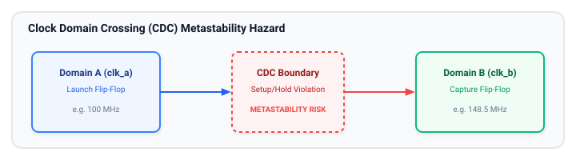
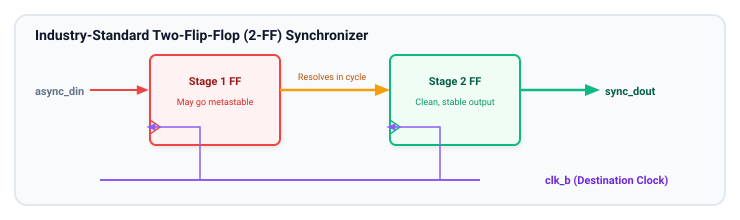
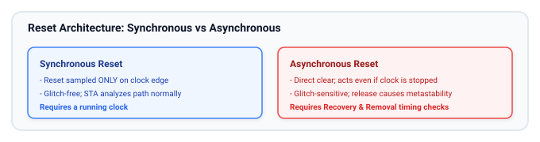
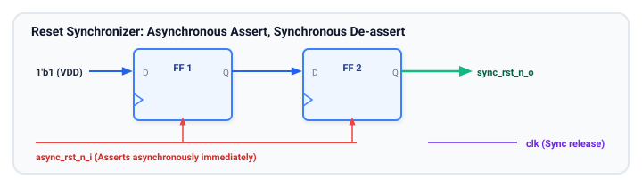

# Clocking and Reset

Proper clock and reset design is the bedrock of stable, reliable digital hardware. Errors in clock distribution, clock domain crossings (CDC), or reset assertion/de-assertion cause unpredictable silicon bugs, intermittent field failures, and metastability that simulation often misses.

## Learning Goals

After completing this chapter, you should be able to:
- Define clock domains and explain why asynchronous signal transfers cause metastability.
- Calculate and understand Mean Time Between Failures (MTBF) and how 2-Flip-Flop synchronizers mitigate metastability for single-bit control signals.
- Explain why multi-bit buses cannot be synchronized using independent flip-flop synchronizers and identify safe alternatives (handshakes, FIFOs).
- Compare synchronous and asynchronous resets, analyzing their impact on timing closure, glitch susceptibility, and silicon area.
- Implement an **Asynchronous Assert, Synchronous De-assert Reset Synchronizer** (Reset Bridge) in synthesizable SystemVerilog.

---

## Clock Domains and Clock Domain Crossing (CDC)

A **clock domain** is an area of a digital circuit where all sequential elements are driven by the same clock source (or clocks with a fixed, known phase relationship).

In modern SoCs and FPGAs, a single chip contains dozens of clock domains running at different frequencies (e.g., PCIe at 250 MHz, DDR controller at 800 MHz, CPU at 1.5 GHz, UART at 1.8432 MHz).



### The Metastability Phenomenon
When an input signal changes within the narrow setup-and-hold aperture ($t_{setup} + t_{hold}$) of a flip-flop, the internal master latch can become balanced between logic `0` and logic `1`. The output voltage hovers at an indeterminate intermediate voltage for an unpredictable duration before settling randomly to `0` or `1`.

If the metastable signal propagates to downstream combinational logic before settling, different receiving gates may interpret it differently (one gate sees `1`, another sees `0`), leading to catastrophic state corruption.

### MTBF (Mean Time Between Failures)
The reliability of a synchronizer is quantified by Mean Time Between Failures:

$$\text{MTBF} = \frac{e^{t_r / \tau}}{T_0 \cdot f_{clk} \cdot f_{data}}$$

Where:
- $f_{clk}$ is the destination clock frequency.
- $f_{data}$ is the toggle rate of the crossing asynchronous signal.
- $t_r$ is the available resolving time (slack between clock edge and setup time of next stage).
- $\tau$ and $T_0$ are physical parameters of the flip-flop silicon process.

Adding a second flip-flop dramatically increases $t_r$, typically increasing MTBF from fractions of a second to **thousands of years**!

---

## Single-Bit Synchronization: The 2-FF Synchronizer

For a single-bit, slowly changing control signal crossing between unrelated clock domains, the standard industry solution is a **Two-Flip-Flop (2-FF) Synchronizer**:



### Synthesizable SystemVerilog 2-FF Synchronizer
```systemverilog
// cdc_2ff_sync.sv - Industry-standard 2-FF Synchronizer
(* dont_touch = "true" *) // Prevents synthesis optimization from removing FFs
module cdc_2ff_sync #(
    parameter bit RESET_VAL = 1'b0
) (
    input  logic clk_b,
    input  logic rst_n_b,
    input  logic async_din,
    output logic sync_dout
);
    // Apply synthesis attributes to prevent merging/register retiming
    // and place registers physically close in FPGA/ASIC layout
    (* async_reg = "true" *) logic sync_stage1;
    (* async_reg = "true" *) logic sync_stage2;

    always_ff @(posedge clk_b or negedge rst_n_b) begin
        if (!rst_n_b) begin
            sync_stage1 <= RESET_VAL;
            sync_stage2 <= RESET_VAL;
        end else begin
            sync_stage1 <= async_din;
            sync_stage2 <= sync_stage1;
        end
    end

    assign sync_dout = sync_stage2;

endmodule
```

> [!CAUTION]
> **The 2-FF synchronizer works ONLY for single-bit signals!**
> Never use separate 2-FF synchronizers for multi-bit data buses (e.g., an 8-bit counter). Because wire delays and flip-flop sampling points vary slightly, stage 1 flip-flops will resolve intermediate skewed values (e.g., transitioning from `0111` to `1000` could be sampled as `0000`, `1111`, etc.), causing severe data corruption.
>
> **Multi-bit solutions:** Use Gray-code pointers (where only 1 bit changes at a time, common in Asynchronous FIFOs) or a 4-phase/2-phase Request-Acknowledge Handshake.

---

## Reset Strategies: Synchronous vs. Asynchronous

Reset logic brings all sequential state elements to a known starting state upon power-up or system initialization.



### Detailed Comparison

| Feature | Synchronous Reset | Asynchronous Reset |
| :--- | :--- | :--- |
| **Response Time** | Delayed until next rising clock edge | Immediate (combinational path to clear pin) |
| **Clock Dependency** | **Requires clock to be running** | Operates even if clock is dead or unstable |
| **Noise & Glitches** | Highly robust; glitches between edges ignored | Highly sensitive; noise glitch resets the chip |
| **Timing Analysis** | Standard register-to-register setup/hold check | Requires **Recovery and Removal** timing checks |
| **Silicon Area** | May require extra multiplexer logic before D-input | Dedicated asynchronous clear pin on standard cell |

### Recovery and Removal Time
Asynchronous resets have a hidden timing catch: **Reset De-assertion (Release)**!
- **Recovery Time ($t_{rec}$):** The minimum time the reset signal must be de-asserted **before** the active clock edge.
- **Removal Time ($t_{rem}$):** The minimum time the reset signal must remain asserted **after** the active clock edge before being released.

If an asynchronous reset is de-asserted right on a clock edge, some flip-flops will come out of reset in cycle $N$ while others stay in reset until cycle $N+1$, destroying FSM synchronization!

---

## The Industry Standard: Asynchronous Assert, Synchronous De-assert (Reset Bridge)

To achieve the best of both worlds—guaranteeing immediate reset even if clocks are stopped, while ensuring deterministic, glitch-free, synchronized reset de-assertion—industry designs use a **Reset Synchronizer**:



### How it Works:
1. **Assertion:** When `async_rst_n_in` goes low, it immediately asserts the asynchronous reset pins of both flip-flops. `sync_rst_n_out` goes to `0` instantly, without waiting for the clock.
2. **De-assertion:** When `async_rst_n_in` returns to `1`, the flip-flops shift `1'b1` through the chain, releasing the reset synchronously aligned to the target clock rising edge!

### Synthesizable SystemVerilog Reset Synchronizer
```systemverilog
// rst_sync.sv - Industry Standard Reset Synchronizer
module rst_sync (
    input  logic clk,
    input  logic async_rst_n_i, // Raw asynchronous reset input
    output logic sync_rst_n_o   // Synchronized reset output for local domain
);
    (* async_reg = "true" *) logic rst_stage1;
    (* async_reg = "true" *) logic rst_stage2;

    always_ff @(posedge clk or negedge async_rst_n_i) begin
        if (!async_rst_n_i) begin
            rst_stage1 <= 1'b0; // Assert immediately on async reset
            rst_stage2 <= 1'b0;
        end else begin
            rst_stage1 <= 1'b1; // Shift in 1 synchronously after reset release
            rst_stage2 <= rst_stage1;
        end
    end

    assign sync_rst_n_o = rst_stage2;

endmodule
```

---

## Clock Distribution Networks & Clock Skew

In high-speed designs, distributing a clock across millions of flip-flops requires a balanced **Clock Tree (CTS)** composed of matched inverter/buffer trees (H-tree or mesh):

- **Clock Skew ($t_{skew}$):** The spatial difference in arrival times of a clock edge at two different registers.
- **Positive Skew:** Clock arrives at the capture register later than the launch register. (Helps setup time, hurts hold time).
- **Negative Skew:** Clock arrives at the capture register earlier than the launch register. (Hurts setup time, helps hold time).
- **Clock Jitter:** Temporal fluctuation in clock period caused by power supply noise, thermal noise, and PLL phase noise.

---

## Learning Resources

### Industry Papers & Standards
- **"Clock Domain Crossing (CDC) Design & Verification Techniques Using SystemVerilog"** by Clifford E. Cummings (SNUG) — Essential reading for every hardware engineer.
- **"Asynchronous & Synchronous Reset Design Techniques - Part Deux"** by Clifford E. Cummings and Don Mills.
- **AMD Xilinx UG903:** Vivado Design Suite User Guide: Using Constraints (CDC & Timing Exceptions).

---

## Exercises

### Exercise 4.1: Single-Bit vs. Multi-Bit CDC Hazard
1. Explain why sampling a 4-bit binary counter transitioning from `4'b0011` (3) to `4'b0100` (4) through 4 separate 2-FF synchronizers can result in any value from 0 to 7.
2. What is the Gray-code representation of 3 and 4?
3. Explain why Gray coding prevents this multi-bit sampling error.

### Exercise 4.2: Reset Synchronizer Integration
Design a top-level module `chip_core` that accepts a global active-low push-button reset `btn_rst_n` and a 100 MHz clock `clk_100m`:
1. Instantiate the `rst_sync` module to generate a local clean `rst_n`.
2. Connect `rst_n` to a 16-bit up-counter.
3. Simulate what happens when `btn_rst_n` is pulsed low asynchronously for 5 ns, and observe how `rst_n` de-asserts synchronously on the clock edge.

### Exercise 4.3: Pulse Synchronizer Design
Design a **Pulse Synchronizer** circuit that takes a single-cycle pulse from a 100 MHz clock domain and reliably generates a single-cycle pulse in a slower 25 MHz clock domain:
- Hint: Toggle a flip-flop in the source domain on every incoming pulse, pass the toggle signal through a 2-FF synchronizer into the destination domain, and use an edge detector (XOR with delayed version) in the destination domain.

##### Copyright (c) 2026 squared-studio
