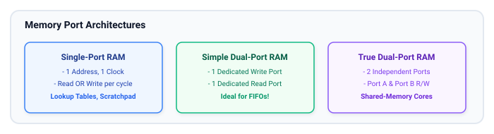
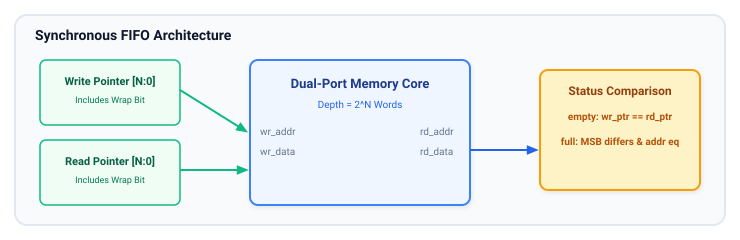

# Memory Design

Memory structures store data, buffer streaming packets, and retain state across computing cycles. This chapter covers the hardware architectures of digital memories—from flip-flop arrays and on-chip SRAM/BRAM to external DRAM—and provides synthesizable SystemVerilog implementations for single-port RAMs, dual-port RAMs, and synchronous First-In First-Out (FIFO) queues.

## Learning Goals

After completing this chapter, you should be able to:

- Navigate the digital memory hierarchy (Registers $\to$ Cache SRAM $\to$ Embedded BRAM $\to$ External DDR DRAM $\to$ Non-Volatile Flash).
- Understand memory port configurations: Single-Port, Simple Dual-Port, and True Dual-Port.
- Differentiate between Read-First, Write-First, and No-Change behaviors during simultaneous read-write collisions.
- Write synthesizable SystemVerilog RTL that cleanly infers vendor Block RAMs without instantiating proprietary macros.
- Design and implement a robust, synthesizable Synchronous FIFO with write/read pointers, wrap-around detection, and `full`/`empty` status flags.

---

## Memory Hierarchy in Digital Systems

Silicon design is constrained by the fundamental trade-off between **access speed**, **storage density**, and **cost**:


### SRAM vs. DRAM vs. ROM

| Memory Type            | Storage Mechanism                   | Speed               | Volatility                           | Typical Use Case                         |
| :--------------------- | :---------------------------------- | :------------------ | :----------------------------------- | :--------------------------------------- |
| **SRAM** (Static RAM)  | Cross-coupled inverters (6T cell)   | Ultra-fast (< 2 ns) | Volatile                             | CPU caches, scratchpads, on-chip FIFOs   |
| **DRAM** (Dynamic RAM) | Capacitor + Pass transistor (1T-1C) | Fast (15–50 ns)     | Volatile (requires periodic refresh) | Main system memory (DDR4/5)              |
| **ROM** (Read-Only)    | Hardwired mask or fused diodes      | Fast                | Non-Volatile                         | Boot ROM, lookup tables, constant arrays |
| **Flash** (NAND/NOR)   | Floating-gate / Charge trap FETs    | Moderate to slow    | Non-Volatile                         | Firmware storage, solid-state drives     |

---

## Memory Organization and Addressing

A memory array is organized as an array of $2^A$ words, where each word is $W$ bits wide:

- **Address Bus ($A$ bits):** Selects one specific memory word from the $2^A$ locations.
- **Data Bus ($W$ bits):** The payload width read from or written to the selected location.
- **Total Capacity:** $2^A \times W$ bits (or $(2^A \times W) / 8$ bytes).
- **Byte Enables (`be`):** Allows selective writing to individual 8-bit slices of a wider data word (e.g., 4 byte-enable bits for a 32-bit word), essential for processor bus interfaces.

---

## Memory Port Configurations



### Read-During-Write Collision Modes

When a port writes to the exact same address that is currently being read on the same clock cycle, the output behavior depends on the memory configuration:

1. **Write-First (Transparent Mode):** The output immediately reflects the **newly written data** in that cycle.
2. **Read-First (Old-Data Mode):** The output delivers the **old data** stored in that location before the write takes effect. (Most energy-efficient on FPGAs).
3. **No-Change Mode:** The output register holds its previous value without changing.

---

## Synthesizable Memory Design

### Parameterized Single-Port Synchronous RAM (BRAM Inferable)

```systemverilog
// sram_single_port.sv - Synthesizable Single-Port RAM
module sram_single_port #(
    parameter int unsigned DATA_WIDTH = 32,
    parameter int unsigned ADDR_WIDTH = 10  // 2^10 = 1024 words
) (
    input  logic                  clk,
    input  logic                  we_i,     // Write Enable
    input  logic                  en_i,     // Chip Enable
    input  logic [ADDR_WIDTH-1:0] addr_i,
    input  logic [DATA_WIDTH-1:0] din_i,
    output logic [DATA_WIDTH-1:0] dout_o
);
    // Declare the memory storage array (unpacked array of packed logic)
    localparam int unsigned DEPTH = 1 << ADDR_WIDTH;
    logic [DATA_WIDTH-1:0] mem [0:DEPTH-1];

    always_ff @(posedge clk) begin
        if (en_i) begin
            if (we_i) begin
                mem[addr_i] <= din_i;
            end
            dout_o <= mem[addr_i]; // Read-first / write-first depending on tool synthesis defaults
        end
    end
endmodule
```

### True Dual-Port RAM with Independent Clocks

```systemverilog
// ram_true_dual_port.sv - Dual Clock, Independent Ports
module ram_true_dual_port #(
    parameter int unsigned DATA_WIDTH = 16,
    parameter int unsigned ADDR_WIDTH = 9   // 512 words
) (
    // Port A
    input  logic                  clk_a,
    input  logic                  we_a,
    input  logic [ADDR_WIDTH-1:0] addr_a,
    input  logic [DATA_WIDTH-1:0] din_a,
    output logic [DATA_WIDTH-1:0] dout_a,

    // Port B
    input  logic                  clk_b,
    input  logic                  we_b,
    input  logic [ADDR_WIDTH-1:0] addr_b,
    input  logic [DATA_WIDTH-1:0] din_b,
    output logic [DATA_WIDTH-1:0] dout_b
);
    localparam int unsigned DEPTH = 1 << ADDR_WIDTH;
    logic [DATA_WIDTH-1:0] ram [0:DEPTH-1];

    // Port A Process
    always_ff @(posedge clk_a) begin
        if (we_a)
            ram[addr_a] <= din_a;
        dout_a <= ram[addr_a];
    end

    // Port B Process
    always_ff @(posedge clk_b) begin
        if (we_b)
            ram[addr_b] <= din_b;
        dout_b <= ram[addr_b];
    end
endmodule
```

---

## FIFO (First-In, First-Out) Queue Design

A FIFO buffer queues data so that the first word written is the first word read. FIFOs decouple processing stages that operate with bursty data rates.



### Pointer Wrap-Around & Status Logic

How can you distinguish whether a FIFO is **completely full** or **completely empty** when both write and read pointers point to the same index (`wr_ptr == rd_ptr`)?

**The Extra Bit Technique:**
Make the pointer counters 1 bit wider than the address space:

- For a FIFO of depth $2^N$, use $(N+1)$-bit pointers: `[N:0] wr_ptr, rd_ptr`.
- The lower $N$ bits (`ptr[N-1:0]`) address the memory array.
- The MSB (`ptr[N]`) tracks how many times the pointer has wrapped around the memory!

1. **Empty Condition:**
   $$\text{empty} = (\text{wr\_ptr} == \text{rd\_ptr})$$
   _(Same index and same wrap bit)._
2. **Full Condition:**
   $$\text{full} = (\text{wr\_ptr}[N] \ne \text{rd\_ptr}[N]) \;\land\; (\text{wr\_ptr}[N-1:0] == \text{rd\_ptr}[N-1:0])$$
   _(Same index, but opposite wrap bit)._

### Complete Synthesizable Synchronous FIFO

```systemverilog
// sync_fifo.sv - Synthesizable Parameterized Synchronous FIFO
module sync_fifo #(
    parameter int unsigned DATA_WIDTH = 8,
    parameter int unsigned ADDR_WIDTH = 4   // Depth = 2^4 = 16 words
) (
    input  logic                  clk,
    input  logic                  rst_n,

    // Write Interface
    input  logic                  wr_en_i,
    input  logic [DATA_WIDTH-1:0] wr_data_i,
    output logic                  full_o,

    // Read Interface
    input  logic                  rd_en_i,
    output logic [DATA_WIDTH-1:0] rd_data_o,
    output logic                  empty_o,

    // Diagnostics
    output logic [ADDR_WIDTH:0]   occupancy_o
);
    localparam int unsigned DEPTH = 1 << ADDR_WIDTH;

    // Memory array
    logic [DATA_WIDTH-1:0] mem [0:DEPTH-1];

    // Pointers with extra wrap bit
    logic [ADDR_WIDTH:0] wr_ptr_q, rd_ptr_q;

    // Status flags
    assign empty_o = (wr_ptr_q == rd_ptr_q);
    assign full_o  = (wr_ptr_q[ADDR_WIDTH] != rd_ptr_q[ADDR_WIDTH]) &&
                     (wr_ptr_q[ADDR_WIDTH-1:0] == rd_ptr_q[ADDR_WIDTH-1:0]);

    assign occupancy_o = wr_ptr_q - rd_ptr_q;

    // Write Logic
    always_ff @(posedge clk or negedge rst_n) begin
        if (!rst_n) begin
            wr_ptr_q <= '0;
        end else if (wr_en_i && !full_o) begin
            mem[wr_ptr_q[ADDR_WIDTH-1:0]] <= wr_data_i;
            wr_ptr_q <= wr_ptr_q + 1'b1;
        end
    end

    // Read Logic (Synchronous Read)
    always_ff @(posedge clk or negedge rst_n) begin
        if (!rst_n) begin
            rd_ptr_q  <= '0;
            rd_data_o <= '0;
        end else if (rd_en_i && !empty_o) begin
            rd_data_o <= mem[rd_ptr_q[ADDR_WIDTH-1:0]];
            rd_ptr_q  <= rd_ptr_q + 1'b1;
        end
    end

endmodule
```

---

## Learning Resources

### Reference Literature

- **"SystemVerilog for Design"** by Stuart Sutherland, Peter Flake, Phil Moorby — Covers arrays and memory modeling techniques.
- **AMD Xilinx UG901 (Vivado Synthesis):** Chapter on RAM and ROM HDL Coding Techniques.
- **Intel Quartus Prime HDL Coding Styles User Guide:** Section on Recommended HDL Coding Styles for Inferring RAM.

---

## Exercises

### Exercise 5.1: Byte-Enable RAM Implementation

Extend the single-port RAM module `sram_single_port` to support 32-bit words with 4 independent byte-enable lines `be_i[3:0]`:

1. Use an unpacked array `logic [3:0][7:0] mem [0:DEPTH-1];` or a `for` loop over the 4 bytes.
2. Ensure that only the enabled bytes are updated on write cycles.

### Exercise 5.2: FIFO Almost-Full / Almost-Empty Flags

Enhance `sync_fifo.sv` to provide programmable watermarks:

- `almost_full_o`: Asserted when remaining free slots $\le 2$.
- `almost_empty_o`: Asserted when available stored words $\le 2$.

### Exercise 5.3: Fall-Through (FWFT) FIFO vs. Standard FIFO

In standard synchronous FIFOs, reading introduces 1 clock cycle of read latency before data is valid on `rd_data_o`.

1. Explain how a **First-Word Fall-Through (FWFT)** FIFO makes the oldest data immediately visible on `rd_data_o` whenever `empty_o` is low.
2. Implement an FWFT output register adapter that sits on the read port of `sync_fifo`.

##### Copyright (c) 2026 squared-studio
