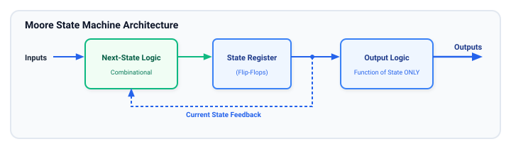
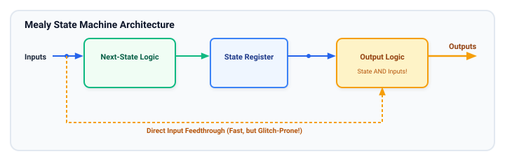
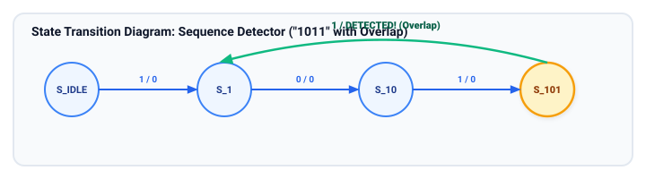
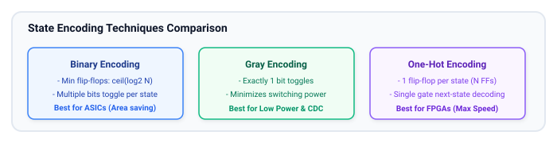

# Finite State Machines (FSMs)

Finite State Machines (FSMs) are the core mechanism for implementing sequential control logic in digital systems. From CPU control units, bus arbiters, and direct memory access (DMA) engines to network packet parsers and peripheral protocol engines (SPI, I2C, UART), FSMs coordinate cycle-by-cycle system execution.

## Learning Goals

After completing this chapter, you should be able to:

- Formulate sequential specifications into formal State Diagrams and State Transition Tables.
- Compare Moore and Mealy FSM architectures, understanding their differences in output timing, latency, and glitch sensitivity.
- Master the **Two-Always-Block** and **Three-Always-Block** FSM coding styles in SystemVerilog using strongly typed `enum` state variables.
- Evaluate State Encoding schemes (Binary, Gray, One-Hot) and choose the right encoding for area, speed, or power targets.
- Implement robust FSM designs that handle illegal states gracefully and prevent deadlocks.

---

## FSM Architectural Models: Moore vs. Mealy

An FSM consists of three distinct functional units:

1. **State Register:** Synchronous flip-flops storing the current state.
2. **Next-State Logic:** Combinational logic computing the next state based on the current state and inputs.
3. **Output Logic:** Combinational or registered logic generating the outputs.

### Moore Machine Architecture

In a **Moore machine**, outputs depend **strictly on the current state** stored in the state register. Inputs affect the state register on the next clock edge, which then updates the outputs.



- **Pros:** Outputs change synchronously with the clock; completely decoupled from input glitches.
- **Cons:** Output response to an input is delayed by at least one clock cycle; may require more states.

---

### Mealy Machine Architecture

In a **Mealy machine**, outputs depend on **both the current state and the current inputs**.



- **Pros:** Reacts immediately within the current cycle to input changes without waiting for the next clock edge; often requires fewer states.
- **Cons:** Combinational paths from inputs feed directly into outputs, allowing external glitches to propagate downstream and making timing closure more difficult.

---

## SystemVerilog FSM Coding Styles

Industry designs use two primary structured styles:

- **Two-Always-Block Style (Recommended Standard):**
  1. `always_ff`: State register update.
  2. `always_comb`: Next-state logic AND output assignments.
- **Three-Always-Block Style:**
  1. `always_ff`: State register update.
  2. `always_comb`: Next-state logic.
  3. `always_ff` or `always_comb`: Output generation logic.

### Complete Worked Example: 4-bit Sequence Detector ("1011" with Overlap)

Let us design a Mealy FSM that scans a continuous serial data stream `din_i` on each clock edge and asserts `detected_o` whenever the sequence **1011** is recognized (with overlapping sequence support, e.g., `1011011` generates two detections).



### Synthesizable SystemVerilog Implementation

```systemverilog
// seq_detector_1011.sv - Synthesizable Mealy Sequence Detector
module seq_detector_1011 (
    input  logic clk,
    input  logic rst_n,
    input  logic din_i,
    output logic detected_o
);
    // 1. Declare states using SystemVerilog enumerated types
    typedef enum logic [1:0] {
        S_IDLE = 2'b00, // No matching bits
        S_1    = 2'b01, // Matched '1'
        S_10   = 2'b10, // Matched '10'
        S_101  = 2'b11  // Matched '101'
    } state_e;

    state_e state_q, state_d;

    // 2. Sequential Block (always_ff): State Register
    always_ff @(posedge clk or negedge rst_n) begin
        if (!rst_n) begin
            state_q <= S_IDLE;
        end else begin
            state_q <= state_d;
        end
    end

    // 3. Combinational Block (always_comb): Next-State and Output Logic
    always_comb begin
        // Safe default assignments to prevent latches
        state_d    = state_q;
        detected_o = 1'b0;

        case (state_q)
            S_IDLE: begin
                if (din_i) state_d = S_1;
                else       state_d = S_IDLE;
            end

            S_1: begin
                if (!din_i) state_d = S_10;
                else        state_d = S_1;
            end

            S_10: begin
                if (din_i) state_d = S_101;
                else       state_d = S_IDLE;
            end

            S_101: begin
                if (din_i) begin
                    state_d    = S_1;    // Overlap: the ending '1' is the first '1' of next
                    detected_o = 1'b1;   // Mealy output asserted on the 4th bit!
                end else begin
                    state_d    = S_10;   // '1010' resets back to '10' match
                end
            end

            default: begin
                state_d    = S_IDLE;     // Safe recovery from illegal states
                detected_o = 1'b0;
            end
        endcase
    end

endmodule
```

---

## State Encoding Techniques

How states are represented as bit patterns in flip-flops has a direct impact on maximum clock frequency, silicon area, and power consumption:



### Comparison Matrix

| Property                              | Binary                    | Gray                      | One-Hot                                     |
| :------------------------------------ | :------------------------ | :------------------------ | :------------------------------------------ |
| **Number of Flip-Flops ($N$ states)** | $\lceil \log_2(N) \rceil$ | $\lceil \log_2(N) \rceil$ | $N$                                         |
| **Bit transitions per state change**  | $1$ to $\log_2(N)$        | **Exactly 1** (adjacent)  | **Exactly 2** (one turns off, one turns on) |
| **Next-State Decoder Complexity**     | High                      | Moderate                  | **Lowest (Single gate per transition)**     |
| **Operating Frequency**               | Moderate                  | Moderate                  | **Highest**                                 |
| **Recommended Platform**              | ASICs (area constrained)  | Low-power ASICs           | **FPGAs (LUT-FF architectures)**            |

---

## FSM Design Best Practices & Defensive Coding

1. **Always Include a `default` Case:**
   Even if an `enum` uses all 4 states of a 2-bit variable, physical hardware can suffer alpha-particle or cosmic-ray radiation (Single Event Upsets, SEU) or power glitches that knock a state register into an unmapped code. A `default: state_d = S_IDLE;` guarantees the system recovers rather than locking up in deadlock.
2. **Assign Default Combinational Outputs:**
   Set all next-state and control outputs to known inactive levels before entering the `case` statement. This eliminates any possibility of inferred latches.
3. **Register FSM Outputs When Possible:**
   If downstream logic is timing-critical, place a flip-flop on the FSM outputs (Three-Always-Block style or pipelined output register). This prevents combinational output glitches from consuming downstream timing budget.

---

## Learning Resources

### Industry Guides & Textbooks

- **"FSM-Based Digital Design Using Verilog HDL"** by Peter Minns & Ian Elliott.
- **"Coding Styles for Finite State Machines in SystemVerilog"** by Clifford E. Cummings (SNUG) — Comprehensive comparison of 1-always, 2-always, and 3-always styles.
- **AMD Xilinx UG901 (Vivado Synthesis):** FSM Extraction, State Encoding Attributes (`fsm_encoding = "one_hot"`).

---

## Exercises

### Exercise 6.1: Traffic Light Controller with Pedestrian Request

Design an intersection controller with Main Street and Side Street lights:

1. States: `MAIN_GREEN`, `MAIN_YELLOW`, `SIDE_GREEN`, `SIDE_YELLOW`.
2. Inputs: `clk`, `rst_n`, `pedestrian_req_i` (active high), `timer_expired_i`.
3. If `pedestrian_req_i` is pressed while Main Street is green, shorten the green light timer and advance to yellow.
4. Implement the controller as a clean Moore FSM in SystemVerilog.

### Exercise 6.2: One-Hot Encoding Synthesis Experiment

Take the Sequence Detector module:

1. Manually encode the states as One-Hot (`4'b0001`, `4'b0010`, `4'b0100`, `4'b1000`).
2. Synthesize using Vivado, Quartus, or Yosys with both binary and one-hot encoding options.
3. Inspect the synthesis schematic and report the number of LUTs and flip-flops utilized.

### Exercise 6.3: Moore vs. Mealy Comparison

Convert the 4-bit Sequence Detector from Mealy to a pure Moore FSM:

- How many states are required for the Moore version?
- How many clock cycles does it take from the arrival of the 4th bit until `detected_o` is observed at the output?

##### Copyright (c) 2026 squared-studio
