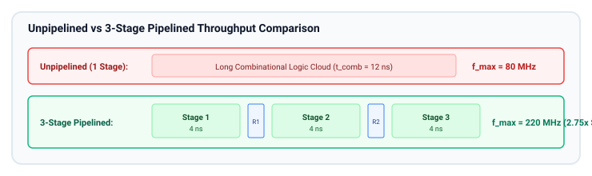
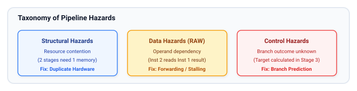
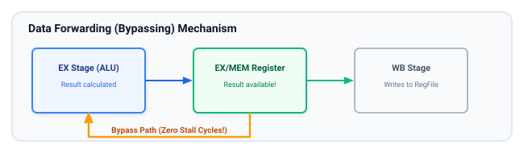

# Pipelining

Pipelining is the most important technique in high-performance digital hardware design for maximizing **throughput** and **operating clock frequency**. By inserting synchronous registers into long combinational paths, complex multi-nanosecond calculations are subdivided into shorter, faster stages operating concurrently like an industrial assembly line.

## Learning Goals

After completing this chapter, you should be able to:
- Explain the fundamental difference between **Latency** (time for one operation to complete) and **Throughput** (rate of completed operations per second).
- Calculate maximum clock frequency, speedup, and efficiency for pipelined architectures.
- Identify and resolve the three classical pipeline hazards: **Structural Hazards**, **Data Hazards** (RAW dependencies), and **Control Hazards** (branching).
- Implement hardware mechanisms to resolve hazards: **Forwarding (Bypassing)**, **Stalling (Pipeline Bubbles)**, and **Flushing**.
- Write synthesizable SystemVerilog code for a pipelined datapath featuring **Valid-Ready Handshaking** flow control.

---

## Pipelining Concepts and Motivation

In a non-pipelined circuit, the clock period $T_{clk}$ must be long enough to allow a signal to propagate through the entire combinational path in a single cycle.



---

## Throughput vs. Latency

| Metric | Definition | Unpipelined | $k$-Stage Ideal Pipeline |
| :--- | :--- | :--- | :--- |
| **Latency (Clock Cycles)** | Cycles required for one operation from input to output | $1$ cycle | $k$ cycles |
| **Clock Period ($T_{clk}$)** | Minimum duration of one clock cycle | $T_{unpiped}$ | $T_{pipe} \approx \frac{T_{unpiped}}{k} + t_{cq} + t_{setup}$ |
| **Latency (Time, ns)** | Physical time for a single item to emerge | $T_{unpiped}$ | $k \cdot T_{pipe}$ *(slightly longer due to register overhead)* |
| **Throughput (Ops/sec)** | Number of completed operations per second | $\frac{1}{T_{unpiped}}$ | $\frac{1}{T_{pipe}}$ **(Significantly Higher!)** |

> [!NOTE]
> Pipelining does **not** make a single calculation finish faster in absolute time (latency). In fact, latency slightly increases due to flip-flop setup and clock-to-Q overheads. Pipelining increases **throughput**: the volume of completed work per unit time.

---

## Pipeline Hazards and Resolutions

Hazards are situations where the next instruction or data set cannot execute in its scheduled clock cycle.



### 1. Data Hazards (Read-After-Write - RAW)
Occurs when Instruction 2 reads a register that is written by Instruction 1:
```
Inst 1: R1 = R2 + R3   (Writes R1 in Stage 4 - Writeback)
Inst 2: R5 = R1 * R4   (Needs R1 in Stage 2 - Decode/Operand Fetch)
```

#### Resolutions:
1. **Data Forwarding (Bypassing):**
   Route the intermediate result directly from the output of Stage 3 (Execute) or Stage 4 back to the ALU input multiplexer of Stage 2. Eliminates stalls for most ALU-to-ALU operations!
2. **Pipeline Stall (Bubble Insertion):**
   When forwarding is physically impossible (e.g., Load-to-Use hazard where data is only available after RAM read), hold the dependent stage for 1 cycle by disabling clock enable on earlier stages and inserting a `NOP` (bubble) forward.



### 2. Control Hazards (Branch Penalty)
In instruction pipelines, branch outcomes are typically resolved in Stage 3 (Execute). If the branch is taken, instructions already fetched in Stage 1 and 2 are invalid.
- **Resolution:**
  - **Stall:** Wait until branch resolves.
  - **Branch Prediction:** Speculatively fetch from predicted address; if wrong, **flush** the pipeline (clear valid bits of intermediate stages) and jump to the correct target.

### 3. Structural Hazards
Multiple stages compete for the exact same physical resource in the same cycle (e.g., single-port RAM accessed simultaneously for instruction fetch and data read).
- **Resolution:** Duplicate hardware (e.g., separate instruction and data caches—Harvard architecture, or dual-ported memories).

---

## Synthesizable Pipelined Datapath with Valid-Ready Flow Control

In modular SoC design, stages must pass data smoothly without dropping words or overflowing when downstream logic stalls. The industry standard protocol is the **Valid-Ready Handshake**:
- `valid`: Producer asserts when output payload is valid.
- `ready`: Consumer asserts when able to accept data.
- **Transfer occurs on clock edge only when `valid && ready` is TRUE.**

```systemverilog
// pipelined_multiplier.sv - 2-Stage Pipelined Multiplier with Backpressure
module pipelined_multiplier #(
    parameter int unsigned WIDTH = 16
) (
    input  logic                   clk,
    input  logic                   rst_n,

    // Upstream Interface
    input  logic                   s_valid_i,
    output logic                   s_ready_o,
    input  logic [WIDTH-1:0]       s_data_a_i,
    input  logic [WIDTH-1:0]       s_data_b_i,

    // Downstream Interface
    output logic                   m_valid_o,
    input  logic                   m_ready_i,
    output logic [(2*WIDTH)-1:0]   m_data_res_o
);
    // Pipeline Stage 1 Registers
    logic                   stg1_valid_q;
    logic [WIDTH-1:0]       stg1_a_q, stg1_b_q;

    // Pipeline Stage 2 Registers
    logic                   stg2_valid_q;
    logic [(2*WIDTH)-1:0]   stg2_prod_q;

    // Flow control: Stage can accept new data if downstream is ready or stage is empty
    wire stg2_ready = m_ready_i || !stg2_valid_q;
    wire stg1_ready = stg2_ready || !stg1_valid_q;

    assign s_ready_o = stg1_ready;

    // Stage 1: Latch Inputs
    always_ff @(posedge clk or negedge rst_n) begin
        if (!rst_n) begin
            stg1_valid_q <= 1'b0;
            stg1_a_q     <= '0;
            stg1_b_q     <= '0;
        end else if (stg1_ready) begin
            stg1_valid_q <= s_valid_i;
            if (s_valid_i) begin
                stg1_a_q <= s_data_a_i;
                stg1_b_q <= s_data_b_i;
            end
        end
    end

    // Stage 2: Perform Multiplication and Register Result
    always_ff @(posedge clk or negedge rst_n) begin
        if (!rst_n) begin
            stg2_valid_q <= 1'b0;
            stg2_prod_q  <= '0;
        end else if (stg2_ready) begin
            stg2_valid_q <= stg1_valid_q;
            if (stg1_valid_q) begin
                stg2_prod_q <= stg1_a_q * stg1_b_q; // Synthesized to DSP block
            end
        end
    end

    // Output assignments
    assign m_valid_o    = stg2_valid_q;
    assign m_data_res_o = stg2_prod_q;

endmodule
```

---

## Learning Resources

### Classical Literature
- **"Computer Organization and Design: The Hardware/Software Interface"** by David A. Patterson & John L. Hennessy — Chapters 4 & 5 (The canonical guide to CPU pipelining, hazards, and forwarding).
- **"Computer Architecture: A Quantitative Approach"** by John L. Hennessy & David A. Patterson.

---

## Exercises

### Exercise 7.1: Pipeline Balancing and Max Frequency
A non-pipelined floating-point logic block has 4 sequential sub-steps with the following combinational propagation delays:
- Sub-step 1: $1.2\text{ ns}$
- Sub-step 2: $3.8\text{ ns}$
- Sub-step 3: $1.5\text{ ns}$
- Sub-step 4: $2.5\text{ ns}$

Each flip-flop has $t_{cq} = 0.2\text{ ns}$ and $t_{setup} = 0.1\text{ ns}$.
1. What is the maximum operating frequency of the unpipelined design?
2. If partitioned into a 4-stage pipeline where each sub-step forms one stage, what is the bottleneck stage delay, and what is the new maximum frequency?
3. Calculate the ideal throughput speedup.

### Exercise 7.2: Implement Data Forwarding Logic
Consider a 3-stage ALU pipeline with stages `FETCH`, `EXECUTE`, `WRITEBACK`:
- Write the SystemVerilog combinational logic for an operand forwarding multiplexer that compares the destination register index of the `WRITEBACK` stage with the source register indices of the `EXECUTE` stage, bypassing the writeback data if the indices match.

### Exercise 7.3: Skid Buffer (Pipeline Decoupler)
When a downstream module de-asserts `ready`, a standard pipelined module must stall immediately. If the ready signal has a high fanout or timing delay, this creates a critical timing path.
- Design a **Skid Buffer** (a 2-entry register buffer) that isolates the input ready timing from the output ready timing while maintaining 100% throughput (zero bubble insertion).

##### Copyright (c) 2026 squared-studio
