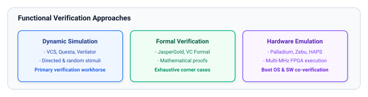
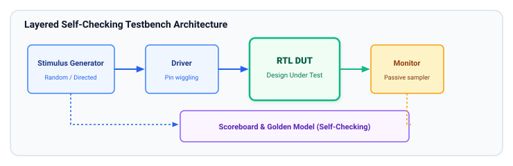
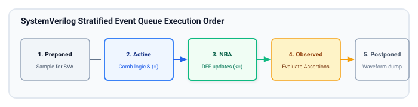

# Verification Basics

In modern integrated circuit engineering, **verification accounts for over 60–70% of total project effort, time, and budget**. A design is only as good as the verification environment proving its correctness. This chapter introduces the fundamentals of functional verification, simulation event scheduling, self-checking testbench architecture in SystemVerilog, and Assertion-Based Verification (SVA).

## Learning Goals

After completing this chapter, you should be able to:

- Compare verification methodologies: Dynamic Simulation, Static Formal Verification, and Hardware Emulation.
- Understand the SystemVerilog Stratified Event Queue to avoid testbench/DUT race conditions.
- Construct a modular, layered, **self-checking testbench** with clock/reset generators, stimulus drivers, monitors, and scoreboards.
- Use tasks, functions, and structured control to write maintainable test suites.
- Author both **Immediate Assertions** and **Concurrent Assertions (SVA)** with sequence operators to catch protocol violations at the cycle of failure.

---

## Verification Methodologies Overview



---

## Layered Testbench Architecture

A robust testbench architecture separates **stimulus generation**, **protocol driving**, **signal monitoring**, and **result checking** into independent modular blocks:



1. **DUT (Design Under Test):** The synthesizable RTL hardware block being verified.
2. **Clock & Reset Generator:** Generates periodic clock oscillations and power-on reset sequences.
3. **Stimulus Driver:** Converts high-level transactions (e.g., "Write 32'hDEADBEEF to address 4") into physical pin transitions according to the bus protocol.
4. **Monitor:** Passively observes signal pins, decodes completed transfers, and packages them into transactions.
5. **Scoreboard:** Houses the reference model (predicts what the hardware should do) and compares actual DUT outputs against expected results, maintaining pass/fail counts.
6. **Assertions:** Inline checkers that actively ensure bus protocols and timing rules are never violated.

---

## SystemVerilog Stratified Event Queue

To write deterministic testbenches free of simulation race conditions, you must understand how simulators order events within each simulation time step:



> [!TIP]
> Driving testbench inputs on the **negedge** of the clock (or slightly after the posedge using clocking blocks) ensures input signals are fully settled when the DUT samples them on the next **posedge clk**, completely avoiding setup race conditions in simulation!

---

## Complete Self-Checking SystemVerilog Testbench

Here is an industry-grade, self-checking testbench for an arithmetic processing unit:

```systemverilog
// tb_alu.sv - Complete Self-Checking Testbench
`timescale 1ns/1ps

module tb_alu;

    // 1. Parameters and Test Configuration
    localparam time CLK_PERIOD = 10ns;
    localparam int unsigned WIDTH = 16;

    // 2. Interconnect Signals
    logic             clk;
    logic             rst_n;
    logic [WIDTH-1:0] a_i;
    logic [WIDTH-1:0] b_i;
    logic [1:0]       op_i;
    logic             valid_i;
    logic [WIDTH-1:0] res_o;
    logic             valid_o;

    // Verification bookkeeping
    int pass_count = 0;
    int fail_count = 0;

    // 3. DUT Instantiation
    // (Assuming a 1-cycle latency registered ALU)
    alu_pipelined #(
        .WIDTH(WIDTH)
    ) dut (
        .clk     (clk),
        .rst_n   (rst_n),
        .a_i     (a_i),
        .b_i     (b_i),
        .op_i    (op_i),
        .valid_i (valid_i),
        .res_o   (res_o),
        .valid_o (valid_o)
    );

    // 4. Clock Generation Process
    initial begin
        clk = 1'b0;
        forever #(CLK_PERIOD / 2) clk = ~clk;
    end

    // 5. Testbench Tasks
    task automatic apply_reset();
        rst_n   <= 1'b0;
        valid_i <= 1'b0;
        a_i     <= '0;
        b_i     <= '0;
        op_i    <= '0;
        repeat (3) @(posedge clk);
        @(negedge clk);
        rst_n <= 1'b1;
        $display("[TB] %0t: Reset released.", $time);
    endtask

    task automatic drive_op(
        input logic [WIDTH-1:0] a,
        input logic [WIDTH-1:0] b,
        input logic [1:0]       op
    );
        @(negedge clk); // Drive on negedge to prevent setup races
        valid_i <= 1'b1;
        a_i     <= a;
        b_i     <= b;
        op_i    <= op;

        @(negedge clk);
        valid_i <= 1'b0; // Single-cycle pulse
    endtask

    // 6. Scoreboard and Checking Process
    task automatic check_result(
        input logic [WIDTH-1:0] a,
        input logic [WIDTH-1:0] b,
        input logic [1:0]       op
    );
        logic [WIDTH-1:0] expected;

        // Golden Reference Calculation
        case (op)
            2'b00: expected = a + b;
            2'b01: expected = a - b;
            2'b10: expected = a & b;
            2'b11: expected = a ^ b;
        endcase

        // Wait for DUT output valid
        @(posedge clk);
        while (!valid_o) @(posedge clk);

        // Self-checking comparison
        if (res_o === expected) begin
            pass_count++;
            $display("[PASS] %0t: OP=%b A=%h B=%h | RES=%h (Expected=%h)",
                     $time, op, a, b, res_o, expected);
        end else begin
            fail_count++;
            $error("[FAIL] %0t: OP=%b A=%h B=%h | RES=%h (Expected=%h)",
                   $time, op, a, b, res_o, expected);
        end
    endtask

    // 7. Main Stimulus Sequencing Process
    initial begin
        $display("============================================");
        $display("       Starting ALU Self-Checking Test      ");
        $display("============================================");

        apply_reset();

        // Test Case 1: Simple Addition
        fork
            drive_op(16'd15, 16'd25, 2'b00);
            check_result(16'd15, 16'd25, 2'b00);
        join

        // Test Case 2: Subtraction with Negative Result
        fork
            drive_op(16'd10, 16'd20, 2'b01);
            check_result(16'd10, 16'd20, 2'b01);
        join

        // Test Case 3: Random Vector Sweep
        repeat (20) begin
            logic [WIDTH-1:0] rand_a = $urandom();
            logic [WIDTH-1:0] rand_b = $urandom();
            logic [1:0]       rand_op = $urandom_range(0, 3);

            fork
                drive_op(rand_a, rand_b, rand_op);
                check_result(rand_a, rand_b, rand_op);
            join
        end

        // 8. Test Summary and Exit
        repeat (5) @(posedge clk);
        $display("============================================");
        $display("  TEST FINISHED | PASSED: %0d | FAILED: %0d", pass_count, fail_count);
        $display("============================================");

        if (fail_count == 0) begin
            $display(">>> ALL TESTS PASSED SUCCESSFULLY! <<<");
        end else begin
            $fatal(1, ">>> VERIFICATION FAILED WITH ERRORS! <<<");
        end

        $finish;
    end

    // 9. Concurrent SystemVerilog Assertions (SVA)
    // Rule: valid_o must NEVER be X or Z when rst_n is high
    assert property (@(posedge clk) disable iff (!rst_n) !$isunknown(valid_o))
        else $error("[SVA] valid_o contains X or Z state!");

    // Rule: valid_i asserted must produce valid_o exactly 1 cycle later
    assert property (@(posedge clk) disable iff (!rst_n) valid_i |=> valid_o)
        else $error("[SVA] Latency violation: valid_o was not asserted 1 cycle after valid_i!");

endmodule
```

---

## Introduction to SystemVerilog Assertions (SVA)

Assertions express designer intent directly in the source code or verification bind files.

### Immediate Assertions

Executed like procedural statements inside `always` blocks or tasks:

```systemverilog
assert (divisor != 0) else $error("Division by zero error!");
```

### Concurrent Assertions

Sample values across clock edges over multiple cycles:

- **Overlapping Implication (`|->`):** If condition antecedent matches on current edge, consequent must hold on the **same clock edge**.
- **Non-Overlapping Implication (`|=>`):** If condition antecedent matches on current edge, consequent must hold on the **next clock edge** (equivalent to `|-> ##1`).

```systemverilog
// Protocol Property: A handshake request must stay high until acknowledged
property req_held_until_ack;
    @(posedge clk) disable iff (!rst_n)
    req_i && !ack_i |=> req_i;
endproperty
assert property (req_held_until_ack)
    else $error("Protocol Violation: req dropped before ack received!");
```

---

## Learning Resources

### Classical Textbooks

- **"Writing Testbenches using SystemVerilog"** by Janick Bergeron (The foundational book for verification methodology).
- **"SystemVerilog for Verification: A Guide to Learning the Testbench Language Features"** by Chris Spear & Greg Tumbush.
- **"SystemVerilog Assertions Handbook"** by Ben Cohen, Srinivasan Venkataramanan, Anurag Meygevand.

---

## Exercises

### Exercise 8.1: Testbench for Synchronous FIFO

Write a self-checking testbench for the `sync_fifo` module designed in Chapter 5:

1. Generate a 100 MHz clock and proper reset.
2. Write a driver task `fifo_write(data)` and a checker task `fifo_read_and_check(expected_data)`.
3. Test edge conditions:
   - Fill the FIFO until `full_o` is asserted, and assert that further writes do not corrupt memory.
   - Read until `empty_o` is asserted, and assert that further reads do not underflow.
   - Perform simultaneous writes and reads on each clock cycle when half-full.

### Exercise 8.2: SVA Protocol Checking

Write concurrent SVA assertions for an AXI-Stream interface:

1. `tvalid` must never drop while `tready` is low (payload stability rule: once `tvalid` is asserted, `tdata` must remain constant until `tready` is high).
2. After `aresetn` is de-asserted, `tvalid` must be de-asserted (`1'b0`) in the very first clock cycle.

##### Copyright (c) 2026 squared-studio
