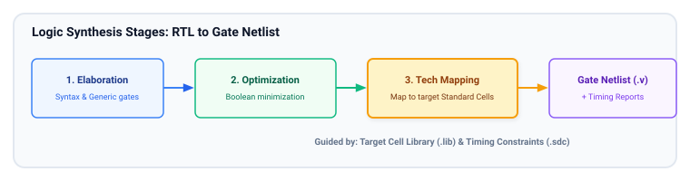
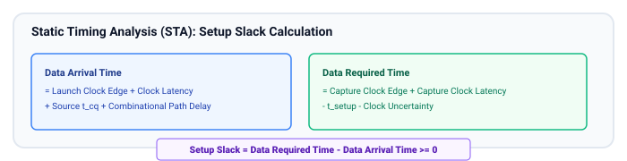
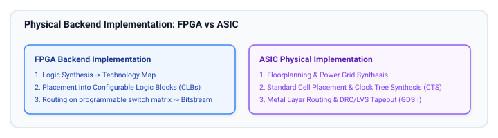

# Synthesis and Implementation Basics

Writing RTL is only the first step in creating hardware. Logic synthesis and physical implementation transform abstract SystemVerilog code into real silicon gates, wires, and transistor layouts. Understanding how synthesis tools translate RTL constructs—and how timing constraints guide physical optimization—is essential for every digital designer.

## Learning Goals

After completing this chapter, you should be able to:
- Explain the four stages of logic synthesis: **Parsing/Elaboration**, **Technology-Independent Optimization**, **Technology Mapping**, and **Gate-Level Optimization**.
- Write and interpret industry-standard **Synopsys Design Constraints (SDC)** for clock definitions, I/O delays, false paths, and multi-cycle paths.
- Perform **Static Timing Analysis (STA)**, calculating Data Arrival Time, Data Required Time, and Setup/Hold Slack.
- Contrast the physical implementation flow of **FPGAs** (Placement $\to$ Routing $\to$ Bitstream) against **ASICs** (Floorplanning $\to$ Placement $\to$ Clock Tree Synthesis $\to$ Routing $\to$ Sign-off DRC/LVS $\to$ GDSII).
- Structure RTL code to encourage resource sharing, minimize logic depth, and prevent synthesis/simulation mismatches.

---

## Logic Synthesis Flow: RTL to Gate-Level Netlist

Logic synthesis converts human-readable RTL into an optimal interconnection of physical standard cells or FPGA LUTs/flip-flops:



---

## Synthesis Constraints (SDC)

Synthesis tools are optimization engines driven by cost functions. Without constraints, the tool has no idea what frequency the circuit must run at or how fast external chips drive the inputs. Constraints are defined using **Synopsys Design Constraints (SDC)**.

### Essential SDC Commands with Examples

#### Clock Definition
```tcl
# Define a 200 MHz system clock with 50% duty cycle on port 'sys_clk'
create_clock -name sys_clk -period 5.0 [get_ports sys_clk]

# Model 150 ps of clock jitter and phase error
set_clock_uncertainty 0.150 [get_clocks sys_clk]
```

#### Input and Output Delays
```tcl
# Data arrives up to 1.5 ns after the external clock edge
set_input_delay -clock sys_clk -max 1.5 [get_ports data_in[*]]

# External receiver requires data to be stable 1.0 ns before the clock edge
set_output_delay -clock sys_clk -max 1.0 [get_ports data_out[*]]
```

#### Timing Exceptions (False Paths and Multi-Cycle Paths)
```tcl
# Treat asynchronous reset release or cross-domain signals as false paths (ignored by STA)
set_false_path -from [get_ports rst_n_async]

# Configure a path that architecturally requires 2 clock cycles to settle
set_multicycle_path 2 -setup -from [get_cells mult_stage_q*] -to [get_cells accum_q*]
set_multicycle_path 1 -hold  -from [get_cells mult_stage_q*] -to [get_cells accum_q*]
```

---

## Static Timing Analysis (STA) Deep Dive

Static Timing Analysis verifies that every register-to-register, input-to-register, and register-to-output path in the design meets setup and hold times across all manufacturing process corners, voltages, and temperatures (PVT corners).



### Example Timing Report Interpretation
```
  Path 1: MET (Setup Check)
  Endpoint: sub_block/acc_q_reg[7]/D (rising edge-triggered flip-flop clocked by sys_clk)
  -----------------------------------------------------------------------------------
  Clock sys_clk (rise edge)                        0.000     0.000
  Clock network delay (ideal)                      0.000     0.000
  sub_block/data_in_reg[3]/CLK (DFFX1)             0.000     0.000 r
  sub_block/data_in_reg[3]/Q (DFFX1)               0.320     0.320 r (t_cq)
  sub_block/U14/Y (NAND2X1)                        0.145     0.465 f
  sub_block/U22/Y (AOI22X1)                        0.280     0.745 r
  sub_block/U45/Y (ADDER8_X1)                      2.100     2.845 r (Data Path)
  sub_block/acc_q_reg[7]/D                         0.050     2.895 r
  data arrival time                                          2.895

  Clock sys_clk (rise edge)                        5.000     5.000
  Clock network delay (ideal)                      0.000     5.000
  Clock uncertainty                               -0.150     4.850
  sub_block/acc_q_reg[7]/CLK (DFFX1)                         4.850 r
  Library setup time                              -0.120     4.730
  data required time                                         4.730
  -----------------------------------------------------------------------------------
  data required time                                         4.730
  data arrival time                                         -2.895
  -----------------------------------------------------------------------------------
  slack (MET)                                               +1.835 ns
```

---

## Physical Implementation Flow: FPGA vs. ASIC

Once logic synthesis outputs a gate netlist, the design moves into physical backend implementation:



---

## Impact of RTL Coding Style on Synthesis Optimization

Synthesis tools can only optimize what your code permits. Certain RTL patterns unintentionally restrict the tool:

### Resource Sharing
If an expensive arithmetic operation (like a 32-bit multiplier) is invoked inside multiple branches of an `if-else` statement, the tool may synthesize multiple separate multipliers unless you explicitly restructure the code to share the unit:

```systemverilog
// POOR: May synthesize TWO separate 32-bit multipliers (wastes silicon area!)
always_comb begin
    if (mode == 1'b0)
        result = a * b;
    else
        result = c * d;
end

// BETTER: Explicit Resource Sharing (synthesizes exactly ONE multiplier + MUXes)
always_comb begin
    op_a = (mode == 1'b0) ? a : c;
    op_b = (mode == 1'b0) ? b : d;
    result = op_a * op_b;
end
```

### Priority Logic vs. Parallel Selection
- **Cascaded `if-else if-else`:** Infers a priority chain where each condition is evaluated sequentially. The last condition sits at the bottom of a deep logic tree, hurting timing.
- **`case` statement:** In modern SystemVerilog, `case` statements where cases are mutually exclusive infer **parallel multiplexers**, reducing logic depth from $O(N)$ to $O(\log N)$!

---

## Learning Resources

### Authoritative Literature
- **"Advanced ASIC Chip Synthesis: Using Synopsys Design Compiler, Physical Compiler, and PrimeTime"** by Himanshu Bhatnagar.
- **"Constraining Designs for Synthesis and Timing Analysis: A Practical Guide to SDC"** by Sridhar Gangadharan.
- **AMD Xilinx UG901 (Vivado Synthesis) & UG904 (Vivado Implementation).**

---

## Exercises

### Exercise 9.1: SDC Constraint Writing
Write an SDC constraints file for a network packet processor with:
1. Primary clock `core_clk` at 250 MHz (period 4.0 ns) with 100 ps uncertainty.
2. Input bus `rx_data[7:0]` has an external arrival delay of up to 1.2 ns relative to `core_clk`.
3. Output bus `tx_data[7:0]` feeds an external PHY requiring 0.8 ns setup time.
4. An asynchronous reset line `rst_n` that should be marked as a false path.

### Exercise 9.2: Timing Slack Calculation
Given:
- Clock period $T_{clk} = 4.0\text{ ns}$
- Launch clock latency = $0.2\text{ ns}$, Capture clock latency = $0.25\text{ ns}$
- Source DFF: $t_{cq} = 0.35\text{ ns}$
- Combinational data path delay = $3.2\text{ ns}$
- Destination DFF: $t_{setup} = 0.15\text{ ns}$, $t_{hold} = 0.08\text{ ns}$
- Clock uncertainty = $0.1\text{ ns}$

**Task:**
1. Compute the Data Arrival Time.
2. Compute the Data Required Time.
3. Determine the Setup Slack. Does the path meet timing?

##### Copyright (c) 2026 squared-studio
