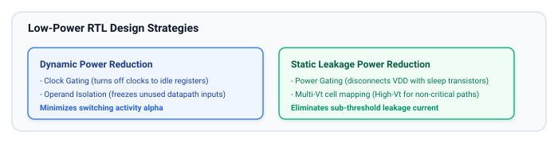
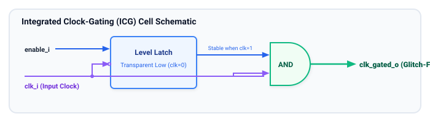
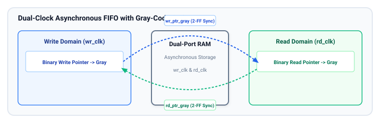
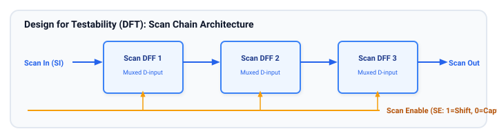
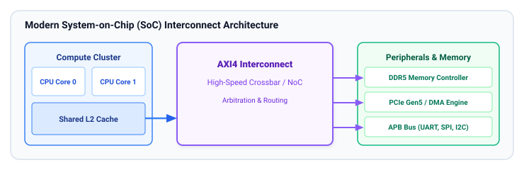

# Advanced RTL Design Topics

This chapter introduces advanced industry topics required for architecting complex, production-grade Systems-on-Chip (SoCs): **Low-Power RTL Design**, **Asynchronous FIFO / Multi-Clock Design**, **Design for Testability (DFT)**, and **Modern SoC Interconnect Architectures**.

## Learning Goals

After completing this chapter, you should be able to:
- Apply low-power RTL techniques: **Clock Gating**, **Operand Isolation**, and understand **Power Gating** domains.
- Explain why a standard clock gating AND gate causes fatal clock glitches and why **Integrated Clock-Gating (ICG)** cells use a negative-edge latch.
- Master multi-clock domain crossing using **Gray-Code pointer synchronizers** in Asynchronous FIFOs.
- Describe Design for Testability (DFT) concepts: **Scan Insertion**, **Scan Chains**, **ATPG** (Automatic Test Pattern Generation), and **BIST** (Built-In Self-Test).
- Understand the architecture of modern Systems-on-Chip (SoCs), including CPU clusters, bus fabrics (AXI/AHB/NoC), and peripheral subsystems.

---

## Low-Power RTL Design Techniques

Total power dissipation in CMOS digital circuits is the sum of **Dynamic Power** (switching and short-circuit) and **Static Power** (sub-threshold leakage):

$$P_{total} = P_{dynamic} + P_{static} = (\alpha \cdot C_L \cdot V_{dd}^2 \cdot f_{clk}) + (I_{leakage} \cdot V_{dd})$$

Where $\alpha$ is the switching activity factor, $C_L$ is capacitive load, $V_{dd}$ is supply voltage, and $f_{clk}$ is frequency.



### 1. Clock Gating and the Integrated Clock-Gating (ICG) Cell
Over 30–50% of chip power is consumed by the clock tree switching every cycle, even when flip-flops hold their previous values.

> [!CAUTION]
> **Why you cannot simply AND a clock with an enable signal:**
> If `en` changes while `clk` is high, the output clock will glitch, creating a spurious runt pulse that violates minimum pulse width and corrupts flip-flop states!

The industry standard solution is the **Integrated Clock-Gating (ICG) Cell**, which places a **level-sensitive latch transparent on low clock** before the gating AND gate:



```systemverilog
// icg_cell.sv - Behavioral Model of Standard Integrated Clock Gating Cell
module icg_cell (
    input  logic clk_i,
    input  logic en_i,
    input  logic test_en_i, // Scan mode bypass pin for DFT
    output logic clk_gated_o
);
    logic en_latched;
    wire  gate_en = en_i | test_en_i;

    // Latch is transparent when clk_i == 0, holding stable when clk_i == 1
    always_latch begin
        if (!clk_i) begin
            en_latched <= gate_en;
        end
    end

    // Pure glitch-free AND gate
    assign clk_gated_o = clk_i & en_latched;

endmodule
```

### 2. Operand Isolation (Input Gating)
Combinational blocks (such as a 64-bit floating-point divider) consume dynamic power whenever their input wires toggle, even if the rest of the processor is ignoring their output.
- **Solution:** Place simple AND or OR gates at the inputs to freeze them to constant `0` whenever the unit's enable is de-asserted.

---

## Asynchronous Multi-Clock FIFO Design

When data must stream between two completely independent, unsynchronized clock frequencies (e.g., streaming network packets from a 156.25 MHz Ethernet PHY into a 400 MHz SoC bus), an **Asynchronous Dual-Clock FIFO** is required:



### Why Gray-Code is Mandatory for Pointer CDC
Binary counters change multiple bits simultaneously (e.g., `3` $\to$ `4` changes `0011` to `0100`, toggling 3 bits at once). If sampled mid-transition by an asynchronous clock, the receiving domain can see illegal intermediate codes.

**Gray Code Property:** Between any two consecutive numbers, **exactly one bit changes**!
- If the receiving clock samples during the single bit transition, it can only resolve to either the old pointer value or the new pointer value. Both values are safe and valid!

```systemverilog
// bin2gray.sv - Parameterized Binary to Gray and Gray to Binary Converters
module bin2gray #(
    parameter int unsigned WIDTH = 4
) (
    input  logic [WIDTH-1:0] bin_i,
    output logic [WIDTH-1:0] gray_o
);
    // Standard Binary to Gray conversion: XOR with right-shifted self
    assign gray_o = bin_i ^ (bin_i >> 1);
endmodule

module gray2bin #(
    parameter int unsigned WIDTH = 4
) (
    input  logic [WIDTH-1:0] gray_i,
    output logic [WIDTH-1:0] bin_o
);
    // Gray to Binary conversion: Cumulative XOR reduction
    always_comb begin
        bin_o[WIDTH-1] = gray_i[WIDTH-1];
        for (int i = WIDTH - 2; i >= 0; i--) begin
            bin_o[i] = bin_o[i+1] ^ gray_i[i];
        end
    end
endmodule
```

---

## Design for Testability (DFT)

Physical manufacturing of silicon chips produces microscopic defects (dust particles, crystal dislocations, open metal vias). DFT circuitry is built directly into the RTL to detect broken chips before shipment.



### 1. Scan Insertion and Scan Chains
- **Concept:** Automated EDA tools replace every normal flip-flop with a **Scan Flip-Flop** (a DFF preceded by a 2-to-1 MUX controlled by `Scan Enable (SE)`).
- **Shift Mode (`SE = 1`):** All flip-flops on the chip connect head-to-tail to form giant shift registers (Scan Chains). Test patterns generated by Automatic Test Pattern Generation (ATPG) are shifted into the chip from external Automatic Test Equipment (ATE).
- **Capture Mode (`SE = 0`):** The chip runs for exactly 1 functional clock cycle, capturing the combinational logic response into the flip-flops.
- **Unload Mode (`SE = 1`):** The captured response is shifted out through the Scan Out pins and compared against expected fault signatures.

### 2. Built-In Self-Test (BIST)
- **Logic BIST (LBIST):** Uses on-chip Linear Feedback Shift Registers (LFSR) as pseudo-random pattern generators to test logic autonomously without expensive test machines.
- **Memory BIST (MBIST):** Dedicated hardware engines that run checkerboard, march, and address-complement algorithms across embedded SRAM blocks at full speed, identifying defective rows/columns and activating redundant spare rows.

---

## System-on-Chip (SoC) Architecture

A modern SoC integrates heterogeneous processing engines, multi-tiered memories, and standard bus topologies onto a single die:



- **Bus Protocols:** High-bandwidth processors and DMA engines communicate across standardized protocols like ARM AMBA **AXI4** (burst transfers, separate read/write address channels) and **AHB**, while low-bandwidth peripherals connect through the low-power **APB** (Advanced Peripheral Bus).

---

## Learning Resources

### Industry Reference Literature
- **"Principles of Asynchronous Circuit Design"** by Jens Sparsø & Steve Furber.
- **"Low Power Methodology Manual: For System-on-Chip Design"** by Michael Keating, David Flynn, Robert Aitken, Alan Gibbons, Kaijian Shi (Springer).
- **"Essentials of Electronic Testing for Digital, Memory and Mixed-Signal VLSI Circuits"** by Michael L. Bushnell & Vishwani D. Agrawal.
- **"ARM AMBA AXI and ACE Protocol Specification"** (IHI0022E).

---

## Exercises

### Exercise 10.1: Glitch Analysis in Clock Gating
1. Draw a timing diagram demonstrating what happens when a simple 2-input AND gate is used for clock gating (`clk_out = clk & en`), and the `en` signal transitions from `0` to `1` while `clk` is high.
2. Explain how the Integrated Clock-Gating (ICG) latch prevents this glitch from appearing on `clk_out`.

### Exercise 10.2: Gray-Code Pointer Verification
Write out the 4-bit binary values and their corresponding 4-bit Gray code values from 0 to 15:
- Verify that transitioning from 15 (`4'b1111`) back to 0 (`4'b0000`) in Gray code also changes exactly **1 bit** (cyclic Gray code property).

### Exercise 10.3: Behavioral Scan Flip-Flop Model
Write a SystemVerilog module `scan_dff` that models a scan flip-flop:
- Inputs: `clk`, `rst_n`, `d_i`, `si_i` (scan in), `se_i` (scan enable).
- Output: `q_o`, `so_o` (scan out, typically connected to `q_o`).
- Implement the multiplexed capture logic in synthesizable RTL.

##### Copyright (c) 2026 squared-studio
