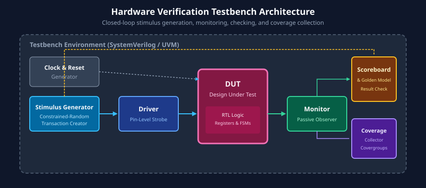

# Chapter 1: Introduction to Verification and Verification Planning

Hardware verification is the systematic process of demonstrating that a digital design fulfills its specified requirements across all operational scenarios. In contemporary semiconductor engineering, verification routinely accounts for **60% to 70% of the entire design cycle time, compute resources, and engineering headcount**.

This chapter establishes the core rationale for hardware verification, analyzes the escalating cost of hardware defects, contrasts the primary verification methodologies, details the verification execution flow, and presents the foundational principles of verification planning and testbench architecture.

---

## Learning Goals

After completing this chapter, you should be able to:
- Explain why hardware verification dominates the VLSI design cycle and calculate the business and safety impact of bug escapes.
- Contrast the capabilities, trade-offs, and deployment domains of Simulation, Emulation, Formal Verification, and Static Analysis.
- Map the end-to-end verification lifecycle from architectural feature extraction to tape-out sign-off.
- Differentiate between Code Coverage (structural execution) and Functional Coverage (specification completion).
- Formulate a comprehensive Verification Plan document with verifiable milestones and measurable exit criteria.
- Diagram the structural blocks of a closed-loop verification testbench environment.

---

## 1. Why Verification is Critical

### The Exponential Complexity of Modern SoCs
Modern System-on-Chip (SoC) architectures integrate billions of transistors, dozens of heterogeneous CPU/GPU/NPU cores, multi-level coherent cache hierarchies, high-speed SerDes interfaces (PCIe Gen 5/6, DDR5/LPDDR5, Ethernet), and complex security subsystems. 

As the number of interacting state machines and asynchronous clock domains grows, the total design state space expands exponentially ($2^N$ possible states for $N$ flip-flops). This sheer combinatorial scale makes unintended corner-case interactions inevitable unless checked by rigorous verification methodologies.

### The Cost of Bugs: Life-Cycle Escalation
Unlike software, where a post-release bug can often be resolved with an over-the-air (OTA) patch, hardware is physically etched into silicon masks. 


The financial, schedule, and reputational penalty for a hardware bug escalates by roughly an order of magnitude at each progressive milestone:
1. **RTL Stage (1x Cost):** A bug detected in simulation can be corrected in code and re-simulated within minutes or hours.
2. **Block / Subsystem Integration (10x Cost):** Bugs caught after subsystems are assembled require re-verifying interconnected IP blocks and rerunning regression suites over several days.
3. **Tape-out / Mask Generation (100x Cost):** If an error escapes into physical synthesis or mask generation, rectifying it delays product introduction schedules by weeks and incurs engineering change order (ECO) tooling costs.
4. **Post-Silicon / Field Escapes (1,000x to 10,000x+ Cost):** Fabricated silicon containing functional defects requires a full physical mask re-spin (often costing \$5M to \$20M in cutting-edge 5nm/3nm nodes), halts customer shipments, triggers product recalls, and permanently damages brand credibility.

### Real-World Historical Hardware Bug Escapes
The history of digital computing highlights the catastrophic risks of verification escapes:

| Historical Incident | Root Cause | Impact & Consequence | Verification Lesson |
| :--- | :--- | :--- | :--- |
| **Intel Pentium FDIV Bug (1994)** | Five missing lookup table entries in the floating-point divider hardware PLA array. | Resulted in \$475 million in recall costs and widespread reputational damage. | Directed testing of common values failed to exercise all PLA lookup indices; established the necessity of formal verification for arithmetic datapaths. |
| **Ariane 5 Flight 501 Failure (1996)** | A 64-bit floating-point value was converted into a 16-bit signed integer without overflow protection, triggering an unhandled software/hardware exception that shut down guidance computers. | Complete loss of the \$370 million launch vehicle and its payload within 37 seconds of launch. | Highlighted the critical danger of reusing IP and subsystems without re-verifying full dynamic range boundary conditions in the target environment. |
| **Therac-25 Accidents (1980s)** | Asynchronous race condition between user input routines and radiation beam magnet configuration hardware. | Delivered lethal radiation overdoses (100x therapeutic dose) to patients, causing multiple fatalities and severe injuries. | Exposed the fatal danger of missing hardware interlocks and failing to verify concurrent asynchronous race conditions. |

### Core Verification Goals
A robust verification program is engineered around six fundamental goals:
- **Functional Correctness:** Guaranteeing the Design Under Test (DUT) matches its written specification under all valid operational conditions.
- **Bug Detection & Isolation:** Exposing defects as early as possible in the design flow, with minimum cycle latency between bug manifestation and root-cause localization.
- **Specification Compliance:** Validating compliance with industry bus standards (AMBA AXI/APB, PCIe, USB, MIPI, RISC-V).
- **Corner-Case Discovery:** Subjecting the RTL to simultaneous boundary stresses (e.g., FIFO almost-full combined with bus stall and reset deassertion).
- **Confidence Building:** Quantifying verification completeness through rigorous, mathematically trackable metrics.
- **Risk Mitigation:** Eliminating post-silicon mask re-spins and field vulnerability errata.

---

## 2. Verification Methodologies

No single verification technology can address every facet of modern digital hardware. Verification teams deploy a balanced suite of complementary methodologies.


### Comparative Methodology Breakdown

| Methodology | Primary Mechanism | Best Suited For | Major Strengths | Inherent Limitations |
| :--- | :--- | :--- | :--- | :--- |
| **Static Verification (Lint, CDC, STA)** | Mathematical & structural rule analysis without dynamic stimulus. | RTL syntax, clock domain crossing (CDC), reset domain crossing (RDC), timing constraints. | Instant execution; requires no testbench or simulation test cases. | Cannot verify functional correctness or dynamic algorithmic behavior. |
| **Dynamic Simulation** | Cycle-based or event-based testbench driving stimuli to DUT. | Block, subsystem, and full-chip functional verification (SystemVerilog / UVM). | Maximum debugging visibility; full waveform inspection; highly flexible. | Incomplete coverage; simulation speed decreases as design gate count scales. |
| **Formal Verification (Model Checking)** | Mathematical proof engines searching all reachable state space. | Control logic, protocol arbiters, security firewalls, arithmetic units. | 100% mathematical certainty; finds obscure corner bugs without stimulus writing. | State-space explosion on complex datapaths and large FIFO/memory buffers. |
| **Hardware Emulation & FPGA Prototyping** | Mapping RTL onto arrays of FPGAs or custom emulation processors. | Full SoC boot, firmware/driver development, long video/network traffic streams. | 10,000x to 100,000x faster than software simulation; real-time hardware-software co-design. | High capital cost; reduced waveform visibility; longer compilation/mapping turnaround. |

---

## 3. The Closed-Loop Verification Flow

Hardware verification is not a linear, one-pass effort; it is an iterative, coverage-driven feedback loop.

```
+-----------------------------------------------------------------------------------+
|                        THE VERIFICATION LIFECYCLE FLOW                            |
+-----------------------------------------------------------------------------------+
|  1. Planning & Spec Analysis  : Extract features, define coverage goals & targets  |
|               |                                                                   |
|               v                                                                   |
|  2. Environment Development   : Build interfaces, drivers, monitors, scoreboards  |
|               |                                                                   |
|               v                                                                   |
|  3. Test Execution            : Run directed smoke tests & random seed regressions|
|               |                                                                   |
|               v                                                                   |
|  4. Failure Triage & Debug    : Waveform & log diagnosis -> Fix RTL or Testbench  |
|               |                                                                   |
|               v                                                                   |
|  5. Coverage Closure          : Analyze coverage holes -> Refine constraints      |
|               |                                                                   |
|               v                                                                   |
|  6. Tape-Out Sign-Off         : 100% Functional & Code Coverage reached with 0 bug|
+-----------------------------------------------------------------------------------+
```

### Steps in the Verification Lifecycle
1. **Verification Planning:** The architectural specification is analyzed to identify every feature, protocol boundary, configuration mode, and potential failure scenario.
2. **Testbench Architecture & Development:** Verification engineers construct modular verification components (agents, sequences, scoreboards) in SystemVerilog/UVM.
3. **Execution & Regression Testing:** Massive parallel regression runs are dispatched across compute clusters using pseudo-random seeds to uncover unexpected corner-case interactions.
4. **Coverage Analysis:** Simulators aggregate execution data into unified coverage databases to monitor progress against predetermined targets.
5. **Debugging & Refinement:** When tests fail, engineers analyze simulation logs, assertion firings, and waveform traces to classify failures as RTL bugs, testbench bugs, or specification ambiguities.
6. **Coverage Closure & Sign-Off:** Once functional and code coverage targets hit 100% and the open-bug curve flattens to zero, the team proceeds with tape-out authorization.

---

## 4. Verification Metrics: Measuring Completeness

How does an engineering team know when verification is complete? Verification relies on objective, quantifiable metrics.

### Code Coverage (Structural Execution Metric)
Code coverage measures how thoroughly the simulation stimulus has exercised the underlying syntactic structure of the RTL code:
- **Line (Statement) Coverage:** Percentage of executable RTL code lines evaluated at least once.
- **Branch (Decision) Coverage:** Percentage of `if-else` and `case` branches traversed in both true and false directions.
- **Condition (Expression) Coverage:** Evaluates whether each boolean sub-expression in a complex condition (e.g., `if (A && (B || C))`) has independently affected the overall outcome.
- **Toggle Coverage:** Tracks whether every bit of every register and wire has transitioned from `0 -> 1` and `1 -> 0`.
- **FSM State & Transition Coverage:** Measures which states and valid state-to-state transitions of Finite State Machines were executed.

> [!WARNING]
> High code coverage is a **necessary but insufficient** criterion for verification sign-off. An unwritten feature has 0 lines of RTL code, meaning a design missing a critical safety interlock can easily score 100% code coverage while remaining fundamentally broken!

### Functional Coverage (Specification Compliance Metric)
Functional coverage is a user-defined metric that answers the question: *Did we test what the specification required?*
- Defined using SystemVerilog `covergroup` and `coverpoint` constructs.
- Directly maps to items in the Verification Plan (e.g., all legal packet lengths, simultaneous bus interrupts, invalid address accesses).
- Groups test occurrences into discrete **bins**, including single-value bins, range bins, transition bins (`0 => 1 => 3`), and multidimensional cross-coverage matrices.

### Bug Escape Rate and Bug Convergence Curves
- **Bug Escape Rate:** The count of defects uncovered in later stages (e.g., during gate-level simulation, emulation, or post-silicon validation) per unit of design complexity.
- **Bug Discovery Curve:** Tracking new bugs found per week versus open bugs resolved. Tape-out readiness requires the bug discovery rate to approach zero while regression run volume remains at peak capacity.

---

## 5. Verification Planning and Sign-Off Strategy

The **Verification Plan (vPlan)** is the central contract governing the verification project. It converts an ambiguous architectural document into concrete, verifiable test requirements.

### Essential Sections of a Production Verification Plan
1. **Design Features & Interfaces:** Inventory of all operating modes, interfaces, registers, and timing constraints.
2. **Verification Goals & Metrics:** SMART (Specific, Measurable, Achievable, Relevant, Time-bound) targets, such as achieving 100% functional coverage and 95% branch coverage.
3. **Environment Architecture:** Topology of testbench components, virtual interfaces, register abstraction models, and scoreboards.
4. **Stimulus & Test Strategy:** Categorization of directed smoke tests, constrained-random sequence scenarios, error-injection tests, and performance stress workloads.
5. **Resource & Schedule Estimation:** Engineer allocations, simulator tool license budgets, regression compute farm capacity, and tape-out milestone dates.
6. **Sign-Off Criteria:** Explicit gating requirements that must be met before physical fabrication can begin:
   - 100% Functional Coverage achieved across all defined covergroups.
   - 100% Code Coverage achieved (with all unreachable dead code formally waived and documented).
   - Zero open Severity-1 (critical) and Severity-2 (major) bugs.
   - Clean regression run over a continuous 7-day period with billions of simulated cycles.

---

## 6. Testbench Architecture Overview

A verification testbench is a software harness wrapping the hardware design to stimulate inputs and validate outputs.



### Structural Testbench Components
- **Clock and Reset Generator:** Simulates physical oscillators and power-on-reset circuitry, generating synchronous clock edges and controlled reset sequences.
- **Stimulus Generator (Sequence):** Generates high-level transaction data objects (packets, bus commands) using constrained-random algorithms.
- **Driver (Transactor):** Receives abstract transaction objects from the generator and converts them into cycle-accurate pin toggles conforming to protocol timing.
- **Design Under Test (DUT):** The synthesizable hardware RTL module being verified.
- **Monitor (Observer):** A strictly passive component that watches interface pins, detects valid transactions, unpacks pin-level activity back into transaction objects, and broadcasts them.
- **Scoreboard & Golden Reference Model:** Compares observed DUT outputs against predicted results generated by an algorithmic reference model. Flags immediate errors on mismatches.
- **Coverage Collector:** Samples transaction data and internal state variables to compute functional coverage metrics.

---

## 7. Learning Resources

- **Books:**
  - *Writing Testbenches using SystemVerilog* by Janick Bergeron (Springer).
  - *SystemVerilog for Verification: A Guide to Learning the Testbench Language Features* by Chris Spear and Greg Tumbush (Springer).
- **Standards & Industry Guidelines:**
  - IEEE Standard for SystemVerilog (IEEE Std 1800-2023).
  - Accellera Systems Initiative: Universal Verification Methodology (UVM) User's Guide.

---

## 8. Review Exercises

1. Calculate the financial and schedule consequences if a hardware division bug escapes verification into 500,000 deployed automotive microcontrollers versus finding it during RTL simulation.
2. Why is 100% statement (line) coverage insufficient to prove that an RTL module meets its functional specification? Give a concrete example.
3. Contrast Dynamic Simulation with Formal Verification in terms of setup time, scalability, and coverage certainty.
4. Draft a brief functional verification plan outline for a 4-entry, 32-bit synchronous FIFO with `push`, `pop`, `full`, `empty`, and `overflow` flags. Identify at least four critical functional coverage bins.

##### Copyright (c) 2026 squared-studio
