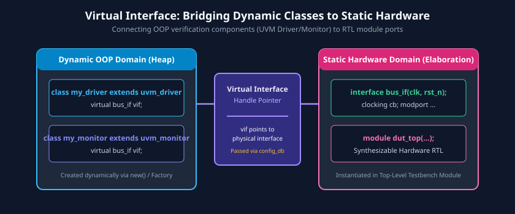
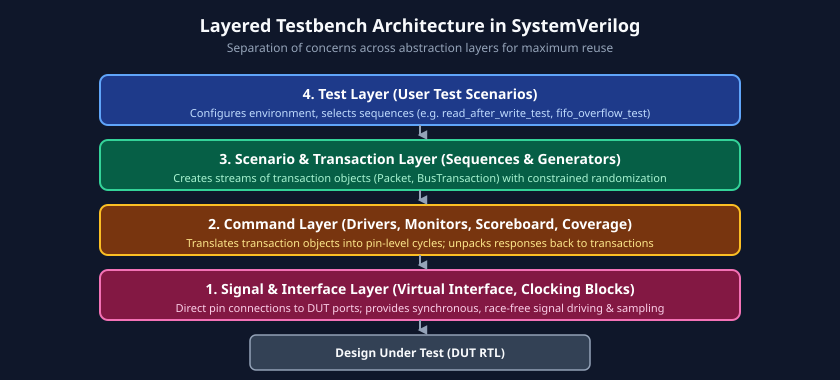

# Chapter 2: SystemVerilog for Verification - Testbench Fundamentals

SystemVerilog is uniquely distinguished as both a synthesizable Hardware Description Language (HDL) and a powerful, object-oriented **Hardware Verification Language (HVL)**. Standardized under IEEE 1800, its verification features were engineered specifically to overcome the limitations of classic Verilog-1995/2001 testbenches.

This chapter explores the essential language constructs and architectural patterns required to construct scalable, modular verification environments: Object-Oriented Programming (OOP), interfaces and virtual interfaces, stratified event scheduling regions, clocking blocks, Transaction-Level Modeling (TLM), and layered testbench design.

---

## Learning Goals

After completing this chapter, you should be able to:
- Apply Object-Oriented Programming principles (encapsulation, inheritance, polymorphism) to construct modular testbench components.
- Explain the SystemVerilog stratified event execution regions and use clocking blocks (`#1step` input skew) to eliminate simulation race conditions.
- Implement SystemVerilog interfaces, modports, and virtual interfaces to dynamically bind class-based verification environments to static hardware RTL.
- Structure a modern verification environment using a four-layer testbench architecture.
- Develop transaction classes, transactors (drivers and monitors), and queue-based self-checking scoreboards.

---

## 1. SystemVerilog as a Verification Language: Core Constructs

### Classes, Objects, and Object-Oriented Programming (OOP)
In classic Verilog, testbenches relied on static `module` blocks and global variables. SystemVerilog introduces dynamic OOP classes:
- **Classes:** Blueprints declared with the `class ... endclass` keyword. A class encapsulates data attributes (properties) and operational functions/tasks (methods).
- **Objects:** Dynamic instances created on the heap at runtime using the `new()` constructor. Unlike static hardware modules, objects are created and garbage-collected dynamically.

```systemverilog
// Definition of a basic bus transaction class
class bus_transaction;
    // Class properties (data attributes)
    rand bit [31:0] addr;
    rand bit [31:0] data;
    rand bit        write_read; // 1 = Write, 0 = Read

    // Constructor method
    function new(bit [31:0] addr = 32'h0, bit [31:0] data = 32'h0);
        this.addr = addr;
        this.data = data;
        this.write_read = 1'b0;
    endfunction

    // Utility display method
    virtual function void print(string tag = "TRANS");
        $display("[%s] Addr=0x%08h Data=0x%08h Op=%s", 
                 tag, this.addr, this.data, (write_read ? "WRITE" : "READ"));
    endfunction
endclass
```

### The Four Pillars of OOP in Verification
1. **Encapsulation:** Grouping data and methods into single units with access control (`local`, `protected`). Prevents external components from directly modifying internal state variables without validation.
2. **Abstraction:** Presenting high-level transaction interfaces (e.g., `send_packet()`) while hiding low-level cycle-by-cycle pin assertions.
3. **Inheritance:** Creating specialized derived classes (`class eth_vlan_packet extends eth_packet;`) that inherit and extend base class functionality, minimizing code duplication.
4. **Polymorphism:** Enabling base-class handles to refer to derived-class objects at runtime. Virtual methods (`virtual function`) ensure that the overriding derived implementation executes dynamically.

### Packages: Namespaces for Organization and Reuse
Packages group related classes, typedefs, enumerations, parameters, and tasks into distinct namespaces, eliminating naming collisions:

```systemverilog
package bus_pkg;
    typedef enum bit {READ_OP = 1'b0, WRITE_OP = 1'b1} bus_op_e;
    `include "bus_transaction.sv"
    `include "bus_driver.sv"
    `include "bus_monitor.sv"
endpackage : bus_pkg

// In testbench: import the entire package or specific classes
import bus_pkg::*;
```

---

## 2. Eliminating Race Conditions: Simulation Event Regions

One of the most persistent bugs in legacy Verilog testbenches is the **simulation race condition**, where a testbench samples an output on the same delta cycle that the design register updates, yielding non-deterministic values depending on simulator engine ordering.

SystemVerilog eliminates race conditions through **Stratified Event Scheduling Regions**.


### Major Simulation Regions in an Event Time-Step

| Event Region Set | Sub-Regions | Primary Responsibility |
| :--- | :--- | :--- |
| **Preponed** | Preponed | **Stable Sampling Window:** Values are sampled before any events occur in the time-step. Concurrent assertions (SVA) and clocking block inputs sample here. |
| **Active Region Set** | Active, Inactive, NBA | **Design Execution:** Evaluates synthesizable RTL. Blocking assignments (`=`) run in Active; `#0` in Inactive; non-blocking register assignments (`<=`) in Non-Blocking Assignment (NBA) region. |
| **Observed** | Observed | **Property Evaluation:** Concurrent assertions evaluate expressions against values sampled in the Preponed region. |
| **Reactive Region Set** | Reactive, Re-Inactive, Re-NBA | **Testbench Execution:** Code inside `program` blocks and clocking block drive updates execute here, *after* design RTL has completely settled. |
| **Postponed** | Postponed | **Final Readout:** System tasks like `$strobe` and waveform dumping routines capture final settled signal states. |

---

## 3. Clocking Blocks: Deterministic Synchronous Interfacing

A **Clocking Block** synchronizes testbench drives and samples to specific clock edges, completely abstracting setup and hold timings.

### Clocking Block Skew Semantics
- **Input Skew (`default input #1step`):** Tells the simulator to sample input signals in the **Preponed** region—immediately *prior* to the active clock edge. This guarantees sampling the previous stable state of the register, exactly mimicking a physical flip-flop's setup window.
- **Output Skew (`default output #1ns` or `output #0`):** Drives signals into the design with a defined delay, preventing hold-time violations.

```systemverilog
interface bus_if (input logic clk, input logic rst_n);
    logic [31:0] paddr;
    logic        pwrite;
    logic        psel;
    logic        penable;
    logic [31:0] pwdata;
    logic [31:0] prdata;
    logic        pready;

    // Driver Clocking Block (Synchronous Stimulus Driving)
    clocking drv_cb @(posedge clk);
        default input #1step output #1ns;
        output paddr, pwrite, psel, penable, pwdata;
        input  pready, prdata;
    endclocking

    // Monitor Clocking Block (Synchronous Passive Observation)
    clocking mon_cb @(posedge clk);
        default input #1step;
        input paddr, pwrite, psel, penable, pwdata, pready, prdata;
    endclocking

    // Modports defining directionality
    modport DRV (clocking drv_cb, input rst_n);
    modport MON (clocking mon_cb, input rst_n);
endinterface : bus_if
```

---

## 4. Virtual Interfaces: Bridging Dynamic Classes to Static RTL

In SystemVerilog, synthesizable RTL modules are **static structures** created at elaboration and compiled into fixed memory locations. In contrast, testbench components (drivers, monitors, scoreboards) are **dynamic OOP classes** instantiated at runtime on the heap.

A class cannot directly contain a hardware `module` or `interface` instance. The solution is the **Virtual Interface**.



### Virtual Interface Mechanism
- A **Virtual Interface** is a typed handle (pointer) to a physical interface instance:
  `virtual bus_if.DRV vif;`
- During testbench initialization, the physical interface instantiated in the top-level module is passed to the class-based components via a configuration database or constructor argument.
- Inside class methods, transactors drive and sample hardware pins via `vif.drv_cb.signal <= value;`.

```systemverilog
class apb_driver;
    // Virtual interface handle
    virtual bus_if.DRV vif;

    function new(virtual bus_if.DRV vif);
        this.vif = vif;
    endfunction

    // Cycle-accurate bus write task
    task drive_write(bit [31:0] addr, bit [31:0] data);
        // Step 1: SETUP phase
        @(vif.drv_cb);
        vif.drv_cb.paddr   <= addr;
        vif.drv_cb.pwrite  <= 1'b1;
        vif.drv_cb.psel    <= 1'b1;
        vif.drv_cb.penable <= 1'b0;
        vif.drv_cb.pwdata  <= data;

        // Step 2: ACCESS phase
        @(vif.drv_cb);
        vif.drv_cb.penable <= 1'b1;

        // Step 3: Wait until peripheral asserts PREADY
        do begin
            @(vif.drv_cb);
        end while (vif.drv_cb.pready !== 1'b1);

        // Step 4: Deassert controls back to IDLE
        vif.drv_cb.psel    <= 1'b0;
        vif.drv_cb.penable <= 1'b0;
    endtask
endclass
```

---

## 5. Layered Testbench Architecture

Monolithic testbenches where test logic, protocol formatting, and pin wiggling are intermingled become unmaintainable as designs scale. Production verification environments utilize a **Layered Testbench Architecture**.



### The Four Architectural Layers
1. **Signal & Interface Layer (Physical Layer):**
   - Wires, bidirectional busses, clock generators, reset sequencers, and SystemVerilog interfaces.
   - Interacts directly with the physical input/output ports of the DUT.
2. **Command / Transactor Layer (Protocol Layer):**
   - **Driver:** Converts high-level transaction objects (`bus_transaction`) into pin-level signal toggles.
   - **Monitor:** Continuously observes pin-level protocol transitions and reconstructs complete transaction objects.
3. **Scenario / Transaction Layer:**
   - **Generators & Sequences:** Generates streams of constrained-random transactions.
   - Operates entirely in terms of abstract data objects (packets, instructions, frames).
4. **Test & Verification Core Layer:**
   - **Test Layer:** Controls the top-level test flow, sets environment configurations, and selects scenario sequences.
   - **Scoreboard:** Houses algorithmic golden models and queues to verify data integrity and transaction ordering.
   - **Coverage Collector:** Measures protocol and state completeness.

---

## 6. Building a Self-Checking Testbench with a Queue-Based Scoreboard

Below is a complete, working example illustrating a layered, self-checking SystemVerilog testbench for a synchronous processing pipeline using virtual interfaces, transactors, and a queue-based scoreboard.

```systemverilog
// 1. Transaction Definition
class alu_transaction;
    rand bit [7:0] operand_a;
    rand bit [7:0] operand_b;
    rand bit [1:0] opcode; // 0=ADD, 1=SUB, 2=AND, 3=OR
    bit [8:0]      result;

    function void display(string tag = "ALU_TRANS");
        $display("[%s] A=%0d B=%0d Op=%0d Result=%0d", 
                 tag, operand_a, operand_b, opcode, result);
    endfunction
endclass

// 2. Scoreboard with In-Order Reference Queue
class alu_scoreboard;
    alu_transaction expect_q[$]; // SystemVerilog unbounded queue
    int match_count = 0;
    int mismatch_count = 0;

    // Push expected transaction calculated by reference model
    function void push_expected(alu_transaction tx);
        alu_transaction exp_tx = new tx; // Shallow copy
        case (tx.opcode)
            2'b00: exp_tx.result = tx.operand_a + tx.operand_b;
            2'b01: exp_tx.result = tx.operand_a - tx.operand_b;
            2'b10: exp_tx.result = tx.operand_a & tx.operand_b;
            2'b11: exp_tx.result = tx.operand_a | tx.operand_b;
        endcase
        expect_q.push_back(exp_tx);
    endfunction

    // Check actual transaction observed from DUT
    function void check_actual(alu_transaction actual_tx);
        alu_transaction exp_tx;
        if (expect_q.size() == 0) begin
            $error("[SCOREBOARD_ERROR] Unexpected output from DUT! Queue is empty.");
            mismatch_count++;
            return;
        end

        exp_tx = expect_q.pop_front();
        if (exp_tx.result === actual_tx.result) begin
            $display("[SCOREBOARD_PASS] Match! Exp=0x%0h Act=0x%0h", 
                     exp_tx.result, actual_tx.result);
            match_count++;
        end else begin
            $error("[SCOREBOARD_FAIL] Mismatch! Exp=0x%0h Act=0x%0h (A=%0d B=%0d Op=%0d)",
                   exp_tx.result, actual_tx.result, exp_tx.operand_a, exp_tx.operand_b, exp_tx.opcode);
            mismatch_count++;
        end
    endfunction

    function void report();
        $display("-------------------------------------------");
        $display("SCOREBOARD REPORT: %0d Matches, %0d Mismatches", 
                 match_count, mismatch_count);
        $display("-------------------------------------------");
    endfunction
endclass
```

---

## 7. Learning Resources

- **Books:**
  - *SystemVerilog for Verification: A Guide to Learning the Testbench Language Features* by Chris Spear & Greg Tumbush (Chapters 3-5: OOP, Interfaces, Clocking Blocks).
  - *Writing Testbenches Using SystemVerilog* by Janick Bergeron.
- **Reference Standards:**
  - IEEE Std 1800-2023 SystemVerilog Language Reference Manual (Section 14: Clocking Blocks, Section 24: Program Blocks, Section 25: Interfaces).

---

## 8. Review Exercises

1. Explain the difference between an interface instance and a virtual interface handle in SystemVerilog. Why can a class not contain an interface instance directly?
2. What happens if a testbench samples an asynchronous output from a DUT inside the Active region versus inside the Preponed region via a clocking block with `#1step` skew?
3. In a layered testbench architecture, describe the exact transformation that occurs as data moves from the Scenario Layer down through the Command Layer to the Signal Layer.
4. Modify the `alu_scoreboard` example to support an out-of-order design where transactions carry an identifier tag (`id`). Which SystemVerilog data structure should replace the simple queue?

##### Copyright (c) 2026 squared-studio
