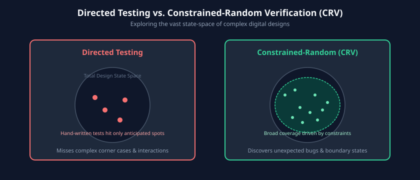
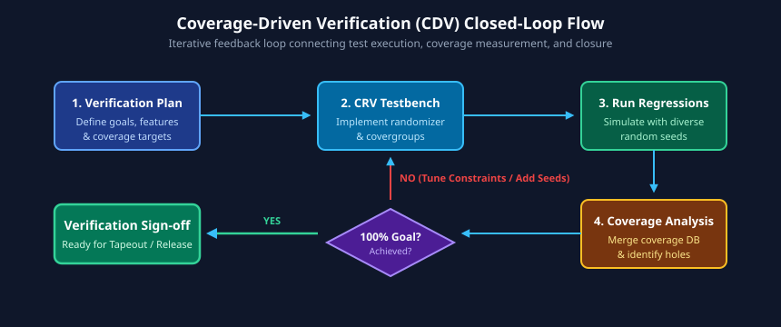

# Constrained-Random Verification

As digital designs surpass millions of equivalent gates, hand-crafted directed tests become inadequate for exploring the combinatorial state space. A directed test exercises only the exact sequence envisioned by the testbench author, systematically missing obscure corner cases and cross-domain race conditions.

**Constrained-Random Verification (CRV)** coupled with **Coverage-Driven Verification (CDV)** is the industry-standard methodology for discovering unexpected bugs and objectively proving verification completeness. This chapter explores SystemVerilog's declarative constraint language, the constraint solver engine, functional coverage modeling, and coverage closure techniques.

---

## Learning Goals

After completing this chapter, you should be able to:
- Contrast directed testbenches with constrained-random verification across state-space exploration efficiency.
- Utilize SystemVerilog randomization keywords (`rand`, `randc`) and construct robust declarative constraints (`inside`, `dist`, `solve...before`, `unique`, `foreach`, implication `->`, and `soft`).
- Dynamically control constraint activity using `constraint_mode()`, `random_mode()`, and inline `randomize() with` blocks.
- Construct comprehensive functional coverage models using `covergroup`, `coverpoint`, value/transition/illegal bins, and multidimensional `cross` coverage.
- Execute the closed-loop Coverage-Driven Verification (CDV) flow to locate coverage holes and steer random stimuli to closure.

---

## Directed Testing vs. Constrained-Random Verification

In a **Directed Testing** environment, the verification engineer manually specifies every signal sequence, address offset, and payload value.



### The Limitations of Directed Verification
1. **Anticipation Bias:** A directed test only verifies scenarios the engineer anticipates. If an engineer assumes a FIFO will never experience a simultaneous push and pop while transitioning out of reset, no test will be written for it.
2. **Poor Scalability:** A design with $N$ configuration registers of 32 bits each has $2^{32N}$ operational states. Writing manual tests for even 0.001% of this space is physically impossible.
3. **High Maintenance Overhead:** Small RTL interface modifications break brittle, hardcoded signal timing across hundreds of individual directed tests.

### The CRV Advantage
Constrained-Random Verification automates stimulus generation by defining **valid boundaries** (rules and protocols) rather than specific test values:
- The verification engineer writes constraints that enforce legal protocol behavior (e.g., "address must be 4-byte aligned and burst length between 1 and 16").
- The simulator's mathematical constraint solver generates thousands of pseudo-random legal variations across different random seeds (`+ntb_random_seed=<val>` or `-sv_seed <val>`).
- CRV continually discovers unexpected corner cases, such as back-to-back zero-payload aborts or concurrent buffer wrap-arounds.

---

## SystemVerilog Randomization: `rand`, `randc`, and Constraints

### Random Variables: `rand` vs. `randc`
- **`rand` (Uniform Random):** The variable is assigned a pseudo-random value within its valid range on each call to `randomize()`. Successive calls may return identical values (standard uniform distribution).
- **`randc` (Random Cyclic):** The variable cycles through every possible permutation of its values without repeating any value until the entire set is exhausted.

```systemverilog
class packet;
    rand  bit [7:0] src_addr;
    rand  bit [7:0] dest_addr;
    randc bit [2:0] priority_level; // Cycles through 0..7 without repeats
    rand  bit       is_encrypted;
endclass
```

### Declarative Constraint Blocks
Constraints are declarative boolean expressions evaluated simultaneously by the simulator's constraint engine:

```systemverilog
class packet;
    rand bit [7:0]  src_addr;
    rand bit [7:0]  dest_addr;
    rand bit [15:0] length;
    rand bit [3:0]  tag;

    // Constraint block enforcing protocol rules
    constraint valid_packet_c {
        // Range constraint using inside operator
        src_addr inside {[8'h10 : 8'hEF]};

        // Relational constraint
        dest_addr != src_addr;

        // Inequality constraint
        length inside {[64 : 1518]};

        // Inverted set membership
        !(tag inside {4'h0, 4'hF});
    }
endclass
```

### Non-Uniform Distributions (`dist`)
By default, the constraint solver generates uniformly distributed random values. The `dist` operator allows engineers to shape probability distributions using weights:
- **`:=` Operator:** Assigns the specified weight to every individual value in the range.
- **`:/` Operator:** Divides the specified weight equally across all values in the range.

```systemverilog
class memory_trans;
    rand bit [31:0] addr;
    rand bit [2:0]  burst_size;

    constraint size_dist_c {
        // Weighted distribution: 
        // Size 1: 50% probability (weight 50 / 100)
        // Size 2: 30% probability (weight 30 / 100)
        // Sizes 4, 8: 10% each (weight 20 total divided across 2 values)
        burst_size dist {
            3'd1 := 50,
            3'd2 := 30,
            [3'd4 : 3'd8] :/ 20
        };
    }
endclass
```

### Constraint Ordering with `solve ... before`
SystemVerilog constraints are evaluated concurrently. In cases where random variables have conditional dependencies, uniform selection of solutions can cause unintentional probability bias. The `solve A before B;` directive instructs the solver to pick the value of `A` first, then solve for `B` within the remaining valid space.

```systemverilog
class command_trans;
    rand bit       is_burst;
    rand bit [7:0] burst_length;

    constraint burst_c {
        solve is_burst before burst_length;
        if (!is_burst) {
            burst_length == 8'd1;
        } else {
            burst_length inside {[8'd2 : 8'd64]};
        }
    }
endclass
```

---

## Advanced Constraint Techniques

### Implication (`->`) and `if-else` Constraints
Conditional constraints restrict variable values only when a specific condition evaluates to true:

```systemverilog
class ethernet_frame;
    typedef enum bit [1:0] {DATA_PKT, CTRL_PKT, ERR_PKT} pkt_type_e;
    rand pkt_type_e pkt_type;
    rand bit [15:0] payload_bytes;
    rand bit [7:0]  pause_time;

    constraint frame_rules_c {
        // Implication operator (->)
        (pkt_type == CTRL_PKT) -> (payload_bytes == 16'd0);
        (pkt_type == CTRL_PKT) -> (pause_time > 0);

        // if-else construct
        if (pkt_type == DATA_PKT) {
            payload_bytes inside {[16'd46 : 16'd1500]};
            pause_time == 8'd0;
        } else if (pkt_type == ERR_PKT) {
            payload_bytes < 16'd46; // Generate undersized runt frame
        }
    }
endclass
```

### Array Constraints: `foreach` and `unique`
When randomizing dynamic arrays or fixed buffers, constraints can iterate over indices:

```systemverilog
class dma_descriptor_table;
    rand bit [31:0] buffer_addr[4];
    rand bit [15:0] transfer_len[4];

    constraint table_c {
        // Ensure all buffer addresses are distinct
        unique {buffer_addr};

        // Constrain each array element using foreach
        foreach (buffer_addr[i]) {
            buffer_addr[i][1:0] == 2'b00; // Must be 4-byte word aligned
            transfer_len[i] inside {[64 : 4096]};
            transfer_len[i][2:0] == 3'b000; // 8-byte burst multiple
        }
    }
endclass
```

### Soft Constraints (`soft`)
Introduced in IEEE 1800-2012, the `soft` keyword marks a default constraint that can be overridden at runtime without causing a solver contradiction:

```systemverilog
class bus_transaction;
    rand bit [31:0] addr;
    // Default soft constraint
    constraint default_addr_c {
        soft addr inside {[32'h0000_1000 : 32'h0000_FFFF]};
    }
endclass

// In test case: override soft constraint seamlessly
module test;
    bus_transaction tx = new();
    initial begin
        // Overrides soft constraint without solver error!
        if (!tx.randomize() with { addr == 32'hFFFF_0000; }) begin
            $error("Randomization failed!");
        end
    end
endmodule
```

### Dynamic Constraint Management
Constraints and variables can be selectively enabled or disabled at runtime:
- **`object.constraint_name.constraint_mode(0/1);`**: Disables or enables an entire named constraint block.
- **`object.variable_name.rand_mode(0/1);`**: Disables randomization of a specific property, holding it constant.
- **Inline Constraints (`randomize() with { ... }`):** Appends temporary, high-priority constraints for a single randomization invocation.

---

## Coverage-Driven Verification (CDV)

How do we prevent random testing from aimlessly thrashing in areas that have already been verified? We close the loop using **Coverage-Driven Verification**.



### The CDV Feedback Loop
1. **Define Functional Coverage:** Translate features and corner cases from the Verification Plan into SystemVerilog `covergroup` models.
2. **Execute Random Simulations:** Run automated regression suites with distinct seeds across a server cluster.
3. **Collect & Merge Coverage:** Simulators aggregate hit counts into a centralized Unified Coverage Database (UCDB).
4. **Identify Coverage Holes:** Coverage reporting tools pinpoint bins with zero hits (e.g., "Full-duplex collision during back-to-back jumbo frames was never exercised").
5. **Tune Constraints or Write Directed Tests:** Verification engineers tighten constraints or create targeted sequences to hit the remaining holes until 100% closure is reached.

---

## Functional Coverage Modeling: Covergroups, Coverpoints, and Bins

Functional coverage measures design intent and verification completeness directly in SystemVerilog.


### Constructing a Production Covergroup
A `covergroup` encapsulates multiple `coverpoint` specifications and is instantiated as an object:

```systemverilog
covergroup packet_cg @(posedge clk);
    option.per_instance = 1; // Track coverage separately for each instance
    option.goal = 100;       // Sign-off target: 100%

    // Coverpoint 1: Address partition coverage
    cp_addr: coverpoint pkt.dest_addr {
        bins zero_addr   = {8'h00};
        bins low_subnet  = {[8'h01 : 8'h3F]};
        bins mid_subnet  = {[8'h40 : 8'hBF]};
        bins high_subnet = {[8'hC0 : 8'hFE]};
        bins broadcast   = {8'hFF};
    }

    // Coverpoint 2: Packet length with explicit & transition bins
    cp_len: coverpoint pkt.length {
        bins min_len    = {64};
        bins normal_len = {[65 : 1517]};
        bins max_len    = {1518};
        
        // Transition bin: tests back-to-back minimum to maximum length
        bins min_to_max = (64 => 1518);
        
        // Illegal bins: simulator throws error if sampled!
        illegal_bins bad_len = {[0 : 63], [1519 : $]};
    }

    // Coverpoint 3: Protocol opcodes with ignored bins
    cp_op: coverpoint pkt.opcode {
        bins read_op  = {2'b00};
        bins write_op = {2'b01};
        bins sync_op  = {2'b10};
        ignore_bins unused = {2'b11}; // Excluded from coverage calculation
    }

    // Cross Coverage: Evaluates all permutations of (Address x Opcode)
    cx_addr_op: cross cp_addr, cp_op {
        // Exclude broadcast reads from the cross metric
        ignore_bins no_bcast_read = binsof(cp_addr.broadcast) && binsof(cp_op.read_op);
    }
endgroup : packet_cg
```

### Coverpoint Bin Categorization

| Bin Construct | Keyword | Purpose & Behavior |
| :--- | :--- | :--- |
| **Explicit Value Bin** | `bins name = {val1, val2};` | Tracks hits for specific individual numerical values. |
| **Range Bin** | `bins name = {[min : max]};` | Increments the bin counter if any sampled value falls within the range. |
| **Transition Bin** | `bins name = (A => B => C);` | Tracks sequential temporal transitions across consecutive sample events. |
| **Ignore Bins** | `ignore_bins name = {val};` | Completely removes specific values from the coverage denominator. |
| **Illegal Bins** | `illegal_bins name = {val};` | Triggers an immediate simulation runtime error if sampled. |

---

## Coverage Closure Strategy: Eliminating Coverage Holes

Achieving the final 5% to 10% of coverage closure is typically the most challenging phase of a project:
1. **Analyze Unhit Bins:** Determine why a bin was missed. Is it an unreachable state, a missing stimulus sequence, or an overly restrictive constraint?
2. **Loosen Over-Constrained Classes:** If a base constraint prohibits a valid state (e.g., `payload_len < 1000` prevents jumbo frame testing), relax or soft-declare the constraint.
3. **Seed Exploration:** Run short regressions with thousands of distinct seeds. Many corner cases require specific pseudo-random sequences to trigger.
4. **Targeted Directed Sequences:** For ultra-rare scenarios (e.g., 4-way bus arbiter simultaneous contention on the exact cycle of an ECC uncorrectable fault), write a dedicated sequence to deliberately force the condition.
5. **Formal Waivers:** If a bin represents a functionally unreachable state (e.g., an address bit tied to zero by hardware strap), document the architectural reason and add an official formal coverage exclusion waiver.

---

## Learning Resources

- **Books:**
  - *SystemVerilog for Verification* by Chris Spear & Greg Tumbush (Chapters 6 & 9: Randomization and Functional Coverage).
  - *Writing Testbenches Using SystemVerilog* by Janick Bergeron.
- **Standards:**
  - IEEE Std 1800-2023 SystemVerilog LRM (Clause 18: Constrained Random Value Generation, Clause 19: Functional Coverage).

---

## Review Exercises

1. Explain the operational difference between `rand` and `randc`. What occurs when a `randc` variable exhausts all permutations?
2. Write a SystemVerilog constraint block for an image frame generator where `width` and `height` are between 128 and 1920, `total_pixels == width * height <= 1048576`, and `width` must be divisible by 16.
3. What is the fundamental difference between an `ignore_bins` construct and an `illegal_bins` construct in a `coverpoint`?
4. In Coverage-Driven Verification, why is it dangerous to write directed tests for the first 80% of your coverage goals instead of starting with constrained-random stimulus?

##### Copyright (c) 2026 squared-studio
