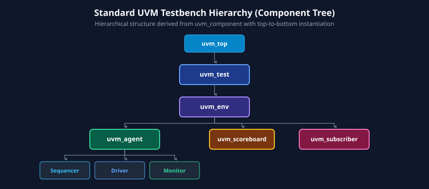
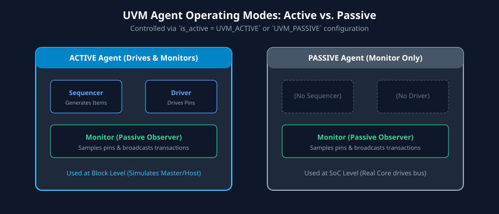

# Chapter 4: Introduction to Universal Verification Methodology (UVM)

The **Universal Verification Methodology (UVM)**, standardized under IEEE 1800.2, represents the pinnacle of verification methodology convergence. Prior to UVM, the semiconductor industry suffered from fragmented, proprietary frameworks (Synopsys VMM, Mentor AVM/OVM, Cadence eRM/URM), making Verification IP (VIP) sharing and engineer mobility exceedingly costly.

UVM provides a standardized, object-oriented SystemVerilog class library designed for **maximum reusability, structural modularity, and scalability**. This chapter introduces the UVM class hierarchy, the anatomy of UVM testbench components, the phased execution lifecycle, the configuration database (`uvm_config_db`), and step-by-step construction of an operational UVM testbench.

---

## Learning Goals

After completing this chapter, you should be able to:
- Explain why the semiconductor industry standardized on UVM and contrast `uvm_object` (transient data) with `uvm_component` (quasi-static infrastructure).
- Construct a standard UVM testbench hierarchy: `uvm_test`, `uvm_env`, `uvm_agent`, `uvm_sequencer`, `uvm_driver`, `uvm_monitor`, and `uvm_scoreboard`.
- Differentiate between **Active** and **Passive** UVM agents and configure their behavior dynamically.
- Map the execution flow of UVM Phasing (top-down construction in `build_phase`, bottom-up binding in `connect_phase`, time-consuming execution in `run_phase`, and status checking in cleanup phases).
- Utilize `uvm_config_db` to pass virtual interface handles and parameterize verification components without hardcoding.
- Author a complete, compiling basic UVM testbench harness.

---

## 1. Motivation for UVM: Industry Standardization and Reuse

Before UVM, verification teams built ad-hoc testbenches or vendor-locked frameworks. This led to:
- **Zero Interoperability:** A PCIe verification IP developed for Mentor tools could not be integrated into a Cadence or Synopsys testbench without extensive rewriting.
- **Lost Investment:** When migrating from block-level verification to SoC-level verification, testbenches were frequently scrapped and rebuilt from scratch.
- **Steep Learning Curve:** New hires spent months learning proprietary in-house scripting harnesses before becoming productive.

UVM solved these challenges through Accellera and IEEE standardization:
1. **Verification IP (VIP) Portability:** A commercial AMBA AXI4 VIP adheres to standard UVM interface ports, plugging seamlessly into any compliant environment.
2. **Horizontal & Vertical Reuse:** An agent developed to verify a SPI peripheral at the block level is reused directly at the subsystem and full-chip SoC level simply by toggling it from **Active** to **Passive** mode.
3. **Structured Execution:** A strictly enforced simulation lifecycle eliminates race conditions during testbench bring-up, configuration, and shutdown.

---

## 2. The UVM Class Library Architecture

Every class in UVM ultimately inherits from the root abstract class `uvm_void`. The library bifurcates into two fundamental branches:

```
                          uvm_void (Root Abstract Class)
                                     |
                               uvm_object
                       (Transient Data Containers)
                                     |
                 +-------------------+-------------------+
                 |                                       |
          uvm_sequence_item                        uvm_component
         (Transactions / Packets)            (Structural Infrastructure)
                 |                                       |
           uvm_sequence                     +------------+------------+
        (Stimulus Scenarios)                |            |            |
                                         uvm_driver   uvm_env      uvm_test
                                         uvm_monitor  uvm_agent    uvm_scoreboard
```

### `uvm_object` vs. `uvm_component`

| Dimension | `uvm_object` | `uvm_component` |
| :--- | :--- | :--- |
| **Lifecycle** | Transient, dynamic. Created and destroyed continuously during simulation. | Quasi-static. Created during `build_phase` at time zero; lives until end of test. |
| **Hierarchy** | No fixed position in the testbench hierarchy tree. | Fixed, parent-child hierarchical tree (`uvm_top.env.agent.driver`). |
| **Phasing** | Does not participate in UVM phases. | Driven strictly through UVM phases (`build_phase`, `connect_phase`, `run_phase`). |
| **Examples** | Transaction packets, configuration settings, sequences. | Drivers, monitors, sequencers, agents, scoreboards, environments, tests. |
| **Constructor** | `function new(string name = "uvm_object");` | `function new(string name, uvm_component parent);` |

---

## 3. The Standard UVM Testbench Hierarchy

A production UVM verification environment is structured as a hierarchical tree of modular components.



### Key Component Roles
1. **`uvm_test`:** The root container instantiated by `run_test()`. Selects and executes specific test scenarios, overrides configurations, and enforces testbench termination criteria.
2. **`uvm_env` (Environment):** The top-level verification container. Assembles one or more agents, scoreboards, coverage collectors, and register models into a cohesive verification system.
3. **`uvm_agent`:** An encapsulated subsystem responsible for verifying a single physical protocol interface. Contains a sequencer, driver, and monitor.
4. **`uvm_sequencer`:** An arbiter and buffer that funnels transaction items from software sequences to the hardware-driving transactor.
5. **`uvm_driver`:** Consumes abstract transaction items from the sequencer and drives cycle-accurate pin toggles onto the physical DUT interface via virtual interfaces.
6. **`uvm_monitor`:** A strictly passive observer that samples physical interface pins, reconstructs transaction items, and broadcasts them via TLM analysis ports.
7. **`uvm_scoreboard`:** Compares actual observed transactions against expected predictions from an internal golden reference model.
8. **`uvm_subscriber` (Coverage Collector):** Subscribes to monitor broadcasts to sample functional covergroups.

---

## 4. Active vs. Passive UVM Agents

The `uvm_agent` is the core building block of modular verification IP. It can be dynamically configured as **Active** or **Passive**.



### Operational Differences

```systemverilog
class apb_agent extends uvm_agent;
    `uvm_component_utils(apb_agent)

    // Configuration object determining operating mode
    apb_agent_config cfg;

    apb_sequencer    seqr;
    apb_driver       drv;
    apb_monitor      mon;

    function new(string name, uvm_component parent);
        super.new(name, parent);
    endfunction

    virtual function void build_phase(uvm_phase phase);
        super.build_phase(phase);
        // Always create monitor regardless of active/passive state
        mon = apb_monitor::type_id::create("mon", this);

        // Conditionally instantiate Driver and Sequencer
        if (cfg.is_active == UVM_ACTIVE) begin
            seqr = apb_sequencer::type_id::create("seqr", this);
            drv  = apb_driver::type_id::create("drv", this);
        end
    endfunction

    virtual function void connect_phase(uvm_phase phase);
        super.connect_phase(phase);
        if (cfg.is_active == UVM_ACTIVE) begin
            // Connect driver's seq_item_port to sequencer's seq_item_export
            drv.seq_item_port.connect(seqr.seq_item_export);
        end
    endfunction
endclass
```

- **Active Mode (`is_active = UVM_ACTIVE`):** Instantiates the Sequencer, Driver, and Monitor. Used at the block level where the testbench must emulate the upstream bus master.
- **Passive Mode (`is_active = UVM_PASSIVE`):** Instantiates **only the Monitor**. The Driver and Sequencer are disabled. Used at the SoC level where real CPU or DMA cores drive the bus, but passive transaction capture, checking, and coverage are still required.

---

## 5. UVM Phasing Architecture

To ensure predictable initialization, execution, and cleanup, UVM executes a strict sequence of standardized **Phases**.


### Execution Traversal: Functions vs. Tasks
- **Function Phases (Zero Simulation Time):** Execute instantaneously in delta time.
- **Task Phases (Time Consuming):** Run concurrently during simulation time (`run_phase`).

| Phase Group | Phase Name | Type | Direction | Primary Responsibility |
| :--- | :--- | :--- | :--- | :--- |
| **Build & Setup** | `build_phase` | `function` | **Top-Down** | Construct child components via factory (`create()`), read/write `uvm_config_db`. |
| | `connect_phase` | `function` | **Bottom-Up** | Connect TLM ports, exports, analysis ports, and bind virtual interfaces. |
| | `end_of_elaboration` | `function` | **Bottom-Up** | Final topology checks, display testbench hierarchy, set verbosity. |
| | `start_of_simulation`| `function` | **Bottom-Up** | Print test start banner, initialize lookup tables. |
| **Run-Time** | `run_phase` | `task` | **Parallel** | Main simulation activity. Sequence execution, stimulus driving. Consumes time. |
| **Cleanup & Signoff**| `extract_phase` | `function` | **Bottom-Up** | Extract coverage scores, drain remaining FIFOs. |
| | `check_phase` | `function` | **Bottom-Up** | Verify scoreboards are empty; flag un-matched transactions as errors. |
| | `report_phase` | `function` | **Bottom-Up** | Print simulation summary, total error count, test PASS/FAIL verdict. |
| | `final_phase` | `function` | **Top-Down** | Final resource deallocation, close file handles. |

---

## 6. The UVM Configuration Database (`uvm_config_db`)

The `uvm_config_db` is a type-safe, string-indexed hierarchical database used to configure testbench components without hardcoding variables or passing values through multiple constructor layers.

### Context, Hierarchy, and Wildcards
The static method signatures are:
```systemverilog
uvm_config_db#(TYPE)::set(uvm_component cntxt, string inst_name, string field_name, TYPE value);
uvm_config_db#(TYPE)::get(uvm_component cntxt, string inst_name, string field_name, output TYPE value);
```

- **`cntxt`:** Hierarchical starting point (typically `this` inside a component, or `null` for global top-level settings).
- **`inst_name`:** Hierarchical path to the destination component. Wildcards (`"*"`) are supported (e.g., `"*.agent*.drv"`).
- **`field_name`:** Identifier key string matching the variable name.
- **`value`:** The typed data payload (e.g., virtual interface handle, integer, configuration class object).

### Passing a Virtual Interface Example
```systemverilog
// In top-level testbench module (tb_top.sv):
module tb_top;
    logic clk, rst_n;
    bus_if dut_if(clk, rst_n); // Physical interface instance

    initial begin
        // Set physical interface handle into config_db globally
        uvm_config_db#(virtual bus_if)::set(null, "*", "vif", dut_if);
        run_test("my_basic_test"); // Start UVM simulation
    end
endmodule

// In driver component (my_driver.sv):
class my_driver extends uvm_driver #(bus_trans);
    `uvm_component_utils(my_driver)
    virtual bus_if vif;

    virtual function void build_phase(uvm_phase phase);
        super.build_phase(phase);
        // Retrieve virtual interface from config_db
        if (!uvm_config_db#(virtual bus_if)::get(this, "", "vif", vif)) begin
            `uvm_fatal("NO_VIF", {"Virtual interface must be set for: ", get_full_name(), ".vif"});
        end
    endfunction
endclass
```

---

## 7. Complete End-to-End Basic UVM Testbench

Below is an architectural template demonstrating how a complete, compiling UVM testbench connects together from top module to UVM test.

```systemverilog
`timescale 1ns/1ps
import uvm_pkg::*;
`include "uvm_macros.svh"

// 1. Transaction Definition
class simple_item extends uvm_sequence_item;
    `uvm_object_utils(simple_item)
    rand bit [7:0] data;

    function new(string name = "simple_item"); super.new(name); endfunction
endclass

// 2. Sequence
class simple_seq extends uvm_sequence #(simple_item);
    `uvm_object_utils(simple_seq)
    function new(string name = "simple_seq"); super.new(name); endfunction

    task body();
        simple_item req;
        repeat (5) begin
            req = simple_item::type_id::create("req");
            start_item(req);
            assert(req.randomize());
            finish_item(req);
            `uvm_info("SEQ", $sformatf("Generated transaction: data=0x%02h", req.data), UVM_LOW)
        end
    endtask
endclass

// 3. Driver
class simple_driver extends uvm_driver #(simple_item);
    `uvm_component_utils(simple_driver)
    function new(string name, uvm_component parent); super.new(name, parent); endfunction

    task run_phase(uvm_phase phase);
        simple_item req;
        forever begin
            seq_item_port.get_next_item(req);
            #10; // Emulate driving pin cycle
            `uvm_info("DRV", $sformatf("Drove transaction to DUT: data=0x%02h", req.data), UVM_LOW)
            seq_item_port.item_done();
        end
    endtask
endclass

// 4. Test
class simple_test extends uvm_test;
    `uvm_component_utils(simple_test)
    simple_driver drv;
    uvm_sequencer #(simple_item) seqr;

    function new(string name, uvm_component parent); super.new(name, parent); endfunction

    function void build_phase(uvm_phase phase);
        super.build_phase(phase);
        drv  = simple_driver::type_id::create("drv", this);
        seqr = uvm_sequencer#(simple_item)::type_id::create("seqr", this);
    endfunction

    function void connect_phase(uvm_phase phase);
        super.connect_phase(phase);
        drv.seq_item_port.connect(seqr.seq_item_export);
    endfunction

    task run_phase(uvm_phase phase);
        simple_seq seq = simple_seq::type_id::create("seq");
        phase.raise_objection(this, "Starting simple_seq");
        seq.start(seqr);
        #50;
        phase.drop_objection(this, "Finished simple_seq");
    endtask
endclass

// 5. Testbench Top
module tb_top;
    initial begin
        run_test("simple_test");
    end
endmodule
```

---

## 8. Learning Resources

- **Official Standards & User Guides:**
  - Accellera Systems Initiative: *UVM 1.2 User's Guide* and *UVM 1.2 Class Reference*.
  - IEEE Std 1800.2-2020 (Standard for Universal Verification Methodology Language Reference Manual).
- **Recommended Textbooks:**
  - *A Practical Guide to Adopting the Universal Verification Methodology (UVM)* by Sharon Rosenberg and Kathleen Meade.
  - *UVM Primer* by Ray Salemi.

---

## 9. Review Exercises

1. Why are `build_phase` methods executed in a top-down order, whereas `connect_phase` methods are executed in a bottom-up order?
2. In an SoC containing an integrated SPI controller and an on-chip CPU, how would you configure the UVM SPI Agent when testing the SPI block stand-alone versus testing the entire SoC?
3. What is the fundamental difference between `uvm_config_db::set` and `uvm_config_db::get`? What occurs if a component calls `get()` with an invalid field name?
4. Explain the function of `phase.raise_objection()` and `phase.drop_objection()` in the `run_phase`. What happens if a test never raises an objection?

##### Copyright (c) 2026 squared-studio
