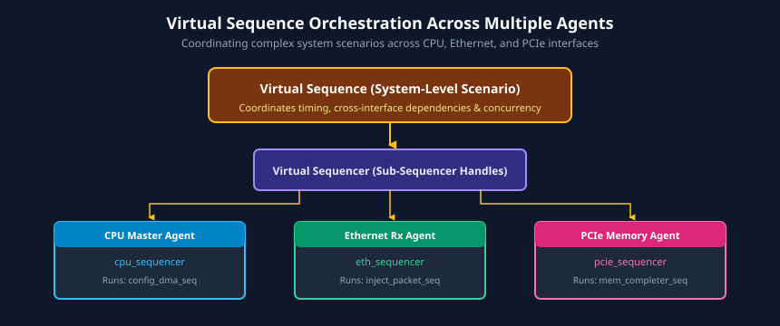
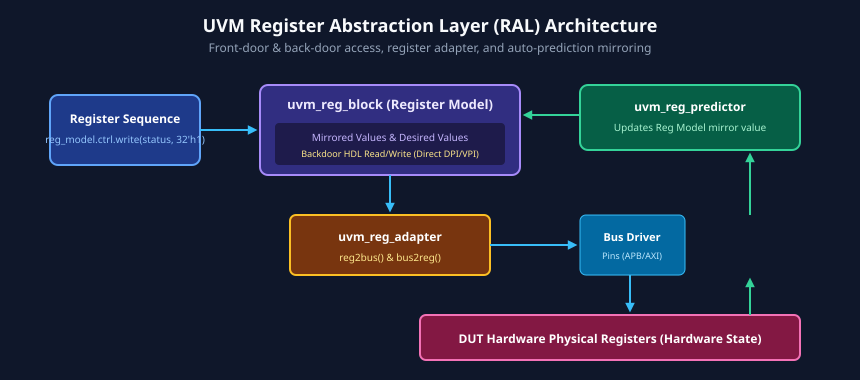
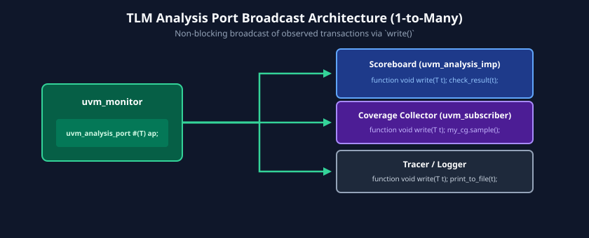

# Chapter 5: UVM Testbench Components and Advanced Features

Building on the architectural foundations of UVM, production verification environments require advanced mechanisms to manage complex, multi-interface System-on-Chips (SoCs). Verifying modern processors and accelerators demands sophisticated stimulus coordination, memory-mapped register modeling, dynamic component polymorphism, and standardized cross-component communication.

This chapter explores advanced UVM features: the sequence-driver handshake protocol, virtual sequence orchestration, the **Register Abstraction Layer (RAL)**, Transaction-Level Modeling (TLM) analysis broadcast ports, the **UVM Factory** override mechanism, callbacks, and the objection synchronization lifecycle.

---

## Learning Goals

After completing this chapter, you should be able to:
- Trace and implement the step-by-step handshake protocol between a `uvm_sequence`, `uvm_sequencer`, and `uvm_driver`.
- Architect **Virtual Sequences** and **Virtual Sequencers** to coordinate concurrent stimulus across multiple heterogeneous interface agents.
- Construct a UVM **Register Abstraction Layer (RAL)** model with custom bus adapters, frontdoor read/write operations, backdoor access, and automatic prediction.
- Implement **TLM Analysis Ports** (`uvm_analysis_port`) and subscribers for non-blocking transaction broadcasting to scoreboards and coverage collectors.
- Apply the **UVM Factory** pattern (`set_type_override_by_type`, `set_inst_override_by_type`) to dynamically replace verification components and sequences without modifying source code.
- Manage simulation run-time execution and shutdown using the UVM objection mechanism and drain times.

---

## 1. UVM Sequences and the Sequence-Driver Handshake

In UVM, stimulus generation is strictly decoupled from pin-level driving. A `uvm_sequence` executes algorithmic transaction generation in software, communicating with a `uvm_driver` through a synchronized, two-way handshake.


### Step-by-Step Handshake Execution Flow

```systemverilog
// 1. Inside the Sequence body() task:
task my_sequence::body();
    my_item req;
    repeat (10) begin
        req = my_item::type_id::create("req");

        // Step 1: Request sequencer bus grant
        start_item(req);

        // Step 2: Randomize transaction fields (late randomization)
        if (!req.randomize() with { addr inside {[32'h1000 : 32'h2000]}; }) begin
            `uvm_error("RAND_FAIL", "Randomization failed!")
        end

        // Step 3: Deliver transaction to Driver and block until completion
        finish_item(req);
    end
endtask

// 2. Inside the Driver run_phase() task:
task my_driver::run_phase(uvm_phase phase);
    my_item req;
    forever begin
        // Step 4: Driver retrieves granted item from sequencer queue
        seq_item_port.get_next_item(req);

        // Step 5: Drive physical pins via virtual interface
        vif.drive_transaction(req);

        // Step 6: Inform sequencer that physical transfer is complete
        seq_item_port.item_done();
    end
endtask
```

### Why Late Randomization Matters
Notice that `req.randomize()` is called **between `start_item()` and `finish_item()`**. This pattern is called **Late Randomization**. It guarantees that transaction variables are randomized only *after* the sequencer has granted bus access, allowing constraints to evaluate real-time DUT state flags (e.g., buffer almost-full signals) right before pin assertion.

---

## 2. Virtual Sequences: Orchestrating Multi-Agent Scenarios

At the subsystem and SoC level, a testbench contains multiple independent interface agents (e.g., PCIe Ingress Agent, Ethernet Rx Agent, DDR Controller Agent, and Interrupt Monitor). Coordinating concurrent transactions across these agents cannot be accomplished with a single agent sequence.

The solution is the **Virtual Sequence**.



### Virtual Sequence Architecture
- **Virtual Sequencer:** A component derived from `uvm_sequencer` that does not drive physical pins. Instead, it holds handle references to the sub-sequencers of all physical agents in the environment.
- **Virtual Sequence:** Executes on the virtual sequencer, starting sub-sequences concurrently or sequentially across multiple agents using SystemVerilog `fork ... join` blocks.

```systemverilog
class system_dma_vseq extends uvm_sequence;
    `uvm_object_utils(system_dma_vseq)
    `uvm_declare_p_sequencer(system_virtual_sequencer)

    task body();
        cpu_config_seq cpu_seq;
        eth_packet_seq eth_seq;
        mem_check_seq  mem_seq;

        `uvm_info("VSEQ", "Initiating coordinated multi-agent scenario", UVM_LOW)

        // Step 1: CPU configures DMA controller via APB
        cpu_seq = cpu_config_seq::type_id::create("cpu_seq");
        cpu_seq.start(p_sequencer.cpu_seqr);

        // Step 2: Inject Ethernet packets while validating Memory buffer
        fork
            begin
                eth_seq = eth_packet_seq::type_id::create("eth_seq");
                eth_seq.start(p_sequencer.eth_seqr);
            end
            begin
                mem_seq = mem_check_seq::type_id::create("mem_seq");
                mem_seq.start(p_sequencer.mem_seqr);
            end
        join

        `uvm_info("VSEQ", "Multi-agent scenario completed successfully", UVM_LOW)
    endtask
endclass
```

---

## 3. The UVM Register Abstraction Layer (RAL)

Virtually every modern digital IP contains dozens or hundreds of memory-mapped Control and Status Registers (CSRs). Verifying registers manually by tracking absolute addresses in hexadecimal is error-prone.

The **UVM Register Abstraction Layer (RAL)** provides an object-oriented high-level model of the DUT register map.



### Key RAL Classes
- **`uvm_reg_field`:** Represents an individual bit-slice inside a register (e.g., `enable` bit [0], `baud_rate` bits [15:4]). Tracks access policies (`RW`, `RO`, `W1C`, `WO`).
- **`uvm_reg`:** Represents a complete register containing one or more fields. Tracks current **Desired Value** and **Mirrored Value**.
- **`uvm_reg_block`:** Hierarchical container representing a complete peripheral register bank or entire chip register map.
- **`uvm_reg_adapter`:** Translates abstract register operations (`read()`, `write()`) into bus transaction objects (`bus_trans`) and vice versa.
- **`uvm_reg_predictor`:** Observes bus transactions from the bus monitor and updates the register model's mirrored value automatically (**Auto-Prediction**).

### Frontdoor vs. Backdoor Access
- **Frontdoor Access (`UVM_FRONTDOOR`):** Reads or writes the register by physically driving bus cycles through the driver and virtual interface (consumes simulation time).
- **Backdoor Access (`UVM_BACKDOOR`):** Reads or writes internal design flip-flops directly using SystemVerilog DPI/VPI hierarchical simulator handles (zero simulation time).

```systemverilog
// Example of writing and reading registers using RAL:
task verify_control_reg(my_reg_block regmodel);
    uvm_status_e status;
    uvm_reg_data_t read_val;

    // Frontdoor write: generates real APB/AXI bus cycles
    regmodel.ctrl_reg.write(status, 32'h0000_0001, UVM_FRONTDOOR);
    
    // Frontdoor read: reads physical register value
    regmodel.ctrl_reg.read(status, read_val, UVM_FRONTDOOR);
    
    // Check mirror consistency: compares hardware state to software model
    if (read_val !== regmodel.ctrl_reg.get_mirrored_value()) begin
        `uvm_error("RAL_MISMATCH", "Hardware value does not match mirrored value!")
    end
endtask
```

---

## 4. TLM Analysis Ports and Non-Blocking Broadcasts

While drivers and sequencers use point-to-point, blocking TLM ports to transfer transactions, monitors require a **one-to-many broadcast mechanism** to send observed transactions to scoreboards, functional coverage collectors, and protocol loggers simultaneously without backpressure.



### Implementation Mechanics
- **Publisher (Monitor):** Declares `uvm_analysis_port #(T) ap;` and broadcasts transactions via `ap.write(trans);`. The `write()` method is a `void function` that executes instantaneously in zero simulation time.
- **Subscribers (Scoreboard / Coverage Collector):** Implement `uvm_analysis_imp #(T, SubscriberClass)` and define the `write(T t)` method to receive and process the transaction.

```systemverilog
// 1. Inside Monitor:
class apb_monitor extends uvm_monitor;
    `uvm_component_utils(apb_monitor)
    uvm_analysis_port #(apb_trans) item_collected_port;

    function void build_phase(uvm_phase phase);
        super.build_phase(phase);
        item_collected_port = new("item_collected_port", this);
    endfunction

    task run_phase(uvm_phase phase);
        apb_trans tx;
        forever begin
            sample_bus(tx);
            // Non-blocking broadcast to all connected subscribers
            item_collected_port.write(tx);
        end
    endtask
endclass

// 2. Inside Scoreboard:
class apb_scoreboard extends uvm_scoreboard;
    `uvm_component_utils(apb_scoreboard)
    `uvm_analysis_imp_decl(_apb) // Declares distinct write implementation
    uvm_analysis_imp_apb #(apb_trans, apb_scoreboard) apb_export;

    virtual function void write_apb(apb_trans tx);
        // Process received transaction immediately
        check_transaction(tx);
    endfunction
endclass
```

---

## 5. The UVM Factory Mechanism: Dynamic Overrides

The **UVM Factory** is an implementation of the classic Software Design Pattern that enables dynamically substituting one class with another derived class **without altering existing code or module instantiations**.

### Factory Registration
All UVM classes must register with the factory using macros:
- Objects: `` `uvm_object_utils(class_name) ``
- Components: `` `uvm_component_utils(class_name) ``

### Factory Creation Rule
Never instantiate UVM classes using direct `new()`. Always invoke the factory's `create()` method:
`comp = comp_type::type_id::create("comp_name", this);`

### Factory Overrides: Type vs. Instance
1. **Type Override (`set_type_override_by_type`):** Replaces **every** instance of a base type throughout the entire testbench hierarchy with a derived replacement.
2. **Instance Override (`set_inst_override_by_type`):** Replaces a **specific** instance located at a targeted hierarchical path (e.g., only replace `env.agent[0].driver` with `error_injecting_driver`).

```systemverilog
class err_inject_test extends uvm_test;
    `uvm_component_utils(err_inject_test)

    function void build_phase(uvm_phase phase);
        // Globally replace base driver with error-injecting derived driver
        base_driver::type_id::set_type_override(error_driver::get_type());

        // Target a specific sequence override
        set_inst_override_by_type("env.agent[1].seqr.*", 
                                  normal_seq::get_type(), 
                                  stress_seq::get_type());

        super.build_phase(phase); // Factory overrides applied as tree builds!
    endfunction
endclass
```

---

## 6. UVM Messaging and Reporting Infrastructure

UVM provides a centralized, severity-classified reporting mechanism through four standard macros:

```systemverilog
`uvm_info(ID, MESSAGE, VERBOSITY)
`uvm_warning(ID, MESSAGE)
`uvm_error(ID, MESSAGE)
`uvm_fatal(ID, MESSAGE) // Immediately halts simulation!
```

### Verbosity Thresholds
Messages are filtered based on the active simulation verbosity setting:
$$\text{Display Condition: } \text{Message Verbosity} \le \text{Active Simulation Verbosity}$$

- `UVM_NONE`: Critical messages that cannot be disabled.
- `UVM_LOW`: High-level test milestones, test start/completion banners.
- `UVM_MEDIUM`: Transaction-level progress reports.
- `UVM_HIGH`: Component-level state changes.
- `UVM_FULL`: Pin-level signal changes and detailed algorithmic steps.
- `UVM_DEBUG`: Diagnostic traces used exclusively for testbench debugging.

Simulation verbosity can be adjusted from the command line without recompilation:
`+UVM_VERBOSITY=UVM_HIGH` or `+uvm_set_verbosity=uvm_test_top.env.agent0.drv,UVM_DEBUG,run`

---

## 7. The UVM Objection Mechanism and Drain Time

The UVM `run_phase` is governed by the **Objection Mechanism**. The simulator stays in `run_phase` as long as at least one component holds an active objection.

```systemverilog
task my_test::run_phase(uvm_phase phase);
    // 1. Raise objection to keep simulation alive
    phase.raise_objection(this, "Starting main test sequence");

    // Set drain time: keeps simulation running for 100ns AFTER objection drops
    phase.phase_done.set_drain_time(this, 100ns);

    // Run sequences
    my_seq.start(env.agent.seqr);

    // 2. Drop objection when test stimulus completes
    phase.drop_objection(this, "Main test sequence finished");
endtask
```

### Drain Time
Dropping an objection does not mean the design has finished processing. Data packets injected into the DUT may take tens of cycles to traverse internal processing pipelines before exiting at output pins. 

Setting a **Drain Time** (`set_drain_time()`) ensures that the `run_phase` lingers for a defined duration after the last objection is dropped, allowing downstream monitors and scoreboards to capture and verify trailing transactions.

---

## 8. Learning Resources

- **Books:**
  - *UVM Primer* by Ray Salemi (Chapters 14-22: Sequences, Factory, and Objections).
  - *A Practical Guide to Adopting UVM* by Sharon Rosenberg & Kathleen Meade.
- **Reference Documentation:**
  - IEEE Std 1800.2-2020 UVM LRM (Clause 8: Factory, Clause 13: Sequences, Clause 18: Register Abstraction Layer).
  - Accellera Systems Initiative: *UVM RAL User Guide and Reference*.

---

## 9. Review Exercises

1. Why must transaction randomization occur inside the `start_item()` / `finish_item()` block rather than prior to calling `start_item()`?
2. What is the fundamental difference between an instance override and a type override in the UVM factory? Give a practical verification use case for each.
3. How does a UVM Register Model maintain synchronization with physical hardware when the DUT registers are updated autonomously by hardware interrupt flags?
4. What is the purpose of setting a drain time on a UVM phase objection, and what risk arises if drain time is omitted in a design with multi-cycle pipeline latency?

##### Copyright (c) 2026 squared-studio
