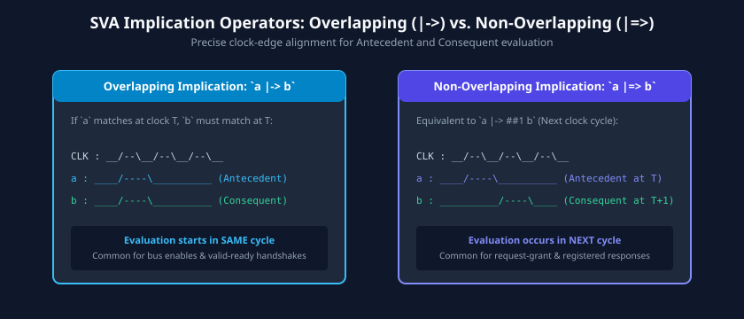

# Assertion-Based Verification (ABV) with SystemVerilog Assertions (SVA)

Traditional simulation checking relies on scoreboards and monitors that compare DUT outputs long after an internal fault occurs. If an arithmetic overflow or state machine glitch corrupts an internal pipeline stage at Cycle 100, the error might not propagate to an external output pin until Cycle 150. By then, determining which internal gate malfunctioned requires tracing through thousands of waveform signals.

**Assertion-Based Verification (ABV)** revolutionizes hardware debugging by embedding formal executable checks directly inside the design and testbench interfaces. When a property is violated, SystemVerilog Assertions (SVA) flag the defect with **zero cycle latency at the exact point of failure**.

This chapter explores immediate versus concurrent assertions, the SVA temporal language, sequence repetition operators, implication semantics, system functions, assertion binding, and formal property proof workflows.

---

## Learning Goals

After completing this chapter, you should be able to:
- Contrast the execution semantics and simulation regions of Immediate Assertions with Concurrent Assertions.
- Construct complex multi-cycle temporal sequences using delay (`##n`), consecutive repetition (`[*n]`), goto repetition (`[->n]`), and non-consecutive repetition (`[=n]`).
- Differentiate between Overlapping (`|->`) and Non-Overlapping (`|=>`) implication operators.
- Utilize SVA system functions (`$rose`, `$fell`, `$stable`, `$past`, `$onehot`, `$isunknown`) to express protocol rules.
- Deploy SVA directives: `assert property` (check design), `assume property` (constrain inputs), and `cover property` (measure reachability).
- Bind assertions non-intrusively into third-party legacy RTL using the SystemVerilog `bind` construct.

---

## Immediate vs. Concurrent Assertions

SystemVerilog provides two fundamentally distinct categories of assertions to balance procedural programming with temporal hardware property checking.


### Comparative Breakdown

| Attribute | Immediate Assertions | Concurrent Assertions (SVA) |
| :--- | :--- | :--- |
| **Execution Trigger** | Procedural flow inside `always` or `initial` blocks. | Clock edge events (`@(posedge clk)`). |
| **Temporal Horizon** | Zero-time; evaluates single-cycle expressions instantaneous with simulation code. | Multi-cycle temporal relationships spanning tens or hundreds of clock cycles. |
| **Sampling Region** | Active region (can experience delta-cycle glitches during combinational evaluation). | **Preponed region** (values sampled immediately before the clock edge; zero race!). |
| **Formal Tool Synthesis** | Typically ignored or restricted in formal tools. | Primary input to formal property checkers and model checkers. |
| **Syntax** | `assert (a == b) else $error(...);` | `assert property (@(posedge clk) a |=> b);` |

---

## SystemVerilog Assertions (SVA) Temporal Syntax

Concurrent assertions are built hierarchically:
$$\text{Boolean Expressions} \longrightarrow \text{Sequences} \longrightarrow \text{Properties} \longrightarrow \text{Directives}$$

### Delay Operators (`##`)
- **Fixed Delay (`##n`):** The subsequent condition must hold exactly $n$ clocks later.
  `req ##2 gnt` (If `req` is true at $T$, `gnt` must be true at $T+2$).
- **Range Delay (`##[min:max]`):** The condition must match at least once between `min` and `max` clock cycles.
  `req ##[1:4] ack` (`ack` must arrive between 1 and 4 cycles after `req`).
- **Unbounded Delay (`##[1:$]`):** The event must eventually happen at some point in the future.

### Repetition Operators
- **Consecutive Repetition (`expr [*n]`):** Expression must hold continuously for $n$ consecutive clocks.
  `frame_valid [*4]` (Valid must stay asserted for exactly 4 consecutive cycles).
- **Goto Repetition (`expr [->n]`):** Expression must match $n$ times non-consecutively, and the sequence ends on the exact cycle of the $n$-th match.
- **Non-Consecutive Repetition (`expr [=n]`):** Expression matches $n$ times non-consecutively, and may remain true for subsequent cycles until the next sequence element starts.

```systemverilog
// Sequence demonstrating repetition:
// Request is pulsed, followed by 3 consecutive busy cycles, terminating in ready
sequence req_busy_done_s;
    req ##1 (busy [*3]) ##1 ready;
endsequence
```

---

## Implication Operators: Overlapping (`|->`) vs. Non-Overlapping (`|=>`)

Properties use implication operators to establish cause-and-effect relationships:
$$\text{Antecedent (Trigger)} \implies \text{Consequent (Requirement)}$$

If the **Antecedent** does not match, the property is **vacuously true** (passes without test). If the antecedent matches, the **Consequent** must match; if it fails, a violation error is reported.



### Operator Timing Mechanics
1. **Overlapping Implication (`|->`):**
   - The consequent begins evaluation in the **exact same clock cycle** that the antecedent completes.
   - Example: `valid |-> ready;` (If valid is high at clock $T$, ready must also be high at clock $T$).
2. **Non-Overlapping Implication (`|=>`):**
   - Equivalent to `|-> ##1`. The consequent begins evaluation on the **subsequent clock cycle** ($T+1$).
   - Example: `req |=> gnt;` (If request matches at $T$, grant must be asserted at $T+1$).

```systemverilog
property p_axi_wdata_stable;
    @(posedge clk) disable iff (!rst_n)
    // When WVALID is asserted and WREADY is low, WDATA must remain static
    (wvalid && !wready) |=> $stable(wdata);
endproperty
assert property (p_axi_wdata_stable) else
    $error("[SVA_ERR] AXI Protocol Violation: WDATA changed while stalled!");
```

---

## Built-In SVA System Functions

SVA provides specialized system functions to inspect past cycles, detect signal transitions, and check bus encoding:

| SVA Function | Operational Meaning | Hardware Use Case |
| :--- | :--- | :--- |
| **`$rose(sig)`** | Evaluates true if `sig` changed from `0 -> 1` on the current clock edge. | Detecting start-of-frame strobes and enable edges. |
| **`$fell(sig)`** | Evaluates true if `sig` changed from `1 -> 0` on the current clock edge. | Detecting deassertion of interrupt or busy flags. |
| **`$stable(sig)`** | Evaluates true if `sig` has not changed value since the prior clock edge. | Verifying bus hold rules during wait states. |
| **`$past(sig, n)`** | Returns the value of `sig` exactly $n$ clock cycles in the past. | Comparing register output against past input values. |
| **`$onehot(bus)`** | Returns true if **strictly one bit** of `bus` is logic 1 (all others 0). | Verifying one-hot FSM states and grant arbiters. |
| **`$onehot0(bus)`** | Returns true if **at most one bit** is logic 1 (all 0s or one-hot). | Verifying priority encoders and optional select lines. |
| **`$isunknown(sig)`**| Returns true if any bit of `sig` is `X` or `Z`. | Trapping uninitialized register reads on reset exit. |

```systemverilog
// Protocol Check: Arbiter Grant must always be strictly one-hot
property p_arbiter_onehot;
    @(posedge clk) disable iff (!rst_n)
    $onehot(grant[3:0]);
endproperty
assert property (p_arbiter_onehot) else
    $error("[SVA_ERR] Arbiter granted multiple masters simultaneously!");
```

---

## Non-Intrusive Assertion Integration: The `bind` Construct

Embedding assertions directly into synthesizable RTL can clutter clean production code or violate intellectual property rules when using third-party encrypted cores.

The SystemVerilog **`bind`** keyword allows engineers to instantiate an assertion module or interface inside an existing RTL module **non-intrusively from a separate testbench file**:

```systemverilog
// 1. Standalone verification module containing SVA checks
module fifo_sva_bind #(parameter int DEPTH = 16) (
    input logic clk,
    input logic rst_n,
    input logic wr_en,
    input logic rd_en,
    input logic full,
    input logic empty
);
    // SVA: Prevent write when full
    property p_no_overflow;
        @(posedge clk) disable iff (!rst_n)
        full && wr_en |-> ##1 full; // Must reject overflow
    endproperty
    assert property (p_no_overflow) else
        $error("[FIFO_SVA] Overflow attempt! Write strobe asserted while FULL.");
endmodule

// 2. In a top-level verification package or testbench:
// Binds the assertion checker to EVERY instance of module 'sync_fifo'
bind sync_fifo fifo_sva_bind #(.DEPTH(DEPTH)) u_fifo_assert (
    .clk   (clk),
    .rst_n (rst_n),
    .wr_en (wr_en),
    .rd_en (rd_en),
    .full  (full),
    .empty (empty)
);
```

---

## The ABV Verification Workflow: Dual-Engine Verification

A major advantage of SVA is that the exact same properties serve two distinct verification engines without modification: **Dynamic Simulation** and **Formal Property Verification (FPV)**.


### Dual-Engine Synergy
1. **In Dynamic Simulation:**
   - SVA properties act as passive watchers, checking valid transactions during test executions.
   - **Assertion Coverage** tracks how many times each property antecedent was triggered, identifying unexercised assertions.
2. **In Formal Verification (Model Checking):**
   - The formal tool (e.g., Cadence JasperGold, Synopsys VC Formal, Siemens Questa Formal) accepts the RTL design and the SVA properties.
   - It mathematically searches **all possible reachable states** for all input sequences to either:
     - **PROVE** that the property can never be violated under any circumstance.
     - Generate a **Counterexample Waveform** displaying the exact cycle sequence that breaks the property.

---

## Learning Resources

- **Books:**
  - *SystemVerilog Assertions Handbook* by Ben Cohen, Srinivasan Venkataramanan, and Ajeetha Kumari.
  - *Applied Formal Verification* by Douglas L. Perry and Harry D. Foster (McGraw-Hill).
- **Standards:**
  - IEEE Std 1800-2023 SystemVerilog LRM (Clause 16: Assertions).

---

## Review Exercises

1. Explain the difference between `req |-> ##2 gnt` and `req |=> ##1 gnt`. In which cycle relative to `req` is `gnt` evaluated in each case?
2. Write a concurrent SVA property that verifies an active-LOW asynchronous reset: whenever `rst_n` falls LOW, the `state` register must equal `IDLE` on the following rising edge of `clk`.
3. What is a "vacuous success" in SystemVerilog concurrent assertions? Why is vacuous success dangerous if not tracked by coverage metrics?
4. Using the `$past` system function, write an assertion checking that a 4-bit synchronous up-counter increments by 1 on every clock cycle when `count_en` is asserted, unless `count == 15` where it rolls over to 0.

##### Copyright (c) 2026 squared-studio
