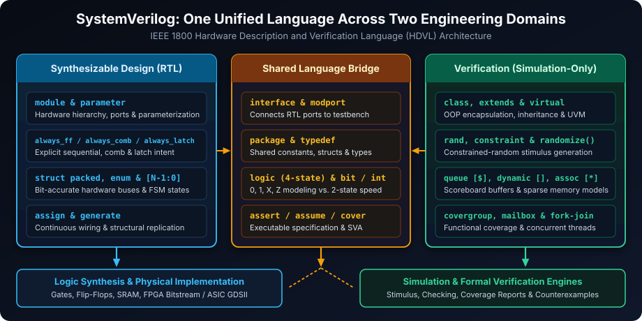
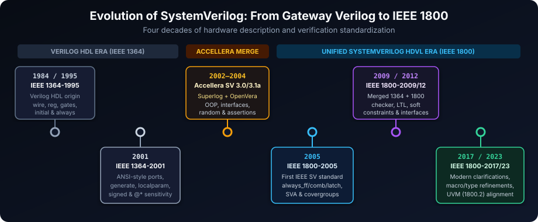
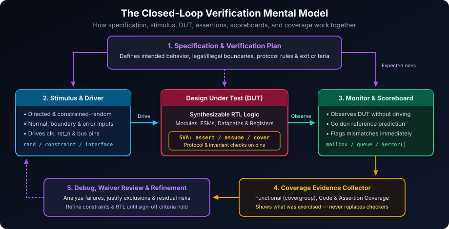
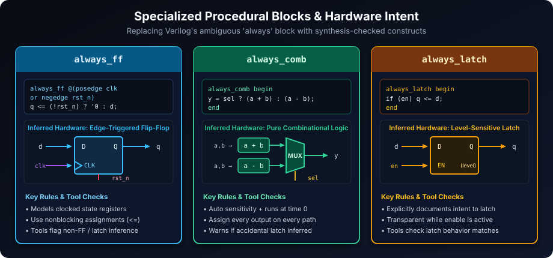
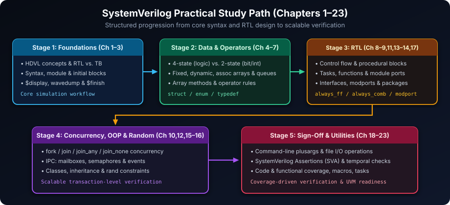

# SystemVerilog Foundations: A Practical Introduction

## Learning Goals

After completing this chapter, you should be able to:

- Explain the difference between an HDL, an HVL, RTL, and a testbench.
- Describe where SystemVerilog fits in a modern design and verification flow.
- Identify which language features are commonly synthesizable and which are normally simulation-only.
- Recognize the purpose of data types, specialized procedural blocks, interfaces, assertions, coverage, randomization, and classes.
- Choose an appropriate verification technique for a given question and understand why no single metric proves that a design is correct.

This chapter is an orientation and vocabulary guide. The later chapters develop the syntax and techniques introduced here in detail.

---

## Demystifying SystemVerilog

SystemVerilog is a standardized **Hardware Description and Verification Language (HDVL)** that significantly expands Verilog HDL. It can describe hardware structure and behavior, and it can also express verification environments, stimulus, checks, assertions, and coverage. It is used for **Integrated Circuits (ICs)**, **Field-Programmable Gate Arrays (FPGAs)**, and Systems-on-Chip (SoCs).



An important distinction is that SystemVerilog is one language with two common usage domains:

- **Design (usually synthesizable RTL):** code that a synthesis tool can translate into gates, flip-flops, memories, and wiring.
- **Verification (usually simulation-only):** code such as classes, constrained randomization, mailboxes, and coverage that models stimulus and checking rather than physical hardware.

The language does not make a design correct automatically. It provides precise ways to state intent, model behavior, generate stimulus, check results, and measure progress. Tool support and synthesizability also depend on the selected construct, coding style, and vendor flow, so the target simulator and synthesis tool must always be checked.

### Four-State vs. Two-State Logic Values

To model physical hardware hazards (such as uninitialized flip-flops or tri-state bus contention) alongside fast software-style verification models, SystemVerilog supports both **4-state** types (such as `logic`) and **2-state** types (such as `bit` and `int`):

| Value | Meaning in Hardware / Simulation | Supported in `logic` (4-State)? | Supported in `bit` / `int` (2-State)? |
| :---: | :--- | :---: | :---: |
| **`0`** | Logic low / False | Yes | Yes |
| **`1`** | Logic high / True | Yes | Yes |
| **`X`** | Unknown / Uninitialized / Multi-driver contention | Yes | No (defaults to `0`) |
| **`Z`** | High-impedance / Undriven tri-state net | Yes | No (defaults to `0`) |

> [!TIP]
> **Why `logic` matters in RTL:** Because `logic` preserves `X` and `Z`, simulation immediately exposes missing resets and bus conflicts instead of silently masking them as `0`.

### A First Synthesizable RTL Example

For example, a small piece of synthesizable sequential RTL can express both the intended hardware and its timing discipline:

```systemverilog
module counter #(
    parameter int unsigned WIDTH = 8
) (
    input  logic             clk,
    input  logic             rst_n,
    output logic [WIDTH-1:0] count
);
    always_ff @(posedge clk or negedge rst_n) begin
        if (!rst_n)
            count <= '0;
        else
            count <= count + 1'b1;
    end
endmodule
```

The `always_ff` block communicates sequential intent; the nonblocking assignment (`<=`) models the update of a flip-flop at the clock edge. A testbench can then drive `clk` and `rst_n`, observe `count`, and check the expected sequence without being synthesized into the counter itself.

---

## A Brief History of SystemVerilog

SystemVerilog's origin is rooted in the growing demands of the semiconductor industry for a more powerful and versatile language. As digital designs became increasingly complex, the limitations of traditional Verilog became apparent, particularly in verification. SystemVerilog emerged as an evolutionary step, incorporating advanced features from Superlog, OpenVera, and assertion languages (Sugar/OVA) to address these challenges.



Initially developed through the **Accellera Systems Initiative**, SystemVerilog was donated to the **IEEE** and standardized as **IEEE 1800-2005**. Later revisions included **IEEE 1800-2009**, **IEEE 1800-2012**, and **IEEE 1800-2017**. These revisions refined the language and its verification features. **IEEE 1800-2023** is a later revision, but projects and tools may support different subsets and revisions; always consult the version supported by the tool flow. The IEEE website is the authoritative source for the standard.

| Standard Revision | Year | Key Milestones &amp; Technical Additions |
| :--- | :---: | :--- |
| **IEEE 1364-1995** | 1995 | First IEEE Verilog HDL standard (`wire`, `reg`, gate primitives, `always`, `initial`) |
| **IEEE 1364-2001** | 2001 | ANSI-style port declarations, `generate` blocks, `localparam`, signed math, `@*` sensitivity |
| **Accellera SV 3.0–3.1a** | 2002–2004 | Pre-IEEE donation merging RTL enhancements, OOP classes, constraints, and assertions |
| **IEEE 1800-2005** | 2005 | First IEEE SystemVerilog standard (`logic`, `always_ff`/`always_comb`, `interface`, SVA, `covergroup`) |
| **IEEE 1800-2009** | 2009 | Merged IEEE 1364 Verilog and IEEE 1800 into one document; added `checker` and LTL operators |
| **IEEE 1800-2012** | 2012 | Added `soft` constraints, `unique` constraints, interface classes (`implements`), and assertion enhancements |
| **IEEE 1800-2017** | 2017 | Maintenance release clarifying scheduling semantics, randomization, and tool interoperability |
| **IEEE 1800-2023** | 2023 | Latest revision refining language rules, macro/type semantics, and alignment with IEEE 1800.2 (UVM) |

---

## Why Use SystemVerilog? Key Applications

SystemVerilog's versatility makes it indispensable across various facets of digital design and verification:

- **Comprehensive Design Specification**: SystemVerilog empowers designers to articulate the architecture and behavior of digital systems with precision. It supports multiple levels of abstraction, from conceptual and transaction-level models to Register Transfer Level (RTL) descriptions used for synthesis and gate-level representations used for implementation and timing analysis. A particular construct is not necessarily synthesizable merely because it is written in SystemVerilog.
- **Advanced Simulation**: Simulation is crucial for verifying the correctness of digital designs. SystemVerilog enables engineers to model behavior under different conditions, identify design flaws early, and check functionality before costly hardware production. This includes event-driven, cycle-aware simulation and transaction-level modeling (TLM) for higher-level system validation. Simulation explores the scenarios supplied by the testbench; it does not exhaustively prove all possible behavior.
- **Formal Verification**: Beyond simulation, SystemVerilog properties and assertions can be used by formal tools to mathematically analyze whether specified behaviors hold. Formal verification is exhaustive over the tool's model and assumptions for the properties being checked; it is not a blanket proof that every aspect of a design is correct.
- **Robust Testbench Development**: SystemVerilog is exceptionally well-suited for creating sophisticated and efficient testbenches. It provides the necessary constructs for:
  - **Stimulus Generation**: Creating complex input patterns, including constrained-random stimulus to thoroughly explore the design's functionality.
  - **Response Checking**: Implementing mechanisms to automatically verify the design's outputs against expected behavior.
  - **Coverage Analysis**: Measuring the effectiveness of verification efforts by tracking which implementation elements and specified behaviors have been exercised.

### A Useful Mental Model

The **design under test (DUT)** is the hardware being evaluated. The **testbench** supplies inputs, observes outputs, predicts expected results, and records evidence.



A complete verification argument normally combines:

1. A specification that defines intended behavior.
2. Stimulus that explores normal, boundary, illegal, and error scenarios.
3. Checkers, scoreboards, and assertions that detect incorrect behavior.
4. Coverage that shows which scenarios and implementation paths were exercised.
5. Debug and review of failures, exclusions, assumptions, and remaining risks.

Coverage is evidence of what was observed, not a substitute for a correct specification or a checker that can detect the bug.

---

## The Winning Advantages of SystemVerilog

Choosing SystemVerilog brings numerous benefits to digital design and verification projects:

- **The Power of a Unified Language**: SystemVerilog combines design and verification constructs in one language. This can streamline workflows and improve communication between design and verification teams, although separate simulators, synthesis tools, formal tools, and methodology libraries may still be used.
- **Cutting-Edge Verification Features**: SystemVerilog is packed with built-in verification features that significantly enhance productivity and effectiveness:
  - **Constrained Random Stimulus Generation**: Automates the creation of varied and targeted test inputs, maximizing test coverage.
  - **Functional Coverage**: Provides metrics to quantify how thoroughly the design's intended functionality has been verified.
  - **Assertions**: Enables the embedding of design intent directly into the code, facilitating early error detection and formal verification.
  - **Object-Oriented Programming (OOP)**: Supports OOP principles, allowing for the creation of modular, reusable, and maintainable verification environments, which are essential for managing the complexity of large verification projects.
- **Integration with Verilog**: SystemVerilog was designed to support Verilog source and common Verilog coding styles, allowing teams to adopt features incrementally and reuse legacy code. "Backward compatible" does not mean every old file behaves identically in every tool: compilation mode, language version, scheduling semantics, and stricter SystemVerilog rules can matter. Mixed-language builds should therefore be compiled and tested explicitly.
- **Industry-Standard Reliability**: As an IEEE standard, SystemVerilog benefits from broad industry acceptance and support. This standardization ensures:
  - **Consistency**: A published language definition gives tools and teams a common reference, although tool support and corner-case interpretation can still vary.
  - **Interoperability**: Compatibility and seamless integration with a wide range of EDA (Electronic Design Automation) tools from various vendors.
  - **Widespread Support**: A large community and many resources, including libraries, training, and tool support, make it easier to learn and implement.
- **Scalability for Any Project**: Whether you're working on a small IP block or a massive SoC, SystemVerilog scales effectively. Its features and methodologies are designed to handle the increasing complexity of digital designs, ensuring efficient verification and design management regardless of project size.

### Legacy Verilog (IEEE 1364) vs. SystemVerilog (IEEE 1800)

| Capability | Legacy Verilog (IEEE 1364) | SystemVerilog (IEEE 1800) |
| :--- | :--- | :--- |
| **Signal &amp; Data Types** | `wire`, `reg`, `integer`; confusion between storage and wiring | `logic`, `bit`, `int`, `enum`, `struct`, `union`, `typedef` |
| **Procedural Intent** | Single overloaded `always` block | Explicit `always_ff`, `always_comb`, `always_latch` |
| **Inter-Module Wiring** | Long, error-prone port-by-port signal lists | Bundled `interface` with directional `modport` views |
| **Dynamic Collections** | Fixed-size arrays only | Dynamic arrays (`[]`), associative arrays (`[*]`), queues (`[$]`) |
| **Testbench Architecture** | Procedural modules and tasks; limited reuse | Full OOP (`class`, inheritance, polymorphism) &amp; UVM |
| **Stimulus Generation** | Manual directed tests and `$urandom` | Built-in `rand` / `randc`, `constraint` solver |
| **Assertions &amp; Coverage** | Ad-hoc `if` checks and code coverage only | Native SVA (`assert`/`assume`/`cover`) and `covergroup` |

---

## Core Features That Set SystemVerilog Apart

SystemVerilog's richness lies in its extensive set of features, making it a powerful and adaptable language:

- **Rich and Flexible Data Types**: SystemVerilog expands upon Verilog's data types, offering a comprehensive set of built-in and user-defined types. These include:
  - **Enhanced Built-in Types**: `logic` represents a four-state variable that is commonly used for signals, while dynamic arrays provide flexible storage in testbenches. `logic` does not by itself guarantee single-driver behavior or synthesizability.
  - **User-Defined Types**: Structures, unions, and enumerated types for creating custom data representations that accurately model hardware components.
- **Advanced Control Flow for Expressiveness**: SystemVerilog enhances code clarity and conciseness with improved control flow constructs:
  - `unique` and `priority` keywords for case statements, ensuring design intent is accurately captured and avoiding unintended behavior.
  - `foreach` loops for efficient iteration over arrays, simplifying data processing and manipulation.
- **Specialized Procedural Blocks**: SystemVerilog introduces specialized procedural blocks that clearly delineate design intent:
  - `always_comb`: Specifically for combinational logic, ensuring correct synthesis and simulation behavior.
  - `always_ff`: For sequential logic (flip-flops), simplifying the modeling of clocked elements.
  - `always_latch`: For level-sensitive latches. Latches are valid hardware when intentionally designed, but accidental latch inference is usually a bug; coding standards should make the intent explicit.



- **Modular Code with Tasks and Functions**: SystemVerilog's tasks and functions are more powerful than their Verilog counterparts, enabling:
  - **Modular Design**: Breaking down complex operations into manageable, reusable blocks of code.
  - **Improved Code Reusability**: Creating libraries of common operations that can be easily reused across different parts of a design or in multiple projects.
- **Interfaces for Simplified Connectivity**: Interfaces are a cornerstone of SystemVerilog, revolutionizing module connections:
  - **Abstraction of Communication**: Interfaces define communication protocols between modules, abstracting away signal-level details and simplifying inter-module connections.
  - **Reduced Complexity**: Interfaces make it easier to manage complex signal interconnections in large designs, improving readability and maintainability.
- **Object-Oriented Programming (OOP) for Verification**: SystemVerilog's OOP support is a game-changer for verification:
  - **Encapsulation, Inheritance, Polymorphism**: OOP principles enable the creation of structured, reusable, and extensible verification environments.
  - **Verification Component Reuse**: OOP facilitates the development of reusable verification components, significantly reducing the effort required to build complex testbenches.
- **Assertions for Design Validation**: SystemVerilog provides built-in assertion constructs (`assert`, `assume`, `cover`) for:
  - **Property Checking**: Formally specifying design properties and automatically checking them during simulation and formal verification. `assert` checks required behavior, `assume` constrains the environment for a formal analysis, and `cover` asks whether a behavior can be reached.
  - **Early Error Detection**: Assertions help catch design errors early in the development cycle, reducing debugging time and improving design quality.
- **Comprehensive Coverage Analysis**: SystemVerilog's coverage features go beyond basic code coverage:
  - **Functional Coverage**: Measures verification completeness against the design's specification, ensuring all intended functionalities are tested.
  - **Assertion Coverage**: Tracks property evaluation and outcomes, providing insight into whether assertion-based checks are active and meaningful. It should not be confused with functional coverage.
  - **Code Coverage**: Measures which lines of code, branches, and conditions have been executed during simulation, identifying potential gaps in testing.
- **Concurrency for Real-World Modeling**: SystemVerilog natively supports concurrent processes and threads, making it ideal for:
  - **Modeling Parallel Hardware Operations**: Accurately representing the parallel nature of hardware execution.
  - **Verification of Complex Interactions**: Simulating and verifying systems with concurrent operations and interactions, essential for modern, high-performance designs.

By leveraging these features, SystemVerilog empowers hardware engineers to design and verify increasingly sophisticated digital systems with greater efficiency, reliability, and confidence.

---

## Design and Verification Boundaries

The same source file may contain both synthesizable and simulation-only constructs, but they serve different purposes. The exact supported subset is tool- and flow-dependent.

### Construct Classification Matrix

| Domain | Typical Constructs | Primary Purpose |
| :--- | :--- | :--- |
| **Synthesizable RTL** | `module`, `parameter`, `localparam`, `assign`, `always_ff`, `always_comb`, `always_latch`, `generate`, packed vectors, `enum`, `struct packed` | Translated into gates, flip-flops, SRAMs, and FPGA/ASIC wiring |
| **Dual-Domain / Bridge** | `interface`, `modport`, `package`, `typedef`, `function`, `logic`, `assert` / `assume` / `cover` (tool-dependent for synthesis/formal) | Shared structural wiring, types, and formal/simulation property specifications |
| **Verification-Only** | `initial`, `#delay`, `class`, `rand`/`constraint`, dynamic/associative arrays, `queue [$]`, `fork`/`join_none`, `mailbox`, `semaphore`, `covergroup`, `$display`, `$finish` | Simulation stimulus, transaction modeling, IPC, checking, and coverage |

Keep these principles in mind:

- Use `always_comb` for combinational logic and assign every output on every path to avoid unintended storage.
- Use `always_ff` for clocked state and follow the project's reset and clock-domain rules.
- Use nonblocking assignments (`<=`) for sequential state updates and blocking assignments (`=`) for local combinational calculations when that matches the coding standard.
- Treat `X` and `Z` values deliberately. Four-state simulation can expose unknown initialization and bus-contention problems that two-state abstractions hide.
- Separate checking from driving where practical. A monitor should observe the DUT without changing it, while a driver applies legal protocol activity.
- Define assumptions and coverage exclusions explicitly. Unexplained exclusions can make a high coverage number misleading.

---

## A Small Verification Example

An immediate assertion checks a condition at the point where it executes:

```systemverilog
always_ff @(posedge clk) begin
    if (rst_n)
        assert (count != '1)
            else $error("Counter wrapped unexpectedly");
end
```

This example is intentionally simple. In a real counter, wraparound may be legal, so the requirement and assertion must agree. That is the central verification habit: write the check from the specification, not from an assumption about the implementation.

### Putting It Together: A Complete Self-Checking Testbench

To see how RTL design and verification constructs collaborate in one simulation, consider a 4-bit `counter` paired with a minimal self-checking testbench (`counter_tb`) that drives clock and reset, checks expected transitions, and samples functional coverage:

```systemverilog
module counter_tb;
    localparam int unsigned WIDTH = 4;

    logic             clk = 1'b0;
    logic             rst_n;
    logic [WIDTH-1:0] count;

    // 1. Instantiate the Design Under Test (DUT)
    counter #(.WIDTH(WIDTH)) dut (
        .clk   (clk),
        .rst_n (rst_n),
        .count (count)
    );

    // 2. Clock generation (10 ns period, simulation-only)
    always #5ns clk = ~clk;

    // 3. Functional coverage for boundary values
    covergroup cg_count @(posedge clk);
        cp_val : coverpoint count {
            bins zero     = {0};
            bins mid      = {[1 : 14]};
            bins max_val  = {15};
            bins rollover = (15 => 0);
        }
    endgroup
    cg_count cov = new();

    // 4. Stimulus and self-checking sequence
    initial begin
        rst_n = 1'b0;
        repeat (2) @(posedge clk);
        assert (count === '0) else $error("Reset failed: count=%0d", count);

        rst_n = 1'b1;
        for (int expected = 1; expected <= 16; expected++) begin
            @(posedge clk);
            #1ns; // Sample after nonblocking DUT update
            assert (count === expected[WIDTH-1:0])
                else $error("Mismatch: got %0d, expected %0d", count, expected[WIDTH-1:0]);
        end

        $display("PASS: count wrapped cleanly, coverage = %0.2f%%", cov.get_inst_coverage());
        $finish;
    end
endmodule
```

Notice how the testbench combines simulation-only features (`initial`, `always #5ns`, `covergroup`, `$display`, `$finish`) with the synthesizable `counter` module without adding non-synthesizable code inside the DUT itself.

---

## Practical Study Path



Use this chapter as a map for the chapters that follow:

- **Foundations &amp; Simulation (Chapters 2–3):** Start with syntax, `module` structure, `initial` blocks, `$display`, wavedumps, and `$finish`.
- **Data Types, Arrays &amp; Operators (Chapters 4–7):** Learn 4-state vs. 2-state types, packed/unpacked arrays, queues, and operators before writing reusable transactions or RTL datapaths.
- **Control Flow, Procedural Blocks &amp; Modularity (Chapters 8–9, 11, 13–14, 17):** Apply `unique`/`priority` control flow, `always_comb`/`always_ff`, tasks/functions, `interface`/`modport`, and `package` definitions.
- **Concurrency, OOP &amp; Randomization (Chapters 10, 12, 15–16):** Master `fork`/`join`, mailboxes/semaphores/events, classes, and constrained randomization for scalable verification.
- **Assertions, Coverage &amp; Utilities (Chapters 18–23):** Use command-line arguments, file I/O, SystemVerilog Assertions (SVA), `covergroup` metrics, macros, and built-in system tasks.
- **Continuous Refinement:** Revisit the verification plan as features become more complex; the plan should evolve with the design and its risks.

---

## Exercises

1. Label each construct as **usually synthesizable RTL**, **usually verification-only**, or **tool-dependent / dual-domain**: `always_ff`, `class`, `covergroup`, `interface`, `queue`, `parameter`, and `$display`.
2. For the counter example, write a short list of legal behaviors for reset, counting, and wraparound. Then identify one immediate assertion and one functional coverage point.
3. Explain why 100% line coverage does not prove that a protocol checker or scoreboard is correct.
4. Compile the example with the SystemVerilog mode of the simulator used in your environment, and record any warnings about language version or unsupported constructs.

### Reference Solutions

1. **Construct Classification:**
   - `always_ff`: Usually synthesizable RTL (models edge-triggered flip-flops).
   - `class`: Usually verification-only (dynamic OOP allocation is not synthesizable).
   - `covergroup`: Usually verification-only (tracks simulation functional coverage).
   - `interface`: Dual-domain / tool-dependent (synthesizable for bundling module ports and `modport` connections, while verification constructs like `clocking` blocks inside an interface are simulation-only).
   - `queue`: Usually verification-only (dynamically resized collection `[$]`).
   - `parameter`: Usually synthesizable RTL (compile-time/elaboration-time constant configuration, also used in testbenches).
   - `$display`: Usually verification-only (ignored or disallowed by synthesis tools).

2. **Counter Legal Behaviors, Assertion &amp; Coverage:**
   - **Reset:** When `rst_n == 0`, `count` asynchronously resets to `'0` and remains `'0` while reset is asserted.
   - **Counting:** When `rst_n == 1`, `count` increments by `1` on every `posedge clk`.
   - **Wraparound:** When `rst_n == 1` and `count == {WIDTH{1'b1}}`, the next `posedge clk` wraps `count` cleanly back to `'0`.
   - **Immediate Assertion:** `assert (count === '0)` checked right after reset release.
   - **Functional Coverage Point:** A `coverpoint` on `count` containing bins for `0`, mid-range values, `2**WIDTH - 1`, and the transition `(2**WIDTH - 1 => 0)`.

3. **Why 100% Line Coverage Is Insufficient:**
   Line coverage only measures whether every syntactic line in the RTL was executed at least once. It cannot detect **missing functionality** (requirements never coded in RTL), **weak or absent checkers** (a testbench that drives inputs without verifying outputs can still hit 100% line coverage), or **untested combinations of concurrent inputs and corner-case sequences**.

4. **Simulator Compilation Check:**
   Run with SystemVerilog enabled—for example:
   - Verilator: `verilator --lint-only -Wall counter.sv` (or `--binary` for testbench simulation; note that some open-source simulators have partial `covergroup` support).
   - Icarus Verilog: `iverilog -g2012 counter.sv counter_tb.sv` (check for unsupported OOP/covergroup features depending on version).
   - Commercial simulators (VCS, Questa, Xcelium): enable `-sverilog` / `-sv` and confirm IEEE 1800 compliance with zero unintended latch or width-mismatch warnings.

##### Copyright (c) 2026 squared-studio
