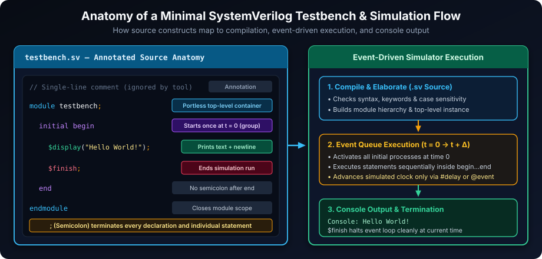
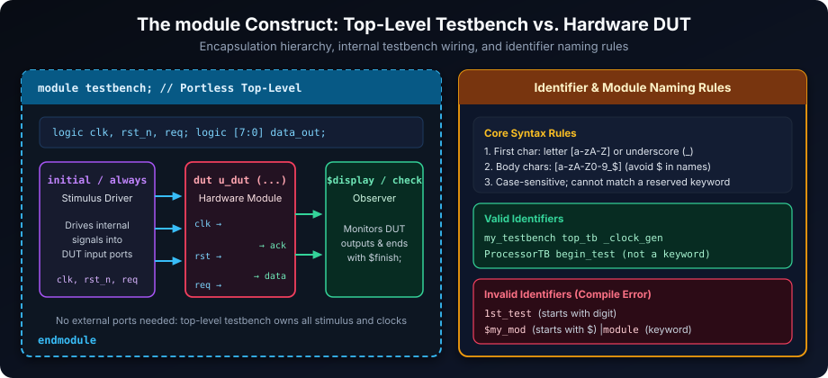
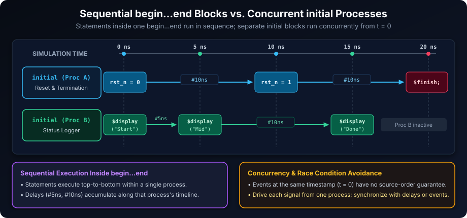
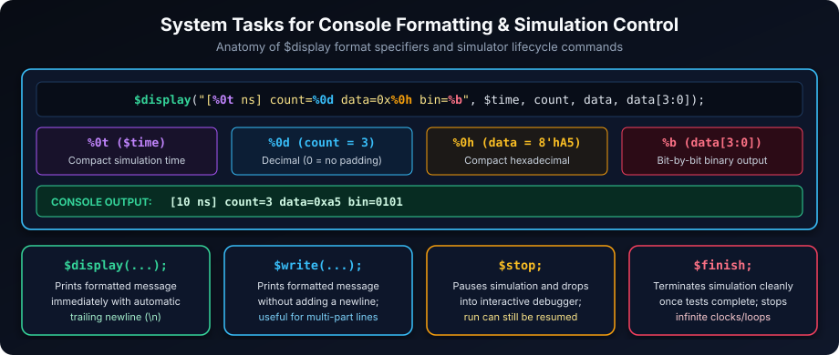

# Basics: Understanding Essential SystemVerilog Testbench Constructs

This document provides a foundational understanding of the core elements within a very simple SystemVerilog testbench. A testbench is a crucial piece of code utilized to simulate and verify that hardware designs function correctly prior to their physical implementation.

## Learning Goals

By the end of this chapter, you should be able to:

- Explain what a simulator does and how a testbench participates in simulation.
- Recognize the basic structure of a SystemVerilog source file and module.
- Apply comments, semicolons, case sensitivity, whitespace, and identifier rules correctly.
- Explain how `begin`/`end` groups procedural statements and how an `initial` process runs.
- Use `$display` for logging and `$finish` for deliberate simulation termination.
- Predict the difference between source-code order, simulation time, and concurrent processes.

### What is Simulation?

When SystemVerilog code is developed, it may describe electronic hardware, verification behavior, or both. Before hardware is constructed, a specialized software program, known as a **simulator**, compiles and executes the source models to calculate how signals and processes behave over simulated time. This process is termed **simulation**. The testbench detailed herein represents the environment created in SystemVerilog to evaluate the hardware design within this simulation context.

Simulation time is a model of time, not necessarily wall-clock time. A simulator advances from one scheduled event to the next; a `#10ns` delay advances simulated time by ten nanoseconds according to the compilation and time-unit settings. Several processes can run at the same simulation time, so source-file order should not be used as a substitute for explicit synchronization or delay.

Consider the following fundamental testbench structure:

```systemverilog
// This is a single-line comment.
/*
This is a multi-line comment.
It can span multiple lines.
*/

module testbench; // Module declaration

  initial begin // Initial procedural block begins here

    $display("Hello World!"); // System task for output to console
    $finish; // System task for simulation termination

  end // Initial procedural block ends here

endmodule // End of module declaration
```



Each component of this structure will now be examined in detail, commencing with general SystemVerilog concepts.

The example has one top-level module and one `initial` process. The process prints a message at the start of simulation and then requests termination. It has no DUT yet; the next stages of a testbench normally add a DUT instance, signals that connect to it, stimulus, and checks.

---

## I. Basic SystemVerilog Syntax Fundamentals

Prior to delving into the testbench structure, it is imperative to comprehend certain fundamental elements of the SystemVerilog language itself.

### SystemVerilog File Naming

SystemVerilog code is stored in plain text files. The conventional file extensions are:

- **.sv**: The recommended extension for SystemVerilog files.
- **.v**: Also commonly used, particularly for legacy Verilog code, though `.sv` specifically denotes SystemVerilog.

Upon developing your testbench code, it is typically saved as `testbench.sv` or, for legacy Verilog-oriented flows, `testbench.v`. These files are then provided to the simulator for compilation and execution. The extension often selects the language mode, but build scripts can override that behavior, so confirm the simulator's compile options.

### The Semicolon (`;`): Statement Terminator

In SystemVerilog, the **semicolon (`;`)** functions as a statement terminator. It signals to the compiler that a complete instruction has been provided.

- **Purpose**: Every individual declaration, assignment, or procedural statement generally concludes with a semicolon. It serves as a separator, ensuring clear demarcation between successive statements.
- **Analogy**: The semicolon is analogous to the period at the end of a sentence in natural language. It signifies the conclusion of a complete thought or instruction.

**Examples**:

```systemverilog
logic my_signal;        // Declaration terminates with a semicolon.
my_signal = 1;          // Assignment terminates with a semicolon.
$display("Message");    // System task invocation terminates with a semicolon.
#10ns;                  // A delay statement terminates with a semicolon.
```

Omission of a semicolon is a common error for new users, which will result in a syntax error during compilation. Blocks of statements, such as those delimited by **`begin`** and **`end`**, do not require a semicolon after the **`end`** keyword. A semicolon may be required after the complete construct that contains the block, but `end else;` is not valid SystemVerilog syntax. A conditional block is written, for example, as `if (ready) begin ... end else begin ... end`.

### Comments: Documenting Code

Comments are textual annotations within the code that are disregarded by the SystemVerilog compiler and simulator. Their primary purpose is to enhance code readability and provide explanations for human comprehension.

- **Single-Line Comments (`//`)**:
  A single-line comment commences with two forward slashes (`//`). All text from the `//` to the end of that specific line is considered a comment.

  ```systemverilog
  // This entire line is a comment.
  logic my_signal; // This is a comment at the end of a code line.
  ```

- **Multi-Line Comments (`/* ... */`)**:
  A multi-line comment begins with `/*` and concludes with `*/`. All text positioned between these markers, potentially spanning multiple lines, is treated as a comment.

  ```systemverilog
  /*
  This is a block comment.
  It can span multiple lines
  and is useful for longer explanations.
  */
  ```

  Effective utilization of comments is a professional practice that significantly improves code comprehension and maintainability.

### Case Sensitivity

SystemVerilog is a **case-sensitive** language. This implies that uppercase and lowercase letters are interpreted as distinct characters.

- **Impact**: `myVariable` is differentiated from `myvariable` or `MyVariable`. Keywords such as **`module`**, **`initial`**, **`begin`**, and **`end`** must be written in lowercase precisely as defined.
- **Best Practice**: Consistent capitalization for module names, signal names, and other identifiers is crucial to prevent errors and enhance code readability.

### Whitespace and Indentation

Whitespace (spaces, tabs, newlines) and indentation (the leading empty space on a line) are generally ignored by the SystemVerilog compiler. However, their importance for human readability and code clarity is paramount.

- **Purpose**: Proper indentation unequivocally illustrates the structural and hierarchical organization of code blocks, simplifying the identification of statements belonging to specific **`begin...end`** blocks or modules.
- **Best Practice**: Employ consistent indentation (e.g., 2 or 4 spaces per level) to ensure professional and easily decipherable code.

Whitespace can also separate tokens. For example, `logic [7:0] data;` is readable as a declaration, while `logic[7:0]data;` may be accepted by a tool but is harder to review. Consistent formatting is therefore part of correctness practice, even when it does not change compilation.

### Syntax Fundamentals Quick Reference

| Feature | Rule / Convention | Common Pitfall |
| :--- | :--- | :--- |
| **File Extensions** | Prefer `.sv` for SystemVerilog; `.v` for legacy Verilog | Compiling `.sv` constructs under strict Verilog-2001 mode |
| **Semicolons (`;`)** | Required after declarations, assignments, tasks, and `module ...;` | Writing `end;` or `end else;` after block delimiters |
| **Comments** | `//` to end of line; `/* ... */` across multiple lines | Nesting `/* ... */` blocks inside another `/* ... */` |
| **Case Sensitivity** | Identifiers and lowercase keywords are strictly case-sensitive | Writing `MODULE` or confusing `DataBus` with `databus` |
| **Whitespace** | Separates tokens and clarifies hierarchy via indentation | Jamming tokens together, hurting code review |

---

## II. The `module` Construct: Testbench Encapsulation

In SystemVerilog, the **`module`** construct serves as the primary unit for design encapsulation and hierarchical organization. It defines a self-contained block of code that represents either a hardware component or, in this context, a testbench environment.



- `module testbench;`: This statement declares a module named `testbench`. For verification purposes, modules are frequently named to reflect their role, such as `testbench` or `design_name_tb`. This module functions as the top-level container for all testbench logic and simulation control.
- `endmodule`: This keyword explicitly marks the conclusion of the **`module`** definition.

The **`module`** effectively establishes the boundaries for the testbench, enclosing all subsequent declarations and procedural statements relevant to its operation. A module is also a hardware hierarchy boundary: modules can instantiate other modules and connect to them through ports.

### Module Ports (or absence thereof in a Top-Level Testbench)

Hardware design modules typically possess **ports** (analogous to electrical pins) that facilitate connections to other components of a design, enabling input reception and output generation. However, for a **top-level testbench module**, it is customary for it to **not possess any external ports**.

- **Rationale for absence of ports**: A top-level testbench typically constitutes the highest level of your simulation environment. It acts as the "controller" for the simulation and directly interacts with the hardware design (which it will "instantiate" internally—a concept to be covered in subsequent topics). Consequently, it does not require external connections during the simulation process.

No ports does not mean that the module is isolated. The testbench can declare internal signals, instantiate a DUT, and connect those signals to the DUT's ports. The simulator identifies the top-level module from the compile or run command; the name `testbench` has no special meaning.

```systemverilog
module inv_gate (
    input  logic a,
    output logic y
);
  assign y = ~a;
endmodule

module testbench; // Portless top-level testbench
  logic tb_a;
  logic tb_y;

  // Instantiate the DUT inside the testbench and connect internal signals
  inv_gate u_dut (
      .a(tb_a),
      .y(tb_y)
  );

  initial begin
    tb_a = 1'b0;
    #5ns;
    $display("a=%b -> y=%b", tb_a, tb_y);
    $finish;
  end
endmodule
```

### Rules for Naming a Module

When assigning a name to a module (or any other identifier, such as a signal or variable), SystemVerilog mandates specific rules:

1. **Valid Characters**: Module names may comprise:
   - Alphabetic characters (a-z, A-Z)
   - Numeric digits (0-9)
   - Underscores (`_`)
   - Dollar signs (`$`) after the first character - although generally avoided for user-defined names to prevent ambiguity with system tasks.
2. **Starting Character**: A module name **must** commence with an alphabetic character or an underscore (`_`). It **cannot** begin with a digit or a dollar sign.
3. **Prohibition of Keywords**: Module names cannot be SystemVerilog **keywords**. Keywords are reserved words possessing predefined significance within the language (e.g., **`module`**, **`initial`**, **`begin`**, **`end`**, **`always`**).
4. **Case Sensitivity**: As previously noted, SystemVerilog is case-sensitive; thus, `MyModule` is distinct from `mymodule`.
5. **Length**: While there is generally no practical limitation on the length of a module name, concise and descriptive names are preferred for readability.

| Identifier | Valid? | Reason |
| :--- | :---: | :--- |
| `my_testbench` | Yes | Starts with a letter; uses lowercase letters and underscore |
| `top_tb` | Yes | Standard descriptive testbench name |
| `_clock_gen` | Yes | Starts with an underscore (`_`) |
| `ProcessorTB` | Yes | Valid mixed-case identifier (distinct from `processortb`) |
| `begin_test` | Yes | Contains `begin`, but the full identifier is not the keyword `begin` |
| `1st_test` | No | Cannot start with a numeric digit (`1`) |
| `$my_module` | No | Cannot start with a dollar sign (`$`, reserved for system tasks/functions) |
| `module` | No | Exact match with a reserved SystemVerilog keyword |

SystemVerilog also supports escaped identifiers, which begin with a backslash (`\`) and end at whitespace. They are useful for interoperability with unusual names but are usually avoided in new RTL because they reduce readability.

---

## III. Procedural Blocks: `begin` and `end` for Grouping Statements

In SystemVerilog, certain constructs, such as the **`initial`** block, contain multiple statements that require sequential execution. To group these statements, the keywords **`begin`** and **`end`** are employed.

- **`begin`**: This keyword denotes the commencement of a block of statements.
- **`end`**: This keyword signifies the termination of a block of statements.

**`begin`** and **`end`** function as delimiters for a "compound statement" or a "block," enabling multiple individual statements to be treated as a singular unit. In SystemVerilog, **`begin`** and **`end`** are utilized for this purpose; curly braces `{}` (as seen in some other programming languages like C++, Java, or for data structures in Python) are **not** used for block grouping.

**Single Statement vs. Compound Block**:

```systemverilog
// Without begin...end: only ONE statement belongs to initial
initial
  $display("Single statement only");

// With begin...end: all statements execute sequentially in source order
initial begin
  statement1; // Executes first
  statement2; // Executes second
  statement3; // Executes third
end
```

In the multi-statement example, `statement1`, `statement2`, and `statement3` all execute in source order because they are enclosed by **`begin`** and **`end`**. Each statement within the block is terminated by a semicolon. Without **`begin`** and **`end`**, a procedural construct such as **`initial`** controls only the first statement immediately following it. Source order applies within this one process; other `initial` or `always` processes run concurrently and may interleave at the same simulation time.

> [!IMPORTANT]
> Always use `begin` and `end` whenever a procedural construct (`initial`, `always`, `if`, `else`, `for`) must control more than one statement—and many style guides require them even for single statements to prevent accidental indentation bugs.

---

## IV. The `initial` Block: Simulation Initialization

The **`initial`** block is a procedural construct designed to start its contained statements once at the commencement of simulation (time 0). It can contain delays, event controls, loops, and other procedural statements, so the process itself may remain active for an arbitrary duration.

- `initial begin`: This syntax initiates an **`initial`** block, with **`begin`** denoting the start of the grouped statements.
- **`end`**: This keyword signifies the termination of the **`initial`** block.

The **`initial`** block is indispensable for tasks necessitating one-time execution at simulation startup. Statements within an **`initial`** block are processed sequentially from top to bottom, with control moving to the next statement after a delay or event control completes. Upon completion of all statements within an **`initial`** block, that specific process becomes inactive and does not re-execute during the remainder of the simulation. It commonly orchestrates initial setup routines and defines the primary sequence of simulation events within a testbench.



### Multiple Concurrent `initial` Blocks in Action

Multiple `initial` blocks start concurrently at simulation time `0`. This is useful for independent activities such as reset driving, clock generation, and logging, as shown below:

```systemverilog
module concurrent_initial_tb;
  logic rst_n;

  // Process A: Drives reset and terminates simulation
  initial begin
    rst_n = 1'b0;
    #10ns;
    rst_n = 1'b1;
    #10ns;
    $display("[%0t ns] Proc A: Finishing simulation", $time);
    $finish;
  end

  // Process B: Logs milestones independently from t = 0
  initial begin
    $display("[%0t ns] Proc B: Start", $time);
    #5ns;
    $display("[%0t ns] Proc B: Midpoint (rst_n=%b)", $time, rst_n);
    #10ns;
    $display("[%0t ns] Proc B: Done (rst_n=%b)", $time, rst_n);
  end
endmodule
```

**Representative Chronological Output**:

```text
[0 ns] Proc B: Start
[5 ns] Proc B: Midpoint (rst_n=0)
[15 ns] Proc B: Done (rst_n=1)
[20 ns] Proc A: Finishing simulation
```

Notice how each `initial` block keeps its own timeline (`0 -> 5 -> 15` ns for Process B; `0 -> 10 -> 20` ns for Process A) and interleaves cleanly across simulated time. Because two processes writing the same variable at the same simulation timestamp can create a race condition, a well-structured testbench gives each signal a clear driver and uses clocking, events, or delays where ordering matters.

---

## V. System Tasks for Simulation Control and Output

**System tasks** are predefined simulator services, conventionally prefixed with a dollar sign (`$`). They facilitate essential functionality for interacting with and controlling the simulation environment. Users are not required to define these tasks; they are ready for direct use. SystemVerilog also has **system functions**, which return a value and can be used in expressions (for example, `$time`). `$display` and `$finish` are tasks because they perform actions rather than return a value.



### `$display`: Simulation Output Task

**`$display`** is a **system task** employed to output information to the simulation console (the text-based interface where your simulator operates).

- `$display("Hello World!");`: This statement invokes the **`$display`** task. The text enclosed within the double quotation marks (`"Hello World!"`) constitutes a "string literal," signifying a direct sequence of characters to be printed. As a complete statement, it is terminated by a semicolon.

The **`$display`** task is highly valuable for:

- **Debugging**: Providing immediate insight into simulation progress.
- **Reporting**: Generating informational messages or warnings.
- **Data Inspection**: Presenting the values of variables and signals (this will be addressed in subsequent topics).

Execution of **`$display`** schedules output when the corresponding line of code is encountered during simulation. It is generally used for immediate logging in the current procedural region; when observing final values after nonblocking updates in the same time step, `$strobe` or an assertion sampling strategy may be more appropriate. The phrase "Hello World!" serves as a conventional initial program in many programming languages, simply demonstrating the capability to produce output.

Useful formatting examples include:

```systemverilog
module display_format_tb;
  int unsigned transaction_count = 3;
  logic [7:0] data = 8'hA5;

  initial begin
    #10ns;
    $display("[%0t ns] count=%0d data=0x%0h bin=%b scope=%m",
             $time, transaction_count, data, data[3:0]);
    $finish;
  end
endmodule
```

| Format Specifier | Meaning | Example Output (`data = 8'hA5`) |
| :---: | :--- | :--- |
| **`%0d`** | Compact decimal integer (no leading spaces) | `165` |
| **`%0h`** | Compact hexadecimal (lowercase hex digits) | `a5` |
| **`%b`** | Bit-by-bit binary representation (shows `x` and `z`) | `10100101` |
| **`%0t`** | Formatted simulation time using current time scale | `10` |
| **`%s`** | Character string | `PASS` |
| **`%m`** | Hierarchical instance path where `$display` ran | `display_format_tb` |

The format specifiers `%0d` and `%0h` request compact decimal and hexadecimal output without extra padding. More display and formatting tasks (`$monitor`, `$strobe`, `$write`, `$dumpvars`) are covered in the next chapter.

### `$finish`: Simulation Termination Task

**`$finish`** is a critical **system task** employed for controlling the simulation flow.

- `$finish;`: This statement directs the simulator to **terminate simulation execution immediately** and end the current run. As a complete statement, it is terminated by a semicolon. The simulator's surrounding command-line process or graphical application may remain available for another run.

The **`$finish`** task is crucial for managing the duration of a simulation. Without its explicit invocation, a simulation might continue indefinitely (if continuous activities like clock generation are present) or proceed until a predefined maximum simulation time is reached. The use of **`$finish`** ensures a controlled and graceful cessation of the simulation once the testbench objectives have been fulfilled. In a reusable environment, it is good practice to finish only after required checks have completed and to use a nonzero failure status or an appropriate reporting mechanism when a test fails.

### Summary of the Basic Testbench Structure

In the provided basic testbench example:

1. Comments (**`//`** and **`/* */`**) are utilized for code documentation.
2. The semicolon (**`;`**) correctly terminates each statement.
3. A **`module`** named `testbench` serves as the primary container for the entire simulation environment, adhering to specific naming rules and typically lacking external ports for a top-level testbench.
4. An **`initial`** block, delineated by **`begin`** and **`end`**, executes its contents precisely once at the commencement of the simulation. Statements within this block are executed sequentially.
5. Within the **`initial`** block, the **`$display`** system task outputs the string "Hello World!" to the console.
6. Subsequently, the **`$finish`** system task halts the simulation, effecting a controlled conclusion.

This fundamental structure forms the basis for constructing more complex and comprehensive SystemVerilog testbenches.

### Hands-On Exercises with Solutions

1. **Spot the Syntax Errors:** Identify and fix the three syntax/keyword bugs in the snippet below:
   ```systemverilog
   MODULE buggy_tb;
     INITIAL begin
       $display("Starting test")
       $finish;
     end;
   endmodule
   ```
2. **Identifier Classification:** Classify each identifier as valid or invalid in SystemVerilog: `uart_rx_tb`, `2nd_channel`, `_reset_seq`, `$custom_name`, `initial_check`.
3. **Trace Concurrent `initial` Timelines:** Predict the exact chronological output (including timestamps) of:
   ```systemverilog
   module trace_tb;
     initial begin
       #15ns $display("A at %0t", $time);
       #10ns $finish;
     end
     initial begin
       $display("B0 at %0t", $time);
       #20ns $display("B1 at %0t", $time);
     end
   endmodule
   ```
4. **Build a Minimal Formatted Logger:** Write a self-contained, portless testbench `hello_timer_tb` that prints `"Booting..."` at `0 ns`, waits `12 ns`, prints an 8-bit `logic` value `8'h3C` in decimal, hex, and binary, and terminates cleanly.

#### Reference Solutions

1. **Fixed `buggy_tb`:**
   - `MODULE` and `INITIAL` must be lowercase keywords (`module`, `initial`).
   - `$display("Starting test")` is missing a terminating semicolon `;`.
   - `end;` should be `end` (no semicolon after `end`).
   ```systemverilog
   module buggy_tb;
     initial begin
       $display("Starting test");
       $finish;
     end
   endmodule
   ```
2. **Identifier Classification:**
   - `uart_rx_tb`: Valid.
   - `2nd_channel`: Invalid (cannot begin with a digit).
   - `_reset_seq`: Valid (underscores are legal leading characters).
   - `$custom_name`: Invalid (user identifiers cannot begin with `$`).
   - `initial_check`: Valid (`initial` is a keyword, but `initial_check` is a distinct identifier).
3. **Chronological Output of `trace_tb`:**
   ```text
   B0 at 0
   A at 15
   B1 at 20
   ```
   Then `$finish` executes in the first `initial` block at `15 + 10 = 25 ns`.
4. **Minimal Formatted Logger (`hello_timer_tb`):**
   ```systemverilog
   module hello_timer_tb;
     logic [7:0] status = 8'h3C;

     initial begin
       $display("[%0t ns] Booting...", $time);
       #12ns;
       $display("[%0t ns] status: dec=%0d hex=0x%0h bin=%b",
                $time, status, status, status);
       $finish;
     end
   endmodule
   ```

##### Copyright (c) 2026 squared-studio
