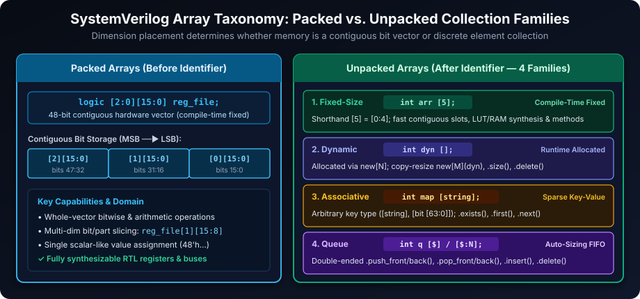
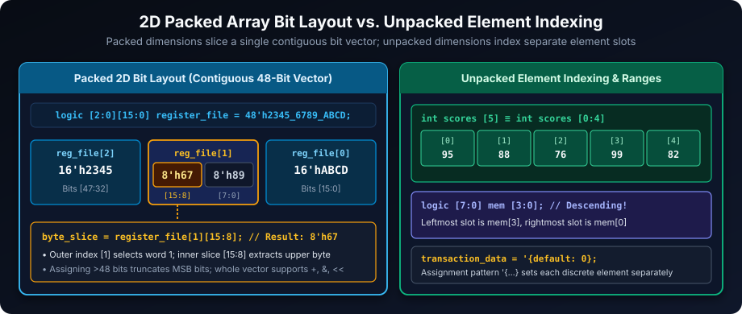
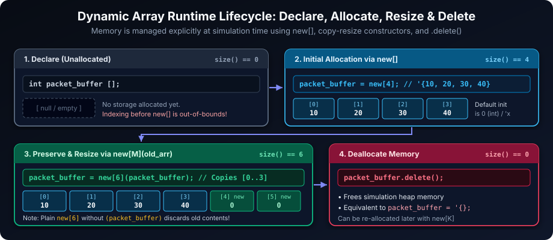
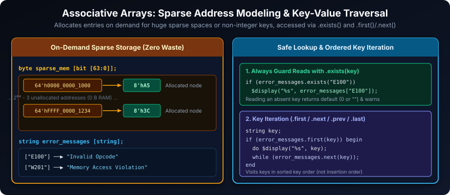
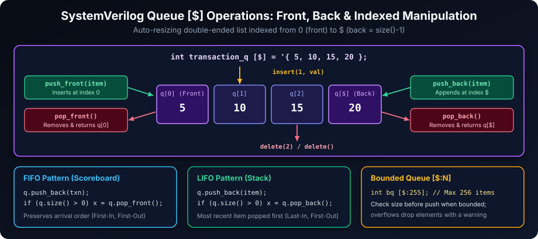

# Arrays in SystemVerilog: A Deep Dive

## Introduction to SystemVerilog Arrays

Arrays are fundamental data structures in SystemVerilog, designed to efficiently manage collections of data elements. SystemVerilog offers a rich array landscape, providing specialized array families tailored to diverse RTL hardware modeling and testbench verification needs. Understanding where dimensions are placed and how memory is laid out is crucial for effective SystemVerilog programming. The primary array categories in SystemVerilog include:

- **Packed Arrays**: Dense, contiguous blocks of bits whose dimensions appear **before** the identifier, optimized for hardware registers, buses, and bit-level slicing.
- **Unpacked Arrays**: Collections whose dimensions appear **after** the identifier, storing discrete elements for memory modeling and verification data structures.
- **Fixed-Size Arrays**: Unpacked arrays whose size is set at compile time, offering fast indexed access and built-in array manipulation methods.
- **Dynamic Arrays**: Unpacked arrays allocated and resized during simulation runtime (`new[]`), providing flexibility for variable-length payloads.
- **Associative Arrays**: Key-value lookup structures (`[key_type]`), ideal for sparse memories or configuration tables indexed by non-contiguous addresses, strings, or IDs.
- **Queues**: Auto-sizing double-ended lists (`[$]` or `[$:N]`), designed for efficient insertion and removal at both ends in drivers, monitors, and scoreboards.



## Learning Goals

By the end of this chapter, you should be able to:

- Distinguish packed, fixed-size unpacked, dynamic, associative, and queue arrays.
- Declare dimensions in the correct position and access elements safely.
- Allocate, resize, search, sort, reduce, and delete array data deliberately.
- Choose an array kind based on index shape, lifetime, ordering, and verification use.
- Recognize which operations return a new collection and which operations modify an array in place.

## Packed vs. Unpacked Arrays: Memory Layout and Usage

The distinction between packed and unpacked arrays is fundamental in SystemVerilog and governs both memory layout and the operators you can apply.

### Packed Arrays: Bit-Level Efficiency

- **Contiguous Bit Storage**: Packed arrays are stored as a single, unbroken sequence of bits in memory—just like a hardware register or multi-field bus vector.
- **Hardware Modeling Focus**: Because the bits are contiguous, you can assign literals to the whole array, apply bitwise/arithmetic operators, or slice sub-fields across dimensions.
- **Dimensions Before Identifier**: All packed dimensions are specified **before** the variable name, from leftmost (outermost slice) to rightmost (innermost bit width). Only single-bit types (`logic`, `bit`, `reg`) and packed structs/unions/enums can form packed arrays.

```systemverilog
logic [2:0][15:0] register_file;    // 3 x 16-bit register file (48 bits total)
register_file = 48'h2345_6789_ABCD; // Initialize all 48 bits as one contiguous vector

logic [7:0] byte_slice;
byte_slice = register_file[1][15:8]; // Extract upper byte of word 1 -> 8'h67
```

**Explanation**: `register_file` is a 2D packed array representing three 16-bit elements (`48` bits total). Assigning a 48-bit literal sets every bit at once (`[2] = 16'h2345`, `[1] = 16'h6789`, `[0] = 16'hABCD`); assigning a wider literal truncates the excess most-significant bits.

### Unpacked Arrays: Element-Based Storage

- **Discrete Element Storage**: Unpacked arrays store each element as a separate item in memory, similar to arrays in C or Java. You cannot perform whole-array arithmetic (such as `arrA + arrB`) directly on unpacked arrays.
- **Verification and Data Storage**: Unpacked arrays are commonly used in verification environments for scoreboards, transaction buffers, and lookup tables, as well as fixed-depth memories in RTL.
- **Dimensions After Identifier**: Unpacked dimensions are declared **after** the array identifier. You may freely combine packed and unpacked dimensions on the same variable (for example, `logic [31:0] mem [0:255]`, representing 256 discrete 32-bit words).

```systemverilog
int transaction_data [1024];     // Unpacked array of 1024 integers ([0:1023])
transaction_data = '{default:0}; // Assignment pattern initializes every element to 0

transaction_data[512] = 999;     // Access and modify individual elements
```

**Explanation**: `transaction_data` holds 1024 discrete `int` elements. Notice that an unpacked dimension written as `[1024]` is shorthand for an ascending range `[0:1023]`. Writing an explicit range such as `[7:0]` instead gives descending indices from `7` down to `0`—the declared index range is part of the array's type, so index `0` is not always the leftmost element.



**Key Difference**: Packed arrays model contiguous bit-level hardware vectors; unpacked arrays store discrete element-level collections.

## Fixed-Size Arrays: Compile-Time Dimensions with Built-in Methods

- **Static Size**: Fixed-size unpacked arrays have their bounds fixed at compile time, offering predictable memory footprint and zero allocation overhead. Fixed-size packed/unpacked arrays (such as register files and LUTs) are also synthesizable.
- **Built-in Manipulation Methods**: SystemVerilog provides built-in array locator, ordering, and reduction methods on unpacked arrays. Most of these methods also work identically on dynamic arrays and queues (while associative arrays support a smaller key-oriented subset).

```systemverilog
int scores [5] = '{95, 88, 76, 99, 82}; // Fixed-size unpacked array
int sorted_scores [5];

sorted_scores = scores; // Element-by-element copy (must match size & element type)
sorted_scores.sort();   // Sort 'sorted_scores' in ascending order (in-place)

int min_q [$] = scores.min(); // Returns a 1-element queue: '{76}
int max_q [$] = scores.max(); // Returns a 1-element queue: '{99}

$display("Sorted scores: %p", sorted_scores); // '{76, 82, 88, 95, 99}
$display("Sum of scores: %0d", scores.sum());    // Sum of scores: 440
```

### Built-in Methods for Fixed-Size Arrays

Note carefully which methods **modify the array in place**, which return a **queue (`[$]`)**, and which return a **scalar reduction value**:

| Method | Return / Side Effect | Description | Example |
| --- | --- | --- | --- |
| **`.size()`** | Returns `int` | Returns the total number of elements in the array | `int n = scores.size();` |
| **`.sort()`** | In-place (`void`) | Sorts elements in ascending order (`with` clause optional) | `scores.sort();` |
| **`.rsort()`** | In-place (`void`) | Sorts elements in descending order | `scores.rsort();` |
| **`.reverse()`** | In-place (`void`) | Reverses element order in place | `scores.reverse();` |
| **`.shuffle()`** | In-place (`void`) | Randomly permutes element order | `scores.shuffle();` |
| **`.sum()`** | Returns scalar | Calculates the sum of all elements (`product`, `and`, `or`, `xor` also exist) | `int total = scores.sum();` |
| **`.min()`** | Returns queue `[$]` | Returns a queue holding the minimum element (empty if array is empty) | `int min_q[$] = scores.min();` |
| **`.max()`** | Returns queue `[$]` | Returns a queue holding the maximum element (empty if array is empty) | `int max_q[$] = scores.max();` |
| **`.unique()`** | Returns queue `[$]` | Returns a queue with one copy of each distinct value (source unchanged) | `int uniq_q[$] = scores.unique();` |
| **`.find()`** | Returns queue `[$]` | Returns a queue of **elements** where the `with` condition is true | `int high_q[$] = scores.find(x) with (x > 90);` |
| **`.find_index()`** | Returns queue `[$]` | Returns a queue of **indices** where the `with` condition is true | `int idx_q[$] = scores.find_index(x) with (x > 90);` |
| **`.find_first()`** | Returns queue `[$]` | Returns a queue holding the **first element** matching the condition | `int first_q[$] = scores.find_first(x) with (x > 90);` |
| **`.find_last()`** | Returns queue `[$]` | Returns a queue holding the **last element** matching the condition | `int last_q[$] = scores.find_last(x) with (x > 90);` |

## Dynamic Arrays: Runtime Resizable Flexibility

- **Runtime Size Adjustment**: Dynamic arrays are declared with empty brackets `[]` and sized at simulation runtime. They are ideal when the required capacity depends on transaction length, configuration parameters read at start-of-test, or runtime stimulus.
- **Memory Allocation with `new[]`**: Before accessing any elements, you must allocate storage with `new[N]`. Calling `new[N]` on an already allocated dynamic array allocates fresh storage and discards old values unless you explicitly pass the array to copy.
- **Non-Destructive Resizing**: Calling `arr = new[new_size](arr);` allocates `new_size` slots, copies elements from the old array (up to `min(old_size, new_size)`), and initializes any extra slots to the element type's default value (`0` for 2-state `int`, `'x` for 4-state `logic`).



```systemverilog
int packet_buffer []; // Declare an unallocated dynamic array (size() == 0)

initial begin
  packet_buffer = new[10]; // Allocate 10 integers indexed [0..9]
  foreach (packet_buffer[i]) packet_buffer[i] = i * 4;

  $display("Initial buffer size: %0d", packet_buffer.size()); // Size: 10

  // Expand to 20 slots while preserving [0..9]; slots [10..19] initialize to 0
  packet_buffer = new[20](packet_buffer);
  $display("Resized buffer size: %0d", packet_buffer.size()); // Size: 20

  packet_buffer.delete(); // Free storage; size() returns to 0
  $display("Buffer size after delete: %0d", packet_buffer.size()); // Size: 0
end
```

Before indexing a dynamic array, ensure it has been allocated (`packet_buffer.size() > 0`) and that the index lies within `0` through `packet_buffer.size() - 1`. Assigning one dynamic array to another copies the elements or array values according to assignment rules, and calling `.delete()` (or assigning `'{}`) releases the allocated elements.

### Methods for Dynamic Arrays

| Method | Description | Example |
| --- | --- | --- |
| **`.size()`** | Returns the current number of allocated elements (`0` if unallocated/deleted) | `int current_size = packet_buffer.size();` |
| **`new[size]`** | Allocates storage for `size` elements (discards previous contents) | `packet_buffer = new[50];` |
| **`new[size](src)`** | Allocates `size` elements and copies overlapping prefix from `src` | `packet_buffer = new[100](packet_buffer);` |
| **`.delete()`** | Deallocates all elements; `size()` becomes `0` | `packet_buffer.delete();` |
| **`.sort()` / `.rsort()`** | Sorts elements ascending or descending in place | `packet_buffer.sort();` |
| **`.reverse()` / `.shuffle()`** | Reverses or randomly shuffles elements in place | `packet_buffer.reverse();` |
| **`.sum()`** | Calculates the sum of all elements | `int total = packet_buffer.sum();` |
| **`.min()` / `.max()`** | Returns a 1-element queue containing the minimum or maximum value | `int min_q[$] = packet_buffer.min();` |
| **`.unique()`** | Returns a queue of unique values without modifying the source | `int unique_q[$] = packet_buffer.unique();` |

## Associative Arrays: Flexible Key-Based Lookup

- **Key-Value Pairs**: Associative arrays store elements indexed by an arbitrary key type (such as `string`, `int`, `bit [63:0]`, or wildcard `[*]`) rather than contiguous zero-based integers.
- **Sparse Data Storage**: Memory is allocated only for keys that have actually been written. Modeling a 64-bit memory space (`2^64` addresses) where a test touches only a few thousand addresses consumes almost no host RAM compared to a fixed or dynamic array.
- **Ordered Key Traversal**: Associative arrays maintain keys in sorted index order (numerical or lexicographical), allowing deterministic traversal with `.first()`, `.next()`, `.prev()`, and `.last()`.



Always check `.exists(key)` before reading a key that may not have been written yet—reading a nonexistent key returns the element type's default value (and emits a simulator warning in many tools) instead of indicating absence.

```systemverilog
string error_messages [string];     // String-keyed dictionary
byte   sparse_mem     [bit [63:0]]; // Sparse 64-bit byte-addressable memory model

initial begin
  error_messages["E100"] = "Invalid Opcode";
  error_messages["W201"] = "Memory Access Violation";

  sparse_mem[64'h0000_0000_0000_1000] = 8'hA5;
  sparse_mem[64'hFFFF_0000_1234_5678] = 8'h3C;

  if (error_messages.exists("E100")) begin
    $display("Error E100: %s", error_messages["E100"]);
  end

  $display("Error entries: %0d", error_messages.num()); // 2

  string key;
  if (error_messages.first(key)) begin
    do begin
      $display("Key=%s -> Msg=%s", key, error_messages[key]);
    end while (error_messages.next(key));
  end
end
```

### Methods for Associative Arrays

| Method | Description | Example |
| --- | --- | --- |
| **`.num()` / `.size()`** | Returns the number of allocated entries currently in the array | `int entry_count = error_messages.num();` |
| **`.delete()`** | Removes all entries from the associative array | `error_messages.delete();` |
| **`.delete(key)`** | Removes only the entry associated with `key` | `error_messages.delete("W201");` |
| **`.exists(key)`** | Returns `1` if an entry with `key` exists, `0` otherwise | `if (error_messages.exists("E100")) ...` |
| **`.first(ref key)`** | Sets `key` to the smallest key; returns `0` if array is empty | `if (error_messages.first(k)) ...` |
| **`.next(ref key)`** | Advances `key` to the next larger key; returns `0` at end | `while (error_messages.next(k)) ...` |
| **`.prev(ref key)`** | Moves `key` to the previous smaller key; returns `0` at start | `while (error_messages.prev(k)) ...` |
| **`.last(ref key)`** | Sets `key` to the largest key; returns `0` if array is empty | `if (error_messages.last(k)) ...` |

## Queues: Ordered Collections for Communication

- **Double-Ended Variable List**: Queues (`[$]`) grow and shrink automatically as elements are added or removed, giving O(1) push/pop performance at both the front (`q[0]`) and the back (`q[$]`), plus random indexed access.
- **FIFO and LIFO Patterns**: Use `push_back()` + `pop_front()` for a standard FIFO queue, or `push_back()` + `pop_back()` for a LIFO stack.
- **Bounded vs. Unbounded Queues**: An unbounded queue is declared with `[$]`. Adding a maximum upper-bound index (`[$:N]`) creates a bounded queue holding at most `N + 1` elements (indices `0` through `N`); attempting to push past `N + 1` drops the out-of-bounds element with a warning, so check `.size()` before pushing.
- **Testbench Communication**: Queues are heavily used in verification components—drivers, monitors, and scoreboards—to buffer expected vs. observed transactions. Note that a plain queue is not thread-safe synchronization by itself; pair queues with events, semaphores, or use a `mailbox` when synchronizing concurrent processes.



```systemverilog
int transaction_q [$]; // Unbounded queue of transaction IDs

initial begin
  transaction_q.push_back(10); // Queue: '{10}
  transaction_q.push_back(20); // Queue: '{10, 20}

  if (transaction_q.size() > 0) begin
    int first_txn = transaction_q.pop_front(); // Removes 10 -> Queue: '{20}
    $display("Dequeued transaction ID: %0d", first_txn);
  end

  transaction_q.push_front(5);   // Queue: '{5, 20}
  transaction_q.insert(1, 15);   // Queue: '{5, 15, 20}
  $display("Front=%0d Back=%0d Size=%0d",
           transaction_q[0], transaction_q[$], transaction_q.size());
end
```

Always verify `q.size() > 0` before calling `.pop_front()` or `.pop_back()` so you never pop from an empty queue (which returns the default value of the element type and logs a warning).

### Methods for Queues

| Method | Description | Example |
| --- | --- | --- |
| **`.size()`** | Returns the number of elements currently in the queue | `int q_size = transaction_q.size();` |
| **`.insert(index, item)`** | Inserts `item` at zero-based `index`, shifting trailing items right | `transaction_q.insert(1, new_txn);` |
| **`.delete()`** | Removes all elements from the queue (`size()` becomes `0`) | `transaction_q.delete();` |
| **`.delete(index)`** | Removes the element at `index`, shifting trailing items left | `transaction_q.delete(0);` |
| **`.pop_front()`** | Removes and returns the front element (`q[0]`) | `int first_item = transaction_q.pop_front();` |
| **`.pop_back()`** | Removes and returns the back element (`q[$]`) | `int last_item = transaction_q.pop_back();` |
| **`.push_front(item)`** | Inserts `item` at the front (`q[0]`) | `transaction_q.push_front(new_txn);` |
| **`.push_back(item)`** | Appends `item` at the back (`q[$]`) | `transaction_q.push_back(new_txn);` |
| **`.sort()` / `.reverse()`** | Sorts or reverses queue elements in place | `transaction_q.sort();` |

## Choosing an Array Kind

Use the simplest array kind that matches your data shape, lifetime, and synthesis requirements:

| Array Kind | Declaration Syntax | Size &amp; Allocation | Access Pattern | Synthesizable? | Best Hardware / Verification Use Case |
| --- | --- | --- | --- | --- | --- |
| **Packed array** | `logic [3:0][7:0] a;` | Compile-time fixed | Contiguous bits &amp; sub-slices | **Yes** | Registers, buses, bitfields, whole-vector math |
| **Fixed-size unpacked** | `int a [16];` | Compile-time fixed | Dense `0..N-1` or `[hi:lo]` | **Yes** (typical memories) | Small LUTs, register banks, static tables |
| **Dynamic array** | `int a [];` | Runtime (`new[N]`) | Dense `0..N-1` integer index | No (TB only) | Variable-length packets, runtime buffers |
| **Associative array** | `int a [key_t];` | On-demand sparse | Arbitrary key (`string`, 64-bit addr) | No (TB only) | Sparse memory models, scoreboards by ID |
| **Queue** | `int a [$];` / `[$:N]` | Auto-resizing | Ends (`0`, `$`) or integer index | No (TB only) | Scoreboard FIFOs, stimulus/transaction lists |

Keep these method behavior rules in mind to avoid common bugs:

- **In-place mutators** (`.sort()`, `.rsort()`, `.reverse()`, `.shuffle()`) modify the receiver directly and return nothing.
- **Locator / filter queries** (`.find()`, `.find_index()`, `.unique()`, `.min()`, `.max()`, `.find_first()`, `.find_last()`) return a **queue (`[$]`)** and leave the source array unchanged.
- **Reductions** (`.sum()`, `.product()`, `.and()`, `.or()`, `.xor()`) return a **single value** matching the element type (so cast or widen elements if a sum could overflow, e.g., `bytes.sum(b) with (int'(b))`).

## Exercises to Practice Array Concepts

Test your understanding of SystemVerilog arrays with these exercises. Place procedural statements inside a module, `program`, or `class` testbench block when compiling in SystemVerilog mode, and always guard empty/boundary cases for dynamic arrays and queues.

1. **Packed Array Initialization**: Declare a 12-bit packed array named `config_bits` and initialize it with the hexadecimal value `0xA3C`.

   ```systemverilog
   logic [11:0] config_bits = 12'hA3C;
   // Solution: Declares a 12-bit packed array and initializes it.
   ```

2. **Unpacked Array of Strings**: Create an unpacked array named `name_list` to hold 4 strings: `"Alice"`, `"Bob"`, `"Charlie"`, and `"Dana"`. Then, use a `foreach` loop to print each name.

   ```systemverilog
   string name_list [4] = '{"Alice", "Bob", "Charlie", "Dana"};
   foreach (name_list[i]) $display("Name: %s", name_list[i]);
   // Solution: Creates and initializes an unpacked array of strings and prints each element.
   ```

3. **Fixed-Size Array Summation**: Declare a fixed-size array of 5 integers, initialize it with the values `'{10, 20, 30, 40, 50}`, and use the `.sum()` method to calculate and display their sum.

   ```systemverilog
   int value_array [5] = '{10, 20, 30, 40, 50};
   $display("Sum of array elements: %0d", value_array.sum());
   // Solution: Calculates and displays the sum of the elements in the fixed-size array.
   ```

4. **Dynamic Array with Even Numbers**: Create an empty dynamic array named `even_numbers`. Allocate space for 8 integers using `new[]`. Then, use a `foreach` loop to fill the array with the first 8 even numbers (`0, 2, 4, ..., 14`).

   ```systemverilog
   int even_numbers [];
   even_numbers = new[8];
   foreach (even_numbers[i]) even_numbers[i] = i * 2;
   // Solution: Creates a dynamic array, allocates memory, and populates it with even numbers.
   ```

5. **Associative Array for Age Lookup**: Create an associative array named `age_map` that uses strings as keys and integers as values. Store the ages of three people: `"Alice"` (30), `"Bob"` (25), and `"Charlie"` (35). Then, check if an entry for `"John"` exists in the array and display `"John not found!"` if it doesn't.

   ```systemverilog
   int age_map [string];
   age_map["Alice"] = 30;
   age_map["Bob"] = 25;
   age_map["Charlie"] = 35;
   if (!age_map.exists("John")) $display("John not found!");
   // Solution: Creates an associative array, populates it with age data, and checks for the existence of a key.
   ```

6. **Queue Operations: Reverse and Pop**: Create a queue named `data_queue` and initialize it with the values `'{1, 2, 3}`. Reverse the queue using `.reverse()`, and then remove and discard the element from the front of the queue using `.pop_front()`.

   ```systemverilog
   int data_queue [$] = '{1, 2, 3};
   data_queue.reverse(); // Queue becomes '{3, 2, 1}
   if (data_queue.size() > 0) void'(data_queue.pop_front()); // Removes 3 -> '{2, 1}
   // Solution: Demonstrates reversing a queue and safely removing the front element.
   ```

By mastering SystemVerilog arrays and their various types, you equip yourself with powerful tools for managing data in both your hardware designs and verification environments. Experiment with these exercises and explore the extensive capabilities of SystemVerilog arrays to enhance your digital design and verification skills.

##### Copyright (c) 2026 squared-studio
