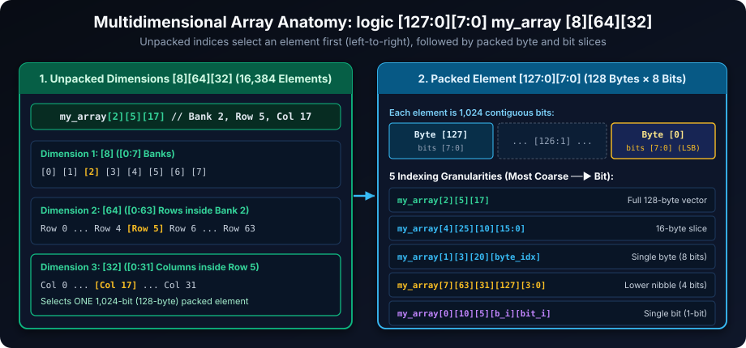
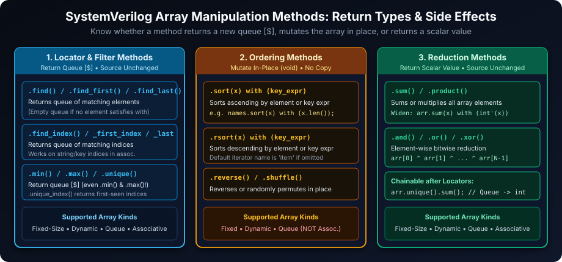
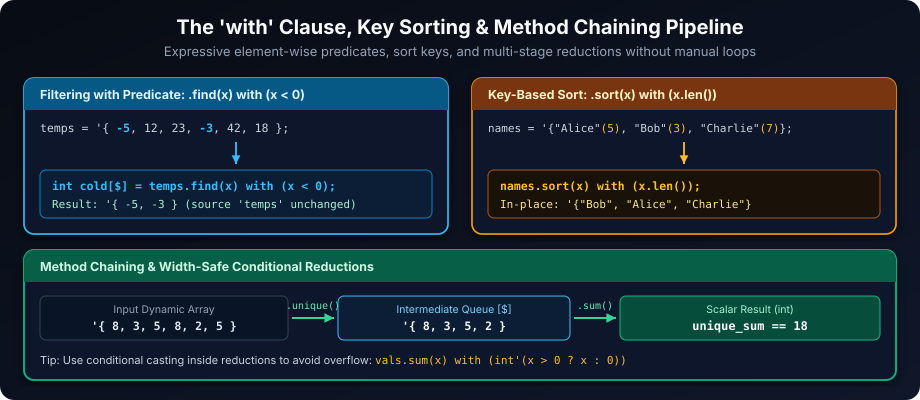
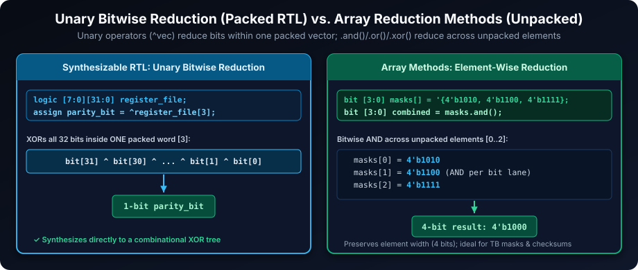

# SystemVerilog Array Manipulation: Boost Your Design Capabilities

## Introduction

SystemVerilog elevates array manipulation far beyond simple index lookups by providing built-in locator, ordering, and reduction methods for unpacked arrays. These methods apply directly to fixed-size unpacked arrays, dynamic arrays, and queues, while associative arrays support the locator and reduction subsets. Combining precision multidimensional indexing with these built-in array methods lets you write concise, bug-free testbench processing alongside clean, synthesizable RTL data structures.

## Learning Goals

By the end of this chapter, you should be able to:

- Read and write packed and unpacked dimensions in multidimensional declarations.
- Use `foreach` and array locator methods to inspect, filter, sort, and reduce collections.
- Distinguish methods that mutate an array from methods that return a queue or value.
- Handle empty search results, dynamic-array initialization, and queue return types safely.
- Separate simulation-oriented array methods from synthesis-friendly packed-vector operations.

## Array Indexing: Precision Access to Multidimensional Data

SystemVerilog handles complex multidimensional arrays that combine unpacked dimensions (after the identifier) and packed dimensions (before the identifier). Mastering the exact left-to-right indexing order is essential for slicing hardware structures cleanly.

### Example: Dissecting a Multidimensional Array

Consider a multidimensional array declaration with both packed and unpacked dimensions:

```systemverilog
logic [127:0][7:0] my_array [8][64][32];
```

#### Understanding Dimensions

1. **Unpacked Dimensions (`[8][64][32]`)**: Declared **after** the variable name, these organize the array into discrete addressable elements—here `8 * 64 * 32 = 16,384` elements (imagine 8 banks, each with 64 rows, and each row with 32 columns). Unpacked indices `[bank][row][col]` are always applied **first**.
2. **Packed Dimensions (`[127:0][7:0]`)**: Declared **before** the variable name, these define the contiguous bit layout of each individual element—128 bytes × 8 bits = `1,024` bits per element. Packed indices `[byte_idx][bit_idx]` are applied **after** selecting the unpacked element.



### Indexing Techniques: Navigating the Array

| Access Level | Example | Description |
| --- | --- | --- |
| **Full Element** | `my_array[2][5][17]` | Retrieves the entire 128-byte (1,024-bit) packed vector at bank 2, row 5, col 17. |
| **Single Byte** | `my_array[1][3][20][byte_index]` | Accesses a single 8-bit byte (`byte_index` from `0` to `127`) inside that element. |
| **Single Bit** | `my_array[0][10][5][byte_index][bit_index]` | Accesses a single bit (`byte_index` `0..127`, `bit_index` `0..7`). |
| **Byte Range (Slice)** | `my_array[4][25][10][15:0]` | Extracts a contiguous 16-byte slice (bytes `0` through `15`). |
| **Bit Slice (Nibble)** | `my_array[7][63][31][127][3:0]` | Extracts the lower 4-bit nibble (`[3:0]`) of byte `127`. |

### Efficient Iteration with `foreach`

SystemVerilog's `foreach` loop automatically adapts to the bounds of each dimension without hardcoding loop limits:

```systemverilog
foreach (my_array[i, j, k]) begin // Iterates over all unpacked banks, rows, cols
  foreach (my_array[i][j][k][byte_index]) begin // Iterates over packed bytes 127..0
    $display("Bank %0d, Row %0d, Col %0d, Byte %0d: %h",
             i, j, k, byte_index, my_array[i][j][k][byte_index]);
  end
end
```

### Key Indexing Considerations

1. **Packed Dimension Order**: In packed dimensions (such as `[127:0][7:0]`), the **rightmost dimension is the least significant** and varies fastest in contiguous bit order.
2. **Storage Semantics**: Packed dimensions guarantee contiguous bit layout and whole-vector arithmetic; unpacked arrays store discrete elements whose physical layout depends on simulator or synthesis optimizations.
3. **Synthesis Implications**: Synthesis inference (block RAM, distributed LUT RAM, or flip-flop arrays) depends on read/write port structure, array depth, and tool directives. Always verify inferred hardware in synthesis reports.

## Array Manipulation Methods: Beyond Basic Indexing

SystemVerilog's built-in array methods replace verbose boilerplate `foreach` loops in testbenches. Always pay attention to two properties before chaining or assigning results: **what the method returns** and **whether it mutates the receiver in place**.



### Searching and Filtering (Return Queue `[$]`, Source Unchanged)

Locator methods **always return a queue (`[$]`)** of matching elements (or matching indices), even when `0` or `1` match is found:

| Method | Description | Example with `with` Expression |
| --- | --- | --- |
| **`.find()`** | Returns a queue containing all elements matching the predicate. | `arr.find(x) with (x > threshold)` |
| **`.find_index()`** | Returns a queue of indices for all elements matching the predicate. | `arr.find_index(x) with (x % 2 != 0)` |
| **`.find_first()`** | Returns a 1-element (or empty) queue with the first matching element. | `arr.find_first(x) with (x < min_val)` |
| **`.find_last()`** | Returns a 1-element (or empty) queue with the last matching element. | `arr.find_last(x) with (x == target)` |
| **`.unique()`** | Returns a queue containing one copy of each distinct value. | `arr.unique()` |
| **`.unique_index()`** | Returns a queue of indices for the first occurrence of each distinct value. | `arr.unique_index()` |

> **Safe Single-Match Check**: Because `.find()`, `.find_first()`, `.min()`, and `.max()` return queues, check `.size() != 0` before indexing `[0]`:
> ```systemverilog
> int matches[$] = temperatures.find_first(x) with (x < 0);
> if (matches.size() != 0)
>   $display("First freezing sample: %0d", matches[0]);
> ```

### Sorting and Ordering (Mutate In-Place, Return `void`)

Ordering methods modify fixed-size unpacked arrays, dynamic arrays, and queues **in place** (they are **not** supported on associative arrays, whose keys remain sorted by key order):

| Method | Description | Example with Key Clause |
| --- | --- | --- |
| **`.sort()`** | Sorts elements ascending in place (optional `with` sort key). | `people.sort(x) with (x.age)` |
| **`.rsort()`** | Sorts elements descending in place (optional `with` sort key). | `names.rsort(x) with (x.len())` |
| **`.reverse()`** | Reverses element order in place (`with` clause not allowed). | `arr.reverse()` |
| **`.shuffle()`** | Randomly permutes element order in place (`with` clause not allowed). | `arr.shuffle()` |

Note that the `with (...)` clause on `.sort()` and `.rsort()` evaluates a **single-element key expression** (using the declared iterator identifier `x`, or default `item` if omitted such as `names.sort() with (item.len())`)—it is not a two-operand comparator like `(a < b)`.

### Mathematical and Extremum Operations

| Method | Return Type | Description &amp; Overflow Note |
| --- | --- | --- |
| **`.sum()`** | Scalar | Sums all elements; default result type matches the element type (use `with (int'(x))` to widen narrow bytes). |
| **`.product()`** | Scalar | Multiplies all elements; use `longint` casts in `with` to avoid 32-bit overflow. |
| **`.min()`** | Queue `[$]` | Returns a queue holding the minimum element (or `'{}` if the array is empty). |
| **`.max()`** | Queue `[$]` | Returns a queue holding the maximum element (or `'{}` if the array is empty). |

### Bitwise Reduction Operations (Across Unpacked Elements)

| Method | Description | Typical Use Case |
| --- | --- | --- |
| **`.and()`** | Bitwise AND across all array elements: `arr[0] & arr[1] & ...` | Verifying which mask bits are set in *every* active channel. |
| **`.or()`** | Bitwise OR across all array elements: `arr[0] | arr[1] | ...` | Aggregating sticky error flags across multiple sources. |
| **`.xor()`** | Bitwise XOR across all array elements: `arr[0] ^ arr[1] ^ ...` | Computing packet-level multi-byte XOR parity / LRC checksums. |

## Illustrative Examples with Expected Outputs



### Filtering with `.find()` for Temperature Data

```systemverilog
int temperatures[] = '{-5, 12, 23, -3, 42, 18};
int below_freezing[$] = temperatures.find(x) with (x < 0);
$display("Temperatures below freezing: %p", below_freezing);
// Output: Temperatures below freezing: '{-5, -3}
```

### Sorting Strings by Length using `.sort()` with Key Clause

```systemverilog
string names[] = '{"Alice", "Bob", "Charlie"};
names.sort(x) with (x.len()); // Sort in-place using string length as the key
$display("Sorted by length: %p", names);
// Output: Sorted by length: '{"Bob", "Alice", "Charlie"}
```

### Bitwise AND Reduction Across Elements

```systemverilog
bit [3:0] masks[] = '{4'b1010, 4'b1100, 4'b1111};
bit [3:0] combined_mask = masks.and();
$display("Combined AND mask: %b", combined_mask);
// Output: Combined AND mask: 1000  (4'b1010 & 4'b1100 & 4'b1111 = 4'b1000)
```

### Finding Unique Indices with `.unique_index()`

```systemverilog
int data_stream[] = '{5, 2, 5, 7, 2, 9};
int unique_indices[$] = data_stream.unique_index();
$display("Indices of first unique values: %p", unique_indices);
// Output: Indices of first unique values: '{0, 1, 3, 5} (indices of 5, 2, 7, 9)
```

### Method Chaining for Concise Operations

Because locator methods return a queue `[$]`, you can immediately chain another array method onto the result:

```systemverilog
int sample_values[] = '{8, 3, 5, 8, 2, 5};
int unique_sum = sample_values.unique().sum(); // '{8, 3, 5, 2}.sum()
$display("Sum of unique values: %0d", unique_sum);
// Output: Sum of unique values: 18
```

## Important Considerations for Array Manipulation

1. **In-Place Mutation vs. New Queue Return**: `.sort()`, `.rsort()`, `.reverse()`, and `.shuffle()` mutate the source array directly and return `void`. If you need the original order intact, copy the array before calling them.
2. **Array Kind Applicability**: Built-in array manipulation methods apply to **1-D unpacked arrays** (fixed-size unpacked, dynamic arrays, and queues). Associative arrays support locator and reduction methods (with keys visited in sorted key order), but **not** ordering methods (`.sort()`, `.rsort()`, `.reverse()`, `.shuffle()`).
3. **Flexibility of the `with` Clause**: You can access struct/class fields, perform arithmetic casts, or inspect indices (`x.index` when iterating with `find`/`sort`) inside `with (...)`:

   ```systemverilog
   typedef struct { int age; string name; } person_t;
   person_t people[];
   // ... populate 'people' ...
   people.sort(x) with (x.age); // Sort array of structs ascending by 'age'
   ```

4. **Empty Result Handling**: Searching methods return an empty queue `'{}` when no matches exist (or when called on an empty array). Always verify `result.size() > 0` before reading `result[0]`.
5. **Sum Width & Overflow**: `byte arr[]` calls `arr.sum()` with an 8-bit `byte` accumulator by default! Whenever an arithmetic sum could exceed the element bit width, widen the expression inside `with`, e.g., `int'(arr.sum(x) with (int'(x)))`.

## Practical Exercises to Enhance Your Skills

Try solving each task below before expanding or comparing against the reference solutions.

1. **Memory Byte Extraction**: Using `logic [127:0][7:0] my_array [8][64][32];`, extract bytes `64` through `127` from `my_array[0][0][0]` into a `logic [63:0][7:0] upper_half` variable and display it.

   ```systemverilog
   logic [63:0][7:0] upper_half;
   upper_half = my_array[0][0][0][127:64];
   $display("Upper 64 bytes: %h", upper_half);
   ```

2. **Financial Transaction Validation**: Given a queue `txn_t txns[$]` where each item has an `int amount`, find all transactions strictly exceeding `1000` into a new queue `large_txns[$]`.

   ```systemverilog
   txn_t large_txns[$] = txns.find(t) with (t.amount > 1000);
   ```

3. **Packet Checksum Calculation**: Given a dynamic array `byte pkt[]`, compute the 8-bit XOR checksum of all payload bytes starting at index `4` (skipping the 4-byte header).

   ```systemverilog
   // XOR with 8'h00 is identity, skipping header indices 0..3 safely
   byte checksum = (pkt.size() > 4) ? pkt.xor(b) with (b.index >= 4 ? b : 8'h00) : 8'h00;
   ```

4. **Unique Random Address List**: Generate `100` unique 32-bit addresses using a dynamic array or queue and `.shuffle()` them cleanly without duplicates.

   ```systemverilog
   bit [31:0] addrs[] = new[100];
   foreach (addrs[i]) addrs[i] = 32'h1000_0000 + (i * 4);
   addrs.shuffle();
   ```

5. **Associative Array Value Sorting**: Given `time err_time [string];` (mapping error code keys to timestamps), collect the keys into a queue and sort the error codes in ascending timestamp order.

   ```systemverilog
   string codes[$];
   string k;
   if (err_time.first(k)) begin
     do codes.push_back(k); while (err_time.next(k));
   end
   codes.sort(c) with (err_time[c]);
   ```

## Pro-Level Tips for Array Mastery



1. **Combined Indexing and Slice Extraction**: Combine `foreach` over unpacked indices with packed slice ranges to extract fields cleanly across large structures:

   ```systemverilog
   // Extract upper 64 bytes [127:64] from every element of 'my_array'
   foreach (my_array[i, j, k]) begin
     upper_bytes[i][j][k] = my_array[i][j][k][127:64];
   end
   ```

2. **Searching Multidimensional Arrays Row-by-Row**: Array locator methods operate on one unpacked dimension at a time. To search a 2D unpacked array `int matrix[10][20]`, iterate over the outer dimension with `foreach`:

   ```systemverilog
   int found[$];
   foreach (matrix[r]) begin
     found = matrix[r].find_first(x) with (x inside {[10:20]});
     if (found.size() > 0) begin
       $display("First match in row %0d: %0d", r, found[0]);
       break;
     end
   end
   ```

3. **Conditional Summation for Targeted Aggregation**: Combine a ternary expression and explicit type cast inside `.sum()` to filter and sum in one pass:

   ```systemverilog
   int all_values[] = '{-4, 10, -2, 7, 3};
   int positive_sum = all_values.sum(x) with (x > 0 ? x : 0); // Result: 20
   ```

4. **RTL Synthesis: Use Unary Reductions on Packed Vectors, Not `.xor()` Methods**: In synthesizable RTL, use Verilog/SystemVerilog unary reduction operators (`&`, `|`, `^`) on packed slices to build combinational parity or flag trees cleanly, reserving `.sum()`, `.find()`, and `.sort()` for verification code:

   ```systemverilog
   logic [7:0][31:0] register_file;
   logic parity_bit;
   assign parity_bit = ^register_file[3]; // Unary XOR across all 32 bits of reg 3
   ```

By mastering packed/unpacked indexing alongside locator, ordering, and reduction methods, you gain clean expressive power for testbenches while keeping RTL hardware models deterministic and synthesis-friendly.

##### Copyright (c) 2026 squared-studio
