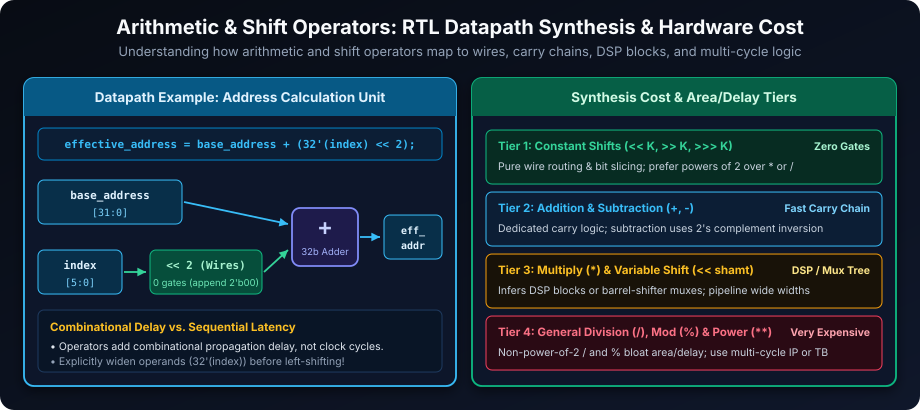
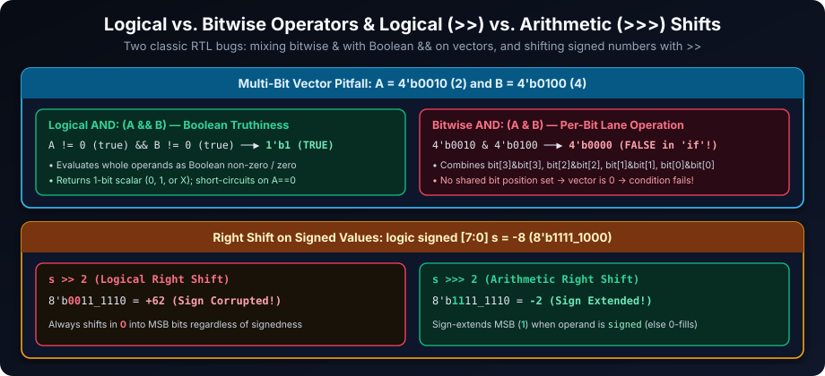
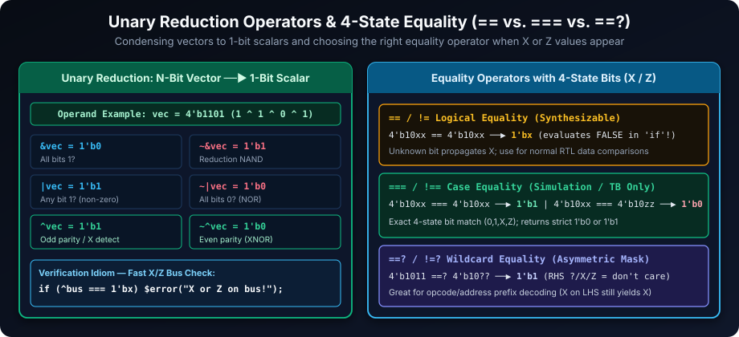
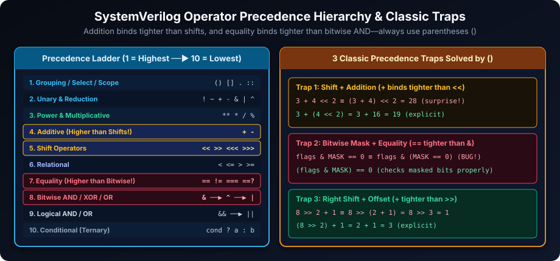

# SystemVerilog Operators: The Language of Hardware

## Introduction

Operators are the verbs of SystemVerilog, enabling you to describe hardware datapaths, control conditions, and verification checks concisely. A deep understanding of SystemVerilog operators goes beyond syntax—it means knowing how each operator maps to combinational gates or routing wires, how bit widths and signedness propagate, and how `X`/`Z` unknown states behave during simulation.

## Learning Goals

By the end of this chapter, you should be able to:

- Choose arithmetic, logical, bitwise, reduction, comparison, and shift operators by intent.
- Predict width, signedness, overflow, and `X`/`Z` behavior in common expressions.
- Distinguish combinational propagation delay from cycles added by a sequential implementation.
- Use parentheses to make precedence explicit and avoid accidental expression changes.
- Recognize when an operator is synthesizable in a particular tool flow rather than assuming that syntax alone determines hardware.

## Arithmetic Operators: The Foundation of Datapath Design

Arithmetic operators form the core of hardware datapaths and address/counter calculations.

| Operator | Description | Hardware Equivalent | Key Considerations |
| --- | --- | --- | --- |
| `+` | Addition | Combinational Adder (carry chain) | Supports signed and unsigned arithmetic; propagation delay grows with bit-width. |
| `-` | Subtraction | Combinational Subtractor | Implemented via 2's complement addition for signed and unsigned operands. |
| `*` | Multiplication | DSP Block or Multiplier Array | High area/delay in ASIC/FPGA; pipeline wide multipliers to meet timing. |
| `/` | Division | Constant Shift/Mul or Multi-Cycle Divider | Power-of-2 constants optimize cleanly; general division is expensive and divides by zero return `'x` in 4-state logic. |
| `%` | Modulus (Remainder) | Power-of-2 Bit Mask or Remainder Logic | Power-of-2 modulo (`x % 8` -> `x[2:0]`) is free; arbitrary `%` is expensive in RTL. |
| `**` | Exponentiation | Constant Power or Math Function | Constant powers of 2 map to shifts (`2**N`); variable exponents are generally for testbench models. |



### Real-World Example: Address Calculation Unit

```systemverilog
module address_calculation_unit #(
  parameter int BYTE_OFFSET_FACTOR = 2 // 2^2 = 4 bytes per 32-bit word
) (
  input  logic [31:0] base_address,
  input  logic [5:0]  index,
  output logic [31:0] effective_address
);

  // Zero-extend index to 32 bits before shifting, then add base_address
  assign effective_address = base_address + (32'(index) << BYTE_OFFSET_FACTOR);
endmodule
```

**Explanation**: Left-shifting by a compile-time constant (`<< BYTE_OFFSET_FACTOR`) requires **zero logic gates**—synthesis simply wires `index` shifted left by 2 bits (appending `2'b00`) into a 32-bit combinational adder (`+`). Explicitly widening `32'(index)` makes it clear that upper bits are preserved after the shift.

**Key Hardware and Synthesis Considerations for Arithmetic Operators:**

- **Synthesis Complexity**: Prefer constant shifts (`<< K`, `>> K`) and bit masks (`& (2**K - 1)`) over variable `*`, `/`, and `%` in single-cycle combinational paths.
- **Delay vs. Clock Latency**: A combinational operator adds **combinational propagation delay**, not clock cycles. Clock-cycle latency comes only when you insert flip-flops/pipeline stages around the logic.
- **Signed vs. Unsigned Mixing**: If an arithmetic expression mixes signed and unsigned operands, SystemVerilog converts the operation to **unsigned**—always keep operand signedness consistent or cast explicitly (`signed'()`, `unsigned'()`).
- **Overflow and Result Width**: Context-determined expressions take the maximum width of all operands and the LHS target (e.g., assigning `a + b` of 8 bits to an 8-bit target drops the carry-out bit; use a 9-bit LHS `{carry, sum} = a + b` to capture overflow).
- **Division by Zero**: Dividing or taking modulo by zero yields `'x` for 4-state types (`0` or simulator error depending on context) without raising an exception—guard denominators explicitly in testbenches and RTL.

## Logical vs. Bitwise Operators: Boolean vs. Vector Operations

SystemVerilog distinguishes **logical operators** (which collapse operands to Boolean truthiness) from **bitwise operators** (which compute bit-by-bit across matching bit lanes).

### Logical Operators: Evaluating Boolean Conditions

Logical operators treat `0` as false and any non-zero vector as true. They return a **1-bit 4-state scalar** (`1'b1`, `1'b0`, or `1'bx` if unknown bits prevent determining truth). Use them in `if`, `while`, assertions, and control signals. Note that `&&` and `||` perform **short-circuit evaluation** (skipping the right operand if the left operand already determines the result).

| Operator | Description | Example | Result Type |
| --- | --- | --- | --- |
| `&&` | Logical AND | `(enable && ready)` | 1-bit 4-state (`0`, `1`, `X`) |
| `\|\|` | Logical OR | `(error_flag \|\| timeout)` | 1-bit 4-state (`0`, `1`, `X`) |
| `!` | Logical NOT | `!valid_data` | 1-bit 4-state (`0`, `1`, `X`) |

### Bitwise and Shift Operators: Operating on Vectors

Bitwise operators align operands bit-by-bit and preserve vector width:

| Operator | Description | Example (4-bit) | Result (4-bit) |
| --- | --- | --- | --- |
| `&` | Bitwise AND | `4'b1101 & 4'b1011` | `4'b1001` |
| `\|` | Bitwise OR | `4'b1101 \| 4'b1011` | `4'b1111` |
| `^` | Bitwise XOR | `4'b1101 ^ 4'b1011` | `4'b0110` |
| `~` | Bitwise NOT (Inversion) | `~4'b1101` | `4'b0010` |
| `<<` | Logical Left Shift (0-filled) | `4'b0011 << 2` | `4'b1100` |
| `>>` | Logical Right Shift (0-filled) | `4'b1100 >> 1` | `4'b0110` |
| `<<<` | Arithmetic Left Shift (0-filled) | `4'sb1000 <<< 1` | `4'sb0000` |
| `>>>` | Arithmetic Right Shift (sign-extended if signed) | `4'sb1000 >>> 1` | `4'sb1100` |



**Illustrating Shift Operator Differences (Logical vs. Arithmetic):**

```systemverilog
module shift_example;
  initial begin
    logic        [3:0] logical_val    = 4'b1001;
    logic signed [3:0] arithmetic_val = 4'sb1001; // Signed -7

    $display("Logical Right (>>):     %b -> %b", logical_val, logical_val >> 1);       // 0100 (zero-filled)
    $display("Arithmetic Right (>>>): %b -> %b", arithmetic_val, arithmetic_val >>> 1); // 1100 (-4, sign-extended)
  end
endmodule
```

**Important Caveat on `>>>`**: Arithmetic right shift (`>>>`) **only sign-extends when the left-hand operand itself is `signed`**. If you apply `>>>` to an unsigned `logic [7:0]` vector, it shifts in `0`s just like `>>`. Left arithmetic shift (`<<<`) always zero-fills the LSB positions, identical to `<<`.

## Reduction Operators: Condensing Vectors to Scalars

Reduction operators are **unary** prefix operators that fold every bit of a single vector together to produce a **1-bit scalar** result. They synthesize cleanly into tree logic for parity, all-ones, or any-bit-set flags.

| Operator | Description | Example (`4'b1101`) | Result (1-bit) |
| --- | --- | --- | --- |
| `&` | Reduction AND (all bits 1?) | `&4'b1101` | `1'b0` |
| `\|` | Reduction OR (any bit 1?) | `\|4'b1101` | `1'b1` |
| `^` | Reduction XOR (odd parity) | `^4'b1101` | `1'b1` |
| `~&` | Reduction NAND | `~&4'b1101` | `1'b1` |
| `~\|` | Reduction NOR (all bits 0?) | `~\|4'b1101` | `1'b0` |
| `~^` | Reduction XNOR (even parity) | `~^4'b1101` | `1'b0` |

### Practical Application: Parity Bit Generation

```systemverilog
module parity_generator (
  input  logic [7:0] data_byte,
  output logic       parity_even,
  output logic       parity_odd
);

  assign parity_even = ~^data_byte; // Reduction XNOR for even parity
  assign parity_odd  =  ^data_byte; // Reduction XOR for odd parity
endmodule
```

## Comparison Operators: Evaluating Relationships

Comparison operators evaluate relationships and produce a 1-bit result. Knowing how each comparison family reacts to `X` and `Z` is critical for avoiding silent testbench bugs.



### Standard Comparison Operators (Synthesizable)

| Operator | Description | X/Z Handling |
| --- | --- | --- |
| `==` | Logical Equality | Returns `X` if unknown bits prevent a definite match/mismatch |
| `!=` | Logical Inequality | Returns `X` if unknown bits prevent a definite match/mismatch |
| `>`, `<`, `>=`, `<=` | Relational | Returns `X` if either operand contains any `X` or `Z` bit |

### Case Equality (`===`, `!==`) and Wildcard Equality (`==?`, `!=?`)

| Operator | Description | X/Z Handling &amp; Synthesis Role |
| --- | --- | --- |
| `===` | Case Equality | Bit-by-bit 4-state match (`X` and `Z` **must match**); simulation/TB only |
| `!==` | Case Inequality | Returns `1'b1` if any bit differs across `{0, 1, X, Z}`; simulation/TB only |
| `==?` | Wildcard Equality | `X`, `Z`, or `?` in the **RHS** operand act as don't-care wildcards (`4'b1011 ==? 4'b10??` is `1'b1`); RTL-friendly with constant RHS masks |
| `!=?` | Wildcard Inequality | Negation of wildcard equality (`!(lhs ==? rhs)`) |

**Illustrating the Difference: Handling X and Z States**

```systemverilog
module comparison_example;
  initial begin
    logic [3:0] val_x = 4'b10xx;
    logic [3:0] val_z = 4'b10zz;

    $display("val_x ==  val_z   : %b", (val_x ==  val_z));   // X (unknown)
    $display("val_x === val_z   : %b", (val_x === val_z));   // 0 ('x != 'z)
    $display("val_x === 4'b10xx : %b", (val_x === 4'b10xx)); // 1 (exact 4-state match)
    $display("4'b1011 ==? 4'b10??: %b", (4'b1011 ==? 4'b10??)); // 1 (wildcard match)
  end
endmodule
```

## Operator Precedence: Order of Evaluation

Precedence dictates the binding order when multiple operators appear without parentheses. SystemVerilog's precedence hierarchy includes two well-known traps inherited from Verilog/C: **additive operators (`+`, `-`) bind tighter than shift operators (`<<`, `>>`)**, and **equality operators (`==`, `!=`) bind tighter than bitwise operators (`&`, `^`, `|`)**.



**SystemVerilog Operator Precedence (Highest to Lowest):**

1. **Grouping, Indexing &amp; Scope**: `()`, `[]`, `.`, `::`
2. **Unary &amp; Reduction**: `!`, `~`, `+`, `-`, `&`, `~&`, `|`, `~|`, `^`, `~^`
3. **Power &amp; Multiplicative**: `**`, then `*`, `/`, `%`
4. **Additive**: `+`, `-`
5. **Shifts**: `<<`, `>>`, `<<<`, `>>>`
6. **Relational**: `<`, `<=`, `>`, `>=`, `inside`
7. **Equality**: `==`, `!=`, `===`, `!==`, `==?`, `!=?`
8. **Bitwise AND**: `&`
9. **Bitwise XOR / XNOR**: `^`, `~^`
10. **Bitwise OR**: `|`
11. **Logical AND**: `&&`
12. **Logical OR**: `||`
13. **Conditional (Ternary)**: `?:`

### Example: Precedence and Explicit Parentheses

```systemverilog
module precedence_example;
  initial begin
    int a = 3 + 4 << 2;   // Evaluated as (3 + 4) << 2 = 28 (+ binds tighter than <<!)
    int b = 3 + (4 << 2); // Explicit shift first: 3 + 16 = 19

    $display("3 + 4 << 2   = %0d", a); // 28
    $display("3 + (4 << 2) = %0d", b); // 19
  end
endmodule
```

**Best Practice**: Never rely on memory for shift-vs-add or bitwise-vs-equality precedence—always add explicit `()` around bit masks like `(flags & MASK) == 0` and shift expressions like `(base + offset) << 2`.

## Common Pitfalls to Avoid

1. **Confusing Bitwise (`&`, `|`) and Logical (`&&`, `||`) Operators**: Using `&` instead of `&&` on multi-bit flags (`4'b0010 & 4'b0100`) evaluates to `4'b0000` (false!), even though both vectors are non-zero. Always use `&&` / `||` / `!` for Boolean conditions and `&` / `|` / `~` for bit-lane logic.

   ```systemverilog
   module logical_bitwise_pitfall (
     input  logic       enable,
     input  logic       ready,
     output logic       ok_boolean,
     input  logic [3:0] mask_a,
     input  logic [3:0] mask_b,
     output logic [3:0] lane_overlap
   );
     assign ok_boolean   = enable && ready; // Boolean control intent (1-bit)
     assign lane_overlap = mask_a & mask_b; // Bitwise per-lane intersection (4-bit)
   endmodule
   ```

2. **Shifting Signed Numbers with `>>` Instead of `>>>`**: Logical right shift (`>>`) fills vacated MSBs with `0`, flipping negative signed values positive. Use `>>>` on `signed` variables to sign-extend properly:

   ```systemverilog
   logic signed [7:0] signed_value = -8; // 8'b1111_1000
   // signed_value >> 2  == 8'b0011_1110 (+62 — sign lost!)
   // signed_value >>> 2 == 8'b1111_1110 (-2  — sign preserved)
   ```

3. **Checking for `X` or `Z` Using Standard Equality (`==`)**: `if (sig == 1'bx)` evaluates to `1'bx`, which `if` treats as **false**! Always use case equality (`===`) or the reduction idiom `(^bus === 1'bx)` when testing for unknown or high-impedance bits:

   ```systemverilog
   logic unknown_signal; // Starts at 1'bx
   if (unknown_signal == 1'bx)  $display("Never prints (result is 'x)");
   if (unknown_signal === 1'bx) $display("Detects X correctly!");
   ```

## Practical Exercises to Solidify Operator Skills

Try solving each exercise yourself before checking the reference implementations below.

1. **4-bit ALU Design**: Implement a combinational 4-bit ALU supporting `AND` (`2'b00`), `OR` (`2'b01`), `XOR` (`2'b10`), and `ADD` (`2'b11`) with a `carry_out` flag.

   ```systemverilog
   module alu_4bit (
     input  logic [3:0] a, b,
     input  logic [1:0] op,
     output logic [3:0] y,
     output logic       carry_out
   );
     always_comb begin
       carry_out = 1'b0;
       case (op)
         2'b00: y = a & b;
         2'b01: y = a | b;
         2'b10: y = a ^ b;
         2'b11: {carry_out, y} = {1'b0, a} + {1'b0, b};
         default: y = 4'b0;
       endcase
     end
   endmodule
   ```

2. **Parity Generator (Even and Odd)**: Output both even and odd parity for an 8-bit `data` vector using reduction operators.

   ```systemverilog
   module parity_gen_8bit (
     input  logic [7:0] data,
     output logic       even_parity,
     output logic       odd_parity
   );
     assign even_parity = ~^data;
     assign odd_parity  =  ^data;
   endmodule
   ```

3. **8-bit Barrel Shifter**: Shift an 8-bit input left (`dir == 0`) or right (`dir == 1`) by `shamt` (`0..7`).

   ```systemverilog
   module barrel_shifter_8bit (
     input  logic [7:0] data_in,
     input  logic [2:0] shamt,
     input  logic       dir, // 0 = left, 1 = logical right
     output logic [7:0] data_out
   );
     assign data_out = dir ? (data_in >> shamt) : (data_in << shamt);
   endmodule
   ```

4. **X/Z State Detection**: Detect whether any bit on an 8-bit `bus` is `X` or `Z` using case equality / reduction.

   ```systemverilog
   module xz_detector (
     input  logic [7:0] bus,
     output logic       has_xz
   );
     // ^bus produces 1'bx whenever any bit of bus is X or Z
     assign has_xz = (^bus === 1'bx);
   endmodule
   ```

5. **Operator Precedence Challenges**: Evaluate these expressions manually using the precedence ladder, then verify in simulation:
   - `10 - 2 * 3 + 1` -> `10 - 6 + 1 = 5` (`*` binds tighter than `-` and `+`, which associate left-to-right).
   - `(10 - 2) * (3 + 1)` -> `8 * 4 = 32`.
   - `8 >> 2 + 1` -> `8 >> (2 + 1) = 8 >> 3 = 1` (`+` binds tighter than `>>`).
   - `(8 >> 2) + 1` or `8 >> (2 + 1)` -> Explicitly `2 + 1 = 3` vs `8 >> 3 = 1`.

Mastering SystemVerilog operators is essential for every RTL designer and verification engineer. By keeping width rules, signedness, X/Z equality semantics, and explicit parentheses front of mind, you ensure your code behaves identically in simulation and silicon.

##### Copyright (c) 2026 squared-studio
