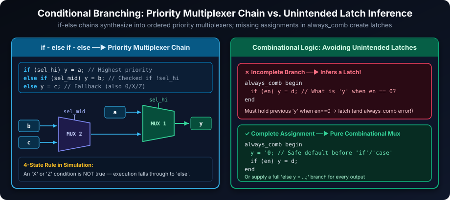
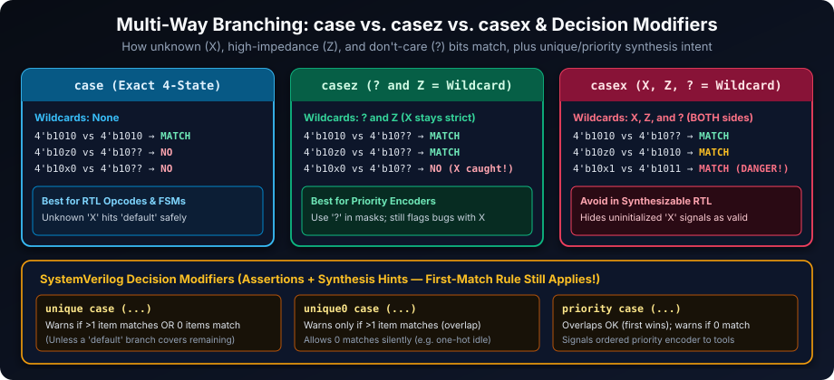
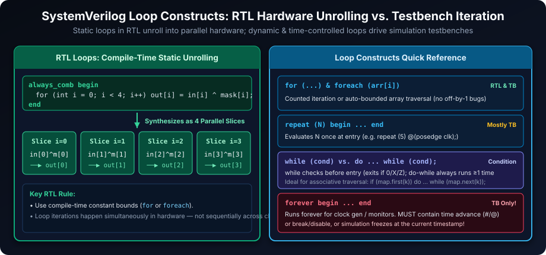
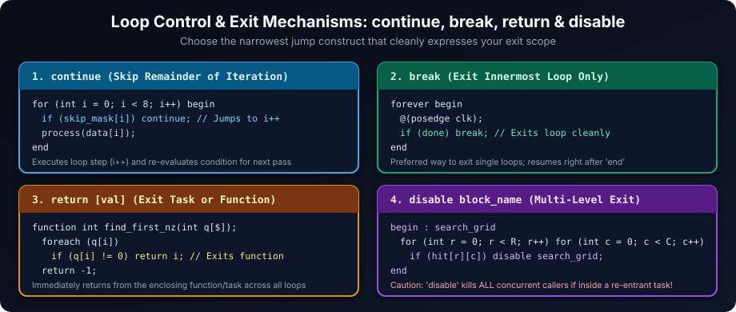

# Control Flow in SystemVerilog: Directing Execution

## Introduction

Control flow statements are the traffic directors of SystemVerilog, governing execution order in both hardware descriptions and verification environments. Mastering how `if-else`, `case` variants, and loop constructs map to combinational multiplexers, hardware unrolling, or sequential simulation loops ensures your SystemVerilog code is readable, latch-free, and free of subtle `X`/`Z` bugs.

## Learning Goals

By the end of this chapter, you should be able to:

- Select `if`, `case`, and loop constructs based on the behavior being modeled.
- Account for four-state `X`/`Z` values when conditions and case expressions are evaluated.
- Use `unique`, `unique0`, `priority`, `default`, and pre-default assignments without creating accidental latches.
- Write statically bounded loops for RTL synthesis and time-controlled loops for testbenches.
- Exit loops predictably using `continue`, `break`, `return`, or named-block `disable` when appropriate.

## Conditional Statements: Branching Logic

Conditional statements evaluate Boolean expressions and choose which execution path or hardware multiplexer input is active.



### `if-else` Statements: Binary and Multi-Way Decisions

- **`else if` Priority Chain**: Conditions are tested strictly top-to-bottom. The first true condition wins, synthesizing a cascaded priority multiplexer chain when used inside combinational `always_comb` logic.
- **Explicit `begin`/`end` Delimiters**: Always wrap multi-line or nested branches in `begin ... end` (remember that `{}` in SystemVerilog means vector concatenation or assignment patterns, never procedural blocks).
- **Preventing Accidental Latches**: In `always_comb`, assign safe default values to all outputs before `if` statements, or ensure every `if` has a matching `else` covering every output.

```systemverilog
module if_else_example;
  localparam int THRESHOLD_HIGH = 50;
  localparam int THRESHOLD_MID  = 30;
  logic [7:0] data_value = 8'd42;

  initial begin
    if (data_value > THRESHOLD_HIGH) begin
      $display("%0d: Data is HIGH (above %0d)", data_value, THRESHOLD_HIGH);
    end else if (data_value > THRESHOLD_MID) begin
      $display("%0d: Data is MEDIUM (%0d..%0d)", data_value, THRESHOLD_MID + 1, THRESHOLD_HIGH);
    end else begin
      $display("%0d: Data is LOW (<= %0d)", data_value, THRESHOLD_MID);
    end
  end
endmodule
```

**Four-State `X`/`Z` Evaluation Rule**: An `if (cond)` branch executes **only** when `cond` evaluates to a known non-zero value (`1` or non-zero vector). If `cond` evaluates to `0`, `'x`, or `'z`, execution skips that branch and falls into `else`. When unknown values must be caught rather than silently taking `else`, pair your logic with assertions or explicit `===` checks.

## Case Statements: Multi-Way Branching Based on Value

`case` statements dispatch among multiple branches by comparing a selector expression against a list of case items. Comparisons happen sequentially from top to bottom—the first matching item wins—so ordering matters whenever patterns overlap.



### `case`: Exact 4-State Value Matching

- **Bit-for-Bit 4-State Match**: Plain `case` matches `0`, `1`, `X`, and `Z` literally (`4'b10x1` only matches `4'b10x1`, not `4'b1011`).
- **Best for Opcodes and FSM States**: Unknown `X` control signals fail to match normal encoded items and fall cleanly into `default`.

```systemverilog
module case_example (
  input  logic [1:0] opcode,
  output logic [1:0] result
);
  always_comb begin
    result = 2'b00; // Safe default before case prevents latches
    case (opcode)
      2'b00:   result = 2'b01; // add
      2'b01:   result = 2'b10; // subtract
      2'b10:   result = 2'b11; // multiply
      default: result = 2'b00; // handles 2'b11 and any X/Z
    endcase
  end
endmodule
```

### `casez`: Wildcards for `Z` and `?`

- **Masked Pattern Matching**: `casez` treats `?` and `Z` in both the case expression and case items as don't-care wildcards, while **keeping `X` strict** (non-wildcard).
- **Use `?` for Readability**: Write `?` (rather than `z`) in case items to document intentionally ignored bits in priority encoders or address decoders, placing narrower/higher-priority patterns first.

```systemverilog
module casez_example (
  input  logic [3:0] request,
  output logic [1:0] source
);
  always_comb begin
    priority casez (request)
      4'b1???: source = 2'd3; // Bit 3 has highest priority
      4'b01??: source = 2'd2;
      4'b001?: source = 2'd1;
      default: source = 2'd0;
    endcase
  end
endmodule
```

### `casex`: Wildcards for `X`, `Z`, and `?` (Avoid in RTL)

`casex` treats `X`, `Z`, and `?` as wildcards on **both** sides. That means an uninitialized `4'b10x1` signal will silently match `4'b1011` and hide real reset or wiring bugs in simulation:

```systemverilog
module casez_vs_casex_example;
  logic [3:0] flags = 4'b10x1;

  initial begin
    casez (flags)
      4'b1011: $display("casez: valid status");
      default: $display("casez: unknown status"); // Executes: X is NOT ignored
    endcase

    casex (flags)
      4'b1011: $display("casex: valid status");   // Executes: X falsely treated as don't-care!
      default: $display("casex: unknown status");
    endcase
  end
endmodule
```

| Statement | Wildcards | X Handling | Recommended Domain |
| --- | --- | --- | --- |
| `case` | None | `X` must match `X` (falls to `default`) | Standard RTL decoders, FSMs, ALUs |
| `casez` | `?` and `Z` | `X` remains strict (exposes bugs) | Priority encoders &amp; masked bit patterns (use `?`) |
| `casex` | `X`, `Z`, and `?` | `X` silently matches any pattern | **Avoid in RTL** |

### `unique case`, `unique0 case`, and `priority case`

SystemVerilog decision modifiers add runtime simulator checks and communicate parallel/priority intent to synthesis tools without altering the basic first-match execution rule:

- **`unique case`**: Asserts that **exactly one** branch matches (warns on `0` matches or `&gt;1` overlapping matches; adding `default` suppresses the zero-match warning). Enables parallel multiplexer synthesis.
- **`unique0 case`**: Asserts that **at most one** branch matches (warns on overlapping matches, allows `0` matches without needing `default`).
- **`priority case`**: Asserts that **at least one** branch matches (allows overlapping patterns where the first wins; warns if `0` branches match without `default`).
- *(Same modifiers also work with `unique if`, `unique0 if`, and `priority if`.)*

## Loop Constructs: Repetitive Operations

SystemVerilog provides counted, condition-checked, array-driven, and infinite loops. In **synthesizable RTL**, loops (`for`, `foreach`) must have compile-time static bounds so tools can unroll them into parallel hardware slices; dynamic and infinite loops belong in **testbenches**.



### `repeat` Loop: Fixed Iteration Count

Evaluates `count` once upon entry and executes the body that many times (ideal in testbenches for waiting clock edges, e.g., `repeat (4) @(posedge clk);`).

```systemverilog
module repeat_example;
  localparam int NUM_REPEATS = 4;

  initial begin
    repeat (NUM_REPEATS) begin
      $display("- Repeat iteration");
    end
  end
endmodule
```

### `while` and `do-while` Loops: Condition-Based Iteration

- **`while (cond)`**: Evaluates `cond` *before* each pass. If `cond` is `0`, `X`, or `Z` on entry, the body executes zero times.
- **`do ... while (cond);`**: Evaluates `cond` *after* the body, guaranteeing at least one iteration (great for associative array `.first()` / `.next()` iteration).

```systemverilog
module while_example;
  int counter = 0;
  localparam int LIMIT = 5;

  initial begin
    while (counter < LIMIT) begin
      $display("- While loop count: %0d", counter);
      counter++;
    end
  end
endmodule
```

### `for` Loop: Compact Counted Iteration

Combines initialization, condition, and step in one header; declare the loop variable inline (`for (int i = 0; ...)` so its scope stays local to the loop and avoids race conditions across concurrent loops):

```systemverilog
module for_example;
  localparam int ITERATIONS = 3;

  initial begin
    for (int i = 0; i < ITERATIONS; i++) begin
      $display("- For loop iteration i = %0d", i);
    end
  end
endmodule
```

### `foreach` Loop: Safe Automatic Array Traversal

Automatically iterates across declared array dimensions (ascending or descending, packed or unpacked, fixed, dynamic, associative, or queue) without manual index bounds:

```systemverilog
module foreach_example;
  int data_values [5] = '{15, 25, 35, 45, 55};

  initial begin
    foreach (data_values[idx]) begin
      $display("- data_values[%0d] = %0d", idx, data_values[idx]);
    end
  end
endmodule
```

### `forever` Loop: Continuous Testbench Processes

Runs indefinitely—used in testbenches for clock generation and continuously polling monitors. **Always include timing control (`#delay` or `@(event)`) or an exit condition (`break`/`disable`)**, or simulation will hang at zero simulation time.

```systemverilog
module forever_example;
  initial begin : forever_process
    int cycle_count = 0;
    forever begin
      $display("- Cycle %0d", cycle_count);
      cycle_count++;
      #10;
      if (cycle_count >= 5) break; // Cleanly exit loop after 5 cycles
    end
    $display("Exited forever loop cleanly.");
  end
endmodule
```

### Controlling Loop Flow: `continue`, `break`, `return`, and `disable`



- **`continue`**: Skips the rest of the current iteration and jumps to the loop's step/condition check.
- **`break`**: Immediately exits the innermost enclosing loop.
- **`return`**: Immediately exits the enclosing `function` or `task`.
- **`disable block_name`**: Aborts a named `begin : block_name` block (useful for breaking out of nested loops, though note that `disable` affects *all* active threads inside a static/re-entrant block).

## Exercises to Solidify Control Flow Understanding

Try implementing each task before reviewing the reference solutions below.

1. **Number Classifier (`if-else`)**: Classify an integer `val` as `"Positive"`, `"Negative"`, or `"Zero"`.

   ```systemverilog
   function automatic void classify_int(int val);
     if (val > 0)      $display("%0d: Positive", val);
     else if (val < 0) $display("%0d: Negative", val);
     else              $display("%0d: Zero", val);
   endfunction
   ```

2. **Weekday Name (`case`)**: Map `day_num` (`1..7`) to a weekday string using `unique case` with a `default` branch.

   ```systemverilog
   function automatic string weekday_name(logic [2:0] day_num);
     unique case (day_num)
       3'd1:    return "Monday";
       3'd2:    return "Tuesday";
       3'd3:    return "Wednesday";
       3'd4:    return "Thursday";
       3'd5:    return "Friday";
       3'd6:    return "Saturday";
       3'd7:    return "Sunday";
       default: return "Invalid";
     endcase
   endfunction
   ```

3. **`repeat` Loop Counter**: Display numbers from `1` through parameterized `LIMIT`.

   ```systemverilog
   module repeat_counter #(parameter int LIMIT = 7);
     initial begin
       int n = 1;
       repeat (LIMIT) begin
         $display("Count: %0d", n);
         n++;
       end
     end
   endmodule
   ```

4. **Array Traversal (`while` Loop)**: Traverse an unpacked array `int arr[4] = '{10, 20, 30, 40}` using `while`.

   ```systemverilog
   initial begin
     int arr[4] = '{10, 20, 30, 40};
     int idx = 0;
     while (idx < $size(arr)) begin
       $display("arr[%0d] = %0d", idx, arr[idx]);
       idx++;
     end
   end
   ```

5. **Factorial Calculation (`for` Loop)**: Compute `N!` for a parameterized non-negative integer `N`.

   ```systemverilog
   module factorial_calc #(parameter int N = 5);
     initial begin
       longint fact = 1;
       for (int i = 2; i <= N; i++) fact *= i;
       $display("%0d! = %0d", N, fact);
     end
   endmodule
   ```

6. **Array Summation (`foreach` Loop)**: Compute and display the sum of `int vals[5] = '{3, 7, 2, 9, 4}` using `foreach`.

   ```systemverilog
   initial begin
     int vals[5] = '{3, 7, 2, 9, 4};
     int total = 0;
     foreach (vals[i]) total += vals[i];
     $display("Sum = %0d", total);
   end
   ```

7. **Controlled Clock Generator (`forever` Loop)**: Generate a 10 ns period clock for `20` cycles and terminate cleanly.

   ```systemverilog
   module tb_clk_gen;
     logic clk = 1'b0;
     initial begin : clk_driver
       int cycles = 0;
       forever begin
         #5 clk = ~clk;
         if (clk === 1'b1) begin
           cycles++;
           $display("Posedge cycle %0d at %0t", cycles, $time);
           if (cycles >= 20) disable clk_driver;
         end
       end
     end
   endmodule
   ```

By choosing the right branching and looping constructs for synthesis versus verification, you eliminate accidental latches, prevent `casex` masking bugs, and keep simulation testbenches deterministic and readable.

##### Copyright (c) 2026 squared-studio
