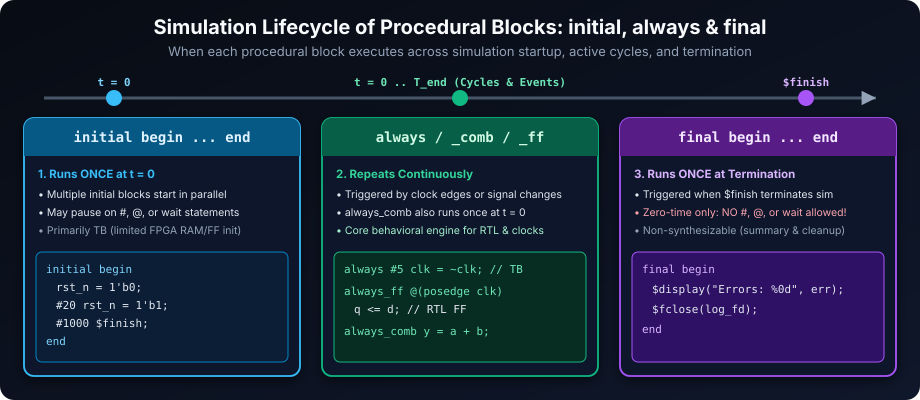
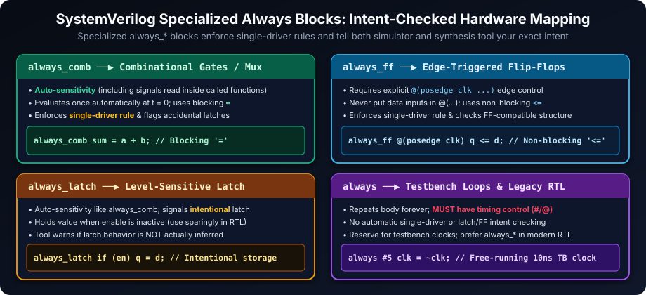
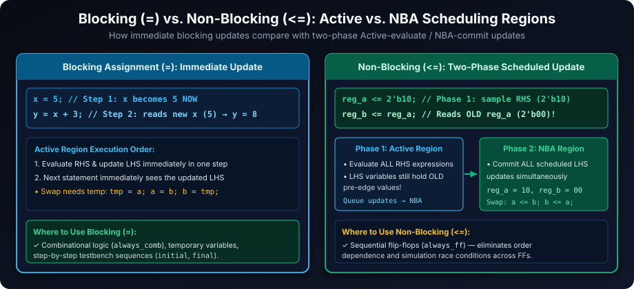
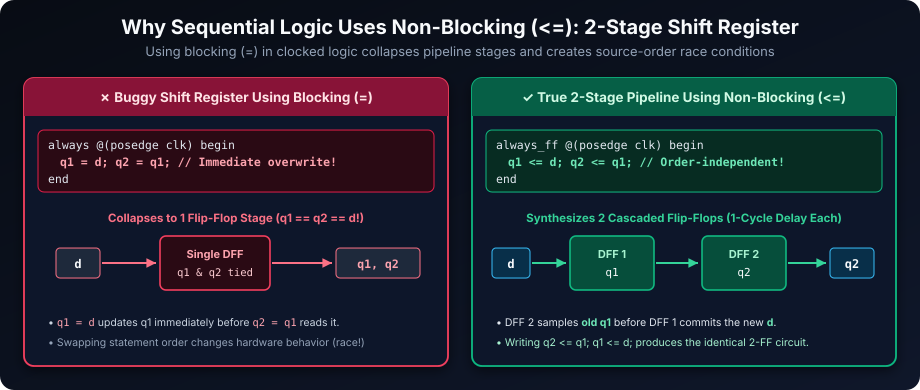

# Procedural Blocks in SystemVerilog: Behavioral Modeling Core

## Introduction

Procedural blocks are the engines of behavioral modeling in SystemVerilog. Unlike continuous `assign` statements that evaluate concurrently as input wires change, statements *inside* a procedural block execute **sequentially** from top to bottom until they reach a delay (`#`), event control (`@`), or wait condition. Multiple procedural blocks execute concurrently with one another, making the choice between `initial`, `final`, and the `always` family—and between blocking (`=`) and non-blocking (`<=`) assignments—critical for race-free simulation and accurate hardware synthesis.

## Learning Goals

By the end of this chapter, you should be able to:

- Distinguish `initial`, `final`, general `always`, `always_comb`, `always_ff`, and `always_latch` processes.
- Choose blocking (`=`) or non-blocking (`<=`) assignments according to the behavior being modeled.
- Explain simulation scheduling, including concurrent processes and non-blocking NBA update timing.
- Write complete combinational logic and intentional sequential or latch behavior without accidental storage.
- Recognize synthesis-tool checks and avoid race-prone or multiply driven procedural code.

## Initial Blocks: Simulation Setup and Initialization

`initial` blocks execute **once starting at simulation time `0`**. Their primary role is initializing testbench variables, resetting the DUT, opening log files, and driving stimulus sequences.



**Key Characteristics and Usage:**

- **Single Entry at `t = 0`**: Execution begins once at time `0` and proceeds sequentially until the block finishes.
- **Multiple Concurrent `initial` Blocks**: All `initial` blocks start concurrently at time `0` in arbitrary simulator order—never assume one `initial` block finishes before another starts at `t = 0`.
- **Testbench Focus**: Primarily used in verification. While some FPGA synthesis tools support `initial` blocks or declaration initialization for inferred memories and power-on register states, ASIC flows generally treat `initial` blocks as non-synthesizable.

```systemverilog
module testbench;
  logic       clk;
  logic       rst_n;
  logic [7:0] data_in;
  logic       start_transaction;

  initial begin // Stimulus thread
    clk               = 1'b0;
    rst_n             = 1'b0;
    data_in           = 8'h00;
    start_transaction = 1'b0;

    $display("Testbench: Simulation starting at %0t", $time);
    #20  rst_n             = 1'b1; // De-assert reset
    #50  start_transaction = 1'b1; // Start transaction
    #100 start_transaction = 1'b0;
  end

  initial begin // Watchdog thread (runs concurrently with block 1)
    #1000 $finish;
  end

  always #5 clk = ~clk; // Free-running clock (period = 10 time units)
endmodule
```

## Final Blocks: Simulation Wrap-up and Reporting

`final` blocks execute **once right before simulation exits** (for example, when `$finish` terminates active simulation threads).

**Key Characteristics and Usage:**

- **Zero Simulation Time Execution**: A `final` block executes like a function call—it **cannot** contain `#delay`, `@(event)`, `wait`, or `fork...join` statements that consume simulation time.
- **Non-Synthesizable**: Used strictly in testbenches for printing pass/fail summaries, transaction counts, coverage reports, and closing `$fopen` file handles.

```systemverilog
module verification_environment;
  int transaction_count = 0;
  int error_count       = 0;
  int log_file_desc;

  initial begin
    log_file_desc = $fopen("simulation_log.txt", "w");
    // ... run simulation stimulus & scoreboard ...
  end

  final begin
    $display("\n--- Simulation Summary ---");
    $display("Total Transactions: %0d", transaction_count);
    $display("Total Errors:       %0d", error_count);
    if (error_count > 0)
      $display("SIMULATION FAILED!");
    else
      $display("SIMULATION PASSED!");
    if (log_file_desc != 0) $fclose(log_file_desc);
  end
endmodule
```

## Always Blocks: Continuous, Reactive Behavior

The `always` family models processes that repeat indefinitely throughout simulation. SystemVerilog adds specialized intent-checked variants—`always_comb`, `always_ff`, and `always_latch`—that detect missing sensitivity signals, accidental latches, and multiple-driver bugs at compile or simulation time.



### General `always` Block: Testbench Clock Generation &amp; Legacy RTL

General `always` repeats its statement forever without compiler checks for combinational, flip-flop, or latch intent. **Always include a timing control (`#` or `@`)** inside a general `always` block—otherwise it loops forever at zero simulation time and freezes the simulator. Reserve bare `always #...` for testbench clocks; use specialized `always_*` blocks in RTL.

```systemverilog
module clock_generator (
  output logic clk_out
);
  initial clk_out = 1'b0;
  always #5 clk_out = ~clk_out; // Toggles every 5 time units (period = 10)
endmodule
```

### `always_comb` Block: Combinational Logic Inference

- **Automatic Sensitivity List**: Automatically tracks every signal read inside the block **and inside any functions called from the block**.
- **Time-0 Evaluation**: Automatically evaluates once at time `0` after `initial` zero-time initializations settle, preventing initial `'x` mismatches on combinational outputs.
- **Single-Driver &amp; Complete Assignment**: Tools forbid driving the same variable from another procedural block and flag incomplete `if`/`case` paths that would infer a latch. Use **blocking assignments (`=`)**.

```systemverilog
module combinational_adder (
  input  logic [7:0] input_a,
  input  logic [7:0] input_b,
  output logic [7:0] sum
);
  always_comb begin
    sum = input_a + input_b;
  end
endmodule
```

### `always_ff` Block: Sequential Logic (Flip-Flop) Inference

- **Explicit Edge Control Required**: Sensitivity must list only clock edge(s) and optional asynchronous reset/preset edges (`@(posedge clk or negedge rst_n)`). Data inputs belong inside the body, never in `@(...)`.
- **Single-Driver Enforcement**: Tools check that outputs are driven by a single `always_ff` block and match a valid flip-flop template. Use **non-blocking assignments (`<=`)**.

```systemverilog
module d_flip_flop (
  input  logic clk,
  input  logic rst_n,
  input  logic data_in,
  output logic data_out
);
  always_ff @(posedge clk or negedge rst_n) begin
    if (!rst_n) begin
      data_out <= 1'b0;    // Asynchronous active-low reset
    end else begin
      data_out <= data_in; // Synchronous D input capture
    end
  end
endmodule
```

### `always_latch` Block: Intentional Level-Sensitive Latches

`always_latch` uses automatic sensitivity like `always_comb`, while telling tools that **level-sensitive state retention is intentional** (and warning if the block actually describes purely combinational logic without memory). Avoid latches in synchronous RTL unless required by specialized low-power or clock-gating cells.

```systemverilog
module level_sensitive_latch (
  input  logic enable,
  input  logic data_in,
  output logic data_out
);
  always_latch begin
    if (enable) begin
      data_out = data_in; // Transparent when enable == 1; holds state when enable == 0
    end
  end
endmodule
```

## Assignment Types within Procedural Blocks: Blocking vs. Non-Blocking



### Blocking Assignments (`=`): Immediate Update in the Active Region

When a procedural blocking assignment (`=`) executes, its RHS expression is evaluated and its LHS target is updated **immediately** before the next statement runs.

- **Use for**: Combinational logic in `always_comb`, loop counters/temporaries, and sequential step-by-step operations in `initial`/`final` testbench procedures.

```systemverilog
module blocking_assignment_example;
  int variable_x, variable_y;

  initial begin
    variable_x = 5;              // variable_x becomes 5 immediately
    variable_y = variable_x + 3; // Reads updated variable_x -> 8
    $display("variable_x = %0d, variable_y = %0d", variable_x, variable_y);
  end
endmodule
```

### Non-Blocking Assignments (`<=`): Scheduled Update in the NBA Region

A non-blocking assignment (`<=`) operates in two phases within the same simulation timestamp:
1. **Active Region**: Evaluates the RHS expression using the **current** values of all signals and schedules an update event in the **NBA (Non-Blocking Assignment)** queue without pausing block execution.
2. **NBA Region**: After all Active-region statements finish, commits all queued LHS updates simultaneously.

- **Use for**: Flip-flops and registers in `always_ff`, and driving synchronous DUT inputs from a testbench clock edge without clock-skew race conditions.

```systemverilog
module non_blocking_assignment_example;
  logic [1:0] register_a = 2'b00;
  logic [1:0] register_b = 2'b00;

  initial begin
    register_a <= 2'b10;      // Evaluates 2'b10 now; updates register_a in NBA
    register_b <= register_a; // Samples OLD register_a (2'b00) in Active; updates in NBA

    #1 $display("register_a = %b, register_b = %b", register_a, register_b);
    // Output at t=1: register_a = 10, register_b = 00
  end
endmodule
```

**Key Rules for Assignment Types:**

- **Continuous `assign` (`assign y = a & b;`)**: Outside any procedural block, `=` is a continuous assignment, *not* a procedural blocking assignment.
- **Combinational (`always_comb` / `always_latch`)**: Use `=`.
- **Sequential (`always_ff`)**: Use `<=`.
- **Never mix `=` and `<=` on the same variable** inside a procedural block—and never drive the same variable from multiple `always_*` blocks.

## Best Practices and Common Pitfalls with Procedural Blocks



1. **Always Use `<=` in Clocked Flip-Flop Pipelines**:
   Writing `q1 = d; q2 = q1;` inside a clocked block updates `q1` immediately, so `q2` latches the *new* `d` on the same clock edge—collapsing a 2-stage pipeline into 1 register and creating a source-order race condition. Using `q1 <= d; q2 <= q1;` guarantees `q2` captures the pre-edge value of `q1`, matching real flip-flop hardware regardless of statement order.

2. **Prevent Unintended Latches in `always_comb`**:
   Assign safe defaults at the top of `always_comb` or ensure every `if` / `case` branch assigns all outputs:

   ```systemverilog
   // BAD: Missing 'else' creates a latch!
   always_comb begin
     if (enable) output_signal = input_data;
   end

   // GOOD: Pre-default or explicit 'else' guarantees pure combinational logic
   always_comb begin
     output_signal = 1'b0;
     if (enable) output_signal = input_data;
   end
   ```

3. **Keep `always_ff` Sensitivity Lists Strictly to Clock and Async Control Edges**:
   Include `posedge clk` (or `negedge clk`) and asynchronous resets/presets (`negedge rst_n`); never list combinational data signals inside `@(...)`.

4. **Do Not Create Multiple Drivers**:
   Writing to the same signal from two separate `always_comb` or `always_ff` blocks triggers compile/elaboration errors (and causes `X` contention in hardware/simulation if general `always` blocks are used).

## Exercises to Practice Procedural Blocks

Try writing each design before comparing with the reference solutions below.

1. **Initial Block Message**: Display `"System Initialization Started..."` at time `0`.

   ```systemverilog
   module tb_init_msg;
     initial $display("System Initialization Started...");
   endmodule
   ```

2. **Final Block Simulation Time Report**: Report elapsed `$time` inside a `final` block after `#100`.

   ```systemverilog
   module tb_final_time;
     initial #100 $finish;
     final $display("Total simulation time elapsed: %0t", $time);
   endmodule
   ```

3. **100 MHz Clock Generator**: Generate a 100 MHz clock (10 ns period, 50% duty cycle) with `1ns` timescale.

   ```systemverilog
   `timescale 1ns/1ps
   module clk_100mhz (output logic clk = 1'b0);
     always #5 clk = ~clk; // 5ns high + 5ns low = 10ns period (100 MHz)
   endmodule
   ```

4. **Combinational 8-bit Multiplier**: Compute the 16-bit product of two 8-bit unsigned inputs using `always_comb`.

   ```systemverilog
   module mul_8x8_comb (
     input  logic [7:0]  a, b,
     output logic [15:0] product
   );
     always_comb product = a * b;
   endmodule
   ```

5. **4-bit Synchronous Counter with Asynchronous Reset**: Increment on `posedge clk`, reset to `0` on `negedge rst_n`.

   ```systemverilog
   module counter_4bit (
     input  logic       clk, rst_n,
     output logic [3:0] count
   );
     always_ff @(posedge clk or negedge rst_n) begin
       if (!rst_n) count <= 4'd0;
       else        count <= count + 4'd1;
     end
   endmodule
   ```

6. **Transparent Latch**: Pass `data_in` when `enable` is high and retain state when `enable` is low using `always_latch`.

   ```systemverilog
   module transparent_latch_8bit (
     input  logic       enable,
     input  logic [7:0] data_in,
     output logic [7:0] data_out
   );
     always_latch begin
       if (enable) data_out = data_in;
     end
   endmodule
   ```

7. **Blocking vs. Non-Blocking Value Swap**: Contrast swapping two variables without a temporary using `=` vs. `<=`.

   ```systemverilog
   module swap_comparison;
     int blk_a = 10, blk_b = 20;
     int nba_a = 10, nba_b = 20;

     initial begin
       // Blocking without temp overwrites blk_a first -> BOTH become 20!
       blk_a = blk_b;
       blk_b = blk_a;

       // Non-blocking samples both RHS values in Active, commits in NBA -> clean swap!
       nba_a <= nba_b;
       nba_b <= nba_a;

       #1;
       $display("Blocking result:     blk_a=%0d, blk_b=%0d (lost 10!)", blk_a, blk_b);
       $display("Non-blocking result: nba_a=%0d, nba_b=%0d (swapped!)", nba_a, nba_b);
     end
   endmodule
   ```

Mastering procedural blocks and NBA vs. Active scheduling ensures your combinational logic stays latch-free, your sequential pipelines match silicon behavior cycle-for-cycle, and your testbenches execute cleanly without race conditions.

##### Copyright (c) 2026 squared-studio
