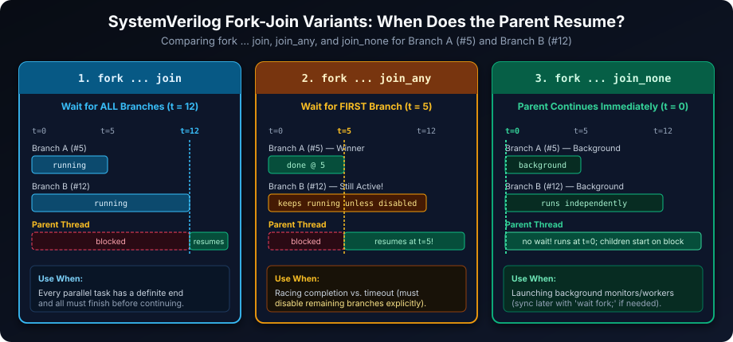
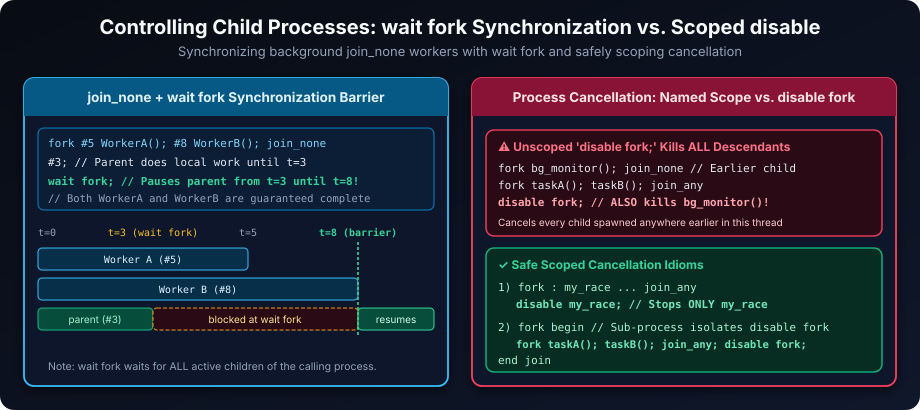
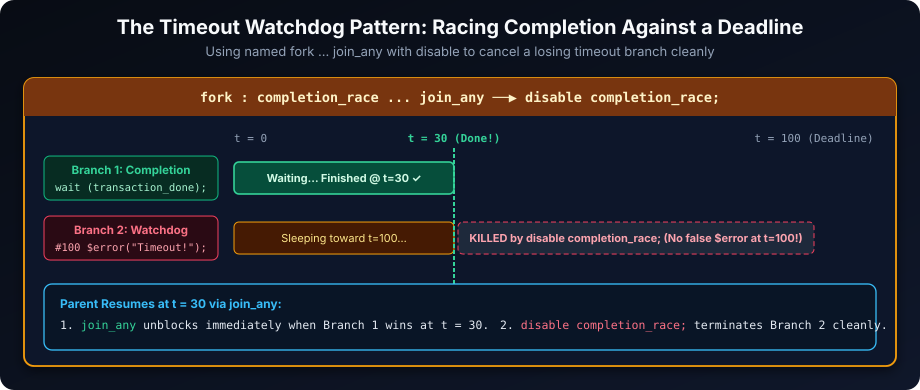
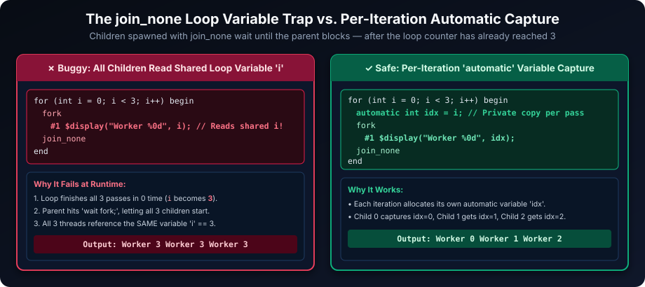

# Fork-Join in SystemVerilog: Concurrent Processes and Synchronization

## Introduction

SystemVerilog procedural statements execute sequentially inside a single process. When a verification testbench needs drivers, monitors, background checkers, and timeout watchdogs running simultaneously, the `fork` construct spawns multiple independent child processes concurrently.

The matching join keyword—`join`, `join_any`, or `join_none`—determines when the parent process resumes: after every child finishes, after the first child finishes, or immediately. Choosing the right join variant, synchronizing with `wait fork`, and scoping process cancellation cleanly are essential for race-free simulation.

## Learning Goals

By the end of this chapter, you should be able to:

- Explain how a `fork` block creates concurrent child processes.
- Choose among `join`, `join_any`, and `join_none` based on synchronization needs.
- Wait on outstanding child processes using `wait fork`.
- Stop competing or unneeded processes deliberately using named forks or isolated `disable fork` scopes.
- Avoid simulation races caused by shared variables and `join_none` loop-variable capture.
- Recognize that `fork...join` is a verification/simulation construct, not synthesizable RTL.

## The `fork` Construct: Starting Concurrent Processes

A `fork` block creates a separate child process for **each statement** inside its body. Use `begin ... end` to group multiple sequential statements into a single concurrent branch; without `begin ... end`, every individual line becomes its own parallel branch!



```systemverilog
initial begin
  fork
    begin // Branch 1
      #5  $display("First branch finished at %0t", $time);
    end
    begin // Branch 2
      #12 $display("Second branch finished at %0t", $time);
    end
  join

  $display("All branches finished at %0t", $time); // Prints at t = 12
end
```

Both branches start concurrently at `t = 0` and progress independently. If two branches read/write shared state in the same timestamp, never depend on source-code order—use explicit synchronization (`event`, `semaphore`, `mailbox`).

### `fork` Does Not Mean Parallel Hardware

Forked processes are simulator threads, **not** parallel RTL hardware blocks. Reserve `fork...join` for `initial` blocks, testbench tasks, scoreboards, and drivers; model parallel hardware in RTL with `always_comb`, `always_ff`, continuous `assign`, and module instances.

## `join`: Wait for Every Branch

`join` suspends the parent process until **every branch** spawned by that `fork` completes.

```systemverilog
initial begin
  $display("Starting parallel checks");

  fork
    begin
      #10 $display("Data check complete at %0t", $time);
    end
    begin
      #4;
      #9  $display("Protocol check complete at %0t", $time); // Total: 13 time units
    end
  join

  $display("Both checks completed at %0t", $time); // Prints at t = 13
end
```

Use `join` when all branches have a definite end and the caller cannot proceed until every branch completes. Note that if any branch contains an infinite loop (such as `forever`), `fork ... join` will block forever.

## `join_any`: Continue After the First Branch

`join_any` suspends the parent only until **the first branch** finishes. Any remaining branches **keep running in the background** unless you stop them explicitly.

```systemverilog
initial begin
  fork
    begin
      #20  $display("Transaction completed at %0t", $time);
    end
    begin
      #100 $error("Transaction timed out");
    end
  join_any

  $display("First branch finished at %0t", $time); // Prints at t = 20
end
```

In this snippet, without explicit cancellation, the `#100 $error(...)` branch stays alive after `t = 20` and will still fire at `t = 100`! Always cancel or coordinate losing branches after `join_any` when modeling races.

## `join_none`: Continue Without Waiting

`join_none` lets the parent resume **immediately at the current timestamp** without waiting for any child to finish. Child processes stay active in the background.

```systemverilog
initial begin
  fork
    begin
      #10 $display("Background task completed at %0t", $time);
    end
  join_none

  $display("Parent continues immediately at %0t", $time); // Prints at t = 0
  #20; // Parent waits, allowing child to run and print at t = 10
end
```

**Important Scheduling Detail**: Child threads spawned by `join_none` are queued to run, and **do not execute their first statement until the parent process suspends** (at `#delay`, `@event`, `wait`, `wait fork;`) or finishes. This subtle rule is why unsynchronized loop variables change before `join_none` workers read them.

## Waiting for Outstanding Children with `wait fork`

`wait fork;` blocks the calling process until **all currently active child processes spawned by that caller** finish. It is the standard barrier used after launching background workers with `join_none`.

```systemverilog
initial begin
  fork
    begin
      #5 $display("Worker A done at %0t", $time);
    end
    begin
      #8 $display("Worker B done at %0t", $time);
    end
  join_none

  $display("Parent performs local work at %0t", $time); // t = 0
  #3;
  $display("Parent now waits at %0t", $time);           // t = 3
  wait fork;                                            // Blocks until t = 8
  $display("All child processes are done at %0t", $time);
end
```

Keep in mind that `wait fork;` waits for *every* active child thread owned by the calling process (not just the most recent `fork`), so be careful if the caller earlier spawned persistent background monitors meant to run forever.

## Ending Processes Deliberately



To cleanly stop remaining processes after a `join_any` race—without accidentally killing unrelated background monitors—use one of two scoped patterns:

1. **Named `fork : label` + `disable label;`** (stops only branches inside that named fork):

```systemverilog
initial begin
  fork : transaction_or_timeout
    begin
      #20  $display("Transaction completed at %0t", $time);
    end
    begin
      #100 $error("Transaction timed out");
    end
  join_any

  disable transaction_or_timeout; // Terminates only the pending timeout branch
  $display("Clean exit at %0t", $time);
end
```

2. **Isolated Sub-Process Wrapper (`fork begin ... join` + `disable fork;`)**: Calling `disable fork;` directly kills *all* active descendants of the **calling process**. Wrapping the `fork ... join_any; disable fork;` race inside an outer single-branch `fork begin ... end join` gives it its own child process boundary, protecting earlier monitors spawned by the outer `initial` process:

```systemverilog
initial begin
  fork background_monitor(); join_none // Protected outer monitor

  fork // Single-branch outer fork creates an isolated child process boundary
    begin
      fork
        do_transaction();
        #100 $error("Timeout!");
      join_any
      disable fork; // Terminates ONLY do_transaction / timeout inside this child process
    end
  join
end
```

Remember that `disable` is an **abrupt termination**: code after the cancellation point inside the killed branch will not run, so do not rely on a killed thread to release semaphores or close files.

## A Practical Race: Timeout Versus Completion



A classic verification pattern races a transaction completion event against a maximum latency timeout:

```systemverilog
module transaction_watchdog;
  bit transaction_done = 1'b0;

  initial begin
    fork : completion_race
      begin
        wait (transaction_done === 1'b1);
        $display("Transaction completed at %0t", $time);
      end
      begin
        #100;
        $error("Transaction timed out at %0t", $time);
      end
    join_any

    disable completion_race; // Immediately kills whichever branch lost
  end

  initial begin
    #30 transaction_done = 1'b1; // Finishes well before timeout at t = 100
  end
endmodule
```

At `t = 30`, `wait (transaction_done === 1'b1)` completes, `join_any` unblocks the parent, and `disable completion_race;` immediately cancels the sleeping `#100` timeout branch so no false error fires at `t = 100`.

## Shared Variables and Race Conditions

When two concurrent branches write to the same variable without synchronization, the final result depends on arbitrary simulator thread ordering:

```systemverilog
int result;

initial begin
  fork
    result = 1;
    result = 2;
  join
  // Race condition: simulator may schedule branch 1 or branch 2 last!
  $display("result = %0d", result);
end
```

Give each branch its own output variable (and combine after `join`), or coordinate shared resources explicitly using `mailbox`, `semaphore`, or named `event` handshakes rather than inserting artificial `#1` delays.

## Loop Variables with `join_none`



Because `join_none` threads only start executing after the parent hits a blocking statement (typically `wait fork;` *after* the `for` loop has finished), referencing the loop index `i` directly causes every spawned worker to read the final post-loop value (`3`)!

Fix this by capturing a fresh **`automatic`** variable inside every loop iteration before entering `fork ... join_none`:

```systemverilog
initial begin
  for (int i = 0; i < 3; i++) begin
    automatic int index = i; // Separate per-iteration automatic variable

    fork
      begin
        #1 $display("Worker %0d running at %0t", index, $time);
      end
    join_none
  end

  wait fork; // Prints Worker 0, Worker 1, Worker 2 cleanly
end
```

## Best Practices and Common Pitfalls

1. **Match the Join Variant to the Synchronization Goal**: Use `join` for barrier completion, `join_any` for first-to-finish races, and `join_none` for background tasks.
2. **Never Assume Source Order Between Concurrent Branches**: Coordinate shared accesses with events, semaphores, or mailboxes.
3. **Always Clean Up Losing Branches After `join_any`**: Leftover timeout branches fire later in simulation and cause false failures.
4. **Scope Cancellation Tightly**: Prefer `fork : race_name ... join_any; disable race_name;` (or a helper task wrapping `disable fork;`) over bare `disable fork;` inside a thread that owns long-lived background monitors.
5. **Capture Loop Indices in `automatic` Variables Before `join_none`**: Prevents all workers from seeing the terminal loop count.
6. **Keep `fork...join` in Testbenches**: Use `always_comb`, `always_ff`, and `assign` for synthesizable RTL hardware.

## Summary

| Construct | Parent Blocks Until... | Remaining Children After Unblock | Typical Role |
| --- | --- | --- | --- |
| `fork ... join` | **All** branches finish | None (all finished) | Parallel drivers/checkers that must all complete |
| `fork ... join_any` | **First** branch finishes | Keep running until done or disabled | Timeout watchdogs &amp; racing events |
| `fork ... join_none` | **Immediate** (no wait) | Start when parent suspends/exits | Background monitors &amp; independent workers |
| `wait fork;` | All active child processes of caller finish | All finished | Joining previously launched `join_none` work |
| `disable <label>;` | Immediate | Kills threads inside named `<label>` only | Targeted cleanup of a specific `join_any` race |
| `disable fork;` | Immediate | Kills **all** descendants of calling process | Full teardown inside an isolated scope or task |

##### Copyright (c) 2026 squared-studio
