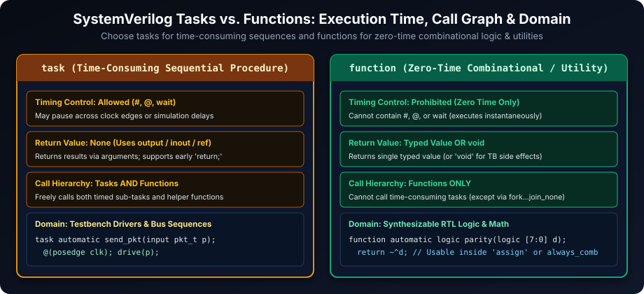
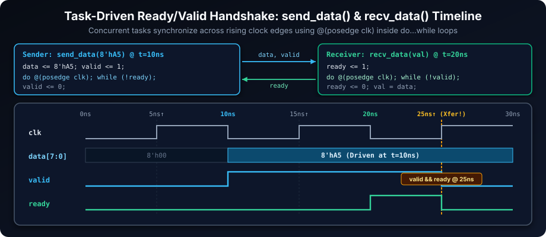
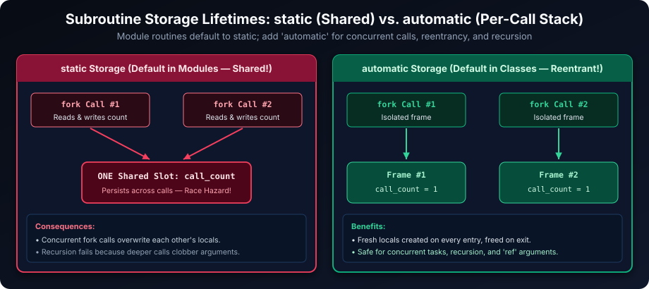
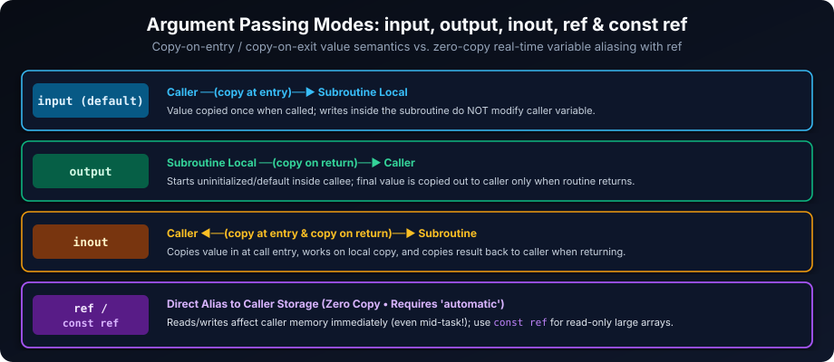

# Tasks and Functions in SystemVerilog: Modular Code and Reusability

## Introduction

Tasks and functions are the core building blocks for creating modular, reusable, and maintainable SystemVerilog code. By encapsulating repeated logic or bus sequences into well-defined subroutines, you separate *what* an operation does from *where* it is invoked—improving readability across both RTL designs and verification testbenches.

### Learning Goals

By the end of this chapter, you should be able to:

- Distinguish tasks from functions by timing behavior, call hierarchy, arguments, and typical RTL or verification use.
- Choose appropriate argument directions (`input`, `output`, `inout`, `ref`, `const ref`) and storage lifetimes (`static` vs. `automatic`).
- Write `automatic` tasks and functions that are safe to call recursively or concurrently inside `fork...join`.
- Separate synthesizable combinational RTL functions from simulation-only testbench tasks.

## Key Differences: Tasks vs. Functions - Choosing the Right Tool

While both tasks and functions promote code reuse, SystemVerilog gives them very different timing and call rules. Choosing the right one prevents compile errors and unintended simulation races.



| Feature | Tasks (`task ... endtask`) | Functions (`function ... endfunction`) |
| --- | --- | --- |
| **Timing Controls** | **Allowed** (`#delay`, `@event`, `wait`) | **Prohibited** (must execute in zero simulation time) |
| **Return Value** | **None** (returns data via `output`, `inout`, or `ref`; supports early `return;`) | **Typed value or `void`** (returns a single value via `return expr;` or function name) |
| **Call Hierarchy** | Can call **both tasks and functions** | Can directly call **only functions** (may launch a task via `fork...join_none`) |
| **Execution Time** | **May consume simulation time** across clock cycles | **Zero simulation time** (instantaneous evaluation) |
| **Typical Use Cases** | Testbench stimulus drivers, protocol handshakes, timed checks | Combinational RTL logic, checksums, lookups, `void` logging helpers |
| **Synthesis for RTL** | Not synthesizable if timed; synthesizable only when untimed &amp; behavioral | **Synthesizable** as combinational logic when following RTL rules |

**Rule of Thumb**: Use a **function** whenever an operation finishes in zero time (combinational logic, calculations, formatting); use a **task** whenever an operation must wait for time delays or clock edges.

## Task Implementation: Modeling Sequential Behavior

Tasks encapsulate multi-step operations involving time delays, clock-edge synchronization, and side effects. Notice that SystemVerilog allows multiple statements directly inside `task ... endtask` without needing an extra inner `begin ... end` wrapper.

### Basic Task Structure

```systemverilog
task automatic task_name (
  input  logic [7:0] cmd,
  output logic       ack
);
  // Task body may include #delays, @(posedge clk), or wait(...)
  @(posedge clk);
  ack = 1'b1;
endtask
```

### Example: Ready/Valid Handshake Tasks (`send_data` &amp; `recv_data`)



```systemverilog
module task_test;
  logic       clk   = 1'b0;
  logic [7:0] data  = 8'h00;
  logic       valid = 1'b0;
  logic       ready = 1'b0;

  // Free-running 10 ns clock
  always #5ns clk = ~clk;

  // Drive one data item and hold valid high until ready is sampled high on posedge clk
  task automatic send_data(input int value);
    data  <= 8'(value);
    valid <= 1'b1;
    do @(posedge clk); while (!ready);
    valid <= 1'b0;
  endtask

  // Raise ready and wait until valid is sampled high on posedge clk
  task automatic recv_data(output int value);
    ready <= 1'b1;
    do @(posedge clk); while (!valid);
    ready <= 1'b0;
    value = int'(data);
  endtask

  initial begin
    $timeformat(-9, 0, "ns");
    #50ns $finish;
  end

  initial begin
    #10ns;
    $display("[%0t] Starting data send...", $time);
    send_data(8'hA5);
    $display("[%0t] Sent data: 0x%0h", $time, 8'hA5);
  end

  initial begin
    int captured;
    #20ns;
    $display("[%0t] Starting data receive...", $time);
    recv_data(captured);
    $display("[%0t] Received data: 0x%0h", $time, captured);
  end
endmodule
```

**Explanation**:
- At `10 ns`, `send_data` asserts `valid` and drives `8'hA5`, then waits on `@(posedge clk)` until `ready` is high.
- At `20 ns`, `recv_data` asserts `ready`. On the next rising edge (`25 ns`), both `valid` and `ready` are high, completing the transfer cleanly for both tasks simultaneously.
- Declaring both tasks `automatic` ensures each call maintains private local storage if multiple channels invoke them concurrently.

## Function Implementation: Combinational Logic and Calculations

Functions compute and return a single value in **zero simulation time**. Keep RTL functions purely combinational and free of side effects (do not read/modify external state variables silently) so `always_comb` and `assign` synthesize predictably.

### Basic Function Structure

```systemverilog
function automatic logic [7:0] mask_upper (input logic [7:0] val);
  return val & 8'h0F; // Preferred SystemVerilog 'return' statement
endfunction
```

- **Implicit `input` Direction**: If an argument direction is omitted inside a function header, it defaults to `input`. Functions can also declare `output`, `inout`, and `ref` arguments when needed, as well as a `void` return type for side-effect helpers in testbenches.
- **No Timing Controls**: `#`, `@`, and `wait` statements are illegal inside a `function`.

### Example: RTL Parity Calculation Function

```systemverilog
module data_processing_unit (
  input  logic [7:0] data_bus,
  output logic       parity_bit
);

  function automatic logic parity_calculate (input logic [7:0] data_in);
    return ~^data_in; // Reduction XNOR produces even parity bit
  endfunction

  assign parity_bit = parity_calculate(data_bus); // Synthesizes combinational logic

  initial begin
    $display("Data: %b -> Even Parity: %b", 8'b10101010, parity_calculate(8'b10101010));
    $display("Data: %b -> Even Parity: %b", 8'b11001100, parity_calculate(8'b11001100));
  end
endmodule
```

## Storage Classes: `static` vs. `automatic` - Memory Management

Storage lifetime controls whether local variables and arguments are shared in a single static slot across all calls (`static`), or dynamically allocated on a per-call stack frame (`automatic`).



| Characteristic | `static` Storage | `automatic` Storage |
| --- | --- | --- |
| **Memory Allocation** | Single persistent slot shared across all calls | Fresh local stack frame per invocation |
| **Variable Lifetime** | Retains value between calls | Created on call entry; destroyed on return |
| **Recursion Support** | **No** (deeper calls overwrite caller's state) | **Yes** (fully reentrant) |
| **Concurrent `fork` Calls** | **Race hazard** (all calls mutate the same variable) | **Safe** (each concurrent thread owns its own locals) |
| **Where Default?** | Default inside `module`, `interface`, `program` | Default inside `class` methods (opt-in elsewhere via `automatic`) |

### Pitfall of `static` Variables in Concurrent Tasks

```systemverilog
module static_task_example;
  // Without 'automatic' in a module, local variables are static!
  task static_counter_task ();
    int call_count = 0; // Initialized ONCE at elaboration/time-0, NOT per call!
    #1 call_count++;
    $display("[%0t] Static call_count = %0d", $time, call_count);
  endtask

  initial begin
    fork
      static_counter_task(); // Both threads touch the SAME call_count!
      static_counter_task();
    join
  end
endmodule
```

*(Watch out for a subtle Verilog/SV trap too: `int call_count = 0;` inside a `static` task initializes `call_count` only once before simulation starts, whereas adding `automatic` initializes `call_count` fresh to `0` on **every** call!)*

### `automatic` Tasks and Functions: Reentrancy and Recursion

```systemverilog
module automatic_example;
  function automatic longint recursive_factorial (input int n);
    if (n <= 1) return 1;
    return n * recursive_factorial(n - 1);
  endfunction

  task automatic automatic_counter_task (input int id);
    int local_count = 0; // Fresh per-call automatic variable
    #1 local_count++;
    $display("[%0t] Worker %0d local_count = %0d", $time, id, local_count);
  endtask

  initial begin
    $display("5! = %0d", recursive_factorial(5)); // 120
    fork
      automatic_counter_task(1);
      automatic_counter_task(2);
    join
  end
endmodule
```

## Advanced Features: Enhancing Task and Function Capabilities

### `void` Functions: Subroutines for Side Effects

Declaring a `void` return type lets a function perform testbench logging, scoreboard checks, or queue updates cleanly without needing a dummy return value:

```systemverilog
class verification_utils;
  static function void print_test_banner (input string test_name);
    $display("\n=======================================");
    $display("  Running Test: %s", test_name);
    $display("=======================================\n");
  endfunction
endclass

module test_sequence;
  initial verification_utils::print_test_banner("Address Bus Write Test");
endmodule
```

### Argument Directions: Controlling Data Flow (`input`, `output`, `inout`, `ref`, `const ref`)



Notice the timing distinction between copy-based arguments and references:
- **`input` / `output` / `inout`** pass by **value**: inputs are copied at call entry and outputs are copied back **only when the subroutine returns**. If an `inout` changes halfway through a long task, the caller's variable does not see it until `endtask`.
- **`ref` / `const ref`** pass by **reference** (requires the task/function to be `automatic`): the formal argument aliases the caller's storage directly with **zero copying**, making it ideal for large dynamic arrays/queues or live handshake visibility (`const ref` prevents accidental writes).

```systemverilog
module argument_direction_example;
  task automatic data_manipulation_task (
    input  int in_val,
    output int out_val,
    inout  int io_val,
    ref    int ref_val
  );
    out_val = in_val * 2;
    io_val  = io_val + 10;
    ref_val = ref_val * out_val; // Modifies caller's variable immediately!
  endtask

  initial begin
    int a_in = 5, a_out = 0, a_io = 20, a_ref = 100;
    data_manipulation_task(a_in, a_out, a_io, a_ref);
    $display("a_in=%0d, a_out=%0d, a_io=%0d, a_ref=%0d", a_in, a_out, a_io, a_ref);
    // Output: a_in=5, a_out=10, a_io=30, a_ref=1000
  end
endmodule
```

### Default Arguments

You can assign default values to trailing arguments so callers only override what differs:

```systemverilog
function automatic int calculate_timeout (
  input int base_time,
  input int multiplier = 2,
  input int offset     = 5
);
  return base_time * multiplier + offset;
endfunction
// calculate_timeout(100)       -> 205
// calculate_timeout(100, 3)    -> 305
// calculate_timeout(50, 4, 10) -> 210
```

## Best Practices for Tasks and Functions

1. **Always Add `automatic` to Module/Interface Subroutines**: Unless you explicitly want persistent state across calls, declare `task automatic` and `function automatic` to eliminate static race hazards.
2. **Use Pure Functions in RTL**: Keep synthesizable functions free of global variable side effects and timing controls; call them from `always_comb` or continuous `assign`.
3. **Use `const ref` for Large Read-Only Arrays**: Passing large unpacked arrays or queues by `input` copies the entire array on every call; `const ref` avoids the copy while protecting the caller's data from modification.
4. **Use Standard Diagnostic Reporting (`$info`, `$warning`, `$error`)**: Keep `$display` and severity system tasks inside verification code or debug wrappers, not inside synthesizable RTL functions.
5. **Always Use `()` on Function/Task Calls**: Writing `do_check();` instead of bare `do_check;` improves clarity even when no arguments are passed.

## Exercises to Solidify Task and Function Concepts

Try implementing each task or function before checking the solutions below.

1. **`sum_task`**: Create an `automatic` task taking two integer inputs and printing their sum.

   ```systemverilog
   task automatic sum_task(input int a, input int b);
     $display("%0d + %0d = %0d", a, b, a + b);
   endtask
   ```

2. **`multiply_function`**: Return the product of two integers and call it from `initial`.

   ```systemverilog
   function automatic int multiply_function(input int a, input int b);
     return a * b;
   endfunction
   // initial $display("Product = %0d", multiply_function(6, 7));
   ```

3. **Recursive Factorial Task (`factorial_task`)**: Compute `n!` recursively using an `automatic` task with `output longint result`.

   ```systemverilog
   task automatic factorial_task(input int n, output longint result);
     longint sub_res;
     if (n <= 1) begin
       result = 1;
     end else begin
       factorial_task(n - 1, sub_res);
       result = n * sub_res;
     end
   endtask
   ```

4. **`circle_area_function`**: Compute circle area as `real` given `real radius`.

   ```systemverilog
   function automatic real circle_area_function(input real radius);
     localparam real PI = 3.1415926535;
     return PI * radius * radius;
   endfunction
   // initial $display("Area = %0f", circle_area_function(2.5));
   ```

5. **`byte_swap_task` with `inout`**: Swap the upper and lower 4-bit nibbles of an `inout logic [7:0]` argument in place.

   ```systemverilog
   task automatic byte_swap_task(inout logic [7:0] data_byte);
     data_byte = {data_byte[3:0], data_byte[7:4]};
   endtask
   // Calling on 8'hA3 updates it in-place to 8'h3A upon return.
   ```

6. **`config_load_task` with Timing**: Transmit each byte of an input dynamic byte array with a `#10` delay between transfers.

   ```systemverilog
   task automatic config_load_task(const ref byte cfg_bytes[]);
     foreach (cfg_bytes[i]) begin
       #10;
       $display("[%0t] Serial TX cfg[%0d] = 0x%02h", $time, i, cfg_bytes[i]);
     end
   endtask
   ```

7. **`check_range_function` with Default Arguments**: Return `1'b1` if `min_val <= value <= max_val` using defaults `0` and `100`.

   ```systemverilog
   function automatic bit check_range_function(
     input int value,
     input int min_val = 0,
     input int max_val = 100
   );
     return (value >= min_val) && (value <= max_val);
   endfunction
   ```

Mastering tasks, functions, argument directions, and `automatic` storage gives you clean, modular building blocks for both synthesizable hardware design and scalable verification environments.

##### Copyright (c) 2026 squared-studio
