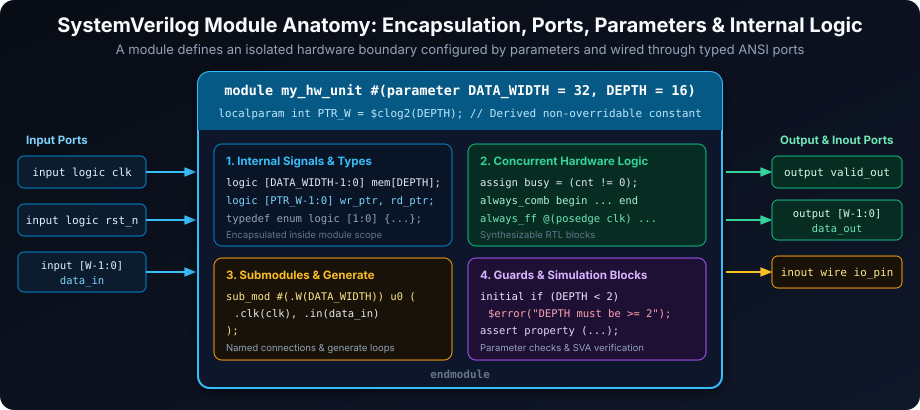
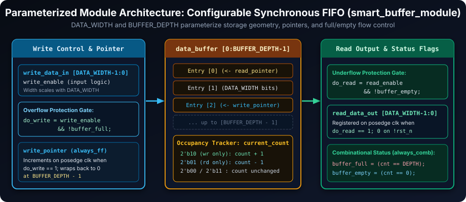
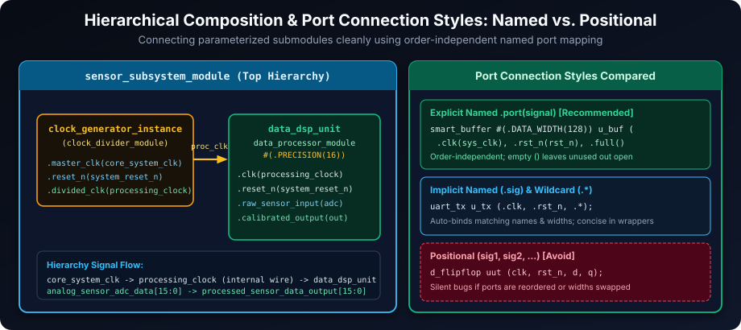
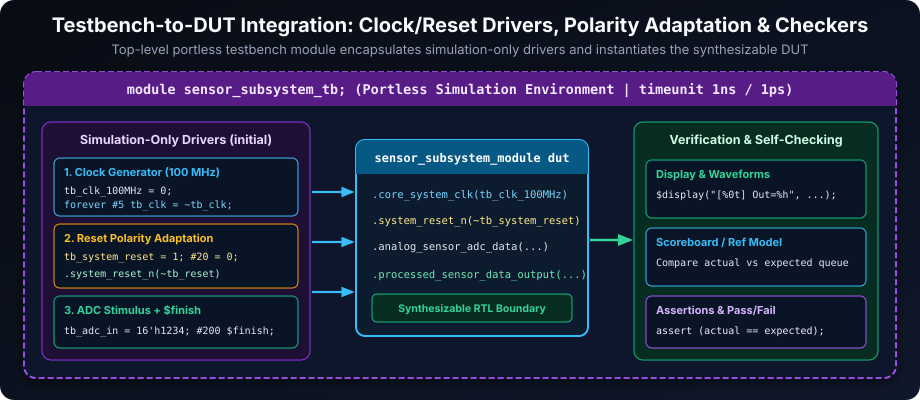

# SystemVerilog Modules: The Foundation of Hierarchical and Reusable Hardware Designs

## Introduction: Modules as the Building Blocks of SystemVerilog Designs

Modules are the cornerstone of hardware description in SystemVerilog, serving as the fundamental units of design abstraction, hierarchy, and reusability. Think of modules as the LEGO bricks of digital design – self-contained, reusable components that you can connect and combine to build complex systems. They are the essential containers that encapsulate hardware functionality and define the boundaries of your design.

**Key Aspects Encapsulated by Modules:**

- **Interface**: Modules define their interaction with the external environment through well-defined input and output ports. These ports specify the signals that a module receives and drives, forming the module's communication interface.
- **Functionality**: The core of a module lies in its internal logic, which describes the module's behavior and operations. This logic is implemented using SystemVerilog constructs such as variables, nets (wires), and concurrent processes (using `always` and `initial` blocks). The internal logic defines how the module processes inputs and generates outputs.
- **Structure**: Modules promote hierarchical design by allowing you to instantiate other modules within them. This hierarchical composition enables you to build complex systems by assembling and connecting simpler, pre-verified modules. Module instantiation creates a design hierarchy, making it easier to manage complexity and reuse design components.

**Primary Benefits of Using Modules:**

- **Design Partitioning and Complexity Management**: Modules enable you to break down large, complex designs into smaller, more manageable, and logically distinct units. This divide-and-conquer approach simplifies design, implementation, and verification. By working with modules, designers can focus on specific functionalities in isolation and then integrate them to form the complete system.
- **Design Reusability Across Projects**: Well-designed modules are highly reusable. Once a module is created and verified, it can be instantiated and reused in different parts of the same project or in entirely new projects. This reusability saves design time and effort, promotes design consistency, and leverages proven components. Module libraries and IP (Intellectual Property) cores are built upon this principle of reusability.
- **Clear Interface Definitions for Team Collaboration**: Modules provide clear and standardized interfaces for communication between different parts of a design. The port list of a module explicitly defines its inputs and outputs, serving as a contract between the module's implementer and users. This well-defined interface facilitates team-based design, where different engineers can work on different modules concurrently, knowing how their modules will connect and interact. Clear module interfaces are essential for efficient collaboration and integration in large design teams.

In essence, SystemVerilog modules are the fundamental organizational unit in hardware design, enabling a structured, hierarchical, and reusable approach to building digital systems of any complexity.

### Learning Goals

By the end of this chapter, you should be able to:

- Define a module with clear ANSI-style ports, parameters, and internal implementation items.
- Instantiate modules using named port connections and parameter overrides.
- Distinguish synthesizable RTL from simulation-only testbench behavior.
- Build and verify a small hierarchy while accounting for reset polarity, clocking, and parameter validity.

## Module Definition: Structuring Hardware Functionality

Modules are defined using the `module` keyword, followed by the module name, an optional parameter list and port list, and the module body enclosed within `endmodule`.



### Basic Module Structure

```systemverilog
module module_name [(port_list)]; // Optional port list for interface definition
  // Module Item Declarations:
  //  - Port declarations (if port_list is not used in module header)
  //  - Parameter declarations
  //  - Variable and net declarations (internal signals and storage)
  //  - Interface and modport declarations
  //  - Task and function declarations

  // Module Body:
  //  - Concurrent statements (processes):
  //    - initial blocks (commonly testbench-only; synthesis support is device/tool dependent)
  //    - always blocks (for sequential and combinational logic, synthesizable)
  //  - Module instantiations (hierarchical composition)
  //  - Continuous assignments (assign statements for combinational logic)
  //  - Assertion statements (for formal and dynamic verification)
  //  - Generate blocks (for conditional or iterative module structure generation)

endmodule // End of module definition
```

### Example: A Minimalist Module with Internal Storage

```systemverilog
module sensor_interface_module; // Module name: 'sensor_interface_module' (using '_module' suffix for clarity)
  // No ports - this module is self-contained and doesn't directly interact with other modules through ports

  // Internal register declaration to store sensor data
  logic [3:0] sensor_data_register; // 4-bit register to hold sensor readings

  // Example: Process to simulate sensor data update (for demonstration purposes)
  initial begin
    sensor_data_register = 4'b0000; // Initialize sensor data at the start of simulation
    forever begin
      #10; // Wait for 10 time units (simulation time)
      sensor_data_register = $random(); // Update sensor data with a random value
    end
  end

  // Example: Display task to monitor sensor data (for demonstration purposes)
  task display_sensor_data;
    $display("[%0t] Sensor Data: %b", $time, sensor_data_register);
  endtask

  initial begin
    #5; // Wait a short time before starting data display
    forever begin
      #20; // Display sensor data every 20 time units
      display_sensor_data();
    end
  end

  initial begin
    #150; // Wait a short time before starting data display
    $finish;
  end

endmodule // End of 'sensor_interface_module' module
```

This `sensor_interface_module` example, while minimal, demonstrates the basic structure of a SystemVerilog module. It has a name, no ports (making it self-contained), and internal logic (a register and `initial` blocks for simulation behavior). In a real design, this module might be expanded to interface with actual sensor hardware, but this simple example illustrates the fundamental module definition.

## Ports and Parameters: Defining Module Interfaces and Configuration

Modules communicate with their environment through ports, which are declared in the module's port list or within the module body. Parameters provide a way to configure module behavior and characteristics at elaboration/instantiation time, making modules more flexible and reusable.



### Interface Elements: Ports and Parameters

| Element          | Purpose                                                            | Syntax Example                                          |
| ---------------- | ------------------------------------------------------------------ | ------------------------------------------------------- |
| **Parameters**   | Configuration constants, customizable at instantiation             | `#(parameter DATA_WIDTH=32, parameter BUFFER_DEPTH=64)` |
| **`localparam`** | Derived internal constants computed from parameters (non-override) | `localparam int ADDR_W = $clog2(BUFFER_DEPTH);`         |
| **Input Ports**  | Receive signals from external modules                              | `input logic clk, input logic [7:0] command_in`         |
| **Output Ports** | Drive signals to external modules                                  | `output logic data_valid, output logic [15:0] data_out` |
| **Inout Ports**  | Bidirectional signals, for shared communication lines              | `inout wire memory_data_bus`                            |

### Parameterized Module Example: Configurable Smart Buffer

```systemverilog
module smart_buffer_module #( // Module name with '_module' suffix
  parameter integer DATA_WIDTH = 64,   // Parameter for data bus width, default 64 bits
  parameter integer BUFFER_DEPTH = 8    // Parameter for buffer depth (number of entries), default 8
) ( // ANSI-style port list - ports declared within the module header
  input  logic clk,             // Clock input
  input  logic rst_n,           // Active-low reset input
  input  logic [DATA_WIDTH-1:0] write_data_in, // Data input for writing, width parameterized
  input  logic write_enable,      // Write enable signal
  input logic read_enable,       // Read enable signal
  output logic [DATA_WIDTH-1:0] read_data_out,  // Data output for reading, width parameterized
  output logic buffer_full,        // Output flag indicating buffer full status
  output logic buffer_empty        // Output flag indicating buffer empty status
);
  // Internal storage declaration: a memory array (FIFO buffer)
  logic [DATA_WIDTH-1:0] data_buffer [0:BUFFER_DEPTH-1]; // Array to store data, depth and width parameterized
  integer write_pointer;        // Write address pointer for the buffer
  integer read_pointer;         // Read address pointer for the buffer
  integer current_count;        // Counter to track the number of items in the buffer

  // Functionality implementation: FIFO buffer logic (write, read, status flags)
  logic do_write;
  logic do_read;

  always_comb begin
    buffer_full  = (current_count == BUFFER_DEPTH);
    buffer_empty = (current_count == 0);
    do_write     = write_enable && !buffer_full;
    do_read      = read_enable && !buffer_empty;
  end

  always_ff @(posedge clk or negedge rst_n) begin
    if (!rst_n) begin
      // Reset logic: initialize pointers, counter, and status flags
      write_pointer <= 0;
      read_pointer  <= 0;
      current_count <= 0;
      read_data_out <= '0;
    end else begin
      if (do_write) begin // Write operation
        data_buffer[write_pointer] <= write_data_in; // Write data to buffer
        write_pointer <= (write_pointer == BUFFER_DEPTH-1) ? 0 : write_pointer + 1; // Increment/wrap write pointer
      end

      if (do_read) begin // Read operation
        read_data_out <= data_buffer[read_pointer]; // Registered read data
        read_pointer <= (read_pointer == BUFFER_DEPTH-1) ? 0 : read_pointer + 1; // Increment/wrap read pointer
      end

      case ({do_write, do_read})
        2'b10: current_count <= current_count + 1;
        2'b01: current_count <= current_count - 1;
        default: current_count <= current_count;
      endcase
    end
  end

  // Parameter validation (example - can be more comprehensive)
  initial begin
    if (BUFFER_DEPTH < 2) begin
      $error("Error: BUFFER_DEPTH parameter must be 2 or greater for smart_buffer_module.");
      $finish; // Terminate simulation if parameter validation fails
    end
  end

endmodule // End of parameterized 'smart_buffer_module'
```

This `smart_buffer_module` example demonstrates:

- **Parameterization**: Using `parameter` keyword to define `DATA_WIDTH` and `BUFFER_DEPTH`, allowing customization of the buffer size.
- **ANSI-style Port List**: Declaring ports directly within the module header for more compact syntax.
- **Internal Logic**: Implementing a basic FIFO buffer functionality with write and read pointers, data storage, and status flags.
- **Parameter Validation**: Including an `initial` block to check parameter values and issue errors if they are invalid, enhancing module robustness.

## Module Instantiation: Creating Instances and Connecting Modules

To use a module in a design, you need to instantiate it within another module. SystemVerilog supports positional port connections as well as named port connections (`.port(sig)`, implicit `.sig` shorthand when signal and port names match, and `.*` wildcard auto-connection).



### Module Instantiation and Port Connection Methods

1.  **Positional Connection** (Less Recommended - prone to errors and harder to maintain)

    ```systemverilog
    // Example: Instantiating a d_flipflop module (assumed to be defined elsewhere)
    d_flipflop uut (clk, rst_n, data_input, data_output); // Order of ports in instantiation MUST match definition
    // 'uut' is the instance name
    // clk, rst_n, data_input, data_output are signals connected to the ports in the defined order
    ```

    **Disadvantages of Positional Connection**:
    - **Order-Dependent**: Relies on the order of ports in the module definition, which is error-prone if the definition changes or if the instantiation is done incorrectly.
    - **Poor Readability**: Less clear about which signal is connected to which port, especially for modules with many ports.
    - **Maintenance Issues**: If ports are added or reordered in the module definition, all positional instantiations need to be carefully updated.

2.  **Named Connection** (Recommended - more robust, readable, and maintainable)

    ```systemverilog
    // Example: Instantiating the parameterized 'smart_buffer_module' using named connections
    smart_buffer_module #( // Parameter value overrides (optional)
      .DATA_WIDTH(128),    // Override DATA_WIDTH parameter to 128 bits
      .BUFFER_DEPTH(16)    // Override BUFFER_DEPTH parameter to 16 entries
    ) data_cache_instance ( // 'data_cache_instance' is the instance name
      .clk(system_clock),      // Connect module port 'clk' to signal 'system_clock'
      .rst_n(main_reset_n),    // Connect 'rst_n' port to 'main_reset_n' signal
      .write_data_in(network_data_payload), // Connect 'write_data_in' to 'network_data_payload'
      .read_enable(processor_read_enable), // Connect read control to the FIFO
      .read_data_out(processor_data_input), // Connect 'read_data_out' to 'processor_data_input'
      .write_enable(data_ready_flag),     // Connect 'write_enable' to 'data_ready_flag'
      .buffer_full(),           // Connect 'buffer_full' port (leave unconnected - output only, if not needed)
      .buffer_empty()            // Connect 'buffer_empty' port (leave unconnected - output only, if not needed)
    );
    ```

    **Advantages of Named Connection**:
    - **Order-Independent**: Port connections are specified by name, not position, making instantiation order irrelevant.
    - **Improved Readability**: Clearly shows which signal is connected to each module port, enhancing code understanding.
    - **Better Maintainability**: More resilient to changes in module port order or additions. You only need to update connections for ports you are actually using.
    - **Parameter Overrides**: Allows you to easily override module parameters during instantiation using the `#( .PARAMETER_NAME(value) )` syntax.

**Recommendation**: Always use named port connections for module instantiation in SystemVerilog. It leads to more robust, readable, and maintainable code, especially in complex designs. Positional connection should be avoided in favor of named connections except in very simple, trivial cases.

### Hierarchical Design Example: Building a Sensor Subsystem

**Submodule: Data Processor (for Calibration)**

```systemverilog
module data_processor_module #(parameter integer PRECISION = 16) ( // Parameterized data processor
  input  logic clk,                    // Clock input
  input  logic reset_n,                // Reset input (active low)
  input  logic [PRECISION-1:0] raw_sensor_input, // Raw sensor data input, width parameterized
  output logic [PRECISION-1:0] calibrated_sensor_output // Calibrated data output, width parameterized
);
  // Internal logic for data calibration (example: simple scaling)
  logic [PRECISION-1:0] internal_calibrated_data;

  always_ff @(posedge clk or negedge reset_n) begin
    if (!reset_n) begin
      internal_calibrated_data <= '0;
      calibrated_sensor_output <= '0;
    end else begin
      // Example calibration: multiply raw input by a constant (3)
      internal_calibrated_data <= raw_sensor_input * 3;
      calibrated_sensor_output <= internal_calibrated_data;
    end
  end

endmodule // End of 'data_processor_module'
```

**Top-Level Module: Sensor Subsystem (Integrating Submodules)**

```systemverilog
module sensor_subsystem_module ( // Top-level module for sensor subsystem
  input  logic core_system_clk,     // Input clock from the main system
  input  logic system_reset_n,      // System-level reset (active low)
  input  logic [15:0] analog_sensor_adc_data, // Input from ADC (Analog-to-Digital Converter)
  output logic [15:0] processed_sensor_data_output // Output of processed sensor data
);
  // Internal clock signal (can be same as core_clk or generated internally)
  logic processing_clock;

  // Instantiate a clock divider module (assumed to be defined elsewhere)
  clock_divider_module clock_generator_instance ( // Instance name: 'clock_generator_instance'
    .master_clk(core_system_clk),    // Connect master clock input
    .reset_n(system_reset_n),        // Connect reset input
    .divided_clk(processing_clock)  // Connect divided clock output to internal 'processing_clock'
  );

  // Instantiate the data_processor_module for signal processing
  data_processor_module #(.PRECISION(16)) data_dsp_unit ( // Instance name: 'data_dsp_unit', parameter override for PRECISION
    .clk(processing_clock),        // Clock input connected to divided clock
    .reset_n(system_reset_n),      // Reset input connected to system reset
    .raw_sensor_input(analog_sensor_adc_data), // Connect raw ADC data input
    .calibrated_sensor_output(processed_sensor_data_output) // Connect calibrated output to module output
  );

  // Additional modules for sensor subsystem can be instantiated and connected here (e.g., filtering, data formatting)

endmodule // End of 'sensor_subsystem_module'
```

This hierarchical design example shows:

- **Submodule Instantiation**: The `sensor_subsystem_module` instantiates `clock_divider_module` and `data_processor_module` as submodules.
- **Named Connections**: Using named port connections for clarity and robustness when connecting submodules.
- **Parameter Passing**: Overriding the `PRECISION` parameter of `data_processor_module` during instantiation to match the data width.
- **Hierarchical Signal Connections**: Connecting signals between modules at different levels of hierarchy (e.g., `core_system_clk` to `clock_divider_module`, `processing_clock` from `clock_divider_module` to `data_processor_module`).
- **Building a System from Components**: Demonstrating how to build a larger system (`sensor_subsystem_module`) by integrating smaller, specialized modules (`clock_divider_module`, `data_processor_module`).

## Testbench Integration: Verifying Module Functionality

Testbenches are essential for verifying the functionality of SystemVerilog modules. A testbench is also a module, typically a top-level portless module, that instantiates the Design Under Test (DUT) and provides stimuli and checks responses to verify its correct operation.



### Basic Testbench Structure: Clock and Reset Generation, DUT Instantiation

```systemverilog
module sensor_subsystem_tb; // Testbench module for 'sensor_subsystem_module' (using '_tb' suffix)
  timeunit 1ns;
  timeprecision 1ps;
  // 1. Declare testbench signals (wires or logic) to drive DUT inputs and observe outputs
  logic tb_clk_100MHz;      // Testbench clock signal (100MHz)
  logic tb_system_reset;     // Testbench reset signal
  logic [15:0] tb_sensor_adc_input; // Testbench input for sensor ADC data
  logic [15:0] tb_processed_sensor_data; // Testbench signal to observe processed data output

  // 2. Clock Generation Block (using 'initial' and 'forever' for simulation clock)
  initial begin : clock_generation_block
    tb_clk_100MHz = 1'b0; // Initialize clock low
    forever #5 tb_clk_100MHz = ~tb_clk_100MHz; // Toggle clock every 5 time units (period = 10, frequency = 100MHz if time unit is 1ns)
  end

  // 3. Reset Sequence Generation Block (using 'initial' for reset stimulus)
  initial begin : reset_sequence_block
    tb_system_reset = 1'b1; // Assert reset initially (active high in this example)
    #20; // Hold reset asserted for 20 time units
    tb_system_reset = 1'b0; // De-assert reset after 20 time units (release reset)
    #50; // Simulate some time after reset release
    tb_sensor_adc_input = 16'h1234; // Apply some input stimulus after reset
    #100;
    tb_sensor_adc_input = 16'h5678; // Change input stimulus again
    #200;
    $finish; // End simulation after a certain time
  end

  // 4. Device Under Test (DUT) Instantiation - Instantiate the module to be tested
  sensor_subsystem_module dut ( // Instance name 'dut' (Device Under Test)
    .core_system_clk(tb_clk_100MHz),    // Connect DUT 'core_clk' input to testbench clock 'tb_clk_100MHz'
    .system_reset_n(~tb_system_reset),  // Connect DUT 'system_reset_n' (active low) to negated testbench reset 'tb_system_reset' (active high)
    .analog_sensor_adc_data(tb_sensor_adc_input), // Connect DUT 'analog_sensor_adc_data' input to testbench input 'tb_sensor_adc_input'
    .processed_sensor_data_output(tb_processed_sensor_data) // Connect DUT 'processed_data_output' output to testbench signal 'tb_processed_sensor_data'
  );

  // 5. Verification and Checking (Assertions, Display, Scoreboarding - can be added here or in separate blocks)
  initial begin : verification_block
    #100; // Wait for some simulation time after reset
    $display("[%0t] Testbench: Monitoring DUT outputs...", $time);
    #10;
    $display("[%0t] Testbench: Processed Data Output = %h", $time, tb_processed_sensor_data); // Example: Display DUT output
    #100;
    $display("[%0t] Testbench: Processed Data Output = %h", $time, tb_processed_sensor_data); // Example: Display DUT output again
  end

endmodule // End of testbench module 'sensor_subsystem_tb'
```

Key elements of this testbench example:

1.  **Testbench Signals**: Declaring `logic` signals in the testbench to drive the DUT's inputs (e.g., `tb_clk_100MHz`, `tb_system_reset`, `tb_sensor_adc_input`) and to observe its outputs (e.g., `tb_processed_sensor_data`).
2.  **Clock Generation**: Using an `initial` block with a `forever` loop to generate a periodic clock signal (`tb_clk_100MHz`). The `#5` delay creates a half-period of 5 time units, resulting in a clock period of 10 time units (100MHz if time unit is 1ns).
3.  **Reset Sequence**: Using an `initial` block to generate a reset pulse (`tb_system_reset`). The reset is asserted high for 20 time units and then de-asserted.
4.  **DUT Instantiation**: Instantiating the `sensor_subsystem_module` (the DUT) using named port connections, connecting the testbench signals to the DUT's ports. Note the negation `~tb_system_reset` to connect the active-high testbench reset to the active-low DUT reset input `system_reset_n`.
5.  **Verification and Checking**: A basic `initial` block (`verification_block`) is used to monitor the DUT's output (`tb_processed_sensor_data`) and display its value at certain simulation times using `$display`. In a more comprehensive testbench, this section would include assertions, scoreboards, and more sophisticated checking mechanisms.
6.  **Simulation Control**: `$finish` is used in the reset sequence block to end the simulation after a defined duration.

This is a basic example, and real-world testbenches can be significantly more complex, involving stimulus generation, response checking, coverage analysis, and integration with verification methodologies like UVM.

## Best Practices for SystemVerilog Module Design

1.  **Consistent and Meaningful Naming Conventions**:
    - **Module Names**: Use `lowercase_with_underscores` for module names (e.g., `uart_transmitter_module`, `memory_controller_module`). Adding a `_module` suffix can improve clarity, especially when interfaces with similar names exist (e.g., `uart_if` and `uart_module`).
    - **Parameters**: Use `UPPER_SNAKE_CASE` for parameter names (e.g., `DATA_WIDTH`, `BUFFER_DEPTH`, `FIFO_SIZE`).
    - **Clock Signals**: Name clock signals clearly, indicating frequency if applicable (e.g., `clk_100MHz`, `system_clk`, `core_clk`). Use `clk` as a general clock signal name when frequency is not critical in the name itself.
    - **Reset Signals**: Name reset signals to indicate their active level (e.g., `rst_n` for active-low reset, `reset_l`, `arst_n`; `rst` or `reset_h` for active-high reset, `arst`). Be consistent in active-low vs. active-high reset naming across the project.
    - **Instance Names**: Use descriptive instance names that indicate the module type and its function or position in the hierarchy (e.g., `data_cache_instance`, `clock_generator_instance`, `dsp_unit`, `rx_fifo_buffer`).

2.  **Port Declaration Styles - Prefer ANSI Style for Compactness**:
    - **ANSI Style (Port declaration in module header)**: Declare ports directly within the module header for a more compact and readable syntax, especially for modules with many ports. This style improves code locality and reduces verbosity.

      ```systemverilog
      module uart_tx_module ( // ANSI style port declaration
        input  logic clk_50MHz,
        input  logic [7:0] tx_data,
        output logic tx_active,
        output logic uart_tx_serial_out
      );
        // Module body...
      endmodule
      ```

    - **Non-ANSI Style (Separate port declaration)**: Declare ports inside the module body, separate from the module header. While valid, this style is often less preferred for new SystemVerilog code as it is more verbose and less compact than ANSI style.

      ```systemverilog
      module uart_tx_module_non_ansi; // Non-ANSI style - ports declared inside module
        input  logic clk_50MHz;
        input  logic [7:0] tx_data;
        output logic tx_active;
        output logic uart_tx_serial_out;

        // Module body...
      endmodule
      ```

    **Recommendation**: Adopt ANSI-style port declarations as the standard style for new SystemVerilog designs for improved code conciseness and readability.

3.  **Parameter Validation and Error Handling**:
    - **Parameter Range Checks**: Include `initial` blocks to validate parameter values at the beginning of simulation. Check for out-of-range or invalid parameter settings that could lead to design errors or unexpected behavior.
    - **`$error` and `$fatal` System Tasks**: Use `$error` to report parameter validation failures and `$fatal` to terminate the simulation immediately when a critical parameter error is detected. This helps catch configuration errors early in the design cycle.
    - **Informative Error Messages**: Provide clear and informative error messages that specify the parameter name, the invalid value, and the acceptable range or conditions. This makes it easier for users to understand and correct parameter settings.

    ```systemverilog
    module parameterized_module #(parameter integer BUFFER_SIZE = 1024) (/* ports */);
      initial begin
        if (BUFFER_SIZE <= 0) begin
          $error("Error: BUFFER_SIZE parameter must be a positive integer. Invalid value: %0d", BUFFER_SIZE);
          $fatal; // Terminate simulation due to critical parameter error
        end
        if (BUFFER_SIZE > 4096) begin
          $warning("Warning: BUFFER_SIZE is large (%0d), which may impact performance.", BUFFER_SIZE);
        end
      end
      // ... rest of module code ...
    endmodule
    ```

## Exercises to Practice Module Design in SystemVerilog

1.  **Basic Module Creation: Serial Encoder**:
    - **Objective**: Create a `serial_encoder_module` that converts parallel byte data to a serial bit stream.
    - **Ports**:
      - `input logic clk`: Clock signal.
      - `input logic rst_n`: Active-low reset signal.
      - `input logic data_valid`: Indicates when `byte_data` is valid.
      - `input logic [7:0] byte_data`: Parallel byte data input.
      - `output logic serial_out`: Serial data output (idles high).
      - `output logic busy`: High while shifting a 10-bit UART-style frame (start + 8 data + stop).
    - **Functionality**: When `data_valid` is asserted while idle, latch `byte_data` and shift `{1'b1, byte_data, 1'b0}` LSB-first on `serial_out` synchronized to `clk`.

    ```systemverilog
    module serial_encoder_module (
      input  logic       clk,
      input  logic       rst_n,
      input  logic       data_valid,
      input  logic [7:0] byte_data,
      output logic       serial_out,
      output logic       busy
    );
      logic [9:0] shift_reg;
      logic [3:0] bit_cnt;

      assign serial_out = busy ? shift_reg[0] : 1'b1;
      assign busy       = (bit_cnt != 4'd0);

      always_ff @(posedge clk or negedge rst_n) begin
        if (!rst_n) begin
          shift_reg <= 10'h3FF;
          bit_cnt   <= 4'd0;
        end else if (!busy) begin
          if (data_valid) begin
            shift_reg <= {1'b1, byte_data, 1'b0}; // Stop, 8 data bits, Start
            bit_cnt   <= 4'd10;
          end
        end else begin
          shift_reg <= {1'b1, shift_reg[9:1]};
          bit_cnt   <= bit_cnt - 4'd1;
        end
      end
    endmodule
    ```

2.  **Parameterized Design: Configurable FIFO**:
    - **Objective**: Implement a `configurable_fifo_module` with parameterizable data width and depth.
    - **Parameters**: `parameter int DATA_WIDTH = 8`, `parameter int DEPTH = 16`.
    - **Functionality & Validation**: Synchronous FIFO with overflow/underflow protection, `full`/`empty` flags, and elaboration/simulation validation requiring `DATA_WIDTH > 0` and `DEPTH >= 2`.

    ```systemverilog
    module configurable_fifo_module #(
      parameter int DATA_WIDTH = 8,
      parameter int DEPTH      = 16
    ) (
      input  logic                  clk,
      input  logic                  rst_n,
      input  logic [DATA_WIDTH-1:0] write_data,
      input  logic                  write_enable,
      output logic [DATA_WIDTH-1:0] read_data,
      input  logic                  read_enable,
      output logic                  full,
      output logic                  empty
    );
      localparam int PTR_W = $clog2(DEPTH);

      logic [DATA_WIDTH-1:0] mem [0:DEPTH-1];
      logic [PTR_W-1:0]      wr_ptr, rd_ptr;
      logic [$clog2(DEPTH+1)-1:0] count;
      logic do_write, do_read;

      assign full     = (count == DEPTH);
      assign empty    = (count == '0);
      assign do_write = write_enable && !full;
      assign do_read  = read_enable  && !empty;

      always_ff @(posedge clk or negedge rst_n) begin
        if (!rst_n) begin
          wr_ptr    <= '0;
          rd_ptr    <= '0;
          count     <= '0;
          read_data <= '0;
        end else begin
          if (do_write) begin
            mem[wr_ptr] <= write_data;
            wr_ptr      <= (wr_ptr == DEPTH - 1) ? '0 : wr_ptr + 1'b1;
          end
          if (do_read) begin
            read_data <= mem[rd_ptr];
            rd_ptr    <= (rd_ptr == DEPTH - 1) ? '0 : rd_ptr + 1'b1;
          end
          case ({do_write, do_read})
            2'b10:   count <= count + 1'b1;
            2'b01:   count <= count - 1'b1;
            default: count <= count;
          endcase
        end
      end

      initial begin
        if (DATA_WIDTH <= 0 || DEPTH < 2) begin
          $fatal(1, "Invalid configurable_fifo_module params: DATA_WIDTH=%0d, DEPTH=%0d",
                 DATA_WIDTH, DEPTH);
        end
      end
    endmodule
    ```

3.  **Hierarchical Integration: Network Interface Module**:
    - **Objective**: Create a `network_interface_module` that integrates `rx_fifo`, `tx_fifo` (`configurable_fifo_module #(.DATA_WIDTH(8), .DEPTH(32))`), and `serial_tx_encoder` (`serial_encoder_module`).

    ```systemverilog
    module network_interface_module (
      input  logic       clk,
      input  logic       rst_n,
      // System TX push / RX pop ports
      input  logic [7:0] sys_tx_data,
      input  logic       sys_tx_valid,
      output logic       sys_tx_full,
      output logic [7:0] sys_rx_data,
      input  logic       sys_rx_read,
      output logic       sys_rx_empty,
      // Simulated RX byte write-in & physical serial TX output
      input  logic [7:0] phy_rx_byte,
      input  logic       phy_rx_valid,
      output logic       phy_rx_full,
      output logic       serial_tx_out
    );
      logic [7:0] tx_fifo_rdata;
      logic       tx_fifo_empty, tx_fifo_read;
      logic       enc_busy, enc_valid;

      // Registered read data from tx_fifo arrives 1 cycle after tx_fifo_read
      always_ff @(posedge clk or negedge rst_n) begin
        if (!rst_n) enc_valid <= 1'b0;
        else        enc_valid <= tx_fifo_read;
      end
      assign tx_fifo_read = !tx_fifo_empty && !enc_busy && !enc_valid;

      configurable_fifo_module #(.DATA_WIDTH(8), .DEPTH(32)) tx_fifo (
        .clk(clk), .rst_n(rst_n),
        .write_data(sys_tx_data), .write_enable(sys_tx_valid),
        .read_data(tx_fifo_rdata), .read_enable(tx_fifo_read),
        .full(sys_tx_full), .empty(tx_fifo_empty)
      );

      configurable_fifo_module #(.DATA_WIDTH(8), .DEPTH(32)) rx_fifo (
        .clk(clk), .rst_n(rst_n),
        .write_data(phy_rx_byte), .write_enable(phy_rx_valid),
        .read_data(sys_rx_data), .read_enable(sys_rx_read),
        .full(phy_rx_full), .empty(sys_rx_empty)
      );

      serial_encoder_module serial_tx_encoder (
        .clk(clk), .rst_n(rst_n),
        .data_valid(enc_valid), .byte_data(tx_fifo_rdata),
        .serial_out(serial_tx_out), .busy(enc_busy)
      );
    endmodule
    ```

4.  **Testbench Development: Self-Checking FIFO Testbench**:
    - **Objective**: Create a self-checking testbench for `configurable_fifo_module` with jittery 100 MHz clock generation, reset sequences, overflow protection verification, a reference queue scoreboard, and pass/fail reporting.

    ```systemverilog
    module configurable_fifo_tb;
      timeunit 1ns;
      timeprecision 1ps;

      localparam int DW = 8;
      localparam int DP = 4;

      logic          clk = 1'b0;
      logic          rst_n;
      logic [DW-1:0] write_data;
      logic          write_enable;
      logic [DW-1:0] read_data;
      logic          read_enable;
      logic          full, empty;

      logic [DW-1:0] ref_queue[$];
      int            errors = 0;

      configurable_fifo_module #(.DATA_WIDTH(DW), .DEPTH(DP)) dut (.*);

      // ~100 MHz clock with up to +/-10% duty-cycle jitter (5ns nominal half-period)
      initial begin
        forever begin
          realtime hi_ns = 4.5 + ($urandom_range(0, 100) / 100.0);
          realtime lo_ns = 10.0 - hi_ns;
          #lo_ns clk = 1'b1;
          #hi_ns clk = 1'b0;
        end
      end

      task automatic drive_push(input logic [DW-1:0] val);
        @(negedge clk);
        write_enable = 1'b1;
        write_data   = val;
        read_enable  = 1'b0;
        @(posedge clk);
        if (!full) ref_queue.push_back(val);
        @(negedge clk);
        write_enable = 1'b0;
      endtask

      task automatic drive_pop_and_check();
        logic [DW-1:0] exp_val;
        bit            had_data;
        @(negedge clk);
        read_enable  = 1'b1;
        write_enable = 1'b0;
        had_data     = !empty;
        @(posedge clk);
        #1ps;
        if (had_data) begin
          exp_val = ref_queue.pop_front();
          if (read_data !== exp_val) begin
            $error("[%0t] Mismatch: got 0x%02h, expected 0x%02h", $time, read_data, exp_val);
            errors++;
          end
        end
        @(negedge clk);
        read_enable = 1'b0;
      endtask

      initial begin
        rst_n = 1'b0; write_enable = 1'b0; read_enable = 1'b0; write_data = '0;
        repeat (2) @(posedge clk);
        rst_n = 1'b1;

        // Fill FIFO to capacity + 2 overflow attempts
        for (int i = 0; i < DP + 2; i++) drive_push(8'hA0 + i);
        assert (full === 1'b1) else begin $error("FIFO should report full"); errors++; end

        // Drain FIFO and verify ordering
        repeat (DP) drive_pop_and_check();
        assert (empty === 1'b1) else begin $error("FIFO should report empty"); errors++; end

        if (errors == 0) $display("PASS: configurable_fifo_tb completed with 0 errors.");
        else             $display("FAIL: configurable_fifo_tb detected %0d errors.", errors);
        $finish;
      end
    endmodule
    ```

These exercises will provide hands-on practice in designing SystemVerilog modules, using parameters, creating hierarchical designs, and developing basic testbenches for verification. They cover essential concepts for building more complex hardware systems in SystemVerilog.

##### Copyright (c) 2026 squared-studio
