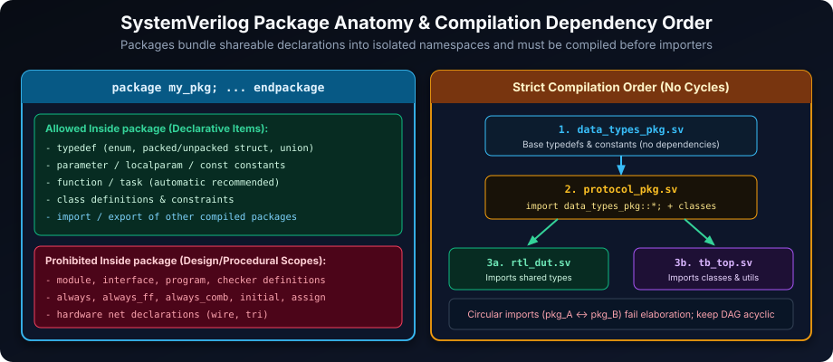
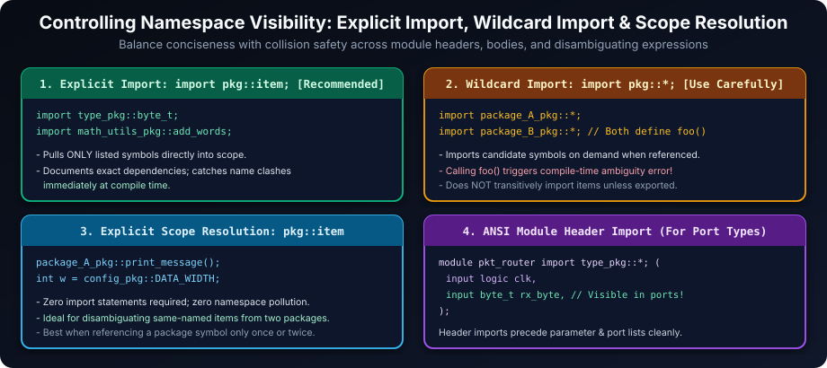
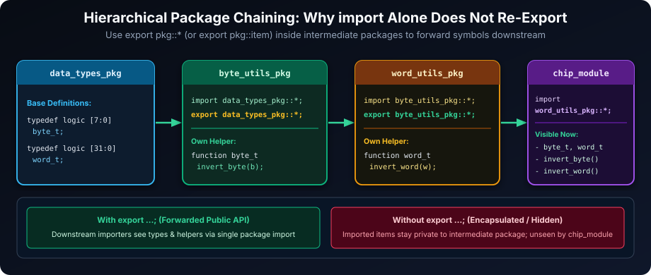
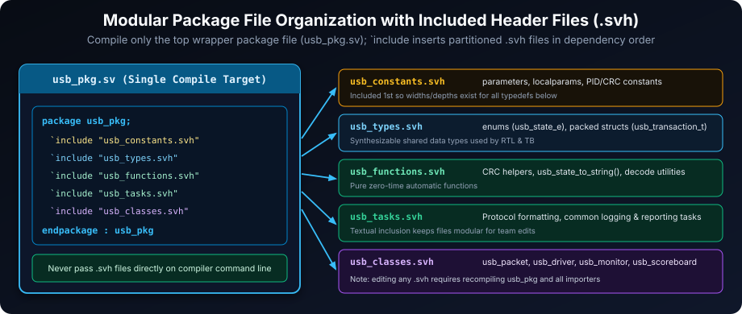

# SystemVerilog Packages: Organizing and Reusing Verification Code

## Introduction: Namespaces for Modular and Reusable Code

SystemVerilog packages are fundamental building blocks for creating well-organized, modular, and reusable verification environments. They act as **namespaces**, providing a dedicated container to group related SystemVerilog declarations. This encapsulation mechanism is crucial for managing the complexity of large-scale verification projects, promoting code reuse, and fostering collaboration among verification teams.

**Key Advantages of Using Packages in SystemVerilog Verification:**

- **Namespace Management and Pollution Prevention**: Packages prevent the pollution of the global namespace. Without packages, all declarations would reside in a single global scope, leading to potential naming conflicts, especially in large projects with contributions from multiple engineers or reuse of IP from different sources. Packages create isolated namespaces, ensuring that identifiers (names) declared within a package do not clash with identifiers declared elsewhere, enhancing code clarity and reducing errors.
- **Code Reusability Across Verification Components**: Packages facilitate code reuse by providing a central repository for commonly used data types, constants, functions, tasks, and classes. Once defined in a package, these elements can be easily imported and reused across various design modules, testbench components, and verification utilities. This significantly reduces code duplication, promotes consistency, and speeds up development.
- **Modular Code Organization and Improved Readability**: Packages encourage a modular approach to verification code organization. By grouping related items into logical packages based on functionality or domain (e.g., a package for bus protocol definitions, a package for common utility functions), you create a more structured and understandable codebase. This improves readability, simplifies navigation, and makes it easier for engineers to locate and understand specific parts of the verification environment.
- **Enhanced Team Collaboration and Standardized Interfaces**: Packages promote team collaboration by establishing standardized interfaces for verification components. When teams agree on packages for common data structures, utility functions, or communication protocols, it becomes easier for different engineers to work on different parts of the verification environment and integrate their work seamlessly. Packages act as contracts, defining clear boundaries and interfaces between modules and components, fostering efficient teamwork.

### Learning Goals

By the end of this chapter, you should be able to:

- Define packages containing shared types, constants, routines, and class declarations.
- Import names selectively, use explicit scope resolution, and avoid namespace collisions.
- Distinguish imported names from names deliberately re-exported with `export`.
- Organize package source files and compile package dependencies in the required order.

## Defining Packages: Creating Namespaces for Declarations

Packages are defined using the `package` keyword, followed by the package name and the package body enclosed within `endpackage`. Packages can encapsulate a wide range of SystemVerilog declarations, making them versatile containers for verification code.

Package source must be compiled before modules or other packages that use its declarations. A package may import another package only after that dependency is available, so organize compilation order explicitly and avoid circular package dependencies. Packages contain declarations; modules, interfaces, and programs remain separate design-unit scopes and are not declared inside a package.



**Elements that can be declared within a SystemVerilog Package:**

- **`typedef` Definitions**: User-defined data types, such as custom structs, enums, and arrays, created using the `typedef` keyword. Packages are ideal for defining and sharing common data types used across the verification environment.
- **`function` and `task` Declarations**: Reusable functions and tasks that perform specific operations or actions. Packages are excellent for grouping utility functions, protocol handlers, or common verification routines that can be called from various parts of the testbench.
- **`class` Definitions**: Class definitions for object-oriented verification components like transaction objects, drivers, monitors, and agents. Packages are used to organize and distribute class definitions, promoting modularity and reuse of verification building blocks.
- **`parameter` and `const` Constants**: Named constants and parameters that define configuration values, thresholds, or fixed data values used throughout the verification environment. Packages provide a central location to define and manage these constants, making it easier to update and maintain them consistently.
- **`import` Statements from Other Packages**: Packages can import items from other packages, allowing you to build hierarchical package structures and reuse code from existing libraries or components. This supports modular design and avoids code duplication across packages.

### Example: Structure of a Basic Utility Package

```systemverilog
package math_utils_pkg; // Package name with '_pkg' suffix for convention

  // 1. Type Definition: Custom data type for words
  typedef logic [31:0] word_t; // Defines 'word_t' as a 32-bit logic type

  // 2. Constant: Definition of Pi constant
  const real PI = 3.1415926535; // Defines a constant 'PI' of type 'real'

  // 3. Function Declaration: Function to add two words
  function automatic word_t add_words(input word_t a, input word_t b); // 'automatic' for re-entrant function
    return a + b; // Returns the sum of the two input words
  endfunction : add_words // Named function end for clarity

  // 4. Task Declaration: Task to print a labeled result
  task print_labeled_result(input string label, input word_t value);
    $display("%s: 0x%h", label, value); // Displays a label and the hexadecimal value
  endtask : print_labeled_result // Named task end for clarity

endpackage : math_utils_pkg // Named package end for clarity
```

In this `math_utils_pkg` example:

- `package math_utils_pkg; ... endpackage : math_utils_pkg` defines the package named `math_utils_pkg`. Using `_pkg` as a suffix is a common SystemVerilog convention to clearly identify packages.
- `typedef logic [31:0] word_t;` defines a reusable data type `word_t` as a 32-bit logic vector.
- `const real PI = 3.1415926535;` declares a constant `PI` of type `real` (floating-point).
- `function automatic word_t add_words(...) ... endfunction : add_words` defines a function `add_words` that takes two `word_t` inputs and returns their sum as a `word_t`. The `automatic` keyword ensures the function is re-entrant, safe for concurrent calls.
- `task print_labeled_result(...) ... endtask : print_labeled_result` defines a task `print_labeled_result` that takes a string label and a `word_t` value and displays them with `$display`.

## Importing Packages: Controlling Namespace Visibility

To use the declarations defined within a package, you need to _import_ the package into the scope where you want to use them (e.g., within a module header, module body, interface, or another package). When module ports or parameters themselves use package `typedef`s, place the `import` statement directly in the ANSI module header (`module my_mod import type_pkg::*; #(parameter ...) (input byte_t data_in, ...);`) so those types are visible before parameter and port elaboration. SystemVerilog offers different import styles, providing flexibility in controlling namespace visibility.



| Import Style                                | Description                                                                                                                                                                                                             | When to Use                                                                                                                                                                                                                                             | Considerations                                                                                                                                                                                                                                       |
| ------------------------------------------- | ----------------------------------------------------------------------------------------------------------------------------------------------------------------------------------------------------------------------- | ------------------------------------------------------------------------------------------------------------------------------------------------------------------------------------------------------------------------------------------------------- | ---------------------------------------------------------------------------------------------------------------------------------------------------------------------------------------------------------------------------------------------------- |
| **`import pkg::*;`**                        | **Wildcard Import (Import All)**: Imports all _visible_ items (types, constants, functions, tasks, classes) declared directly within the package `pkg` into the current scope.                                          | - For smaller packages with a limited number of declarations where naming conflicts are unlikely. <br> - In testbench modules or utility files where you need to use many items from a package conveniently.                                            | - **Use with caution**: Can lead to namespace pollution and naming conflicts if multiple packages with wildcard imports declare items with the same names. <br> - Reduces code explicitness, making it less clear where identifiers are coming from. |
| **`import pkg::item;`**                     | **Specific Item Import**: Imports only the explicitly named `item` (e.g., a specific type, function, or class) from the package `pkg` into the current scope. You can list multiple specific items separated by commas. | - **Recommended for most cases**: Provides fine-grained control over namespace visibility. <br> - When you only need to use a few specific items from a package. <br> - In larger projects to minimize namespace pollution and avoid naming collisions. | - More verbose than wildcard import, especially if you need to import many items from the same package.                                                                                                                                              |
| **No `import` (Explicit Scope Resolution)** | **No Import**: Does not import anything. You access package members using explicit scope resolution with the `package_name::item_name` syntax every time you use them.                                                  | - When you only use a few items from a package very infrequently. <br> - To maximize namespace isolation and avoid any potential import-related naming conflicts. <br> - For very large projects with strict naming conventions.                        | - Can make code more verbose and less readable if you frequently use items from the package.                                                                                                                                                         |

### Example: Selective and Wildcard Package Imports

```systemverilog
package type_pkg;
  typedef logic [7:0] byte_t;
endpackage : type_pkg

package function_pkg;
  import type_pkg::byte_t; // Import 'byte_t' type specifically from 'type_pkg'

  function automatic byte_t increment_byte(input byte_t b);
    return b + 1;
  endfunction : increment_byte
endpackage : function_pkg

module import_example_module;
  // 1. Specific Item Imports: Import 'byte_t' type and 'increment_byte' function
  import type_pkg::byte_t;
  import function_pkg::increment_byte;

  // Uncomment to see wildcard import example:
  // import function_pkg::*; // Wildcard import from 'function_pkg' imports its exported/public declarations only

  initial begin
    byte_t my_byte = 8'h0F; // Use 'byte_t' type directly (imported)
    byte_t incremented_byte;

    incremented_byte = increment_byte(my_byte); // Call 'increment_byte' function directly (imported)
    $display("Original byte: %h, Incremented byte: %h", my_byte, incremented_byte);

    // An import made inside function_pkg is not automatically re-exported.
    // Keep the explicit type_pkg import above, or use type_pkg::byte_t directly.
  end
endmodule : import_example_module
```

In this import example:

- `package type_pkg` defines a type `byte_t`.
- `package function_pkg` imports `type_pkg::byte_t` specifically and defines a function `increment_byte` that uses `byte_t`.
- `module import_example_module` demonstrates:
  - **Specific imports**: `import type_pkg::byte_t;` and `import function_pkg::increment_byte;` import only the `byte_t` type and the `increment_byte` function directly into the `import_example_module` scope. You can then use them directly without package qualification.
  - **(Commented out) Wildcard import**: `import function_pkg::*` would bring declarations from `function_pkg` into the current scope. An import made inside `function_pkg` is not automatically re-exported, so `byte_t` would not become available through this wildcard import unless `function_pkg` also used `export type_pkg::byte_t;`.

## Package Scope Resolution: Explicitly Accessing Package Members

Even without using `import` statements, you can always access members of a package using the **scope resolution operator `::`**. This operator allows you to explicitly specify the package name followed by `::` and then the name of the item you want to access (e.g., `package_name::item_name`). This is known as **explicit scope resolution**.

### Example: Accessing Package Members with Explicit Scope Resolution

```systemverilog
package config_pkg;
  parameter int DATA_WIDTH = 32; // Parameter for data width
  const string VERSION_STRING = "1.0"; // Constant version string
endpackage : config_pkg

package task_utils_pkg;
  task display_config();
    $display("Data Width: %0d bits", config_pkg::DATA_WIDTH); // Explicit scope resolution to access 'DATA_WIDTH'
    $display("Version: %s", config_pkg::VERSION_STRING);     // Explicit scope resolution to access 'VERSION_STRING'
  endtask : display_config
endpackage : task_utils_pkg

module scope_resolution_module;
  initial begin
    task_utils_pkg::display_config(); // Explicit scope resolution to call 'display_config' task

    $display("Data Width (again, using explicit scope): %0d", config_pkg::DATA_WIDTH); // Access 'DATA_WIDTH' directly using scope resolution
  end
endmodule : scope_resolution_module
```

In this scope resolution example:

- `package config_pkg` defines a `parameter` `DATA_WIDTH` and a `const` `VERSION_STRING`.
- `package task_utils_pkg` defines a task `display_config()`. Inside `display_config()`, it accesses `config_pkg::DATA_WIDTH` and `config_pkg::VERSION_STRING` using explicit scope resolution.
- `module scope_resolution_module` calls `task_utils_pkg::display_config()` using scope resolution. It also directly accesses `config_pkg::DATA_WIDTH` in the `$display` statement using scope resolution.
- No `import` statements are used in `scope_resolution_module`. All package member accesses are done using the `package_name::item_name` syntax.

Explicit scope resolution is useful when:

- You only need to use a few items from a package and prefer not to import the entire package or specific items.
- You want to be absolutely clear about the origin of an identifier, especially in large projects where naming conflicts might be a concern.
- You are working with multiple packages that might have items with the same names, and you need to disambiguate them by explicitly specifying the package name.

## Package Export System: Creating Abstraction Layers and Hierarchical Packages

The `export` mechanism in SystemVerilog packages allows you to re-export items that have been imported into a package. This is a powerful feature for creating hierarchical package organizations and abstraction layers. When a package re-exports items from other packages, modules or other packages that import the re-exporting package will also have access to the re-exported items as if they were directly declared in the re-exporting package.



### Example: Building Hierarchical Packages with Export

```systemverilog
// 1. Base Package: 'data_types_pkg' - Defines basic data types
package data_types_pkg;
  typedef logic [7:0] byte_t; // Basic byte type
  typedef logic [31:0] word_t; // Basic word type
endpackage : data_types_pkg

// 2. Utility Package: 'byte_utils_pkg' - Uses and re-exports 'data_types_pkg'
package byte_utils_pkg;
  import data_types_pkg::*; // Import all items from 'data_types_pkg'
  export data_types_pkg::*; // Re-export all imported items from 'data_types_pkg'

  // Utility function operating on 'byte_t' (from 'data_types_pkg')
  function automatic byte_t invert_byte(input byte_t b);
    return ~b; // Bitwise inversion of a byte
  endfunction : invert_byte
endpackage : byte_utils_pkg

// 3. Extended Utility Package: 'word_utils_pkg' - Extends 'byte_utils_pkg' and re-exports
package word_utils_pkg;
  import byte_utils_pkg::*; // Import all from 'byte_utils_pkg' (which already re-exports 'data_types_pkg')
  export byte_utils_pkg::*; // Re-export all imported items from 'byte_utils_pkg' (including re-exported items from 'data_types_pkg')

  // Utility function operating on 'word_t' (from 'data_types_pkg') and using 'invert_byte' (from 'byte_utils_pkg')
  function automatic word_t invert_word(input word_t w);
    word_t inverted_word = 0;
    for (int i = 0; i < 4; i++) begin // Invert each byte of the word
      inverted_word |= (byte_utils_pkg::invert_byte(w[8*i +: 8]) << (8*i)); // Explicit scope resolution to ensure correct 'invert_byte' if there was another one in scope
    end
    return inverted_word;
  endfunction : invert_word
endpackage : word_utils_pkg

// 4. Top Module: 'chip_module' - Uses 'word_utils_pkg' and gets access to all re-exported items
module chip_module;
  import word_utils_pkg::*; // Import all from 'word_utils_pkg' - implicitly gets access to 'byte_utils_pkg' and 'data_types_pkg' items as well due to 'export'

  initial begin
    byte_t data_byte = 8'b1010_1100; // Use 'byte_t' type (from 'data_types_pkg' - re-exported)
    word_t data_word = 32'h1234_5678; // Use 'word_t' type (from 'data_types_pkg' - re-exported)

    $display("Inverted byte: 0x%h", invert_byte(data_byte)); // Call 'invert_byte' (from 'byte_utils_pkg' - re-exported)
    $display("Inverted word: 0x%h", invert_word(data_word)); // Call 'invert_word' (from 'word_utils_pkg')
  end
endmodule : chip_module
```

In this hierarchical package example:

- `data_types_pkg` is the base package defining fundamental data types (`byte_t`, `word_t`).
- `byte_utils_pkg` imports `data_types_pkg::*` and then `export data_types_pkg::*`. This means `byte_utils_pkg` uses items from `data_types_pkg` internally and also makes them available to any module or package that imports `byte_utils_pkg`.
- `word_utils_pkg` imports `byte_utils_pkg::*` and `export byte_utils_pkg::*`. It builds upon `byte_utils_pkg` (and thus indirectly on `data_types_pkg`). By re-exporting `byte_utils_pkg::*`, it makes all items from `byte_utils_pkg` (including re-exported items from `data_types_pkg`) accessible to its importers.
- `chip_module` imports `word_utils_pkg::*`. Because of the export chain, `chip_module` gains access to items from all three packages (`word_utils_pkg`, `byte_utils_pkg`, and `data_types_pkg`) as if they were all declared directly in `word_utils_pkg`.

The `export` system is valuable for:

- **Creating Abstraction Layers**: Packages can re-export items from underlying packages, creating a higher-level interface that hides implementation details and simplifies usage for higher-level modules.
- **Building Package Hierarchies**: Organizing packages in a hierarchical manner, where higher-level packages build upon and extend functionality from lower-level packages, promoting modularity and maintainability.
- **Library Development**: When developing reusable verification libraries, `export` can be used to create well-defined public interfaces for the library packages, while keeping internal implementation details hidden.

## Best Practices for Effective Package Usage

To leverage the full benefits of SystemVerilog packages and maintain a clean and organized verification codebase, adhere to these best practices:

1.  **Prefer Explicit Imports Over Wildcard Imports**:
    - **Problem with Wildcard (`import pkg::*`)**: While convenient for small packages, wildcard imports can lead to namespace pollution, making it harder to track the origin of identifiers and increasing the risk of accidental naming conflicts, especially in larger projects or when integrating code from different sources.
    - **Benefit of Explicit Imports (`import pkg::item, pkg::item2, ...`)**: Explicit imports promote code clarity and maintainability by clearly stating which items from a package are being used in the current scope. This reduces ambiguity and makes it easier to understand dependencies.
    - **Best Practice**: Favor explicit imports (`import pkg::item;`) for better code organization, reduced namespace pollution, and improved long-term maintainability. Only use wildcard imports (`import pkg::*`) sparingly in small, well-contained packages where naming conflicts are highly unlikely and convenience is a significant factor (e.g., in small utility modules or test cases).

    ```systemverilog
    // Example showing preference for explicit imports:

    // Instead of wildcard import (less preferred for larger projects):
    import math_utils_pkg::*; // May import more than you need and risk name clashes

    // Prefer explicit imports (more maintainable and clearer):
    import math_utils_pkg::word_t;   // Only import the 'word_t' type
    import math_utils_pkg::add_words; // Only import the 'add_words' function
    import math_utils_pkg::PI;        // Only import the 'PI' constant
    ```

2.  **Use Unique and Descriptive Package Names**:
    - **Naming Conventions**: Choose package names that are unique across your project and organization to avoid naming collisions, especially when reusing packages or integrating with external libraries.
    - **Prefixing with Project/Organization Name**: A common and effective practice is to prefix package names with a project-specific or organization-specific identifier (e.g., `acme_`, `companyXYZ_`, `projectABC_`). This creates a clear namespace hierarchy and reduces the chance of name clashes.
    - **Suffixing with `_pkg`**: Using the `_pkg` suffix (e.g., `math_utils_pkg`, `memory_model_pkg`) is a widely adopted SystemVerilog convention to clearly distinguish package names from other identifiers (like modules, interfaces, or classes).

    ```systemverilog
    // Good, unique package names:
    package acme_verification_utils_pkg; // Project-specific prefix and '_pkg' suffix
    package companyXYZ_bus_protocol_pkg; // Organization-specific prefix and '_pkg' suffix

    // Less ideal, potentially risky package names (more likely to clash):
    package math_utils; // Too generic, might clash with other 'math_utils' packages
    package common_types; // Too common, high risk of naming conflicts
    package verification; // Very generic, almost certain to clash in larger projects
    ```

3.  **Organize Packages by Functionality or Domain**:
    - **Functional Grouping**: Structure your packages based on logical functional areas or domains within your verification environment. This improves organization, modularity, and makes it easier to locate related code.
    - **Example Package Categories**:
      - `typedefs_pkg`: For common user-defined data types (structs, enums, etc.) used across the project.
      - `utils_pkg` or `common_utils_pkg`: For general-purpose utility functions and tasks (e.g., logging, data manipulation, common algorithms).
      - `testbench_utils_pkg` or `tb_lib_pkg`: For testbench-specific utility functions, base classes for testbench components, and common verification infrastructure.
      - `protocol_name_pkg` (e.g., `usb_pkg`, `ethernet_pkg`, `axi_pkg`): For protocol-specific definitions, classes, functions, and tasks related to a particular interface or protocol.
      - `model_name_pkg` (e.g., `memory_model_pkg`, `cache_model_pkg`): For models of specific design components or sub-systems.

4.  **Combine Packages with `` `include `` for Large Packages**:
    - **Splitting Large Packages**: For very large packages that contain many declarations, consider splitting the package definition into multiple files using the `` `include `` directive. This improves file organization, makes it easier to navigate and edit the package code, but textual inclusion does not inherently make compilation faster: changes generally require recompiling the package and its dependents.
    - **File Organization within a Package**: Create separate `` `include `` files for different categories of declarations within the package (e.g., types, functions, tasks, classes, constants).

    

    - **Example Package File Structure**:

    ```systemverilog
    // File: usb_pkg.sv
    package usb_pkg;
      `include "usb_types.svh"     // Contains typedefs and struct/enum definitions
      `include "usb_functions.svh" // Contains function declarations
      `include "usb_tasks.svh"     // Contains task declarations
      `include "usb_classes.svh"   // Contains class definitions
      `include "usb_constants.svh" // Contains parameter and const declarations
    endpackage : usb_pkg

    // Example content of usb_types.svh:
    // (Inside usb_types.svh)
    typedef enum logic [2:0] { USB_IDLE, USB_SOF, USB_DATA, USB_HANDSHAKE } usb_state_e;
    typedef struct packed {
      usb_state_e state;
      bit [7:0] data_payload;
    } usb_transaction_t;
    // ... more type definitions ...

    // Example content of usb_functions.svh:
    // (Inside usb_functions.svh)
    function automatic string usb_state_to_string(input usb_state_e state);
      // ... function implementation ...
    endfunction : usb_state_to_string
    // ... more function declarations ...

    // ... and so on for usb_tasks.svh, usb_classes.svh, usb_constants.svh ...
    ```

    - **Benefits of Splitting**:
      - Improved file organization and easier navigation within large packages.
      - Includes are textual insertion, so a change to an included file generally requires recompiling the package and its dependents. Splitting files improves organization and parallel editing, but does not inherently make compilation faster.
      - Better support for version control and parallel development when different engineers work on different parts of a large package.

## Exercises to Practice SystemVerilog Packages

1.  **Create a Basic `geometry_pkg`**:
    - Create `geometry_pkg` defining `point_t` (`struct { real x; real y; }`), `function automatic real distance(point_t a, point_t b)`, and `const real AREA_CONST = 10.5;`.

    ```systemverilog
    package geometry_pkg;
      typedef struct {
        real x;
        real y;
      } point_t;

      const real AREA_CONST = 10.5;

      function automatic real distance(input point_t a, input point_t b);
        real dx = b.x - a.x;
        real dy = b.y - a.y;
        return $sqrt((dx * dx) + (dy * dy));
      endfunction : distance
    endpackage : geometry_pkg
    ```

2.  **Import and Use `geometry_pkg` (Wildcard Import)**:
    - Create a module that imports `geometry_pkg::*`, initializes `p1 = '{x: 0.0, y: 0.0}` and `p2 = '{x: 3.0, y: 4.0}`, calls `distance(p1, p2)`, and displays `AREA_CONST`.

    ```systemverilog
    module ex2_wildcard_import;
      import geometry_pkg::*;

      initial begin
        point_t p1 = '{x: 0.0, y: 0.0};
        point_t p2 = '{x: 3.0, y: 4.0};
        $display("Distance = %0.2f, AREA_CONST = %0.2f",
                 distance(p1, p2), AREA_CONST); // 5.00, 10.50
      end
    endmodule : ex2_wildcard_import
    ```

3.  **Use Explicit Scope Resolution (No Imports)**:
    - Rewrite Exercise 2 with no `import` statement using `geometry_pkg::` scope qualification everywhere.

    ```systemverilog
    module ex3_explicit_scope;
      initial begin
        geometry_pkg::point_t p1 = '{x: 1.0, y: 2.0};
        geometry_pkg::point_t p2 = '{x: 4.0, y: 6.0};
        $display("Distance = %0.2f, AREA_CONST = %0.2f",
                 geometry_pkg::distance(p1, p2),
                 geometry_pkg::AREA_CONST); // 5.00, 10.50
      end
    endmodule : ex3_explicit_scope
    ```

4.  **Package Export: `base_pkg` and `graphics_pkg`**:
    - Define `color_t` (`RED`, `GREEN`, `BLUE`) in `base_pkg`; in `graphics_pkg`, import and re-export `base_pkg::*` and define `mix_colors()`; import `graphics_pkg::*` in a module and access both `mix_colors()` and `color_t` directly.

    ```systemverilog
    package base_pkg;
      typedef enum {RED, GREEN, BLUE} color_t;
    endpackage : base_pkg

    package graphics_pkg;
      import base_pkg::*;
      export base_pkg::*; // Forward color_t and enum literals to importers

      function automatic string mix_colors(input color_t c1, input color_t c2);
        if ((c1 == RED && c2 == BLUE) || (c1 == BLUE && c2 == RED))
          return "Mixed color: PURPLE";
        else if ((c1 == RED && c2 == GREEN) || (c1 == GREEN && c2 == RED))
          return "Mixed color: YELLOW";
        else if ((c1 == GREEN && c2 == BLUE) || (c1 == BLUE && c2 == GREEN))
          return "Mixed color: CYAN";
        else
          return {"Mixed color: ", c1.name()};
      endfunction : mix_colors
    endpackage : graphics_pkg

    module ex4_export_chain;
      import graphics_pkg::*; // Receives mix_colors AND re-exported color_t/RED/BLUE

      initial begin
        color_t a = RED;
        color_t b = BLUE;
        $display("%s (primary sample = %s)", mix_colors(a, b), RED.name());
      end
    endmodule : ex4_export_chain
    ```

5.  **Package Name Conflict Resolution**:
    - Create `package_A_pkg` and `package_B_pkg`, each declaring `print_message()`. Show wildcard ambiguity prevention and disambiguation via explicit `::` resolution and a portable wrapper function.

    ```systemverilog
    package package_A_pkg;
      function void print_message();
        $display("Message from Package A");
      endfunction
    endpackage : package_A_pkg

    package package_B_pkg;
      function void print_message();
        $display("Message from Package B");
      endfunction
    endpackage : package_B_pkg

    module ex5_conflict_resolution;
      import package_A_pkg::*;
      import package_B_pkg::*;

      // Portable wrapper alternative for frequently called colliding symbol:
      function void print_message_A();
        package_A_pkg::print_message();
      endfunction

      initial begin
        // print_message(); // Compile-time ambiguity error when referenced unqualified!
        package_A_pkg::print_message(); // Explicit scope resolution
        package_B_pkg::print_message();
        print_message_A();              // Portable wrapper call
      end
    endmodule : ex5_conflict_resolution
    ```

These exercises will provide practical experience in defining, importing, using, and organizing SystemVerilog packages, as well as handling namespace management and conflict resolution, which are crucial skills for developing robust and maintainable verification environments.

##### Copyright (c) 2026 squared-studio
