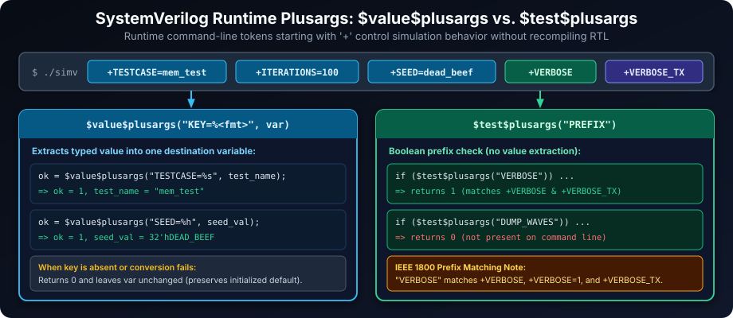
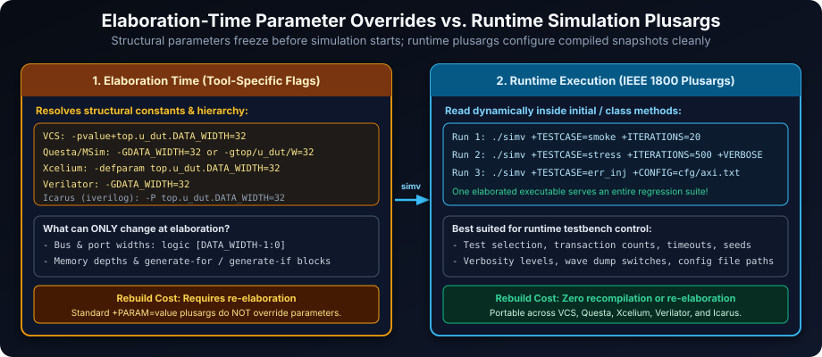
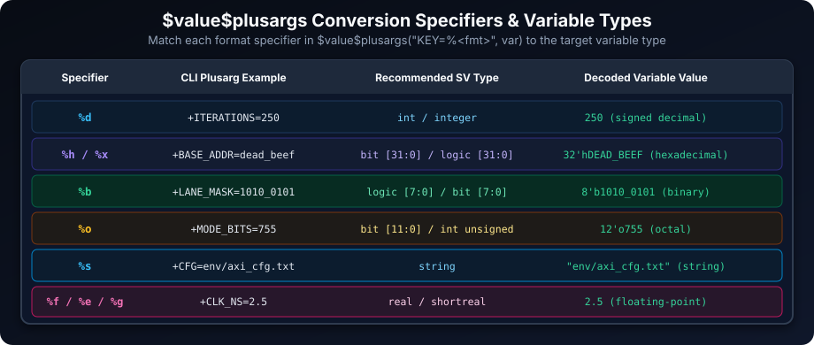
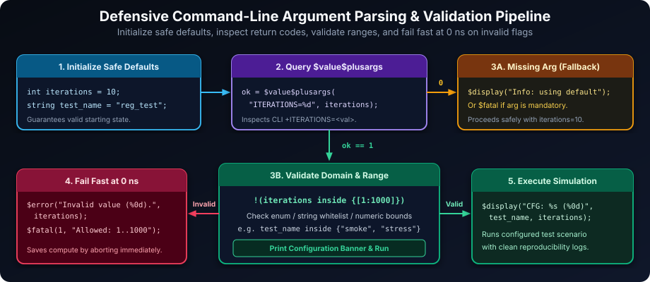

# SystemVerilog Command Line Arguments: Parameterizing Simulations for Flexibility

## Introduction: Tailoring Simulation Behavior from the Command Line

Command line arguments in SystemVerilog provide a powerful mechanism to control and customize simulation runs without modifying the source code. This capability is crucial for creating flexible and reusable verification environments, enabling users to:

- **Parameterize Simulations**: Modify testbench configurations and simulation settings directly from the command line. Elaboration-time design parameters can be overridden with simulator-specific options, whereas runtime simulation parameters are injected dynamically with plusargs without recompiling.
- **Test Case Selection**: Choose specific test cases or test suites to execute during a simulation run. This allows for focused verification and regression testing, targeting specific functionalities or bug fixes.
- **Control Verbosity and Debugging**: Adjust the level of simulation output, enable or disable debug messages, and configure logging options through command line flags. This enhances debugging efficiency and allows for tailored output based on verification needs.
- **Environment Configuration**: Specify paths to configuration files, input data files, and output directories via command line arguments. This improves portability and organization of simulation environments.

By leveraging command line arguments, verification engineers can create highly adaptable simulations that can be easily configured and executed for various verification tasks, promoting efficiency and reusability.

### Learning Goals

By the end of this chapter, you should be able to:

- Parse value and flag plusargs with the correct SystemVerilog system functions.
- Apply defaults and validate command-line values before using them.
- Distinguish runtime plusargs from elaboration-time parameter overrides.
- Build reproducible, tool-aware simulation commands and document their options.

## Accessing Command Line Arguments

SystemVerilog provides built-in system functions (defined in IEEE 1800-2017 Section 21.6) to access command line arguments passed to the simulator during invocation. The two primary functions are `$value$plusargs` and `$test$plusargs`, both of which inspect tokens on the simulation command line beginning with `+`.



### `$value$plusargs`: Retrieving Argument Values

The `$value$plusargs` system function is used to retrieve the value associated with a specific command line argument. It searches for arguments starting with a plus sign (`+`) followed by a matching prefix and value conversion specifier.

**Syntax:**

```systemverilog
int result;
result = $value$plusargs("<argument_format_string>", variable);
```

**Argument Format String:** The `<argument_format_string>` specifies the literal prefix (without the leading `+`) and a single conversion specifier (`%d`, `%h`, `%x`, `%b`, `%o`, `%s`, `%f`, `%e`, or `%g`) to parse the trailing text into `variable`.

- **Flag Matching**: For a keyword with no value, use `$test$plusargs("VERBOSE")` to check for `+VERBOSE`. `$value$plusargs` is used when a value is extracted with a conversion specifier.
- **Value Extraction**: To extract a value associated with an argument, embed one conversion specifier in the format string. For example, `"TESTCASE=%s"` matches `+TESTCASE=test_name` and assigns `"test_name"` to a `string` variable.

**Return Value:**

- Returns `1` (non-zero `int`) when a matching plusarg is found and its value is converted and assigned to `variable`.
- Returns `0` when no matching argument is found on the command line (or conversion fails), leaving `variable` unmodified. The standard IEEE 1800 form accepts exactly two arguments: one format string and one destination variable.

**Example: Retrieving Test Case Name and Iteration Count**

```systemverilog
module command_line_example;
  string test_name = "default_test"; // Safe default before querying plusargs
  int    iterations = 10;
  int    result;

  initial begin
    result = $value$plusargs("TESTCASE=%s", test_name);
    if (result == 1) begin
      $display("Test case name from command line: %s", test_name);
    end else begin
      $display("Test case name not provided via command line, using default.");
    end

    result = $value$plusargs("ITERATIONS=%d", iterations);
    if (result == 1) begin
      $display("Iteration count from command line: %0d", iterations);
    end else begin
      $display("Iteration count not provided, using default (%0d).", iterations);
    end

    $display("--- Simulation Configuration ---");
    $display("Running test case: %s", test_name);
    $display("Number of iterations: %0d", iterations);
  end
endmodule
```

**Simulation Command Example:**

```bash
./simv +TESTCASE=memory_test +ITERATIONS=100
```

### `$test$plusargs`: Checking for Argument Presence

The `$test$plusargs` system function is simpler than `$value$plusargs`. It checks whether any command line plusarg starts with a specified prefix string and does not extract values. It is primarily used for boolean feature flags.

**Syntax:**

```systemverilog
int found;
found = $test$plusargs("<prefix_string>");
```

**Prefix Matching Semantics:** Under IEEE 1800, `$test$plusargs("VERBOSE")` performs a **prefix match** against every `+` argument on the command line. Consequently, `$test$plusargs("VERBOSE")` returns `1` for `+VERBOSE`, `+VERBOSE=1`, and even `+VERBOSE_TX`. To avoid accidental collisions between similarly named flags, keep flag names distinct or append delimiters when appropriate.

**Return Value:**

- Returns `1` if an argument matching the prefix string is found on the command line.
- Returns `0` if no matching argument is found.

**Example: Using Flag Arguments for Verbosity Control**

```systemverilog
module verbosity_control;
  bit verbose_mode;

  initial begin
    if ($test$plusargs("VERBOSE")) begin // Check for +VERBOSE flag
      verbose_mode = 1'b1;
      $display("Verbose mode enabled via command line.");
    end else begin
      verbose_mode = 1'b0;
      $display("Verbose mode disabled (default).");
    end

    $display("--- Simulation Verbosity Setting ---");
    $display("Verbose mode: %0b", verbose_mode);

    if (verbose_mode) begin
      $display("--- Detailed Simulation Output ---");
      // Detailed diagnostic messages...
    end else begin
      $display("--- Summary Simulation Output ---");
      // Concise pass/fail messages...
    end
  end
endmodule
```

**Simulation Command Examples:**

```bash
# Verbose mode disabled
./simv

# Verbose mode enabled
./simv +VERBOSE
```

## Parameter Overriding with Command Line Arguments

Standard SystemVerilog plusargs are read at runtime (`0ns` or later) and cannot override `parameter` values, because parameters resolve during **elaboration** to size hardware ports, packed vectors, unpacked arrays, and `generate` blocks. Simulators therefore provide tool-specific elaboration options for parameter overrides; alternatively, expose a runtime configuration variable when changing the setting should not trigger a rebuild.



**Mechanism:**

- **Runtime plusargs**: Use `+NAME=value` with `$value$plusargs` for testbench configuration read during simulation. One compiled snapshot can execute an entire regression suite with zero recompilation.
- **Elaboration-time overrides**: Use your simulator's parameter-override CLI flag during compile/elaboration. Because syntax differs across EDA tools, verify the exact option in your simulator's manual.

| Simulator | Typical Elaboration Parameter Override Flag | Notes |
| :--- | :--- | :--- |
| Synopsys VCS | `-pvalue+top_module.instance3.DATA_WIDTH=32` | Uses full hierarchical path from top module |
| Siemens Questa / ModelSim | `-GDATA_WIDTH=32` or `-g/top_module/instance3/DATA_WIDTH=32` | Supports top-level (`-G`) or instance-specific (`-g`) overrides |
| Cadence Xcelium | `-defparam top_module.instance3.DATA_WIDTH=32` | Passed to `xmelab` / `xrun` |
| Verilator | `-GDATA_WIDTH=32` | Overrides top-level parameters at build time |
| Icarus Verilog | `-P top_module.instance3.DATA_WIDTH=32` | Passed to `iverilog` at compile/elaboration time |

**Example: Overriding Module Parameter `DATA_WIDTH`**

```systemverilog
module parameterized_module #(parameter int DATA_WIDTH = 8) (
  input  logic [DATA_WIDTH-1:0] data_in,
  output logic [DATA_WIDTH-1:0] data_out
);
  assign data_out = data_in;
  initial $display("%m instantiated with DATA_WIDTH = %0d", DATA_WIDTH);
endmodule

module top_module;
  logic [7:0]  d1_in = 8'hA5, d1_out;
  logic [15:0] d2_in = 16'hBEEF, d2_out;
  // instance3 uses an override target in elaboration examples below
  parameterized_module                 instance1 (.data_in(d1_in), .data_out(d1_out));
  parameterized_module #(.DATA_WIDTH(16)) instance2 (.data_in(d2_in), .data_out(d2_out));

  initial begin
    $display("--- Module Instantiation Summary ---");
  end
endmodule
```

**Simulation Command Examples:**

```bash
# Using default DATA_WIDTH = 8 for instance1
vcs -sverilog top_module.sv -R

# VCS-specific elaboration override for instance1
vcs -sverilog -pvalue+top_module.instance1.DATA_WIDTH=32 top_module.sv -R
```

In the second command, the VCS option `-pvalue+top_module.instance1.DATA_WIDTH=32` overrides `DATA_WIDTH` during elaboration before simulation starts. Make sure any connecting testbench signals match the overridden port width (for example, by parameterizing `top_module` itself and overriding top-level `DATA_WIDTH`).

## Best Practices for Command Line Arguments

- **Descriptive Argument Names**: Use clear, unambiguous uppercase names (e.g., `+TESTCASE`, `+ITERATIONS`, `+VERBOSITY`, `+CONFIG_FILE_PATH`) to improve script readability and avoid `$test$plusargs` prefix collisions.
- **Document Command Line Options**: Provide clear documentation—or a `+HELP` flag—listing supported options, expected types/formats, legal ranges, and default values.
- **Initialize Default Values Early**: Assign sensible defaults to configuration variables before calling `$value$plusargs`, so simulations remain runnable out of the box when optional flags are omitted.
- **Validate Argument Presence and Values**: Check the `int` return code of `$value$plusargs` and verify numeric bounds, string whitelists, or file paths immediately at time zero.
- **Consistent Conventions**: Standardize key-value delimiters (`+KEY=VALUE`) and boolean flags (`+FLAG`) across Makefiles, regression runners, and SystemVerilog testbenches.

## Comprehensive Function Reference Table



| Function | Description | Return Value | Notes |
| :--- | :--- | :--- | :--- |
| `$value$plusargs("<format>", <variable>)` | Searches command line arguments starting with `+` matching `<format>`, parses the trailing substring using one conversion specifier (`%d`, `%h`/`%x`, `%b`, `%o`, `%s`, `%f`, `%e`, `%g`), and assigns it to `<variable>`. | `1` (non-zero `int`) if matched and assigned; `0` otherwise. | IEEE 1800 standard signature takes **two** arguments (format string and one destination variable). If it returns `0`, `<variable>` retains its prior value. |
| `$test$plusargs("<prefix>")` | Checks for the presence of any `+` command line argument whose leading characters match `<prefix>`. Does not parse or assign values. | `1` if found, `0` if not found. | Performs **prefix matching** (`"VERBOSE"` matches `+VERBOSE`, `+VERBOSE=1`, and `+VERBOSE_DEBUG`). Ideal for boolean switches like `+DUMP_WAVES`. |

## Robust Error Handling for Command Line Arguments

Error handling for command line arguments is essential to ensure simulation robustness and provide clear diagnostic feedback before spending hours of regression compute.



### Argument Presence and Value Validation

```systemverilog
module robust_command_line;
  string test_name = "regression_test";
  int    iterations = 10;
  bit    verbose_mode = 1'b0;

  initial begin
    // 1. Check for Test Case Argument
    if ($value$plusargs("TESTCASE=%s", test_name) == 0) begin
      $warning("TESTCASE argument not provided. Using default '%s'.", test_name);
    end else if (!(test_name inside {"smoke_test", "regression_test", "stress_test"})) begin
      $error("Invalid TESTCASE '%s'. Allowed: smoke_test, regression_test, stress_test.", test_name);
      $fatal(1, "Simulation terminated due to invalid TESTCASE argument.");
    end

    // 2. Check for Iterations Argument and Validate Value Range
    if ($value$plusargs("ITERATIONS=%d", iterations) == 0) begin
      $display("Info: ITERATIONS argument not provided. Using default %0d.", iterations);
    end else if (!(iterations inside {[1:1000]})) begin
      $error("Invalid ITERATIONS value (%0d). Must be between 1 and 1000.", iterations);
      $fatal(1, "Simulation terminated due to out-of-range ITERATIONS argument.");
    end

    // 3. Check for VERBOSE Flag (Optional Argument)
    verbose_mode = $test$plusargs("VERBOSE");
    if (verbose_mode) begin
      $display("Verbose mode is enabled.");
    end

    $display("--- Simulation Configuration Summary ---");
    $display("Test Case: %s, Iterations: %0d, Verbose Mode: %s",
             test_name, iterations, (verbose_mode ? "Enabled" : "Disabled"));
  end
endmodule
```

**Key Error Handling Practices:**

- **Check `$value$plusargs` Return Value**: Always inspect the integer return value (`1` vs. `0`) to distinguish an omitted or malformed argument from an explicit CLI override.
- **Initialize Defaults Before Parsing**: Assign safe default values before calling `$value$plusargs` so a `0` return leaves variables in a valid state.
- **Validate Extracted Values Immediately at `0ns`**: Use `inside` ranges, `case` statements, or helper functions to validate legal domains right at startup.
- **Informative Error Messages**: Print both the offending value and the exact list or range of accepted values via `$error` or `$warning`.
- **Terminate Fast on Fatal Errors**: Call `$fatal(1, ...)` for invalid critical arguments so CI pipelines catch misconfigured runs immediately instead of silently running the wrong test.
- **Distinguish Warnings and Errors**: Use `$display`/`$warning` for optional defaults and `$error`/`$fatal` for invalid overrides or missing required arguments.

## Best Practices Checklist for SystemVerilog Command Line Arguments

- **Use Descriptive Argument Names**: Choose meaningful names for command line arguments that clearly indicate their purpose and functionality.
- **Document Command Line Options**: Provide comprehensive documentation detailing each command line argument, its syntax, purpose, valid values, and default behavior.
- **Implement Default Values**: Set default values for parameters and configurations within the SystemVerilog code to ensure simulations can run without mandatory command line arguments.
- **Validate Argument Values**: Always validate the values retrieved from command line arguments to ensure they are within expected ranges and formats.
- **Provide Informative Error Messages**: Display clear and helpful error or warning messages when command line arguments are missing, invalid, or out of range.
- **Use `$value$plusargs` for Value Retrieval**: Utilize `$value$plusargs` to extract values associated with command line arguments using appropriate format specifiers.
- **Use `$test$plusargs` for Flag Arguments**: Employ `$test$plusargs` to efficiently check for the presence of flag arguments (boolean switches) on the command line.
- **Organize Arguments Logically**: Group related command line arguments and use consistent naming conventions to improve the organization and usability of command line options.

## Practical Exercises to Solidify Command Line Argument Skills

1. **Parameterized DUT Simulation**:
   - Create a simple DUT module with parameters for data width (`DATA_WIDTH`) and address width (`ADDR_WIDTH`).
   - Instantiate this DUT in a testbench module that forwards matching top-level parameters.
   - Use your simulator's documented elaboration options (e.g., `-GDATA_WIDTH=32 -GADDR_WIDTH=12` or `-pvalue+...`) to override the parameters at elaboration time.
   - Display the parameter values used in the DUT instance at the start of the simulation to verify the override.

2. **Test Case Selection**:
   - Design a testbench with multiple test cases (`test_case_A`, `test_case_B`, `test_case_C`), implemented as separate tasks.
   - Use `+TESTCASE=%s` to select which test case to run, defaulting to `test_case_A` if omitted, and failing gracefully on unknown names.

3. **Verbosity Level Control**:
   - Implement four verbosity levels (`NONE`, `SUMMARY`, `DETAILED`, `DEBUG`) controlled by `+VERBOSITY=%s`.
   - Default to `SUMMARY` when `+VERBOSITY` is not passed, and gate `$display` diagnostics on the active verbosity level.

4. **Configuration File Path from Command Line**:
   - Create a configuration file (`config.txt`) containing key-value settings (such as `CLK_PERIOD_NS` and `TIMEOUT_CYCLES`).
   - Retrieve the path via `+CONFIG_FILE_PATH=%s`, open and parse it with `$fopen`/`$fscanf`, and report errors via `$fatal` if the flag is missing or the file cannot be opened.

5. **Argument Validation and Error Reporting**:
   - Extend Exercise 3 so any unsupported `+VERBOSITY` value emits a descriptive `$error` message listing all legal values (`NONE`, `SUMMARY`, `DETAILED`, `DEBUG`) and terminates simulation with `$fatal`.

---

### Reference Solutions

#### Exercise 1 Solution: Parameterized Memory DUT & Elaboration Override

```systemverilog
module simple_mem_dut #(
  parameter int ADDR_WIDTH = 8,
  parameter int DATA_WIDTH = 16
) (
  input  logic                  clk,
  input  logic                  we,
  input  logic [ADDR_WIDTH-1:0] addr,
  input  logic [DATA_WIDTH-1:0] wdata,
  output logic [DATA_WIDTH-1:0] rdata
);
  localparam int DEPTH = 1 << ADDR_WIDTH;
  logic [DATA_WIDTH-1:0] mem [0:DEPTH-1];

  always_ff @(posedge clk) begin
    if (we) begin
      mem[addr] <= wdata;
    end
    rdata <= mem[addr];
  end

  initial begin
    $display("[%m] Elaborated with ADDR_WIDTH=%0d (DEPTH=%0d), DATA_WIDTH=%0d",
             ADDR_WIDTH, DEPTH, DATA_WIDTH);
  end
endmodule

module tb_param_dut #(
  parameter int TB_ADDR_WIDTH = 8,
  parameter int TB_DATA_WIDTH = 16
);
  logic                     clk = 1'b0;
  logic                     we;
  logic [TB_ADDR_WIDTH-1:0] addr;
  logic [TB_DATA_WIDTH-1:0] wdata;
  logic [TB_DATA_WIDTH-1:0] rdata;

  always #5ns clk = ~clk;

  simple_mem_dut #(
    .ADDR_WIDTH(TB_ADDR_WIDTH),
    .DATA_WIDTH(TB_DATA_WIDTH)
  ) u_dut (
    .clk  (clk),
    .we   (we),
    .addr (addr),
    .wdata(wdata),
    .rdata(rdata)
  );

  initial begin
    we    = 1'b0;
    addr  = '0;
    wdata = '0;
    @(posedge clk);
    we    = 1'b1;
    addr  = 'h3;
    wdata = TB_DATA_WIDTH'('hCAFE_BABE);
    @(posedge clk);
    we    = 1'b0;
    @(posedge clk);
    $display("Read back rdata = 0x%0h (width = %0d bits)", rdata, $bits(rdata));
    $finish;
  end
endmodule
// Example elaboration overrides:
//   Questa/Verilator: -GTB_ADDR_WIDTH=10 -GTB_DATA_WIDTH=32
//   VCS:              -pvalue+tb_param_dut.TB_ADDR_WIDTH=10 -pvalue+tb_param_dut.TB_DATA_WIDTH=32
```

#### Exercise 2 Solution: Test Case Selection

```systemverilog
module test_case_selector;
  timeunit 1ns;
  timeprecision 1ps;
  string test_case_name = "test_case_A";

  initial begin
    if ($value$plusargs("TESTCASE=%s", test_case_name) == 0) begin
      $display("TESTCASE argument not provided. Running default '%s'.", test_case_name);
    end else begin
      $display("TESTCASE argument provided: '%s'.", test_case_name);
    end

    case (test_case_name)
      "test_case_A": run_test_case_A();
      "test_case_B": run_test_case_B();
      "test_case_C": run_test_case_C();
      default: begin
        $error("Invalid TESTCASE '%s'. Allowed: test_case_A, test_case_B, test_case_C.",
               test_case_name);
        $fatal(1, "Simulation terminated due to invalid TESTCASE argument.");
      end
    endcase

    $display("--- End of Test Case Execution ---");
    $finish;
  end

  task automatic run_test_case_A();
    $display("--- Running Test Case A ---");
    #100ns;
    $display("Test Case A completed.");
  endtask

  task automatic run_test_case_B();
    $display("--- Running Test Case B ---");
    #200ns;
    $display("Test Case B completed.");
  endtask

  task automatic run_test_case_C();
    $display("--- Running Test Case C ---");
    #150ns;
    $display("Test Case C completed.");
  endtask
endmodule
```

#### Exercises 3 & 5 Solution: Verbosity Level Control with Strict Validation

```systemverilog
module verbosity_controller;
  typedef enum int {
    VERB_NONE     = 0,
    VERB_SUMMARY  = 1,
    VERB_DETAILED = 2,
    VERB_DEBUG    = 3
  } verbosity_e;

  string      verb_str = "SUMMARY";
  verbosity_e verb_lvl = VERB_SUMMARY;

  function automatic void log_msg(verbosity_e req_lvl, string msg);
    if (verb_lvl >= req_lvl && verb_lvl != VERB_NONE) begin
      $display("[%0t][%s] %s", $time, req_lvl.name(), msg);
    end
  endfunction

  initial begin
    if ($value$plusargs("VERBOSITY=%s", verb_str) == 0) begin
      $display("Info: +VERBOSITY not set, defaulting to '%s'.", verb_str);
    end

    case (verb_str)
      "NONE":     verb_lvl = VERB_NONE;
      "SUMMARY":  verb_lvl = VERB_SUMMARY;
      "DETAILED": verb_lvl = VERB_DETAILED;
      "DEBUG":    verb_lvl = VERB_DEBUG;
      default: begin
        $error("Invalid +VERBOSITY='%s'. Allowed values: NONE, SUMMARY, DETAILED, DEBUG.",
               verb_str);
        $fatal(1, "Aborting simulation due to invalid +VERBOSITY flag.");
      end
    endcase

    log_msg(VERB_SUMMARY,  "Simulation started.");
    #10ns;
    log_msg(VERB_DETAILED, "Driving stimulus packet #1.");
    #5ns;
    log_msg(VERB_DEBUG,    "Internal state register = 32'h0000_0042.");
    #10ns;
    log_msg(VERB_SUMMARY,  "Simulation finished cleanly.");
    $finish;
  end
endmodule
```

#### Exercise 4 Solution: Configuration File Path from Command Line

```systemverilog
// Example config.txt contents:
// CLK_PERIOD_NS 5.0
// TIMEOUT_CYCLES 2500
module config_file_loader;
  string cfg_path = "";
  int    fd;
  string key;
  real   clk_period_ns = 10.0;
  int    timeout_cycles = 1000;

  initial begin
    if ($value$plusargs("CONFIG_FILE_PATH=%s", cfg_path) == 0) begin
      $error("Missing mandatory argument +CONFIG_FILE_PATH=<path>.");
      $fatal(1, "Usage: ./simv +CONFIG_FILE_PATH=config.txt");
    end

    fd = $fopen(cfg_path, "r");
    if (fd == 0) begin
      $error("Unable to open configuration file '%s'. Verify path and permissions.", cfg_path);
      $fatal(1, "Simulation terminated: failed to open configuration file.");
    end

    while (!$feof(fd)) begin
      if ($fscanf(fd, "%s", key) == 1) begin
        case (key)
          "CLK_PERIOD_NS":  void'($fscanf(fd, "%f", clk_period_ns));
          "TIMEOUT_CYCLES": void'($fscanf(fd, "%d", timeout_cycles));
          default: begin
            string rest_of_line;
            void'($fgets(rest_of_line, fd));
            $warning("Ignoring unknown config key '%s' in '%s'.", key, cfg_path);
          end
        endcase
      end
    end
    $fclose(fd);

    $display("Loaded config '%s': clk_period_ns=%0.2f ns, timeout_cycles=%0d",
             cfg_path, clk_period_ns, timeout_cycles);
    $finish;
  end
endmodule
```

##### Copyright (c) 2026 squared-studio
