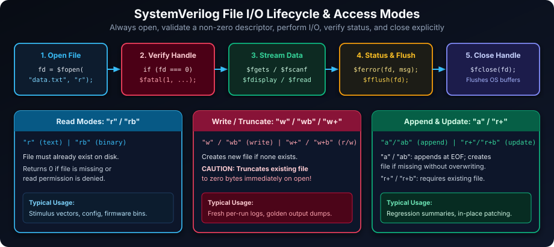
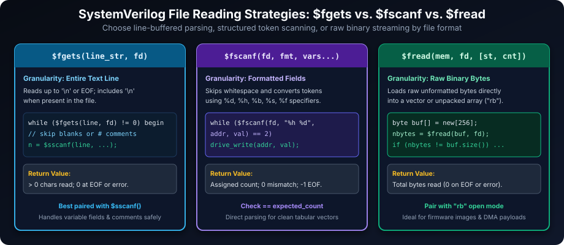
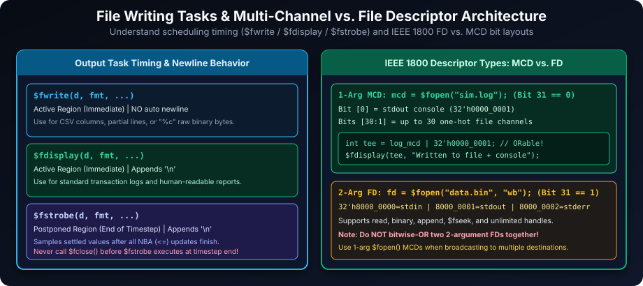
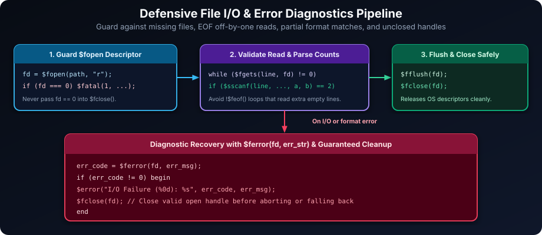

# SystemVerilog File Operations: Interacting with External Data

## Introduction: Bridging Simulation and the External World

File operations in SystemVerilog are essential for enabling simulations to interact with the external environment. This capability is fundamental for a wide range of verification tasks, including:

- **Data-Driven Verification**: Reading test vectors, stimulus data, and configuration parameters from external files to drive simulations. This allows for complex and reusable test scenarios defined outside the simulation code itself.
- **Simulation Result Logging and Debugging**: Recording simulation events, transactions, scoreboard mismatches, and debug messages to external files for detailed analysis and post-simulation debugging.
- **Intermediate Data Handling**: Storing and retrieving intermediate data during simulation runs, such as passing memory images or expected golden packets between reference models and RTL testbenches.
- **Report Generation**: Creating post-simulation reports summarizing simulation results, coverage metrics, and pass/fail status for CI/CD regression dashboards.

Effective file handling is paramount for creating robust, data-driven verification environments and ensuring complete simulation traceability, from input stimulus to output analysis.

### Learning Goals

By the end of this chapter, you should be able to:

- Open, validate, use, and close text and binary files safely.
- Choose between line-oriented (`$fgets` + `$sscanf`), formatted (`$fscanf`), and byte-oriented (`$fread`) file access.
- Distinguish IEEE 1800 Multi-Channel Descriptors (`MCD`) from two-argument File Descriptors (`FD`).
- Produce timestamped logs and broadcast output simultaneously to files and the console.
- Design file-processing code with defensive error checking (`$fopen`, `$ferror`, `$fflush`) and clean resource cleanup.

## File Handling Fundamentals



### Opening Files: Establishing Communication Channels

The `$fopen` system function opens a file and returns an integer handle (either a two-argument **File Descriptor (`FD`)** or a single-argument **Multi-Channel Descriptor (`MCD`)**). When opening files for reading, appending, binary access, or explicit mode control, pass the filename and mode string:

**Syntax:**

```systemverilog
int fd;
fd = $fopen("<filename>", "<mode>");
```

**File Modes:** The `<mode>` argument follows standard C/IEEE 1800-2017 file-I/O conventions. Adding `"b"` selects binary mode, which disables newline/EOF translation on platforms that distinguish text from binary streams.

| Mode | Description | Behavior if File Exists | Behavior if File Doesn't Exist | Use Case |
| :--- | :--- | :--- | :--- | :--- |
| `"r"` | **Read-only** | File must exist (cursor at start) | Error, `$fopen` returns `0` | Reading input test vectors, configuration files |
| `"w"` | **Write-only (truncate)** | **Truncates** to zero length | Creates a new file | Creating fresh simulation output logs |
| `"a"` | **Append-only** | Opens and positions at **end** | Creates a new file | Appending regression status lines |
| `"r+"` | **Read and Update** | Opens for read/write | Error, `$fopen` returns `0` | In-place updates on an existing file |
| `"w+"` | **Write and Update** | **Truncates** to zero length | Creates a new file | Creating new files for mixed read/write |
| `"rb"` | **Read Binary** | File must exist | Error, `$fopen` returns `0` | Reading raw firmware or payload images |
| `"wb"` | **Write Binary** | **Truncates** to zero length | Creates a new file | Writing raw byte streams |
| `"ab"` | **Append Binary** | Opens and positions at **end** | Creates a new file | Appending raw binary records |
| `"r+b"` | **Read/Update Binary** | Opens for read/write | Error, `$fopen` returns `0` | Updating existing binary files |
| `"w+b"` | **Write/Update Binary** | **Truncates** to zero length | Creates a new file | Creating binary files for read/write |

**Important Note:** Always check the return value of `$fopen`. It returns a non-zero descriptor on success and `0` on failure (for example, file not found in `"r"` mode or insufficient permissions).

### Closing Files: Releasing System Resources

Always close opened files using `$fclose(fd);` once all reading or writing completes. Closing releases OS file descriptors and flushes buffered writes to disk. Never pass `0` (a failed open) into `$fclose()`.

## Reading Data from Files

SystemVerilog provides distinct system functions tailored for line-oriented text parsing, formatted token extraction, and raw binary reads.



### Line-by-Line Reading: `$fgets`

`$fgets` reads characters from a file until a newline (`\n`) or EOF is encountered, preserving the newline when present, and stores the line into a `string` variable (recommended) or packed vector.

**Syntax:**

```systemverilog
int chars_read;
string line_buffer;
chars_read = $fgets(line_buffer, fd);
```

**Return Value:**

- Returns the number of characters read (`> 0`) when at least one character was read (even if the final line has no trailing newline).
- Returns `0` at EOF when no characters are left, or on an I/O error.

**Example: Reading and Displaying Lines from a Text File**

```systemverilog
module file_line_reader;
  int    fd;
  string line_of_text;

  initial begin
    fd = $fopen("input_data.txt", "r");
    if (fd === 0) begin
      $error("Error: Could not open file 'input_data.txt' for reading.");
      $finish;
    end

    $display("--- Reading lines from 'input_data.txt' ---");
    while ($fgets(line_of_text, fd) != 0) begin
      // Strip trailing newline if present for clean $display output
      if (line_of_text.len() > 0 && line_of_text[line_of_text.len()-1] == "\n")
        line_of_text = line_of_text.substr(0, line_of_text.len()-2);
      $display("[Line Read] %s", line_of_text);
    end

    $display("--- End of file reached ---");
    $fclose(fd);
  end
endmodule
```

### Formatted Reading: `$fscanf` and `$sscanf`

`$fscanf` scans formatted tokens directly from an open file descriptor using C-style format specifiers (`%d`, `%h`, `%x`, `%b`, `%o`, `%s`, `%f`). Its companion `$sscanf(str, fmt, vars...)` applies the exact same scanning logic to an in-memory `string`—making `$fgets` followed by `$sscanf` the safest way to skip blank lines and `#`/`//` comments!

**Syntax:**

```systemverilog
int items_read;
items_read = $fscanf(fd, "<format_string>", var1, var2, ...);
```

**Return Value:**

- Returns the **number of input items successfully matched and assigned**.
- Returns a count smaller than the number of variables if conversion fails partway through.
- Returns `0` when characters remain in the stream/line but the very first specifier fails to match, or `-1` (`EOF`) when EOF is reached before any item is matched.

**Example: Reading Formatted Integer Values from a File**

```systemverilog
module formatted_data_reader;
  int fd;
  int read_value;

  initial begin
    fd = $fopen("integer_values.txt", "r");
    if (fd === 0) $fatal(1, "Fatal Error: File 'integer_values.txt' could not be opened.");

    $display("--- Reading integer values from 'integer_values.txt' ---");
    while ($fscanf(fd, "%d", read_value) == 1) begin
      $display("Value Read: %0d", read_value);
    end

    $display("--- Finished reading integer values ---");
    $fclose(fd);
  end
endmodule
```

**Best Practices for File Reading:**

- **Always Check `$fopen` Return Value**: Confirm `fd !== 0` before calling any read function.
- **Control Line Loops with `$fgets`**: Drive `while ($fgets(line, fd) != 0)` instead of `while (!$feof(fd))`, because `$feof` only becomes true *after* attempting to read past EOF, which otherwise executes one bogus extra loop iteration.
- **Validate `$fscanf` / `$sscanf` Return Counts**: Verify the returned integer equals the exact number of variables expected.

## Writing Data to Files

SystemVerilog provides `$fwrite`, `$fdisplay`, and `$fstrobe` for writing formatted output to open files.

### Basic Writing Functions: `$fwrite`, `$fdisplay`, and `$fstrobe`

**Syntax:**

```systemverilog
$fwrite(fd, "<format_string>", arguments...);   // Active region, NO auto newline
$fdisplay(fd, "<format_string>", arguments...); // Active region, auto newline
$fstrobe(fd, "<format_string>", arguments...);  // Postponed region, auto newline
```

**Key Differences and Use Cases:**

| Function | Auto Newline | Formatting Support | Execution Scheduling Region | Typical Use Case |
| :--- | :--- | :--- | :--- | :--- |
| `$fwrite` | **No** | Yes (including `%c` raw bytes) | Immediate (`Active`) | CSV tables, partial lines, raw binary bytes |
| `$fdisplay` | **Yes** | Yes | Immediate (`Active`) | General simulation logs and test reports |
| `$fstrobe` | **Yes** | Yes | **Postponed** (end of current time step) | Capturing settled register/bus values after NBA (`<=`) updates |

> **Important `$fstrobe` Timing Rule:** Because `$fstrobe` does not execute until the **Postponed** region at the end of the current simulation time step, do **not** call `$fclose(fd)` in the same procedural time step immediately after `$fstrobe`—advance time first (e.g., `#1ns;`) so `$fstrobe` runs while `fd` is still open.

**Example: Writing Simulation Information to a Log File**

```systemverilog
module file_writer;
  timeunit 1ns;
  timeprecision 1ps;

  int   log_fd;
  logic [7:0] status_reg = 8'h00;

  initial begin
    log_fd = $fopen("simulation_log.txt", "w");
    if (log_fd === 0) begin
      $error("Error: Could not create log file 'simulation_log.txt'.");
      return;
    end

    // Using $fwrite (no automatic newline — continues on same line)
    $fwrite(log_fd, "--- Simulation Start at %0t --- ", $time);

    // Using $fdisplay (appends newline automatically)
    $fdisplay(log_fd, "Mode = %s, Speed = %0d MHz", "Fast", 100);

    // Nonblocking update captured cleanly at end of 10ns step via $fstrobe
    #10ns;
    status_reg <= 8'hA5;
    $fstrobe(log_fd, "[%0t] Settled status_reg = 0x%02h", $time, status_reg);

    // Advance past 10ns Postponed region BEFORE closing the file
    #1ns;
    $fclose(log_fd);
  end
endmodule
```

### Writing and Reading Binary Data

Open binary files with `"wb"` / `"rb"` and write raw bytes with `$fwrite(fd, "%c", byte_val)`. Read raw bytes back with `$fread(array_or_var, fd)`, which returns the total number of bytes transferred.

**Example: Writing and Reading Binary Data**

```systemverilog
module binary_file_operations;
  int  bin_fd;
  int  bytes_read;
  byte tx_data[] = '{8'hDE, 8'hAD, 8'hBE, 8'hEF};
  byte rx_data[];

  initial begin
    // 1. Write Binary Data to File
    bin_fd = $fopen("binary_data.bin", "wb");
    if (bin_fd === 0) $fatal(1, "Binary file open error for writing.");

    foreach (tx_data[i]) $fwrite(bin_fd, "%c", tx_data[i]);
    $fclose(bin_fd);

    // 2. Read Binary Data Back from File
    bin_fd = $fopen("binary_data.bin", "rb");
    if (bin_fd === 0) $fatal(1, "Binary file open error for reading.");

    rx_data = new[4];
    bytes_read = $fread(rx_data, bin_fd);
    if (bytes_read != rx_data.size()) begin
      $error("Expected %0d bytes but read %0d.", rx_data.size(), bytes_read);
    end
    $fclose(bin_fd);

    // 3. Verify Contents
    foreach (rx_data[i]) $display("Byte[%0d]: 0x%02h", i, rx_data[i]);
  end
endmodule
```

## Advanced File Output: Multi-Channel Output



IEEE 1800-2017 Section 21.3 defines **two distinct integer handle encodings** returned by `$fopen`:

1. **Multi-Channel Descriptor (`MCD`) — single-argument `$fopen("<filename>")`**:
   - Bit `31` (MSB) is always **`0`**.
   - Bit `0` (`32'h0000_0001`) is permanently assigned to **standard output (the simulator console)**.
   - Bits `[30:1]` are allocated one-hot to up to 30 open output files.
   - Because each bit represents an independent channel, you can **bitwise-OR (`|`) multiple MCDs**—including `32'h0000_0001` for stdout—to tee a single `$fdisplay` or `$fwrite` call to multiple destinations simultaneously.
2. **File Descriptor (`FD`) — two-argument `$fopen("<filename>", "<mode>")`**:
   - Bit `31` (MSB) is always **`1`**, with predefined handles `32'h8000_0000` (`stdin`), `32'h8000_0001` (`stdout`), and `32'h8000_0002` (`stderr`).
   - FDs support read, binary, append, `$fseek`, and unlimited handles, **but FDs cannot be bitwise-ORed** together or with `1 << 31`.

**Example: Writing to Both Log File and Console with MCDs**

```systemverilog
module multi_channel_logger;
  int log_mcd;
  int tee_mcd;
  localparam int CONSOLE_STDOUT_MCD = 32'h0000_0001; // IEEE 1800 bit 0 = stdout

  initial begin
    // Single-argument $fopen returns an OR-able Multi-Channel Descriptor (MCD)
    log_mcd = $fopen("simulation_activity.log");
    if (log_mcd === 0) $fatal(1, "Log file creation error.");

    // Broadcast simultaneously to the log file AND the console
    tee_mcd = log_mcd | CONSOLE_STDOUT_MCD;

    $fwrite(tee_mcd, "--- System Initialization Message ---\n");
    $fdisplay(tee_mcd, "Timestamp: %0t, System State: Initialized", $time);

    // Close only the file channel (do not close bit 0 stdout)
    $fclose(log_mcd);
  end
endmodule
```

## Comprehensive Function Reference Table

| Function / Task | Description | Return Value | Notes |
| :--- | :--- | :--- | :--- |
| `$fopen("<file>", "<mode>")` | Opens file in explicit mode and returns an `FD` (`bit 31 = 1`) | `FD` (`int`) or `0` on failure | Supports `"r"`, `"w"`, `"a"`, `"r+"`, `"w+"` and `"b"` binary variants |
| `$fopen("<file>")` | Opens file for write and returns an OR-able `MCD` (`bit 31 = 0`) | `MCD` (`int`) or `0` on failure | Bit `0` (`32'h1`) is `stdout`; supports up to 30 open files |
| `$fclose(handle)` | Closes an open `FD` or all channels selected in an `MCD` | None (`void`) | Never pass `0`; closes and flushes buffers |
| `$fgets(str_var, fd)` | Reads next line (including `\n` if present) into `str_var` | Chars read (`> 0`), or `0` on EOF/error | Ideal loop guard: `while ($fgets(line, fd) != 0)` |
| `$fscanf(fd, "<fmt>", vars...)` | Scans formatted items directly from `fd` | Assigned count (`int`); `0` mismatch; `-1` EOF | Verify return equals expected item count |
| `$sscanf(str, "<fmt>", vars...)` | Scans formatted items from an in-memory `string` | Assigned count (`int`); `0` mismatch; `-1` EOF | Pair with `$fgets` to ignore comments/blank lines cleanly |
| `$fread(mem_or_var, fd)` | Reads raw binary bytes from `fd` | Bytes read (`int`) | Use `"rb"` mode; works with packed vars or unpacked arrays |
| `$fwrite(d, "<fmt>", args...)` | Writes formatted text or `%c` bytes with **no** newline | None (task) | Immediate `Active` region execution |
| `$fdisplay(d, "<fmt>", args...)` | Writes formatted text followed by `\n` | None (task) | Immediate `Active` region execution |
| `$fstrobe(d, "<fmt>", args...)` | Writes formatted text followed by `\n` at end of timestep | None (task) | Executes in `Postponed` region |
| `$fflush(fd)` | Flushes buffered writes to OS disk immediately | None (task) | Pass `0` or omit arg on supported tools to flush all |
| `$fseek(fd, offset, op)` / `$ftell(fd)` | Repositions (`0`=start, `1`=cur, `2`=end) / queries byte offset | `$fseek`: `0` ok, `-1` err; `$ftell`: offset (`longint`) | Applies to `FD` handles (not `MCD`) |
| `$feof(fd)` | Checks whether EOF indicator was previously hit | `1` (EOF reached), `0` (not EOF) | Avoid as sole `while` condition with `$fgets` |
| `$ferror(fd, err_str)` | Queries OS/simulator error code and human-readable message | Error code (`int`, `0` = no error) | Call after suspicious I/O failure |
| `$readmemh` / `$readmemb` | Bulk-loads hex or binary text image directly into a memory array | None (task) | Fast initialization of ROM/SRAM arrays at `0ns` |

## Robust Error Handling Techniques

Error handling is crucial for reliable file operations in automated regressions where missing stimulus files or permission failures must be diagnosed immediately.



### Comprehensive File Operation Error Checking

```systemverilog
module safe_file_writer;
  int    fd;
  int    error_code;
  string error_message;

  initial begin
    fd = $fopen("important_data.dat", "a");
    if (fd === 0) begin // 4-state equality safely detects failure (0 or x)
      $error("Fatal File Open Error: Could not open 'important_data.dat' for appending.");
      $fatal(1, "Simulation terminated due to file open error.");
    end else begin
      $display("Successfully opened 'important_data.dat' for appending.");
    end

    $fdisplay(fd, "Critical data entry at time %0t", $time);
    error_code = $ferror(fd, error_message);
    if (error_code != 0) begin
      $error("File Write Error on 'important_data.dat' (Code %0d): %s", error_code, error_message);
    end else begin
      $display("Successfully wrote data to 'important_data.dat'.");
    end

    $fflush(fd);
    $fclose(fd);
    $display("File 'important_data.dat' closed cleanly.");
  end
endmodule
```

**Key Error Handling Practices:**

- **Explicitly Verify `$fopen`**: Check `fd === 0` immediately before doing anything else with the handle.
- **Check Return Values of Read Functions**: Inspect `$fgets != 0`, `$fscanf == expected_count`, and `$fread == expected_bytes`.
- **Utilize `$ferror` for Diagnostics**: Retrieve both the implementation error code and descriptive text string when I/O fails.
- **Close Valid Open Files Before Aborting**: If an error happens *after* a successful `$fopen`, call `$fclose(fd)` before calling `$fatal` or returning—never call `$fclose(0)` on a failed open.

## Best Practices Checklist for SystemVerilog File Operations

- **Always Verify `$fopen` Return Values**: Immediately verify `fd !== 0` after every `$fopen` call before issuing reads, writes, or `$fclose`.
- **Use Appropriate File Modes**: Distinguish `"w"` (truncates existing data) from `"a"` (appends), and add `"b"` (`"rb"`, `"wb"`) whenever processing binary payloads.
- **Close Files Explicitly with `$fclose`**: Close every successfully opened handle once I/O finishes, and allow Postponed `$fstrobe` tasks to complete before closing.
- **Prefer `$fgets` + `$sscanf` for Robust Line Parsing**: Reading a full line with `$fgets` and parsing with `$sscanf` prevents `$fscanf` synchronization bugs on blank lines or comments.
- **Use 1-Arg `$fopen` MCDs for Console+File Teeing**: Combine single-argument MCD handles with `32'h0000_0001` (`stdout`) via `|` instead of ORing two-argument FDs.
- **Check `$fscanf` / `$fread` Return Counts**: Always confirm the exact count of parsed items or bytes transferred matches expectations.
- **Use `$ferror` for Diagnostic Detail**: Report OS-level causes whenever unexpected read/write errors occur.
- **Use `$readmemh` / `$readmemb` for Memory Preloading**: Prefer built-in bulk loaders when initializing large RTL RAM arrays rather than manual `$fscanf` loops.

## Practical Exercises to Solidify File Operation Skills

1. **File Content Analyzer**:
   - Create a SystemVerilog module with a string `FILENAME` parameter that opens the file in `"r"` mode.
   - Read it line by line with `$fgets`, counting total lines, total non-newline characters, and space-delimited words, with error handling if opening fails.

2. **Timestamped Simulation Activity Logger**:
   - Create a module that opens `"simulation_activity.log"` in `"w"` mode and records at least three distinct timestamped events (`[time] TAG: description`) triggered at different simulation delays.

3. **Configuration Parameter Parser**:
   - Parse a `"config.txt"` file containing `parameter_name=value` lines (e.g., `CLOCK_PERIOD=10`, `DATA_WIDTH=32`, `SIMULATION_MODE=FAST`) using `$fgets`, `.substr()` / character scanning, and `$sscanf`, reporting malformed lines gracefully.

4. **ASCII Hex to Binary File Converter**:
   - Read `"hex_data.txt"` containing one hex byte per line using `$fscanf(fd, "%h", byte_val)`, write raw bytes into `"output.bin"` (`"wb"` with `"%c"`), and verify correctness by reading `"output.bin"` back with `"rb"` and `$fread`.

5. **Robust File Wrapper Module with Error Recovery**:
   - Encapsulate file open, read, write, `$ferror` checking, and safe fallback recovery inside reusable wrapper functions/tasks so callers do not repeat boilerplate checks.

---

### Reference Solutions

#### Exercise 1 Solution: File Content Analyzer

```systemverilog
// Sample input file "sample_text.txt":
// Hello SystemVerilog world
// File I/O verification
module file_content_analyzer #(
  parameter string FILENAME = "sample_text.txt"
);
  int    fd;
  string line;
  int    total_lines = 0;
  int    total_chars = 0;
  int    total_words = 0;

  function automatic int count_words_in_line(string s);
    int count = 0;
    bit in_word = 1'b0;
    for (int i = 0; i < s.len(); i++) begin
      byte ch = s[i];
      if (ch == " " || ch == "\t" || ch == "\n" || ch == "\r") begin
        in_word = 1'b0;
      end else if (!in_word) begin
        in_word = 1'b1;
        count++;
      end
    end
    return count;
  endfunction

  initial begin
    fd = $fopen(FILENAME, "r");
    if (fd === 0) begin
      $error("Could not open '%s' for analysis.", FILENAME);
      $fatal(1, "Terminating file analyzer.");
    end

    while ($fgets(line, fd) != 0) begin
      int line_len = line.len();
      if (line_len > 0 && line[line_len-1] == "\n") line_len--;
      if (line_len > 0 && line[line_len-1] == "\r") line_len--;
      total_lines++;
      total_chars += line_len;
      total_words += count_words_in_line(line);
    end
    $fclose(fd);

    $display("File '%s' Summary -> Lines: %0d | Chars (no LF/CR): %0d | Words: %0d",
             FILENAME, total_lines, total_chars, total_words);
    $finish;
  end
endmodule
```

#### Exercise 2 Solution: Timestamped Simulation Activity Logger

```systemverilog
module timestamp_data_logger;
  timeunit 1ns;
  timeprecision 1ps;

  int log_fd;

  task automatic log_activity_event(string tag, string event_description);
    $fdisplay(log_fd, "[%0t] %s: %s", $time, tag, event_description);
  endtask

  initial begin
    log_fd = $fopen("simulation_activity.log", "w");
    if (log_fd === 0) $fatal(1, "Fatal Error: Log file 'simulation_activity.log' creation failed.");

    $display("--- Simulation Timestamped Logger Started ---");
    fork
      begin
        #10ns;
        log_activity_event("ACTIVITY", "Phase 1 Started");
      end
      begin
        #25ns;
        log_activity_event("ACTIVITY", "Data Transaction Initiated");
      end
      begin
        #35ns;
        log_activity_event("ERROR", "Data integrity check failed!");
      end
    join

    $fflush(log_fd);
    $fclose(log_fd);
    $display("--- Simulation Logger Finished - Check 'simulation_activity.log' ---");
    $finish;
  end
endmodule
```

#### Exercise 3 Solution: Configuration Parameter Parser

```systemverilog
// Example config.txt:
// CLOCK_PERIOD=10
// DATA_WIDTH=32
// SIMULATION_MODE=FAST
module config_param_parser;
  int    fd;
  string line;
  int    line_no = 0;

  int    clock_period    = 20;
  int    data_width      = 16;
  string simulation_mode = "NORMAL";

  function automatic string strip_cr_lf(string s);
    int n = s.len();
    while (n > 0 && (s[n-1] == "\n" || s[n-1] == "\r" || s[n-1] == " ")) n--;
    return (n > 0) ? s.substr(0, n-1) : "";
  endfunction

  initial begin
    fd = $fopen("config.txt", "r");
    if (fd === 0) $fatal(1, "Unable to open 'config.txt'.");

    while ($fgets(line, fd) != 0) begin
      string clean = strip_cr_lf(line);
      int eq_idx = -1;
      line_no++;
      if (clean == "" || clean[0] == "#") continue;

      for (int i = 0; i < clean.len(); i++) begin
        if (clean[i] == "=") begin
          eq_idx = i;
          break;
        end
      end

      if (eq_idx <= 0 || eq_idx >= clean.len()-1) begin
        $warning("Line %0d malformed (expected key=value): '%s'", line_no, clean);
        continue;
      end

      begin
        string key = clean.substr(0, eq_idx-1);
        string val = clean.substr(eq_idx+1, clean.len()-1);
        case (key)
          "CLOCK_PERIOD":    if ($sscanf(val, "%d", clock_period) != 1) $warning("Invalid int on line %0d", line_no);
          "DATA_WIDTH":      if ($sscanf(val, "%d", data_width)   != 1) $warning("Invalid int on line %0d", line_no);
          "SIMULATION_MODE": simulation_mode = val;
          default:           $warning("Unknown config key '%s' on line %0d.", key, line_no);
        endcase
      end
    end
    $fclose(fd);

    $display("Parsed Config -> CLOCK_PERIOD=%0d, DATA_WIDTH=%0d, SIMULATION_MODE=%s",
             clock_period, data_width, simulation_mode);
    $finish;
  end
endmodule
```

#### Exercise 4 Solution: ASCII Hex to Binary File Converter

```systemverilog
// Example hex_data.txt:
// DE
// AD
// BE
// EF
module hex_to_bin_converter;
  int       in_fd, bin_fd;
  bit [7:0] hex_val;
  byte      tx_bytes[$];
  byte      rx_bytes[];
  int       bytes_read;

  initial begin
    // 1. Read ASCII hex tokens
    in_fd = $fopen("hex_data.txt", "r");
    if (in_fd === 0) $fatal(1, "Cannot open 'hex_data.txt'.");

    while ($fscanf(in_fd, "%h", hex_val) == 1) begin
      tx_bytes.push_back(byte'(hex_val));
    end
    $fclose(in_fd);

    // 2. Write raw bytes to output.bin
    bin_fd = $fopen("output.bin", "wb");
    if (bin_fd === 0) $fatal(1, "Cannot open 'output.bin' for binary write.");

    foreach (tx_bytes[i]) $fwrite(bin_fd, "%c", tx_bytes[i]);
    $fclose(bin_fd);

    // 3. Read back binary file to verify
    bin_fd = $fopen("output.bin", "rb");
    if (bin_fd === 0) $fatal(1, "Cannot open 'output.bin' for verification.");

    rx_bytes = new[tx_bytes.size()];
    bytes_read = $fread(rx_bytes, bin_fd);
    $fclose(bin_fd);

    if (bytes_read != tx_bytes.size()) begin
      $error("Verification size mismatch: expected %0d, got %0d.", tx_bytes.size(), bytes_read);
    end else begin
      foreach (rx_bytes[i]) $display("Verified Byte[%0d] = 0x%02h", i, rx_bytes[i]);
    end
    $finish;
  end
endmodule
```

#### Exercise 5 Solution: Robust File Wrapper Module with Error Recovery

```systemverilog
module safe_file_wrapper_demo;
  function automatic int safe_open_with_fallback(string primary_path, string fallback_path, string mode);
    int fd = $fopen(primary_path, mode);
    if (fd !== 0) return fd;

    $warning("Could not open '%s' (mode '%s'). Trying fallback '%s'.",
             primary_path, mode, fallback_path);
    fd = $fopen(fallback_path, mode);
    if (fd === 0) begin
      $error("Fallback open also failed for '%s'.", fallback_path);
    end
    return fd;
  endfunction

  task automatic safe_write_line(int fd, string msg);
    int    err_code;
    string err_msg;
    if (fd === 0) begin
      $error("safe_write_line called with invalid handle (0).");
      return;
    end
    $fdisplay(fd, "%s", msg);
    err_code = $ferror(fd, err_msg);
    if (err_code != 0) begin
      $error("Write error (%0d): %s", err_code, err_msg);
    end
  endtask

  task automatic safe_close(ref int fd);
    if (fd !== 0) begin
      $fflush(fd);
      $fclose(fd);
      fd = 0; // Poison handle to prevent double-close bugs
    end
  endtask

  initial begin
    int log_fd = safe_open_with_fallback("/nonexistent_dir/run.log", "fallback_run.log", "w");
    if (log_fd !== 0) begin
      safe_write_line(log_fd, "Wrapper log initialized successfully.");
      safe_close(log_fd);
    end
    $finish;
  end
endmodule
```

##### Copyright (c) 2026 squared-studio
