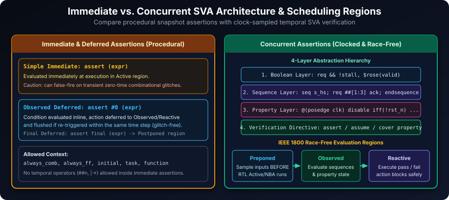
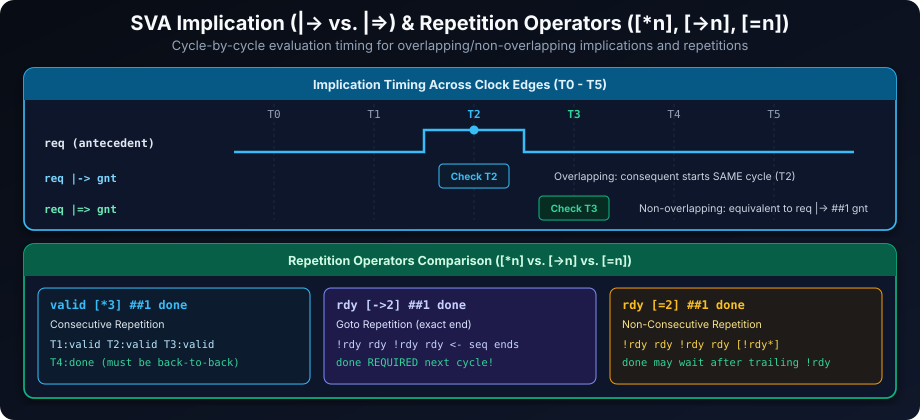
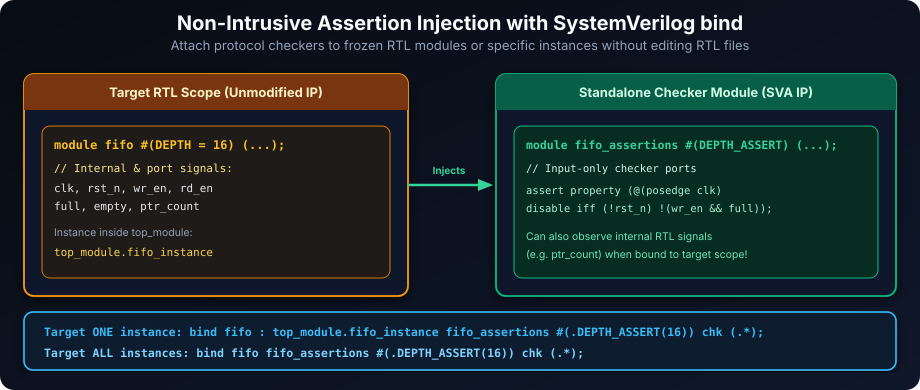
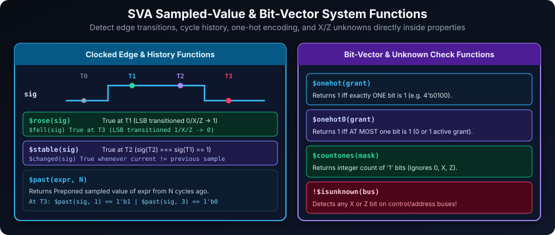

# SystemVerilog Assertions (SVA): Formalizing and Automating Verification

## Introduction to Assertion-Based Verification: Specifying and Validating Design Behavior

SystemVerilog Assertions (SVA) are a cornerstone of modern hardware verification, shifting the focus from manual testbench checks toward proactive formal specification. SVAs do more than find bugs—they **formally specify design intent** and **automatically verify** adherence continuously during simulation and formal proof:

**Key Benefits of Assertion-Based Verification (ABV) with SystemVerilog Assertions (SVA):**

- **Formal Specification of Design Requirements**: SVAs act as executable specifications directly alongside or bound to RTL code, eliminating ambiguity across architecture, RTL, and verification teams.
- **Temporal Property Checking During Simulation**: Concurrent assertions monitor multi-cycle handshakes, pipeline latencies, and protocol invariants on every clock edge.
- **Coverage Metric Collection (`cover property`)**: Tracking sequence and property hits measures whether corner-case temporal scenarios actually occurred during regression runs.
- **Early Error Detection and Root Cause Analysis**: Assertions fire at the exact cycle and hierarchy where an invariant breaks, avoiding long debug trails downstream at external pins.
- **Reusable Verification IP**: Parameterized assertion modules bound via `bind` can be instantiated across projects without touching golden RTL.
- **Bridge to Formal Verification**: The exact same `assert property` and `assume property` statements used in dynamic simulation drive formal model checkers exhaustively.

### Learning Goals

By the end of this chapter, you should be able to:

- Distinguish immediate (and deferred immediate) assertions from clocked concurrent assertions.
- Write properties and sequences using implication (`|->`, `|=>`), delays (`##`), repetition (`[*n]`, `[->n]`, `[=n]`), and sampled-value functions (`$rose`, `$fell`, `$stable`, `$past`).
- Make assertions reset-aware with `disable iff` and prevent false failures or vacuous passes.
- Combine assertion coverage (`cover property`) with functional covergroups.
- Attach assertion IP non-intrusively via `bind` and debug assertions systematically.

## Assertion Types: Immediate vs. Concurrent - Choosing the Right Tool for the Job



SystemVerilog provides two primary assertion categories—**Immediate Assertions** and **Concurrent Assertions**—designed for different scheduling regions and verification scopes.

| Feature | Immediate Assertions | Concurrent Assertions |
| :--- | :--- | :--- |
| **Evaluation Trigger** | **Procedural Execution**: Evaluated inline when execution reaches the statement (`always_comb`, `always_ff`, `initial`, tasks, functions). | **Clocking Events**: Evaluated across clock cycles based on explicit `@(posedge clk)` or `default clocking`. |
| **Temporal Checking** | **Current Sample Snapshot**: Checks single-point boolean expressions only; temporal operators (`##n`, `|->`) are illegal. | **Multi-Cycle Sequences**: Checks temporal sequences, delays, repetitions, and implications across cycles. |
| **Typical Usage** | Combinational invariants, function argument checks, range assertions, procedural invariants. | Handshakes, bus protocols, FSM sequencing, FIFO overflow/underflow checks. |
| **Sampling Semantics** | Evaluates current procedural values in the `Active` region (use `assert #0` / `assert final` to eliminate combinational glitches). | Samples inputs in the race-free **Preponed** region, evaluates in **Observed**, runs action blocks in **Reactive**. |
| **Simulation Overhead** | **Low**: Runs only when the enclosing procedural block triggers. | **Moderate**: Evaluated at each active clock tick across tracked sequence threads. |

**Analogy:**

- **Immediate Assertion**: A checkpoint inside software or combinational logic: *"Right now, as this line runs, is `count <= DEPTH` true?"*
- **Concurrent Assertion**: A hardware logic analyzer continuously watching clock edges: *"Every time `req` rises outside reset, does `ack` arrive within 1 to 3 clock cycles?"*

## Immediate Assertions: Instantaneous Checks in Procedural Code

Immediate assertions sit inside procedural blocks (`always_comb`, `always_ff`, `initial`, `task`, `function`) and test single-cycle boolean expressions.

### Syntax and Glitch-Free Deferred Forms

```systemverilog
// 1. Simple immediate assertion (fires immediately in Active region)
assert (expression)
  [pass_action]
else
  [fail_action];

// 2. Observed deferred immediate assertion (glitch-free within delta cycles)
assert #0 (expression) else $error("...");

// 3. Final deferred immediate assertion (settled values in Postponed region)
assert final (expression) else $error("...");
```

Because combinational blocks (`always_comb`) can execute multiple delta cycles in a single simulation time step before inputs finish settling, simple `assert (...)` statements can suffer transient **delta-cycle glitch false failures**. Using **deferred immediate assertions (`assert #0` or `assert final`)** waits until signals stabilize before reporting a violation, while keeping the familiar procedural syntax.

### Enhanced Example: Parameterized Range Checker with Immediate Assertion

```systemverilog
module parameterized_range_checker #(
  parameter int MIN_VALUE = 0,
  parameter int MAX_VALUE = 255
) (
  input logic [7:0] data_input
);

  always_comb begin : data_range_assertion_block
    // assert #0 prevents transient combinational delta-cycle false alarms
    assert #0 (data_input >= MIN_VALUE && data_input <= MAX_VALUE)
      else $error("Data Out of Range: Value=%0d, Allowed=[%0d:%0d]",
                  data_input, MIN_VALUE, MAX_VALUE);
  end : data_range_assertion_block

endmodule : parameterized_range_checker
```

**Best Practices for Immediate Assertions:**

- **Prefer `assert #0` inside `always_comb`**: Eliminates false triggers caused by delta-cycle signal skew.
- **Avoid Side Effects in Expressions**: Keep assertion expressions purely read-only so disabling assertions never changes functional behavior.
- **Parameterize Bounds**: Expose `parameter` thresholds to build reusable checkers.
- **Include Signal Context in `else $error(...)`**: Always log failing signal values and expected ranges.

## Concurrent Assertions: Temporal Verification for Sequential Behavior

Concurrent assertions verify behavior spanning clock cycles. Under IEEE 1800, they avoid Verilog simulation races through three dedicated scheduling regions:

1. **Preponed Region**: All signals referenced by the concurrent assertion (including `$past`, `$rose`, `$fell`, `$stable`) are sampled *before* `Active` RTL blocks or testbench drivers update signals on that clock edge.
2. **Observed Region**: SVA sequences and properties advance their state machines using those Preponed samples.
3. **Reactive Region**: Pass/fail action blocks (`$info`, `$error`, `$fatal`) execute safely without racing against DUT flops.

### Concurrent Assertion Architecture: Properties, Sequences, and Clocking

Concurrent assertions follow a clean four-layer abstraction:

1. **Boolean Layer**: Combinational expressions evaluated at sampled clock edges (`req && !stall`).
2. **Sequence Layer (`sequence ... endsequence`)**: Multi-cycle temporal patterns built from booleans, cycle delays (`##`), and repetition operators.
3. **Property Layer (`property ... endproperty`)**: Ties sequences together with implications (`|->`, `|=>`), clocking, and `disable iff` reset guards.
4. **Verification Directives**: `assert property`, `assume property`, `cover property`, or `restrict property`.

### Clock Declaration Styles for Concurrent Assertions

Clocked concurrent assertions obtain their clock from either an explicit clocking event in the property or a enclosing `default clocking` block:

1. **Explicit Clock in Property Definition**:

```systemverilog
property request_grant_explicit;
  @(posedge clk_a)
  request_a |-> ##[1:5] grant_a;
endproperty : request_grant_explicit
```

2. **Default Clocking Block**:

```systemverilog
default clocking main_cb @(posedge clk_main);
  default input  #1step;
  default output #0;
endclocking : main_cb

property data_valid_after_address;
  address_valid ##1 data_valid;
endproperty : data_valid_after_address
```

- `default input #1step;` and `default output #0;` configure sampling/driving skew for signals accessed through `main_cb.sig`; standalone concurrent assertions referencing `clk_main` still sample in the Preponed region (`#1step` before the active clock edge).

### Reset-Aware Assertions: Handling Asynchronous Reset

Real hardware requires disabling temporal checks while reset is active using `disable iff (<reset_expr>)`:

```systemverilog
property data_transfer_valid_reset_aware;
  @(posedge clk)
  disable iff (reset_n !== 1'b1) // Aborts active attempts while reset_n is low OR unknown (X/Z)
  valid_request |-> ##1 data_ready;
endproperty : data_transfer_valid_reset_aware
```

- Using `reset_n !== 1'b1` (or `disable iff (!reset_n)` once initialized) aborts in-flight sequence threads whenever reset asserts. Notice that `!== 1'b1` also prevents false failures at time `0` before testbenches drive `reset_n` out of `X`.

## Temporal Operators: Building Blocks for Sequence and Property Definitions



| Operator | Description | Example | Explanation |
| :--- | :--- | :--- | :--- |
| **`##n`** | **Fixed Delay**: Advances exactly `n` clock cycles (`n >= 0`). | `req ##2 gnt` | `gnt` must hold true 2 clock cycles after `req` matches. |
| **`##[m:n]`** | **Range Delay**: Matches `m` to `n` cycles later (`##[1:$]` for unbounded). | `req ##[1:4] gnt` | `gnt` must become true 1, 2, 3, or 4 cycles after `req`. |
| **`[*n]`** | **Consecutive Repetition**: Expression holds true for `n` back-to-back cycles. | `valid [*3]` | `valid` stays high for 3 consecutive clock edges. |
| **`[*m:n]`** | **Consecutive Repetition Range**: Bounded (`[*1:4]`) or unbounded (`[*1:$]`). | `busy [*1:$] ##1 done` | `busy` holds for at least 1 consecutive cycle until `done`. |
| **`[->n]`** | **Goto Repetition**: Non-consecutive `n` occurrences; sequence ends on the `n`th hit. | `req [->3] ##1 gnt` | `req` occurs 3 times (gaps allowed); `gnt` follows immediately after the 3rd `req`. |
| **`[=n]`** | **Non-Consecutive Repetition**: `n` occurrences; trailing `!expr` cycles permitted before next term. | `req [=2] ##1 gnt` | `req` occurs 2 times, followed by zero or more `!req` cycles before `gnt`. |
| **`throughout`** | **Invariant Over Duration**: LHS boolean stays true across every cycle of RHS sequence. | `cs_n_low throughout burst_seq` | `cs_n_low` remains asserted during every clock of `burst_seq`. |
| **`within`** | **Sequence Containment**: Sub-sequence `s1` starts and ends inside envelope `s2`. | `s1 within s2` | `s1` completes entirely during `s2`'s match span. |
| **`and` / `intersect`** | **Sequence Conjunction**: Both match; `intersect` also enforces equal duration. | `s1 intersect s2` | `s1` and `s2` start together and finish on the exact same cycle. |
| **`or`** | **Sequence Disjunction**: Passes if either `s1` or `s2` matches. | `s1 or s2` | Succeeds on whichever branch completes. |
| **`\|->` (Overlapping)** | **Same-Cycle Implication**: Consequent starts in the **same cycle** antecedent completes. | `req \|-> ack` | If `req` is high at `T`, `ack` is checked starting at `T`. |
| **`\|=>` (Non-Overlapping)** | **Next-Cycle Implication**: Consequent starts **1 cycle after** antecedent completes. | `req \|=> ack` | Equivalent to `req \|-> ##1 ack`. |

## Assertion Severity Levels: Controlling Simulation Response to Assertion Failures

SystemVerilog defines four standard severity tasks for assertion action blocks:

| Severity Task | Typical Usage Scenario | Simulation Impact |
| :--- | :--- | :--- |
| **`$fatal`** | Catastrophic safety invariants, corrupted control state | Prints error message and terminates simulation immediately |
| **`$error`** | Functional spec violations, protocol errors (default for failing `assert`) | Increments error counter, logs error, continues simulation |
| **`$warning`** | Suspicious or suboptimal timing/conditions needing review | Logs warning without incrementing failure count |
| **`$info`** | Coverage hit notifications, debug milestones | Logs informational status message |

> **Note:** `$system(...)` invokes an external OS shell command and is **not** an assertion severity task—avoid it inside portable assertion action blocks.

### Severity Level Usage Example: Traffic Light Controller Verification

```systemverilog
module traffic_light_controller_checker (
  input logic       clk,
  input logic       rst,
  input logic [1:0] light_state
);
  // Property: Safety invariant preventing both directions from turning green/red dangerously
  property no_concurrent_invalid_state;
    @(posedge clk)
    disable iff (rst)
    !(light_state == 2'b11);
  endproperty : no_concurrent_invalid_state

  assert property (no_concurrent_invalid_state)
    else $fatal(1, "SAFETY VIOLATION: Invalid light_state=%b at Time=%0t", light_state, $time);

  cover property (@(posedge clk) disable iff (rst) light_state == 2'b00)
    $info("INFO: All-off light state observed at Time=%0t", $time);
endmodule : traffic_light_controller_checker
```

## Coverage-Driven Verification with Assertions: Measuring Verification Progress

Assertions also measure **whether scenarios actually occurred** during simulation, preventing false confidence from vacuous passes (where an antecedent never triggered!).

### Coverage Property Types: Event, Sequence, and Property Coverage

1. **Boolean / Event Coverage**:

```systemverilog
cover property (@(posedge clk) disable iff (!rst_n) enable_signal);
```

2. **Sequence Coverage**:

```systemverilog
sequence req_ack_seq;
  request ##[1:3] acknowledge;
endsequence : req_ack_seq

cover property (@(posedge clk) disable iff (!rst_n) req_ack_seq);
```

3. **Property Coverage**:

```systemverilog
localparam logic [31:0] MIN_ADDR = 32'h1000_0000;
localparam logic [31:0] MAX_ADDR = 32'h1FFF_FFFF;

property valid_address_range;
  valid_txn |-> (address >= MIN_ADDR && address <= MAX_ADDR);
endproperty : valid_address_range

cover property (@(posedge clk) valid_address_range);
```

### Cross-Coverage with Covergroups: Analyzing Combined Coverage

Covergroups pair naturally with SVA checkers to cross state transitions with completion status:

```systemverilog
module protocol_coverage_example (
  input logic clk,
  input logic start_transaction,
  input logic transaction_done
);
  typedef enum logic [1:0] { IDLE, PROCESSING, COMPLETE } state_e;
  state_e protocol_state = IDLE;

  covergroup protocol_coverage_group @(posedge clk);
    start_state_coverage: coverpoint protocol_state {
      bins idle_to_busy     = (IDLE => PROCESSING);
      bins busy_to_complete = (PROCESSING => COMPLETE);
    }

    completion_status_coverage: coverpoint transaction_done {
      bins normal_completion  = {1'b1};
      bins timeout_completion = {1'b0};
    }

    state_completion_cross_coverage: cross start_state_coverage, completion_status_coverage;
  endgroup : protocol_coverage_group

  protocol_coverage_group protocol_coverage_instance = new();

  always_ff @(posedge clk) begin
    if (start_transaction)     protocol_state <= PROCESSING;
    else if (transaction_done) protocol_state <= COMPLETE;
    else                       protocol_state <= IDLE;
  end
endmodule : protocol_coverage_example
```

## Advanced Assertion Techniques: Recursion and Binding

### Parameterized Properties: Defining Checks Based on Previous Occurrences

Writing concise parameterized properties with repetition or `$past` avoids fragile procedural counters and maximizes simulator/formal tool compatibility:

```systemverilog
module run_length_assertion_example #(
  parameter int MAX_CONSEC_ONES = 7
) (
  input logic clk,
  input logic rst_n,
  input logic data_input
);
  property consecutive_ones_limit(int max_ones);
    @(posedge clk)
    disable iff (!rst_n)
    not (data_input [* (max_ones + 1)]);
  endproperty : consecutive_ones_limit

  assert property (consecutive_ones_limit(MAX_CONSEC_ONES))
    else $error("Exceeded maximum %0d consecutive '1's!", MAX_CONSEC_ONES);
endmodule : run_length_assertion_example
```

### Assertion Bindings: Applying Assertions Externally



SystemVerilog's `bind` construct attaches standalone assertion modules to RTL modules or specific hierarchy instances **without editing RTL source files**.

```systemverilog
module fifo #(parameter int DEPTH = 8) (
  input  logic       clk, rst_n, wr_en, rd_en,
  input  logic [7:0] data_in,
  output logic [7:0] data_out,
  output logic       full, empty
);
  // RTL implementation...
endmodule : fifo

module fifo_assertions #(parameter int DEPTH_ASSERT = 8) (
  input logic clk,
  input logic rst_n,
  input logic wr_en,
  input logic rd_en,
  input logic full,
  input logic empty
);
  property fifo_overflow_check;
    @(posedge clk) disable iff (!rst_n)
    !(wr_en && full);
  endproperty : fifo_overflow_check

  property fifo_underflow_check;
    @(posedge clk) disable iff (!rst_n)
    !(rd_en && empty);
  endproperty : fifo_underflow_check

  assert property (fifo_overflow_check)
    else $error("FIFO Overflow (DEPTH=%0d): wr_en asserted while full at %0t", DEPTH_ASSERT, $time);

  assert property (fifo_underflow_check)
    else $error("FIFO Underflow (DEPTH=%0d): rd_en asserted while empty at %0t", DEPTH_ASSERT, $time);
endmodule : fifo_assertions

module top_module;
  logic clk_top, rst_n_top, wr_en_top, rd_en_top, full_top, empty_top;
  logic [7:0] data_in_top, data_out_top;

  fifo #(.DEPTH(16)) fifo_instance (
    .clk(clk_top), .rst_n(rst_n_top), .wr_en(wr_en_top), .rd_en(rd_en_top),
    .data_in(data_in_top), .data_out(data_out_top), .full(full_top), .empty(empty_top)
  );

  // Target one specific instance with colon separator: bind <module> : <instance_list> ...
  bind fifo : top_module.fifo_instance fifo_assertions #(.DEPTH_ASSERT(16)) fifo_checks (
    .clk  (clk),
    .rst_n(rst_n),
    .wr_en(wr_en),
    .rd_en(rd_en),
    .full (full),
    .empty(empty)
  );
  // Note: Omit ": <instance>" (e.g. "bind fifo fifo_assertions ...") to bind every fifo instance.
endmodule : top_module
```

## Debugging Methodologies for SystemVerilog Assertions

### Assertion Control System Tasks: `$asserton`, `$assertoff`, `$assertkill`, `$assertvacuouson`, and `$assertvacuousoff`

- **`$assertoff(levels, [hierarchy_list])`**: Stops future assertion evaluations in the specified hierarchy (e.g., while power is gated or reset is being initialized).
- **`$asserton(levels, [hierarchy_list])`**: Re-enables assertion checking.
- **`$assertkill(levels, [hierarchy_list])`**: Immediately aborts currently active in-flight assertion attempts without disabling new ones.
- **`$assertvacuouson` / `$assertvacuousoff`**: Controls whether vacuous passes of implication properties contribute to pass statistics.

```systemverilog
initial begin
  // Disable all assertion scopes under top.dut.arbiter during cold boot (levels = 0 => all subscopes)
  $assertoff(0, top.dut.arbiter);
  wait (reset_n === 1'b1);
  $asserton(0, top.dut.arbiter);
end
```

### Waveform Markers and `$info` for Debugging Context

- Attach `$info(...)` inside sequence match items or pass action blocks so waveform logs record both triggers and successes:

```systemverilog
property memory_write_ack_check;
  @(posedge clk) disable iff (!rst_n)
  write_enable |-> ##[1:2] (
    acknowledge_signal,
    $info("Write acknowledged at Time=%0t, Addr=0x%08h", $time, current_address)
  );
endproperty : memory_write_ack_check

assert property (memory_write_ack_check)
  else $error("Memory write ack timeout at Time=%0t, Addr=0x%08h", $time, current_address);
```

## Best Practices Checklist for Effective SystemVerilog Assertion Usage

- **Use Named Properties and Sequences**: Give every non-trivial check a meaningful `property`/`sequence` name for clean failure messages and debug traces.
- **Keep Concurrent Assertions Reset-Aware**: Include `disable iff (!rst_n)` (or `rst_n !== 1'b1`) so uninitialized power-on X/reset cycles do not pollute logs.
- **Avoid Combinational Glitches with `assert #0`**: Use deferred immediate assertions inside `always_comb` blocks instead of bare immediate `assert`.
- **Add `cover property` Alongside Every Implication**: Verify the antecedent of `a |-> b` actually fired at least once—never rely solely on zero failures!
- **Parameterize and Bind Externally**: Encapsulate protocol checkers into modules/interfaces and attach them via `bind` rather than intruding into golden RTL.
- **Match Failure Severity to Impact**: Reserve `$fatal` for catastrophic safety violations, `$error` for functional bugs, and `$warning`/`$info` for advisories.

## Practical Exercises to Master SystemVerilog Assertions

1. **Packet Protocol Assertion Suite**: Write concurrent assertions in `packet_protocol_checker` verifying 1-cycle `start_bit`, 8-cycle payload phase, even parity checking, 1-cycle `stop_bit`, and mutual exclusion across frame phases.
2. **UART Controller State Machine Coverage**: Implement `uart_fsm_coverage` tracking `IDLE => START_BIT_DETECT`, all 8 data bit indices in `DATA_RECEIVE`, `STOP_BIT_DETECT`, `ERROR_STATE`, and cross-coverage between transitions and error flags.
3. **Memory Access Assertion Suite**: Build `mem_ctrl_assertions` verifying address stability between `write_enable`/`read_enable` and `acknowledge`, bus contention prevention (`!(write_enable && read_enable)`), minimum enable width, and basic read-after-write scoreboard verification.
4. **AMBA AHB-Lite Bus Protocol Assertions**: Implement key AHB-Lite properties (`HSEL` phase control validity, `HTRANS`/`HREADY` sequencing, `HBURST` incrementing address progression across `INCR4`, and `HRESP` error signaling).

---

### Reference Solutions

#### Exercise 1 Solution: Packet Protocol Assertion Suite

```systemverilog
module packet_protocol_checker (
  input logic       clk,
  input logic       rst_n,
  input logic       start_bit,
  input logic       data_valid,
  input logic [7:0] data,
  input logic       parity_bit,
  input logic       parity_valid,
  input logic       stop_bit
);
  default clocking cb @(posedge clk);
  endclocking

  // 1. Start bit must be a clean 1-cycle pulse
  property p_start_one_cycle;
    disable iff (!rst_n)
    start_bit |=> !start_bit;
  endproperty
  assert property (p_start_one_cycle)
    else $error("Start bit held for >1 cycle!");

  // 2. Mutual exclusion among active packet phase strobes
  property p_phase_mutex;
    disable iff (!rst_n)
    $onehot0({start_bit, data_valid, parity_valid, stop_bit});
  endproperty
  assert property (p_phase_mutex)
    else $error("Overlapping packet phase indicators detected!");

  // 3. After start_bit, 8 cycles of data_valid, then parity_valid, then 1-cycle stop_bit
  property p_full_frame_sequence;
    disable iff (!rst_n)
    $rose(start_bit) |=> (data_valid [*8]) ##1 parity_valid ##1 (stop_bit ##1 !stop_bit);
  endproperty
  assert property (p_full_frame_sequence)
    else $error("Packet frame sequence violation after start_bit!");

  // 4. Even parity check across captured data byte during parity_valid
  property p_even_parity;
    disable iff (!rst_n)
    parity_valid |-> (parity_bit === ^$past(data, 1));
  endproperty
  assert property (p_even_parity)
    else $error("Even parity mismatch: parity_bit=%b, ^data=%b", parity_bit, ^$past(data, 1));

  cover property (@(posedge clk) disable iff (!rst_n) $rose(start_bit));
endmodule : packet_protocol_checker
```

#### Exercise 2 Solution: UART Controller State Machine Coverage

```systemverilog
module uart_fsm_coverage (
  input logic       clk,
  input logic       rst_n,
  input logic [2:0] bit_idx,
  input logic       parity_err,
  input logic       framing_err
);
  typedef enum logic [2:0] {
    IDLE,
    START_BIT_DETECT,
    DATA_RECEIVE,
    PARITY_CHECK,
    STOP_BIT_DETECT,
    ERROR_STATE
  } uart_state_e;

  uart_state_e state;
  wire any_err = parity_err || framing_err;

  covergroup cg_uart @(posedge clk);
    option.per_instance = 1;

    cp_state_trans: coverpoint state {
      bins idle_to_start  = (IDLE => START_BIT_DETECT);
      bins start_to_data  = (START_BIT_DETECT => DATA_RECEIVE);
      bins stop_detected  = {STOP_BIT_DETECT};
      bins entered_error  = (DATA_RECEIVE, PARITY_CHECK, STOP_BIT_DETECT => ERROR_STATE);
    }

    cp_data_bits: coverpoint bit_idx iff (state == DATA_RECEIVE) {
      bins bit_pos[8] = {[0:7]};
    }

    cp_error_flag: coverpoint any_err {
      bins clean = {1'b0};
      bins error = {1'b1};
    }

    cx_state_vs_err: cross cp_state_trans, cp_error_flag;
  endgroup : cg_uart

  cg_uart u_cg_uart = new();

  assert property (@(posedge clk) disable iff (!rst_n) (state == ERROR_STATE) |-> $past(any_err) || any_err)
    else $warning("Entered ERROR_STATE without parity_err or framing_err asserted.");
endmodule : uart_fsm_coverage
```

#### Exercise 3 Solution: Memory Access Assertion Suite

```systemverilog
module mem_ctrl_assertions (
  input logic        clk,
  input logic        rst_n,
  input logic [31:0] address,
  input logic [31:0] data_in,
  input logic [31:0] data_out,
  input logic        write_enable,
  input logic        read_enable,
  input logic        acknowledge
);
  default clocking cb @(posedge clk);
  endclocking

  // 1. Address and write data must stay stable until acknowledge
  property p_addr_stable_during_txn;
    disable iff (!rst_n)
    ((write_enable || read_enable) && !acknowledge) |=> $stable(address);
  endproperty
  assert property (p_addr_stable_during_txn)
    else $error("Address changed before memory acknowledge!");

  // 2. Simultaneous read & write contention prohibited
  property p_no_rw_contention;
    disable iff (!rst_n)
    !(write_enable && read_enable);
  endproperty
  assert property (p_no_rw_contention)
    else $error("Bus contention: write_enable and read_enable asserted together!");

  // 3. Write enable held until acknowledge arrives
  property p_we_held_until_ack;
    disable iff (!rst_n)
    $rose(write_enable) |-> (write_enable throughout (acknowledge [->1]));
  endproperty
  assert property (p_we_held_until_ack)
    else $error("write_enable deasserted prematurely before acknowledge!");

  // 4. Lightweight scoreboard + RAW hazard check
  logic [31:0] shadow_mem [logic [31:0]];
  always_ff @(posedge clk) begin
    if (rst_n && write_enable && acknowledge) begin
      shadow_mem[address] <= data_in;
    end
  end

  property p_read_matches_written;
    disable iff (!rst_n)
    (read_enable && acknowledge && shadow_mem.exists(address))
      |-> (data_out === shadow_mem[address]);
  endproperty
  assert property (p_read_matches_written)
    else $error("Read data mismatch / RAW hazard at addr 0x%08h!", address);
endmodule : mem_ctrl_assertions
```

#### Exercise 4 Solution: AMBA AHB-Lite Bus Protocol Assertions

```systemverilog
module ahb_lite_protocol_assertions (
  input logic        hclk,
  input logic        hresetn,
  input logic        hsel,
  input logic [1:0]  htrans,   // 00:IDLE, 01:BUSY, 10:NONSEQ, 11:SEQ
  input logic [2:0]  hburst,   // 000:SINGLE, 001:INCR, 011:INCR4 ...
  input logic [2:0]  hsize,    // 010 => 4-byte word
  input logic        hwrite,
  input logic [31:0] haddr,
  input logic        hready,
  input logic        hresp     // 0:OKAY, 1:ERROR
);
  localparam logic [1:0] TRANS_IDLE   = 2'b00;
  localparam logic [1:0] TRANS_NONSEQ = 2'b10;
  localparam logic [1:0] TRANS_SEQ    = 2'b11;
  localparam logic [2:0] BURST_INCR4  = 3'b011;

  default clocking cb @(posedge hclk);
  endclocking

  // 1. Control and address phase must stay valid/known and stable during wait states (!hready)
  property p_ctrl_stable_when_stalled;
    disable iff (!hresetn)
    (hsel && htrans != TRANS_IDLE && !hready) |=> $stable({haddr, hwrite, hsize, hburst, htrans});
  endproperty
  assert property (p_ctrl_stable_when_stalled)
    else $error("AHB address/control changed while HREADY=0!");

  property p_addr_phase_known;
    disable iff (!hresetn)
    (hsel && htrans != TRANS_IDLE) |-> !$isunknown({haddr, hwrite, hsize, hburst});
  endproperty
  assert property (p_addr_phase_known)
    else $error("AHB address phase signals contain X/Z during active transfer!");

  // 2. Incrementing INCR4 word burst progression across sequential beats
  property p_incr4_word_addr_step;
    disable iff (!hresetn)
    (hsel && hready && hburst == BURST_INCR4 && hsize == 3'b010 &&
     (htrans == TRANS_NONSEQ || htrans == TRANS_SEQ))
      ##1 (hsel && htrans == TRANS_SEQ)
      |-> (haddr == $past(haddr) + 32'd4);
  endproperty
  assert property (p_incr4_word_addr_step)
    else $error("AHB INCR4 sequential beat address did not increment by 4 bytes!");

  // 3. AHB two-cycle ERROR response protocol: cycle 1 HRESP=1 & HREADY=0, cycle 2 HRESP=1 & HREADY=1
  property p_ahb_two_cycle_error;
    disable iff (!hresetn)
    $rose(hresp) |-> (!hready ##1 (hresp && hready));
  endproperty
  assert property (p_ahb_two_cycle_error)
    else $error("AHB two-cycle ERROR handshake violated (must assert HREADY=0 then HREADY=1 with HRESP=1)!");

  cover property (@(posedge hclk) disable iff (!hresetn) (hsel && htrans == TRANS_NONSEQ && hwrite));
endmodule : ahb_lite_protocol_assertions
```

## Comprehensive Function Reference Table for SystemVerilog Assertions



| Construct / Function | Description | Example | Notes |
| :--- | :--- | :--- | :--- |
| **`sequence ... endsequence`** | Defines a reusable temporal signal pattern | `sequence req_ack_seq; req ##1 ack; endsequence` | Building block for properties |
| **`property ... endproperty`** | Encapsulates a temporal relationship, clock, and reset guard | `property p; @(posedge clk) req \|-> ack; endproperty` | Verified with `assert`, `assume`, or `cover` |
| **`assert property (...)`** | Verifies a property holds across simulation / formal runs | `assert property (p) else $error("Violation!");` | Executes `else` block in `Reactive` region on fail |
| **`cover property (...)`** | Records whether a property/sequence succeeded non-vacuously | `cover property (req_ack_seq);` | Essential to detect untried antecedents |
| **`assume property (...)`** | Constrains legal inputs for formal tools / testbench monitors | `assume property (valid_cfg);` | Prevents false formal counterexamples |
| **`$past(expr, n)`** | Returns Preponed value of `expr` from `n` clock cycles ago | `$past(data_bus, 2)` | Default `n = 1` when omitted |
| **`$rose(signal)`** | Detects LSB `0/X/Z -> 1` transition between clock samples | `$rose(start_bit)` | Uses Preponed sampled values |
| **`$fell(signal)`** | Detects LSB `1/X/Z -> 0` transition between clock samples | `$fell(rst_n)` | Inverse of `$rose` |
| **`$stable(signal)`** | True if sampled value equals the previous cycle's sample | `$stable(haddr)` | Equivalent to `!$changed(signal)` |
| **`$countones(expr)`** | Counts set `'1'` bits in `expr` (ignores `0`, `X`, `Z`) | `$countones(req_vec) <= 2` | Useful for arbiter/credit checks |
| **`$onehot(expr)` / `$onehot0(expr)`** | Checks if **exact 1** (`$onehot`) or **0/1** (`$onehot0`) bit is `'1'` | `$onehot(grant_bus)` | Core invariant for mux/FSM/arbiter ports |
| **`$isunknown(expr)`** | True if any bit in `expr` is `X` or `Z` | `!$isunknown(data_bus)` | Guard against uninitialized control buses |
| **`disable iff (cond)`** | Aborts active attempts and suspends property while `cond` is true | `disable iff (!rst_n)` | Must be used for reset awareness |

##### Copyright (c) 2026 squared-studio
