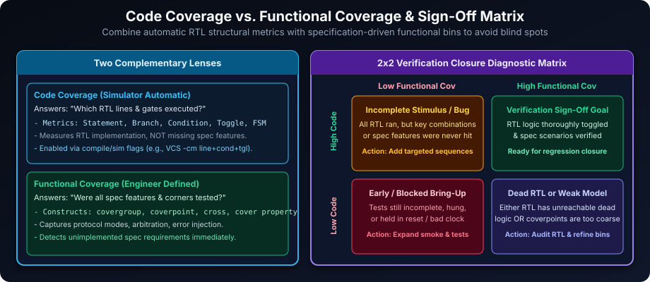
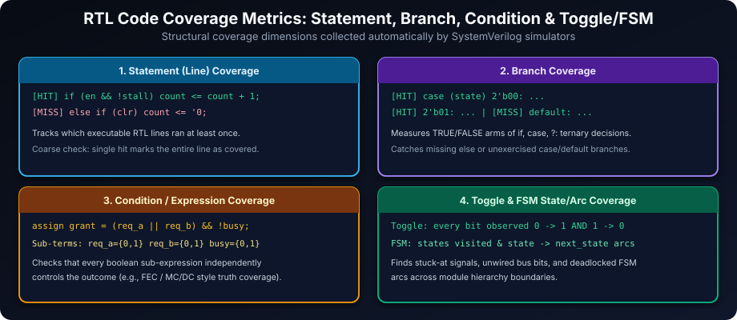
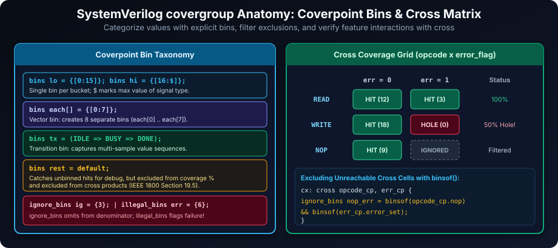
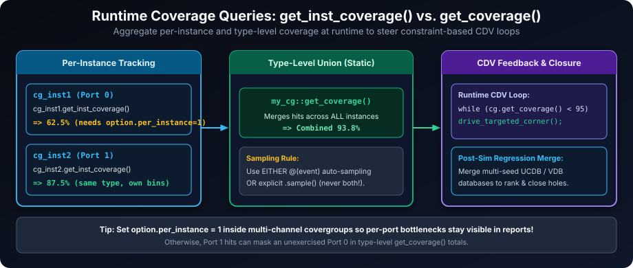

# SystemVerilog Coverage: Measuring and Enhancing Verification Completeness

## Introduction: Quantifying Verification and Closing Coverage Gaps

In hardware verification, coverage serves as a quantitative measure of **how thoroughly a design's structure and intended functionality have been exercised** by the verification environment. By pinpointing **coverage holes**—parts of the RTL logic or specification space never reached—coverage analysis guides stimulus generation and provides an objective sign-off criterion before tape-out.

SystemVerilog recognizes two complementary categories of coverage:

1. **Code Coverage (Automatic)**: Collected automatically by simulation tools, measuring how much of the **RTL implementation** (lines, branches, expressions, toggles, FSM states) executed during simulation.
2. **Functional Coverage (User-Defined)**: Written explicitly by verification engineers (`covergroup`, `coverpoint`, `cross`, `cover property`) to verify whether every **specification requirement, feature, and corner case** was exercised.



**Key Distinction: Code Coverage vs. Functional Coverage**

- **Code Coverage** asks: *"Did our simulation execute every line, branch, condition, and wire toggle inside the RTL?"*
- **Functional Coverage** asks: *"Did our tests exercise every operational mode, packet boundary, error state, and cross-feature interaction specified in the design requirements?"*

> **Critical Insight:** High code coverage with low functional coverage often means the RTL ran through trivial paths without testing real corner-case combinations—or worse, a required feature was never implemented in RTL at all! Both metrics must reach closure together.

## Code Coverage: Automatic Metrics of RTL Execution

Code coverage metrics are instrumented automatically by simulators (enabled via compile/run options such as `-cm line+cond+fsm+tgl+branch` in VCS or `+cover=bcfst` in Questa).



### Statement Coverage: Measuring Executed Lines

**Statement coverage** (line coverage) measures the percentage of executable RTL statements executed at least once.

```systemverilog
module statement_coverage_example;
  logic [1:0] operation_mode = 2'b00;

  initial begin
    if (operation_mode == 2'b00) begin
      $display("Executing Mode A logic");  // Statement 1 (covered)
    end else begin
      $display("Executing Mode B logic");  // Statement 2 (NOT covered)
    end
  end
endmodule
```

With `operation_mode` held at `2'b00`, statement coverage is **50%** (`1 / 2`). Statement coverage quickly reveals dead code or unreachable initialization blocks, though it misses multi-branch condition subtleties.

### Branch Coverage: Exercising Control Flow

**Branch coverage** tracks whether both the true and false outcomes of every `if`/`else`, `case` item, loop, and ternary (`?:`) decision executed.

```systemverilog
module branch_coverage_example;
  logic [1:0] current_state = 2'b01;

  initial begin
    case (current_state)
      2'b00:   $display("State: IDLE");        // Branch 1
      2'b01:   $display("State: PROCESSING");  // Branch 2 (Covered)
      2'b10:   $display("State: ERROR");       // Branch 3
      default: $display("State: UNDEFINED");   // Branch 4
    endcase
  end
endmodule
```

Only `2'b01` ran above (**25%** = `1 / 4` branches). Notably, even an implicit missing `else` branch counts as a branch target in most tools, ensuring default hold behavior is actually tested.

### Condition / Expression Coverage: Boolean Sub-Term Independence

**Condition (expression) coverage** examines compound boolean expressions such as `assign grant = (req_a || req_b) && !busy;` and checks whether each sub-term (`req_a`, `req_b`, `busy`) independently toggled between `0` and `1` and affected the expression outcome. Reaching 100% statement and branch coverage does **not** automatically imply 100% condition coverage if one sub-term masked another.

### Toggle Coverage: Observing Signal Value Changes

**Toggle coverage** tracks whether every single bit of nets and registers transitioned both `0 -> 1` and `1 -> 0` (full toggle). Unconnected bus MSBs or stuck-at status bits show up immediately as toggle holes.

```systemverilog
module toggle_coverage_example;
  logic clock_signal = 1'b0;
  logic enable_flag  = 1'b0;

  initial begin
    #10ns clock_signal = 1'b1;
    #10ns enable_flag  = 1'b1; // 0 -> 1 covered
    #10ns enable_flag  = 1'b0; // 1 -> 0 covered
    #10ns $finish;
  end
endmodule
```

### FSM State & Transition Coverage

Simulators automatically extract finite state machines (`enum` state variables updated inside `always_ff`/`always_comb`) to report:
- **State Coverage**: Did the FSM enter every defined state (`IDLE`, `BUSY`, `ERR`)?
- **Arc / Transition Coverage**: Did the FSM traverse every valid transition edge (`IDLE -> BUSY`, `BUSY -> ERR`, `ERR -> IDLE`)?

**Limitations of Code Coverage:**

- **Structural, Not Functional**: High code coverage proves the existing RTL ran—not that the RTL implements missing specification requirements.
- **Unreachable Defensive Clauses**: Reset-only defaults or one-hot error branches sometimes need justified tool exclusions.

## Functional Coverage: User-Defined Metrics for Specification Verification

Functional coverage captures *what the specification demands* using SystemVerilog `covergroup`, `coverpoint`, `bins`, and `cross` constructs.



### Covergroups: Organizing Functional Coverage Definitions

A `covergroup` acts like a reusable coverage collector object that can be instantiated inside modules, interfaces, or verification classes. Choose **either** automatic event-triggered sampling (`covergroup cg @(posedge clk);`) **or** explicit procedural sampling (`cg.sample();`)—never combine both simultaneously unless you intentionally want double hits.

```systemverilog
module functional_coverage_example;
  logic       clock = 1'b0;
  logic [5:0] address;              // 6-bit address space: 0..63
  logic       read_write_operation; // 0 = Read, 1 = Write

  // Event-less covergroup driven cleanly by explicit sample() calls
  covergroup address_operation_coverage;
    option.per_instance = 1;

    address_range_cp: coverpoint address {
      bins low_range    = {[0:15]};
      bins mid_range    = {[16:31]};
      bins high_range   = {[32:55]};
      bins upper_tail   = default; // Captures 56..63 for inspection (excluded from % and cross)
    }

    rw_cp: coverpoint read_write_operation {
      bins read_op  = {1'b0};
      bins write_op = {1'b1};
    }

    // Cross only includes explicit non-default bins (3 ranges x 2 R/W ops = 6 cross bins)
    address_rw_cross: cross address_range_cp, rw_cp;
  endgroup : address_operation_coverage

  address_operation_coverage coverage_instance = new();

  always #5ns clock = ~clock;

  task automatic drive_transaction(input logic [5:0] addr_val, input bit rw_val);
    address              <= addr_val;
    read_write_operation <= rw_val;
    @(posedge clock);
    @(posedge clock); // Sample after NBA assignment settles cleanly
    coverage_instance.sample();
  endtask

  initial begin
    drive_transaction(6'd5,  1'b0); // Read in low_range
    drive_transaction(6'd25, 1'b1); // Write in mid_range
    drive_transaction(6'd48, 1'b0); // Read in high_range
    drive_transaction(6'd60, 1'b1); // Write hitting upper_tail (default bin)
    #10ns $finish;
  end
endmodule : functional_coverage_example
```

> **IEEE 1800 Rule on `default` Bins:** Under IEEE 1800 Section 19.5.1, `bins rest = default;` matches values outside all explicit/ignore/illegal bins for diagnostic tracking, **but `default` bins are excluded from the coverpoint's coverage percentage calculation and excluded from `cross` products**. If an address range must count toward coverage %, declare it as an explicit range bin (`{[56:63]}`) rather than `default`.

### Coverpoints: Defining What to Measure

```systemverilog
covergroup data_coverage_group (ref logic [7:0] data_signal);
  data_value_cp: coverpoint data_signal {
    bins zero_value           = {8'd0};
    bins small_values         = {[8'd1:8'd5]};
    bins medium_values        = {8'd8, 8'd9, 8'd15};
    bins large_values         = {[8'd16:$]}; // $ expands to type max (255)
    illegal_bins error_value  = {8'd6};      // Hitting 6 flags a coverage failure
    ignore_bins  irrel_value  = {8'd7};      // Excluded from coverage percentage
  }
endgroup : data_coverage_group
```

**Automatic vs. Explicit Vector Bins:**

When a `coverpoint` has no explicit `bins`, SystemVerilog creates up to `option.auto_bin_max` (default `64`) automatic bins. For explicit 1-to-1 tracking on small fields, use vector array bins `bins auto_explicit[] = {[0:$]};`:

```systemverilog
module automatic_bins_example;
  logic       clk = 1'b0;
  logic [2:0] state_reg = 3'b000;

  // Event-free definition paired cleanly with explicit cov_inst.sample()
  covergroup state_coverage;
    state_reg_cp:          coverpoint state_reg; // Creates 8 auto bins: auto[0]..auto[7]
    state_reg_cp_explicit: coverpoint state_reg {
      bins auto_explicit[] = {[0:$]};            // Creates 8 bins: auto_explicit[0]..auto_explicit[7]
    }
  endgroup : state_coverage

  state_coverage cov_inst = new();

  always #5ns clk = ~clk;

  initial begin
    for (int i = 0; i < 8; i++) begin
      state_reg = 3'(i);
      @(posedge clk);
      cov_inst.sample();
    end
    $display("Coverage achieved: %0.2f%%", cov_inst.get_inst_coverage());
    $finish;
  end
endmodule : automatic_bins_example
```

### Cross Coverage: Verifying Value Combinations

**Cross coverage (`cross`)** computes the Cartesian product of bins from two or more coverpoints, catching subtle interaction bugs (e.g., error injection during bursts vs. single writes). Use **`binsof(...) intersect {...}`** inside `cross` blocks to filter out physically impossible combinations via `ignore_bins` or `illegal_bins`:

```systemverilog
covergroup protocol_mode_speed_coverage (
  ref logic [1:0] operation_mode,
  ref logic [1:0] processor_speed
);
  mode_cp: coverpoint operation_mode {
    bins low_power_mode        = {2'b00, 2'b01};
    bins high_performance_mode = {2'b10, 2'b11};
  }
  speed_cp: coverpoint processor_speed {
    bins speed_level_1 = {2'd1};
    bins speed_level_2 = {2'd2};
  }

  // 2 x 2 = 4 raw cross cells; exclude impossible combo (low_power + speed_level_2)
  mode_speed_cross_coverage: cross mode_cp, speed_cp {
    ignore_bins impossible_lp_fast = binsof(mode_cp.low_power_mode) &&
                                     binsof(speed_cp.speed_level_2);
  }
endgroup : protocol_mode_speed_coverage
```

**Coverage Target:** Filtering out the 1 impossible cell leaves $4 - 1 = 3$ legal combinations required for 100% cross coverage closure.

### Accessing Functional Coverage at Runtime: `get_coverage()` and `get_inst_coverage()`



SystemVerilog provides two query methods to inspect functional coverage live during simulation:

- **`cg_type::get_coverage()`**: Static type-level method returning the **cumulative union coverage percentage (`0.0` to `100.0`) across all instances** of `cg_type`.
- **`cg_inst.get_inst_coverage()`**: Instance method returning the coverage achieved by that **specific instance** (requires `option.per_instance = 1;` to maintain independent instance counters).

```systemverilog
covergroup my_transaction_covergroup;
  option.per_instance = 1;
  trans_kind_cp: coverpoint current_kind {
    bins rd_bin  = {0};
    bins wr_bin  = {1};
    bins cfg_bin = {2};
  }
endgroup

// Inside a UVM env or verification controller:
task run_cdv_feedback();
  my_transaction_covergroup cg_port0 = new();
  my_transaction_covergroup cg_port1 = new();
  real total_cov;

  repeat (10) begin
    #100ns;
    total_cov = my_transaction_covergroup::get_coverage();
    $display("[%0t] Type cumulative=%0.2f%% | Port0=%0.2f%% | Port1=%0.2f%%",
             $time, total_cov, cg_port0.get_inst_coverage(), cg_port1.get_inst_coverage());

    if (total_cov < 75.0) begin
      $display("[%0t] Coverage below 75%% — steering constraints toward uncovered bins.", $time);
    end
  end
endtask
```

## Practical Exercises to Solidify Coverage Concepts

1. **Statement Coverage Challenge: 3:1 Multiplexer**: Implement a 3:1 mux (`data_in1`, `data_in2`, `data_in3`, `select_input`) and drive every branch including `default` for 100% statement coverage.
2. **Branch Coverage Scenario: Traffic Light Controller State Transitions**: Model a `RED -> YELLOW -> GREEN -> RED` FSM and traverse all state arms and transition edges to hit 100% branch coverage.
3. **Toggle Coverage Task: 4-bit Counter with Asynchronous Reset**: Simulate a 4-bit counter long enough (`>= 16` clocks + reset cycle) so `reset_n` and every bit of `count[3:0]` toggle `0->1` and `1->0`.
4. **Functional Coverage Implementation: 8-bit Data Bus Bins**: Build `data_bus_cg` covering `zero_bin`, `powers_of_two_bin`, `prime_numbers_bin`, and `default_bin`, hitting all explicit bins cleanly.
5. **Cross Coverage Problem: Opcode and Error Flag Combinations**: Cross a 2-bit `opcode` (`4` values) with `error_flag` (`0`, `1`) to cover all $4 \times 2 = 8$ combinations.

---

### Reference Solutions

#### Exercise 1 Solution: 3:1 Multiplexer (100% Statement Coverage)

```systemverilog
module mux_3to1 (
  input  logic [7:0] data_in1,
  input  logic [7:0] data_in2,
  input  logic [7:0] data_in3,
  input  logic [1:0] select_input,
  output logic [7:0] mux_output
);
  always_comb begin
    case (select_input)
      2'b00:   mux_output = data_in1;
      2'b01:   mux_output = data_in2;
      2'b10:   mux_output = data_in3;
      default: mux_output = 8'h00; // Covers 2'b11 safely without latches
    endcase
  end
endmodule : mux_3to1

module tb_mux_3to1;
  logic [7:0] d1 = 8'h11, d2 = 8'h22, d3 = 8'h33, y;
  logic [1:0] sel;

  mux_3to1 u_dut (.data_in1(d1), .data_in2(d2), .data_in3(d3),
                  .select_input(sel), .mux_output(y));

  initial begin
    for (int s = 0; s < 4; s++) begin
      sel = 2'(s);
      #10ns;
      $display("sel=%b -> mux_output=0x%02h", sel, y);
    end
    $finish;
  end
endmodule : tb_mux_3to1
```

#### Exercise 2 Solution: Traffic Light FSM (100% Branch Coverage)

```systemverilog
module traffic_light_fsm (
  input  logic clk,
  input  logic rst_n,
  output logic [1:0] state_out
);
  typedef enum logic [1:0] { RED = 2'b00, YELLOW = 2'b01, GREEN = 2'b10 } tl_state_e;
  tl_state_e cur_state, next_state;

  always_ff @(posedge clk or negedge rst_n) begin
    if (!rst_n) cur_state <= RED;
    else        cur_state <= next_state;
  end

  always_comb begin
    next_state = cur_state;
    case (cur_state)
      RED:     next_state = YELLOW;
      YELLOW:  next_state = GREEN;
      GREEN:   next_state = RED;
      default: next_state = RED;
    endcase
  end

  assign state_out = cur_state;
endmodule : traffic_light_fsm

module tb_traffic_light_fsm;
  logic       clk = 1'b0, rst_n = 1'b0;
  logic [1:0] state_out;

  always #5ns clk = ~clk;
  traffic_light_fsm u_dut (.*);

  initial begin
    #12ns rst_n = 1'b1; // Covers reset=0 branch then reset=1 branch
    repeat (6) @(posedge clk); // Cycles through RED->YELLOW->GREEN->RED twice
    $finish;
  end
endmodule : tb_traffic_light_fsm
```

#### Exercise 3 Solution: 4-Bit Async-Reset Counter (100% Toggle Coverage)

```systemverilog
module counter_4bit (
  input  logic       clk,
  input  logic       reset_n,
  output logic [3:0] count
);
  always_ff @(posedge clk or negedge reset_n) begin
    if (!reset_n) count <= 4'd0;
    else          count <= count + 4'd1;
  end
endmodule : counter_4bit

module tb_counter_4bit;
  logic       clk = 1'b0, reset_n = 1'b0;
  logic [3:0] count;

  always #5ns clk = ~clk;
  counter_4bit u_dut (.*);

  initial begin
    #12ns reset_n = 1'b1;      // reset_n 0 -> 1
    repeat (18) @(posedge clk); // Wraps 0..15->0->2 so ALL count[3:0] bits toggle 0->1 and 1->0!
    reset_n = 1'b0;            // reset_n 1 -> 0
    #10ns;
    $display("Final count=%0d (all 4 bits toggled 0->1 and 1->0)", count);
    $finish;
  end
endmodule : tb_counter_4bit
```

#### Exercise 4 Solution: 8-Bit Data Bus Functional Coverage

```systemverilog
module data_bus_coverage_example;
  logic [7:0] data_bus_in;
  int         sample_count = 0;

  covergroup data_bus_cg;
    option.per_instance = 1;
    data_bus_cp: coverpoint data_bus_in {
      bins zero_bin          = {8'h00};
      bins powers_of_two_bin = {8'h01, 8'h02, 8'h04, 8'h08, 8'h10, 8'h20, 8'h40, 8'h80};
      bins prime_numbers_bin = {
        3, 5, 7, 11, 13, 17, 19, 23, 29, 31, 37, 41, 43, 47, 53, 59, 61,
        67, 71, 73, 79, 83, 89, 97, 101, 103, 107, 109, 113, 127, 131,
        137, 139, 149, 151, 157, 163, 167, 173, 179, 181, 191, 193, 197,
        199, 211, 223, 227, 229, 233, 239, 241, 251
      };
      bins default_bin       = default;
    }
  endgroup : data_bus_cg

  data_bus_cg db_coverage = new();

  initial begin
    // Direct boundary samples guarantee every bucket hits immediately
    data_bus_in = 8'h00; db_coverage.sample(); sample_count++;
    data_bus_in = 8'h01; db_coverage.sample(); sample_count++;
    data_bus_in = 8'd13; db_coverage.sample(); sample_count++;
    data_bus_in = 8'd55; db_coverage.sample(); sample_count++;

    repeat (200) begin
      data_bus_in = 8'($urandom_range(255, 0));
      db_coverage.sample();
      sample_count++;
    end

    $display("--- %0d Samples Driven | data_bus_cg Coverage = %0.2f%% ---",
             sample_count, db_coverage.get_inst_coverage());
    $finish;
  end
endmodule : data_bus_coverage_example
```

#### Exercise 5 Solution: Opcode x Error Flag Cross Coverage

```systemverilog
module opcode_error_cross_tb;
  logic [1:0] opcode;
  bit         error_flag;

  covergroup opcode_error_cross_coverage;
    option.per_instance = 1;

    opcode_cp: coverpoint opcode {
      bins opcode_00 = {2'b00};
      bins opcode_01 = {2'b01};
      bins opcode_10 = {2'b10};
      bins opcode_11 = {2'b11};
    }

    error_flag_cp: coverpoint error_flag {
      bins error_not_set = {1'b0};
      bins error_set     = {1'b1};
    }

    opcode_error_cross: cross opcode_cp, error_flag_cp;
  endgroup : opcode_error_cross_coverage

  opcode_error_cross_coverage cg = new();

  initial begin
    for (int op = 0; op < 4; op++) begin
      for (int err = 0; err < 2; err++) begin
        opcode     = 2'(op);
        error_flag = bit'(err);
        cg.sample();
      end
    end
    $display("Cross Coverage (opcode x error_flag) = %0.2f%%", cg.get_inst_coverage());
    $finish;
  end
endmodule : opcode_error_cross_tb
```

## Best Practices for Effective Coverage-Driven Verification

1. **Holistic Closure (Code + Functional + SVA)**: Combine automatic RTL code coverage with specification-driven `covergroup` and `cover property` metrics.
2. **Avoid `auto_bin_max` Bloat on Wide Buses**: Always define explicit range or boundary bins on 32/64-bit address/data fields rather than relying on default auto-binning.
3. **Never Double-Sample a Covergroup**: Use either a clocking event `@(posedge clk)` *or* procedural `.sample()`, not both on the same covergroup.
4. **Filter Impossible Cross Pairs Explicitly**: Use `ignore_bins` with `binsof(...) intersect {...}` rather than leaving unreachable combinations at `< 100%`.
5. **Enable `option.per_instance = 1` on Shared Submodules**: Prevent one busy channel from hiding a dead channel inside type-level coverage totals.
6. **Track Trends & Merge Regression Databases**: Merge multi-seed databases (e.g., URG/VDB/UCDB) to rank tests and eliminate redundant simulation seeds.

## Comprehensive Reference Table: SystemVerilog Coverage Constructs and Methods

| Construct / Keyword | Description | Example | Notes |
| :--- | :--- | :--- | :--- |
| **`covergroup name; ... endgroup`** | Encapsulates coverpoints, crosses, options, and sampling trigger | `covergroup tx_cg @(posedge clk); ... endgroup` | Class-like type; must be instantiated via `new()` |
| **`coverpoint expr { ... }`** | Specifies an expression/variable whose values or transitions are tracked | `coverpoint addr { bins lo = {[0:255]}; }` | Creates automatic bins if body is empty |
| **`bins bin_name = {set};`** | Explicit scalar/range/array (`bins b[]`) or transition (`(A=>B)`) bucket | `bins low_values = {[0:15]};` | `$` indicates upper/lower range bound of expression type |
| **`bins others = default;`** | Captures values not matched by any explicit/ignore/illegal bin | `bins others = default;` | Excluded from coverage % calculation and `cross` |
| **`ignore_bins name = {set};`** | Excludes don't-care values or impossible cross combinations | `ignore_bins rsvd = {[200:255]};` | Removed from coverage denominator |
| **`illegal_bins name = {set};`** | Flags forbidden states/values as runtime verification errors | `illegal_bins bad = {3'b111};` | Triggers simulator error on hit |
| **`cross cp1, cp2;`** | Computes Cartesian product of bins from multiple coverpoints | `cross opcode_cp, err_cp;` | Filter with `binsof(...) intersect {...}` |
| **`option.per_instance = 1;`** | Stores independent coverage counters per covergroup instance | `option.per_instance = 1;` | Required for meaningful `get_inst_coverage()` |
| **`cg_inst.sample();`** | Procedurally samples covergroup expressions at exact transaction points | `my_cg_inst.sample();` | Avoid pairing with `@(event)` header trigger |
| **`cg_type::get_coverage()`** | Returns type-level cumulative coverage (`real`, `0.0..100.0`) | `real c = my_cg::get_coverage();` | Static union across all instances |
| **`cg_inst.get_inst_coverage()`** | Returns single-instance coverage (`real`, `0.0..100.0`) | `real c = my_cg.get_inst_coverage();` | Set `option.per_instance = 1` per instance |
| **Code Coverage Metrics** | Simulator-collected structural metrics (Line/Branch/Cond/Toggle/FSM) | Tool CLI options (e.g., `-cm line+branch+tgl`) | Supplements functional coverage |

##### Copyright (c) 2026 squared-studio
