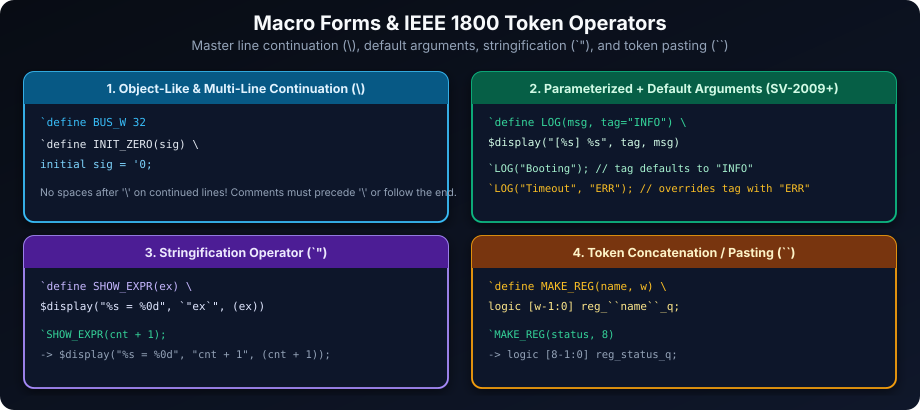
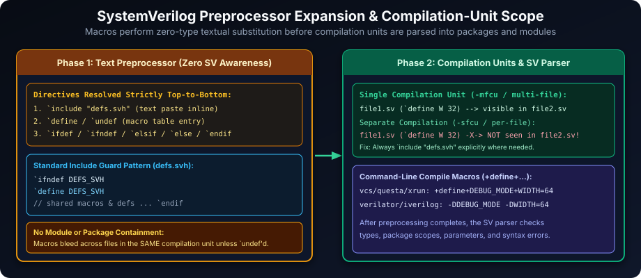
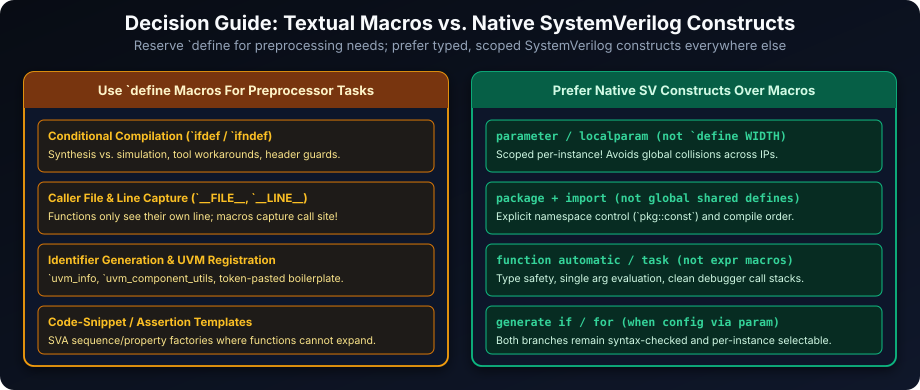
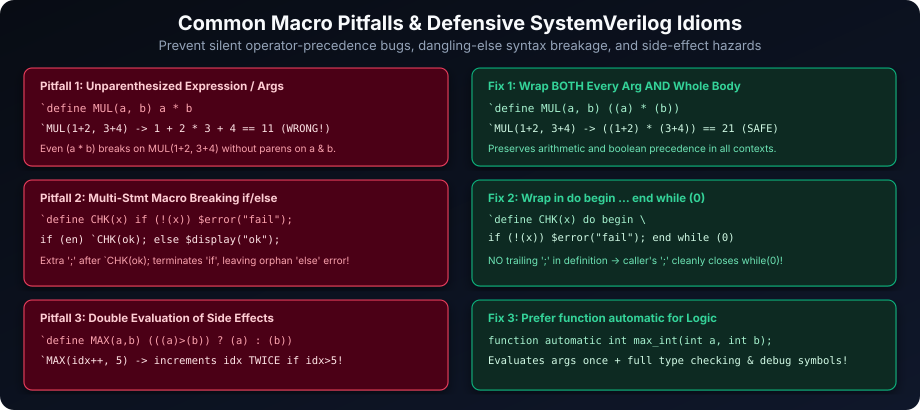

# SystemVerilog Macros: Enhancing Code Reusability and Flexibility

## Introduction: Streamlining Code with Textual Macros

Macros in SystemVerilog are preprocessor directives that perform textual substitution before the SystemVerilog compiler parses a single keyword. Used properly, macros make verification testbenches, assertion factories, and cross-tool builds far cleaner and more maintainable:

- **Code Abstraction**: Assign symbolic names to frequently used boilerplate snippets, assertion checks, or logging helpers.
- **Conditional Compilation (`ifdef` / `ifndef`)**: Enable debug hooks, synthesis pragmas, or tool-specific workarounds cleanly at build time.
- **Caller-Site Diagnostics**: Capture the exact invoking source file and line number using `` `__FILE__ `` and `` `__LINE__ ``—something regular functions cannot do cleanly without manual parameters.
- **Identifier & String Construction**: Synthesize repetitive register names or debug strings using token pasting (`` `` ``) and stringification (`` `" ``).

### Learning Goals

By the end of this chapter, you should be able to:

- Define, invoke, and undefine object-like and parameterized macros (including default arguments).
- Explain preprocessing order, compilation-unit boundaries, header include guards, and conditional compilation.
- Apply IEEE 1800 token operators (stringification `` `" `` and token pasting `` `` ``) and predefined location macros (`` `__FILE__ ``, `` `__LINE__ ``).
- Prevent precedence, trailing-semicolon, dangling-`else`, and double-evaluation hazards.
- Know when `parameter`, `localparam`, `package`, `function automatic`, or `generate` blocks are safer than textual macros.

## Defining and Using Macros

SystemVerilog macros are defined with `` `define ``, removed with `` `undef `` (or `` `undefineall ``), and expanded by prefixing the identifier with a backtick `` ` ``.

### `` `define ``: Defining Macros

**Syntax:**

```systemverilog
`define MACRO_NAME macro_text
```

- **`` `define ``**: Compiler directive initiating a macro definition.
- **`MACRO_NAME`**: Uppercase convention distinguishes preprocessor tokens from SystemVerilog variables and parameters.
- **`macro_text`**: Raw replacement text pasted verbatim at each `` `MACRO_NAME `` invocation. Macros have **no type checking, no data width, and no lexical scope** of their own.

**Example: Defining a Macro for Data Width**

```systemverilog
`define DATA_WIDTH 32

module macro_example;
  logic [`DATA_WIDTH-1:0] data_bus;

  initial begin
    $display("Data bus width: %0d", `DATA_WIDTH);
  end
endmodule
```

### `` `undef ``: Undefining Macros

Use `` `undef MACRO_NAME `` to undefine a macro from that line onward within the compilation unit. Because preprocessing happens *before* simulation starts, even an `` `undef `` placed inside an `initial` block takes effect on all later source lines regardless of execution order.

```systemverilog
`define TEMP_WIDTH 32

module undef_example;
  logic [`TEMP_WIDTH-1:0] data_bus_1;

  initial begin
    $display("Data bus 1 width: %0d", `TEMP_WIDTH);
    `undef TEMP_WIDTH
    // Subsequent uses of `TEMP_WIDTH would now fail preprocessing!
  end
endmodule
```

## Types and Applications of Macros



### Simple Text Substitution & Multi-Line Macros

Use a backslash (`\`) directly before a newline (with **no trailing spaces or inline comments** after `\`) to span a macro definition across multiple lines:

```systemverilog
`define CLK_PERIOD 10ns
`define RST_VAL    1'b0

module simple_macros;
  timeunit 1ns; timeprecision 1ps;
  logic clk = 1'b0;
  logic rst = `RST_VAL;

  always #(`CLK_PERIOD / 2) clk = ~clk;

  initial begin
    #5ns  rst = ~`RST_VAL;
    #20ns rst = `RST_VAL;
    #10ns $finish;
  end
endmodule
```

### Parameterized Macros, Default Arguments & Token Operators

Parameterized macros accept comma-separated arguments and (since SystemVerilog-2009 / IEEE 1800) optional **default argument values**:

```systemverilog
`define ASSERT_TRUE(condition, message = "Check failed") \
  do begin \
    if (!(condition)) begin \
      $error("Assertion Failed: %s at %s:%0d", message, `__FILE__, `__LINE__); \
      $fatal(1); \
    end \
  end while (0)
```

IEEE 1800 also defines three special expansion operators inside macro bodies:

| Operator | Name | Purpose & Example |
| :--- | :--- | :--- |
| `` `" `` | **Stringification** | Converts macro argument text into a string literal: `` `define DBG(ex) $display("%s=%0d", `"ex`", (ex)) `` |
| `` `\`" `` | **Escaped Quote in String** | Emits an escaped `\"` inside a `" ... `" stringified literal |
| `` `` `` | **Token Concatenation (Paste)** | Joins adjacent tokens into one identifier: `` `define REG_Q(n) reg_``n``_q `` -> `reg_ctrl_q` |

### Conditional Compilation Macros

Directives `` `ifdef ``, `` `ifndef ``, `` `elsif ``, `` `else ``, and `` `endif `` select source text prior to syntax parsing:

```systemverilog
`define DEBUG_MODE

module conditional_compilation;
  logic [7:0] data = 8'h55;

  initial begin
    `ifdef DEBUG_MODE
      $display("DEBUG: Before shift = 0x%02h", data);
    `elsif TRACE_LITE
      $display("LITE: Processing");
    `else
      // Silent in production runs
    `endif

    data = data << 1;

    `ifdef DEBUG_MODE
      $display("DEBUG: After shift  = 0x%02h", data);
    `endif
  end
endmodule
```

## Scope of Macro Definitions



Macro directives follow compilation-unit text order—not RTL hierarchy:

- **Compilation-Unit Scope**: A macro remains visible from its `` `define `` until `` `undef `` (or end of compilation unit). Multi-file compilation units (`-mfcu` style) share macros across files passed together, whereas single-file compilation units (`-sfcu`) isolate macros per file.
- **No Module or Package Containment**: Declaring `` `define `` inside a `package` or `module` does **not** restrict it to that block; `import pkg::*;` never imports macros either.
- **Reliable Sharing via Include Guards**: Put shared macros in a `.svh` header wrapped with `` `ifndef GUARD_SVH / `define GUARD_SVH / ... / `endif `` and pull them in with `` `include `` wherever needed, or define build flags on the simulator command line (`+define+NAME=VAL` or `-DNAME=VAL`).

```systemverilog
// common_defs.svh (Header-guarded for safe multi-file inclusion)
`ifndef COMMON_DEFS_SVH
`define COMMON_DEFS_SVH
  `define MSG_BANNER "Hello from guarded header"
`endif
```

## Predefined Macros

IEEE 1800-2017 Section 22.13 defines standard source-location macros (`` `__FILE__ `` and `` `__LINE__ ``), while many EDA tools additionally borrow C-style build macros such as `__DATE__`, `__TIME__`, or vendor version identifiers:

| Predefined Macro | Standard Status | Expansion Description | Example |
| :--- | :--- | :--- | :--- |
| `` `__LINE__ `` | **IEEE 1800 Standard** | Current 1-based line number (`int`) | `42` |
| `` `__FILE__ `` | **IEEE 1800 Standard** | Current source filename string literal | `"my_module.sv"` |
| `` `__TIME__ `` | Tool / C-preprocessor extension | Compile wall-clock time (`hh:mm:ss`), **not** simulation `$time` | `"09:30:15"` |
| `` `__DATE__ `` | Tool / C-preprocessor extension | Compile calendar date (`Mmm dd yyyy`) | `"Nov 13 2026"` |
| `` `__SYSTEMVERILOG__ `` | Simulator-specific | Tool SV version integer where supported; guard with `` `ifdef `` | `201800` |

```systemverilog
module predefined_macros_example;
  initial begin
    $display("--- Compilation Information ---");
    $display("File name: %s", `__FILE__);
    $display("Line number: %0d", `__LINE__);
    `ifdef __DATE__
      $display("Compiled on %s at %s", `__DATE__, `__TIME__);
    `endif
    `ifdef __SYSTEMVERILOG__
      $display("Tool SV macro version: %0d", `__SYSTEMVERILOG__);
    `endif
  end
endmodule
```

## Best Practices for Macros



- **Use Native SV Constructs Whenever Possible**: Use `parameter` / `localparam` for bus widths, `package` for shared types/constants, `function automatic` for reusable calculations, and `generate if` for structural options.
- **Uppercase Naming with Project Prefix**: Prefix global macros (e.g., `AXI_DATA_W`, `TB_ASSERT`) to avoid colliding with third-party IPs inside single compilation units.
- **Guard Headers with `` `ifndef ``**: Always wrap `.svh` files in include guards so multiple `` `include `` paths never trigger redefinition warnings.
- **Capture Location Context**: Reserve assertion/logging macros for places that genuinely need `` `__FILE__ ``, `` `__LINE__ ``, or `` `"expr`" ``.

## Comprehensive Directive Reference Table

| Directive | Description | Syntax Example | Notes |
| :--- | :--- | :--- | :--- |
| `` `define `` | Defines object-like or parameterized macro text | `` `define ADD(a, b=1) ((a)+(b)) `` | Supports default args and `\` multi-line |
| `` `undef `` | Removes a single macro definition | `` `undef DEBUG_MODE `` | Prevents macro pollution after local use |
| `` `undefineall `` | Clears all active user macro definitions | `` `undefineall `` | IEEE 1800 directive for clean unit boundaries |
| `` `ifdef `` / `` `ifndef `` | Conditional compilation based on whether macro is defined | `` `ifndef MY_HDR_SVH `` | Standard mechanism for header guards |
| `` `elsif `` / `` `else `` / `` `endif `` | Multi-way conditional compilation branches | `` `elsif FPGA_BUILD `` | Inactive branches still must tokenize cleanly |
| `` `include `` | Pastes contents of specified header file inline | `` `include "tb_macros.svh" `` | Searches tool `-incdir` paths (`+incdir+...`) |
| `` `resetall `` | Resets compiler directives (e.g., `` `timescale ``) to defaults | `` `resetall `` | Does **not** undefine `` `define `` macros |

## Robust Macro Usage and Error Prevention



### Parenthesize Both Individual Arguments AND the Whole Expression

Simply writing `` `define CALC_MUL(a, b) (a * b) `` still breaks when passed compound expressions such as `` `CALC_MUL(1 + 2, 3 + 4) ``, which expands to `(1 + 2 * 3 + 4) = 11` instead of `21`! Always wrap **every parameter and the outer expression**:

```systemverilog
`define CALC_MUL_BAD(a, b)  a * b
`define CALC_MUL_GOOD(a, b) ((a) * (b))

module precedence_demo;
  initial begin
    $display("Bad  macro: 2 * (1+2)*(3+4) -> %0d", 2 * `CALC_MUL_BAD(1 + 2, 3 + 4));  // 2*1 + 2*3 + 4 = 12
    $display("Good macro: 2 * (1+2)*(3+4) -> %0d", 2 * `CALC_MUL_GOOD(1 + 2, 3 + 4)); // 2 * (3 * 7)   = 42
  end
endmodule
```

### Use `do begin ... end while (0)` Without Trailing Semicolon for Multi-Statement Macros

A multi-statement macro containing `begin ... end` *plus* a trailing `;` breaks `if (cond) `MY_MACRO; else ...;` with a syntax error because the extra `;` terminates the `if` early. Wrapping multiple statements inside `do begin ... end while (0)` **with no trailing semicolon** makes the macro behave identically to a single statement everywhere.

### Watch Out for Double Evaluation & Safe Redefinition

- Never pass side-effect expressions like `i++` or `fifo.pop()` into macros (`MAX(a, b)`) that mention an argument more than once—write a `function automatic` instead.
- If a macro must be overridden cleanly in a file, explicitly call `` `undef `` before redefining it to avoid compiler redefinition warnings.

## Best Practices Checklist for SystemVerilog Macros

- **Uppercase & Prefixed Names**: Distinguish macros cleanly and prevent global namespace collisions across IPs.
- **Wrap Headers in Include Guards**: Protect every `.svh` with `` `ifndef NAME_SVH / `define NAME_SVH / ... / `endif ``.
- **Parenthesize Args & Body**: Always write `((a) op (b))` in expression macros.
- **Use `do begin ... end while (0)` for Multi-Statement Macros**: Omit the trailing semicolon in the definition.
- **Escape `\` Cleanly**: Never place trailing spaces or comments after `\` line continuations.
- **Prefer `parameter`, `package`, and `function automatic`**: Reserve macros strictly for preprocessing, compile-time guards, token pasting, or call-site `__FILE__`/`__LINE__`.

## Practical Exercises to Solidify Macro Skills

1. **Data Width Parameterization with Macros**: Define `FIFO_DEPTH` and `DATA_WIDTH` fallback macros with `` `ifndef `` defaults and build a parameterized FIFO verified in a testbench.
2. **Conditional Feature Compilation**: Implement `FEATURE_LOGGING` and `FEATURE_ERROR_INJECTION` using `` `ifdef `` so build switches selectively compile debug instrumentation and fault injection.
3. **Parameterized Assertion Macros**: Write `ASSERT_RANGE(val, min_v, max_v, msg)` using `do ... while (0)`, `"val"` stringification, `` `__FILE__ ``, and `` `__LINE__ ``.
4. **Version Control Macro**: Combine `VERSION_MAJOR`, `VERSION_MINOR`, and `VERSION_PATCH` (plus guarded `__DATE__`) into a clean build banner.
5. **Include File for Common Macros**: Structure a guarded `tb_common_macros.svh` header defining `CLK_PERIOD`, `RST_VAL`, `TIMEOUT_CYCLES`, and `TB_LOG` for multi-module reuse.

---

### Reference Solutions

#### Exercise 1 Solution: Macro-Configured FIFO Module

```systemverilog
`ifndef FIFO_DEPTH
  `define FIFO_DEPTH 8
`endif
`ifndef DATA_WIDTH
  `define DATA_WIDTH 16
`endif

module macro_fifo (
  input  logic                   clk,
  input  logic                   rst_n,
  input  logic                   wr_en,
  input  logic                   rd_en,
  input  logic [`DATA_WIDTH-1:0] wdata,
  output logic [`DATA_WIDTH-1:0] rdata,
  output logic                   full,
  output logic                   empty
);
  localparam int PTR_W = $clog2(`FIFO_DEPTH);
  logic [`DATA_WIDTH-1:0] mem [0:`FIFO_DEPTH-1];
  logic [PTR_W:0] count;
  logic [PTR_W-1:0] wptr, rptr;

  assign full  = (count == `FIFO_DEPTH);
  assign empty = (count == 0);
  assign rdata = mem[rptr];

  always_ff @(posedge clk or negedge rst_n) begin
    if (!rst_n) begin
      wptr <= '0; rptr <= '0; count <= '0;
    end else begin
      case ({wr_en && !full, rd_en && !empty})
        2'b10: begin mem[wptr] <= wdata; wptr <= wptr + 1'b1; count <= count + 1'b1; end
        2'b01: begin                     rptr <= rptr + 1'b1; count <= count - 1'b1; end
        2'b11: begin mem[wptr] <= wdata; wptr <= wptr + 1'b1; rptr  <= rptr + 1'b1; end
        default: ;
      endcase
    end
  end
endmodule

module tb_macro_fifo;
  logic clk = 1'b0, rst_n = 1'b0, wr_en = 1'b0, rd_en = 1'b0, full, empty;
  logic [`DATA_WIDTH-1:0] wdata = '0, rdata;
  always #5ns clk = ~clk;

  macro_fifo u_dut (.*);

  initial begin
    $display("FIFO Configured via Macros: DEPTH=%0d, DATA_WIDTH=%0d", `FIFO_DEPTH, `DATA_WIDTH);
    #12ns rst_n = 1'b1;
    @(posedge clk); wr_en = 1'b1; wdata = `DATA_WIDTH'('hA5A5);
    @(posedge clk); wr_en = 1'b0; rd_en = 1'b1;
    @(posedge clk);
    $display("Popped rdata = 0x%0h (empty=%0b)", rdata, empty);
    $finish;
  end
endmodule
```

#### Exercise 2 Solution: Conditional Feature Compilation (`FEATURE_LOGGING` & `FEATURE_ERROR_INJECTION`)

```systemverilog
`define FEATURE_LOGGING
// Uncomment or pass +define+FEATURE_ERROR_INJECTION at compile time to enable fault injection:
// `define FEATURE_ERROR_INJECTION

module feature_conditional_compilation;
  timeunit 1ns;
  timeprecision 1ps;

  logic       clk = 1'b0;
  logic [7:0] data_in = 8'h00;
  logic [7:0] data_out = 8'h00;

  always #5ns clk = ~clk;

  always_ff @(posedge clk) begin
    `ifdef FEATURE_ERROR_INJECTION
      data_out <= data_in ^ 8'h01; // Flip LSB when error injection compiled in
    `else
      data_out <= data_in;
    `endif

    `ifdef FEATURE_LOGGING
      $strobe("[%0t] LOG: data_in=0x%02h -> data_out=0x%02h", $time, data_in, data_out);
    `endif
  end

  initial begin
    #10ns data_in = 8'hAA;
    #20ns data_in = 8'h55;
    #20ns $finish;
  end
endmodule
```

#### Exercise 3 Solution: Parameterized `ASSERT_RANGE` Macro

```systemverilog
`define ASSERT_RANGE(val, min_v, max_v, msg) \
  do begin \
    if (((val) < (min_v)) || ((val) > (max_v))) begin \
      $error("[%s:%0d] ASSERT_RANGE(%s) failed (%0d outside [%0d:%0d]): %s", \
             `__FILE__, `__LINE__, `"val`", (val), (min_v), (max_v), (msg)); \
    end \
  end while (0)

module tb_assert_range_macro;
  int pkt_len;

  initial begin
    pkt_len = 64;
    if (1'b1)
      `ASSERT_RANGE(pkt_len, 64, 1518, "Nominal Ethernet frame");
    else
      $display("Dead branch checks dangling-else safety");

    pkt_len = 32;
    `ASSERT_RANGE(pkt_len, 64, 1518, "Runt packet should flag error!");
    $finish;
  end
endmodule
```

#### Exercise 4 Solution: Version Control Banner Macro

```systemverilog
`define VERSION_MAJOR 2
`define VERSION_MINOR 4
`define VERSION_PATCH 1

module design_version_banner;
  initial begin
    `ifdef __DATE__
      $display("IP Build v%0d.%0d.%0d (Compiled: %s %s)",
               `VERSION_MAJOR, `VERSION_MINOR, `VERSION_PATCH, `__DATE__, `__TIME__);
    `else
      $display("IP Build v%0d.%0d.%0d (Source: %s)",
               `VERSION_MAJOR, `VERSION_MINOR, `VERSION_PATCH, `__FILE__);
    `endif
    $finish;
  end
endmodule
```

#### Exercise 5 Solution: Guarded Include Header & Consumer Module

```systemverilog
// File: tb_common_macros.svh (placed in +incdir+ search path)
`ifndef TB_COMMON_MACROS_SVH
`define TB_COMMON_MACROS_SVH

  `define CLK_PERIOD     10ns
  `define RST_VAL        1'b0
  `define TIMEOUT_CYCLES 500
  `define TB_LOG(msg)    $display("[%0t][%s:%0d] %s", $time, `__FILE__, `__LINE__, (msg))

`endif // TB_COMMON_MACROS_SVH

// File: tb_consumer.sv
`include "tb_common_macros.svh"
`include "tb_common_macros.svh" // Safe even if included twice thanks to header guard!

module tb_consumer;
  timeunit 1ns; timeprecision 1ps;
  logic clk = 1'b0;
  logic rst_n = `RST_VAL;

  always #(`CLK_PERIOD / 2) clk = ~clk;

  initial begin
    `TB_LOG("Reset asserted via guarded macro header");
    #25ns rst_n = ~`RST_VAL;
    `TB_LOG("Reset released");
    repeat (`TIMEOUT_CYCLES) @(posedge clk);
    `TB_LOG("Timeout reached cleanly");
    $finish;
  end
endmodule
```

##### Copyright (c) 2026 squared-studio
