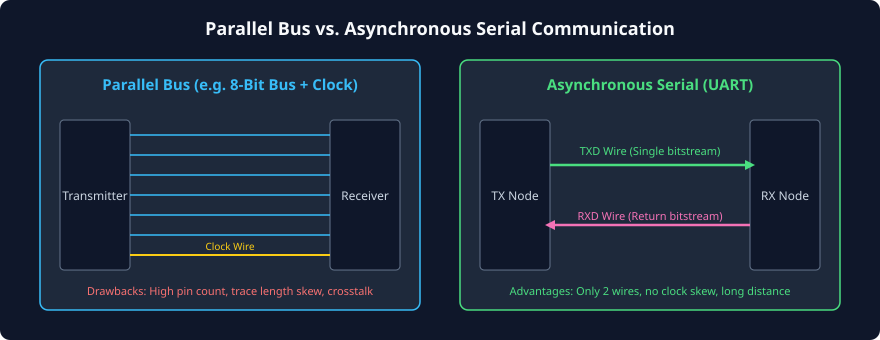
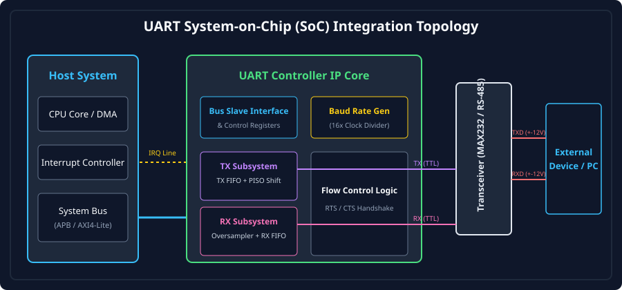

# Introduction to Serial Communication and UART Architecture

### Learning Objectives
- Compare and contrast parallel data buses with serial transmission architectures.
- Distinguish synchronous serial communication (e.g., SPI, I2C) from asynchronous communication (UART).
- Understand the ubiquitous role of UART in modern System-on-Chip (SoC) architectures, debug consoles, and embedded telemetry.
- Master the high-level functional blocks of a UART controller: Transmitter (TX), Receiver (RX), Baud Rate Generator (BRG), and Register File.
- Analyze communication topologies: Simplex, Half-Duplex, and Full-Duplex.
- Calculate transmission bit rates, effective payload throughput, and protocol framing overhead.

---

## Parallel vs. Serial Communication

In early digital computing, **parallel communication**—transmitting an entire byte or word across multiple physical wires simultaneously—was the primary method for high-speed data movement. However, as operating clock frequencies increased and systems became more distributed, parallel buses encountered severe physical limitations:

1. **Clock-to-Data and Wire Skew:** Variations in trace lengths, dielectric constants, and component tolerances cause individual bits in a parallel byte to arrive at the receiver at slightly different times. At high frequencies, this timing jitter closes the data sampling eye.
2. **Crosstalk and Signal Integrity:** Fast signal edges on closely spaced parallel wires induce mutual capacitive and inductive interference, corrupting adjacent data lines.
3. **Pin Count and Silicon Cost:** An 8-bit, 16-bit, or 32-bit parallel bus requires a large number of physical chip package pins, increasing package size, circuit board routing complexity, and manufacturing cost.



**Serial communication** overcomes these bottlenecks by converting a multi-bit parallel word into a sequential stream of single bits transmitted one after another over a single conductive wire or differential pair. Although serial transmission requires serialization logic at the transmitter and deserialization logic at the receiver, it dramatically cuts pin count, eliminates inter-wire skew, and reduces electromagnetic interference (EMI).

---

## Synchronous vs. Asynchronous Serial Communication

Serial communication interfaces fall into two primary architectural classifications:

| Architectural Feature | Synchronous Serial (e.g., SPI, I2C) | Asynchronous Serial (UART) |
|---|---|---|
| **Dedicated Clock Wire** | **Yes** (`SCLK`, `SCK`) transmitted alongside data | **No** (data wire only; no shared clock line) |
| **Clock Source** | Master drives physical clock to slave | Both transmitter and receiver generate local clocks independently |
| **Baud Rate Negotiation** | Implicit: Slave samples strictly on clock edges | **Mandatory prior agreement** on nominal baud rate and frame format |
| **Synchronization Method** | Continuous continuous clock edge tracking | **Per-packet start-bit falling-edge synchronization** |
| **Distance Capability** | Short (PCB-level, typically < 30 cm) | Long (meters to kilometers via RS-232/485 transceivers) |
| **Wiring Overhead** | 3 to 4 wires minimum | **2 wires for full-duplex (TX, RX), 1 wire for half-duplex** |

In **UART (Universal Asynchronous Receiver-Transmitter)**, there is no shared clock signal. Instead, both devices are configured beforehand to operate at the exact same nominal speed (the **Baud Rate**). The receiver resynchronizes its internal sampling clock at the beginning of every single data packet upon detecting a transition from the idle state.

---

## The Role of UART in Modern Embedded Systems and SoCs

Despite being one of the earliest digital communication protocols (dating back to teleprinters in the 1960s), UART remains indispensable in modern silicon design:

1. **Primary Debug Console (Terminal Output):** During early SoC bring-up when complex display controllers, USB stacks, and operating system drivers are not yet functioning, a simple 2-wire UART console is the first peripheral brought alive by boot ROM firmware to print diagnostic messages (`printf` outputs).
2. **Microcontroller-to-Modem Interfacing:** Cellular modems (LTE, 5G), GPS/GNSS positioning modules, Bluetooth transceivers, and Wi-Fi modules (e.g., ESP32) routinely use UART with hardware flow control for command and telemetry transfer (AT commands).
3. **Inter-Processor Communication (IPC):** Provides a lightweight, low-power control link between a main application processor and a dedicated low-power sensor hub or security enclave.
4. **Industrial Instrumentation:** Paired with differential line drivers (RS-485), UART forms the backbone of robust industrial communication protocols such as Modbus and Profibus across electrically noisy factory floors.

---

## High-Level UART Architecture

A complete System-on-Chip UART controller IP core consists of five primary hardware building blocks:



### Bus Slave Interface & Control Register File
Connects the UART core to the system on-chip bus (such as AMBA APB4 or AXI4-Lite). It exposes standard software-accessible memory-mapped registers:
- **Transmitter Holding Register (THR):** Where software writes outbound bytes.
- **Receiver Buffer Register (RBR):** Where software reads inbound bytes.
- **Line Control Register (LCR):** Configures word length (5-8 bits), parity mode, and stop bits.
- **Line Status Register (LSR):** Reports hardware status flags (e.g., Data Ready, Overrun Error, Framing Error).
- **Interrupt Enable Register (IER):** Masks and unmasks interrupt events.

### Baud Rate Generator (BRG)
A programmable clock prescaler that takes the high-speed system bus clock (e.g., 50 MHz or 100 MHz) and divides it down to generate a precise **16x oversampling clock tick** corresponding to the selected baud rate (e.g., 115,200 Hz).

### Transmitter (TX) Subsystem
- **TX FIFO:** Queues outbound bytes waiting for transmission.
- **Parallel-In Serial-Out (PISO) Shift Register:** Loads a parallel byte from the FIFO, prepends a START bit (logic 0), appends optional parity and STOP bits (logic 1), and shifts the bitstream out onto the `UART_TX` pin one bit at a time.

### Receiver (RX) Subsystem
- **Input Synchronizer & Glitch Filter:** Two-stage flip-flop synchronizer that filters noise and prevents metastability from asynchronous external pin transitions.
- **16x Oversampling Engine:** Continuously samples the `UART_RX` pin to detect the falling edge of a START bit and aligns the sampling point to the exact geometric center of each incoming data bit.
- **Serial-In Parallel-Out (SIPO) Shift Register:** Deserializes the incoming bits, verifies parity and stop bits, and pushes the assembled byte into the RX FIFO.

### Flow Control & Interrupt Logic
Monitors FIFO fill watermarks, drives outbound request-to-send (`RTS`) flags, evaluates inbound clear-to-send (`CTS`) flags, and triggers CPU interrupt requests (`IRQ`).

---

## Communication Topologies: Simplex, Half-Duplex, Full-Duplex

UART interfaces can be configured into three physical transmission topologies:

```
1. Simplex (One-Way Broadcast):
   [ Master TX ] ---------------------------------------------> [ Display / Logger RX ]

2. Half-Duplex (Bidirectional, Shared Medium):
   [ Node A ] <====== (Bidirectional Single Wire or RS-485 Bus) ======> [ Node B ]
   *(Only one node transmits at any instant; requires turnaround control)*

3. Full-Duplex (Simultaneous Bidirectional):
   [ Device 1 ] --- TX Line ----------------------------------> RX Line --- [ Device 2 ]
   [ Device 1 ] <-- RX Line <---------------------------------- TX Line --- [ Device 2 ]
   *(Independent wires; both devices can transmit and receive simultaneously)*
```

1. **Simplex:** Data travels in one fixed direction only. Used for low-cost telemetry transmitters, GPS NMEA loggers, or status display panels where the receiving unit never needs to acknowledge or respond.
2. **Half-Duplex:** Data can flow in both directions, but only in one direction at a time over a single physical wire or differential pair (e.g., RS-485). A direction-control signal (Driver Enable, `DE`) must manage bus turnaround to prevent electrical contention.
3. **Full-Duplex:** The standard configuration. Uses two independent unidirectional wires (`TXD` and `RXD`), enabling both endpoints to transmit and receive concurrently without contention.

---

## Throughput and Framing Efficiency Calculations

Because UART adds framing overhead (START and STOP bits, plus optional parity) to every transmitted character, the raw signaling rate (Baud Rate) is higher than the effective user data throughput.

### Mathematical Definitions
- **Baud Rate (\(B\)):** The number of physical signal transitions (symbols or bits) transmitted per second, expressed in Baud or bits/second (bps).
- **Bit Duration (\(T_{bit}\)):** The physical time elapsed during a single bit transmission:
  $$T_{bit} = \frac{1}{\text{Baud Rate}}$$

### Frame Bit Count (\(N_{frame}\))
For a standard configuration designated as **8-N-1** (8 Data bits, No parity, 1 Stop bit):
$$N_{frame} = N_{start} + N_{data} + N_{parity} + N_{stop} = 1 + 8 + 0 + 1 = 10\text{ bits}$$

### Effective Character and Byte Throughput
The maximum number of full bytes transferred per second (\(R_{byte}\)) is:
$$R_{byte} = \frac{\text{Baud Rate}}{N_{frame}} = \frac{B}{N_{frame}}\text{ Bytes/sec}$$

### Protocol Framing Efficiency (\(\eta\))
$$\eta = \frac{N_{data}}{N_{frame}} \times 100\%$$

### Example Calculation: Standard 115,200 Baud (8-N-1)
- Baud Rate = 115,200 bps
- Bit Duration:
  $$T_{bit} = \frac{1}{115,200} \approx 8.681\ \mu\text{s}$$
- Total bits per frame = 10 bits.
- Frame Duration:
  $$T_{frame} = 10 \times 8.681\ \mu\text{s} = 86.81\ \mu\text{s}$$
- Maximum Byte Throughput:
  $$R_{byte} = \frac{115,200}{10} = 11,520\text{ Bytes/sec} = 11.25\text{ KB/sec}$$
- Protocol Efficiency:
  $$\eta = \frac{8}{10} \times 100\% = 80.0\%$$
*(Note: 20% of the channel bandwidth is consumed by START and STOP framing synchronization).*

---

## Chapter Summary

- **Serial communication** solves the high pin count, wire skew, and crosstalk bottlenecks inherent to parallel buses.
- **UART** is an **asynchronous** serial protocol: it transmits data without a shared clock wire, relying on a pre-configured baud rate and per-packet start-bit synchronization.
- UART serves as the ubiquitous bring-up debug console and wireless module control interface across embedded platforms.
- A standard UART IP core integrates a **Baud Rate Generator**, **TX FIFO & PISO serializer**, **RX oversampler & SIPO deserializer**, and a memory-mapped **Register File**.
- Under standard **8-N-1** framing, 10 physical bits are required to transfer 8 payload bits, resulting in an effective protocol efficiency of **80%**.

---

## Review Questions

### Question 1
Why does asynchronous serial communication (UART) require both endpoints to agree on the baud rate in advance, whereas synchronous protocols (like SPI) do not?
<details>
<summary><b>View Answer</b></summary>
In synchronous protocols like SPI, the master transmits a dedicated clock signal (`SCLK`) alongside the data. The slave simply samples the data wire whenever it detects an edge on the incoming clock, regardless of frequency. In UART, there is no clock wire; the receiver must generate its own local sampling clock. If the receiver does not know the exact nominal transmitter baud rate in advance, it cannot know how frequently to sample the line, leading to immediate framing errors and data corruption.
</details>

### Question 2
Calculate the total transmission time required to send a 4-Kilobyte (4096-byte) firmware binary over a UART link configured for 9600 baud using 8-E-1 (8 Data bits, Even parity, 1 Stop bit).
<details>
<summary><b>View Answer</b></summary>
1. Calculate bits per frame:
   $$N_{frame} = 1\text{ (Start)} + 8\text{ (Data)} + 1\text{ (Parity)} + 1\text{ (Stop)} = 11\text{ bits/frame}$$
2. Total bits to transmit:
   $$\text{Total Bits} = 4096\text{ bytes} \times 11\text{ bits/byte} = 45,056\text{ bits}$$
3. Transmission time:
   $$\text{Time} = \frac{45,056\text{ bits}}{9600\text{ bits/sec}} \approx 4.693\text{ seconds}$$
</details>

### Question 3
Explain how clock skew limits the maximum frequency and physical cable length of a high-speed parallel bus compared to a serial UART link.
<details>
<summary><b>View Answer</b></summary>
In a parallel bus, multiple data signals travel alongside a clock line. Because no two physical wires or PCB traces have identical capacitance, resistance, or length, the signals arrive at slightly different times (skew). As clock frequency increases, the bit period shrinks; if the skew exceeds a fraction of the clock period, bits from different clock cycles overlap at the receiver, causing setup/hold violations. In a serial link, all data travels sequentially down the exact same physical path, entirely eliminating inter-wire skew.
</details>

### Question 4
What are the primary functional differences between the Transmitter Holding Register (THR) and the Transmitter Shift Register (TSR)?
<details>
<summary><b>View Answer</b></summary>
The **Transmitter Holding Register (THR)** is a memory-mapped buffer that software or DMA writes to. It holds the next parallel byte waiting to be transmitted. The **Transmitter Shift Register (TSR)** is an internal hardware register that cannot be written directly by software; it receives a parallel byte from the THR (or TX FIFO), appends framing bits (Start, Parity, Stop), and shifts the bits out onto the physical TX pin serially bit-by-bit. This double-buffered structure allows software to write a new byte to THR while TSR is still actively shifting out the previous byte.
</details>

---

##### Copyright (c) 2026 squared-studio

