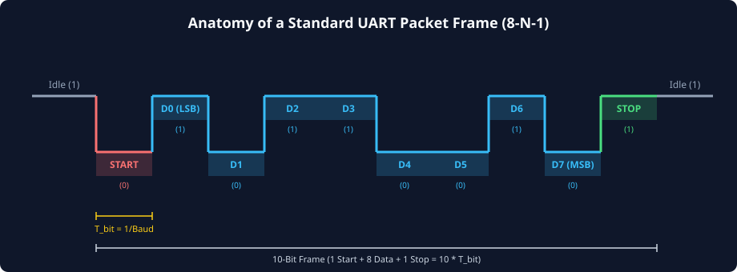
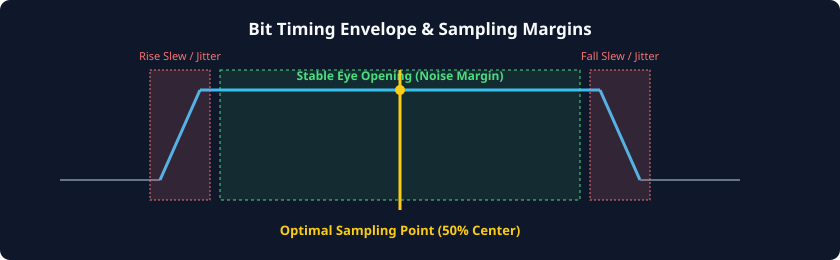

# UART Packet Frame Format and Signaling Mechanics

### Learning Objectives
- Master the electrical states of a UART transmission line: **MARK** (Logic 1) and **SPACE** (Logic 0).
- Understand how the **Start bit** breaks line idling to trigger receiver clock resynchronization.
- Analyze the data payload structure, bit lengths (5 to 9 bits), and the universal **Least Significant Bit (LSB) first** transmission order.
- Calculate and evaluate error-detection parity modes: None, Even, Odd, Mark, and Space.
- Examine the role of **Stop bits** (1, 1.5, or 2 bits) in receiver line relaxation and framing recovery.
- Dissect the complete bit timing envelope, slew rate limits, and eye opening margins.

---

## Line Signaling States: MARK and SPACE

The physical wire connecting a UART transmitter to a receiver is a single-ended binary signal line. By historical convention originating from electromechanical teleprinters, the two electrical states are designated as:

| Signaling State | Logic Level | Voltage Level (TTL / CMOS) | Teleprinter Historical Origin |
|---|:---:|:---:|---|
| **MARK** | **Logic 1** (HIGH) | $V_{DD}$ (3.3V / 1.8V / 5.0V) | Pen closed against moving paper (leaving a ink mark) |
| **SPACE** | **Logic 0** (LOW) | $0.0\text{V}$ (GND) | Pen lifted from paper (leaving a blank space) |

### The Idle Condition
When no communication is taking place, the UART line is held **continuously in the MARK state (Logic 1)**. 

Holding the idle line HIGH provides two crucial architectural benefits:
1. **Cable Break Detection:** If an external serial cable is disconnected, severed, or damaged, the line drops to 0V (ground). The receiver immediately detects this prolonged LOW level as a hardware fault (a **Break Condition**) rather than interpreting it as valid idle state.
2. **Deterministic Start Edge:** Because the line is guaranteed to sit at Logic 1 when idle, the very first transition of a new packet is guaranteed to be a sharp **falling edge (1 $\rightarrow$ 0)**.

---

## Complete Anatomy of a UART Packet Frame

Every single character transmitted over a UART link is packaged within a standalone physical frame composed of four sequential fields:

### The Start Bit
- **Polarity:** Always a single **Logic 0 (SPACE)** bit.
- **Duration:** Exactly one bit period ($T_{bit}$).
- **Function:** The high-to-low transition (falling edge) from the idle state triggers the receiver's internal timer. The receiver verifies that the line remains LOW at the center of the bit, resets its internal bit-timing counter, and locks its phase to the incoming packet.

### Data Payload
- **Length:** Configurable between **5, 6, 7, 8, or 9 bits** (8 bits is modern standard).
- **Transmission Order:** Transmitted **Least Significant Bit (LSB) first**, ending with the Most Significant Bit (MSB):
  $$\text{Payload Sequence} \implies D_0 \rightarrow D_1 \rightarrow D_2 \rightarrow D_3 \rightarrow D_4 \rightarrow D_5 \rightarrow D_6 \rightarrow D_7$$
- **Example:** Transmitting the ASCII character `'A'` (`0x41` = `8'b0100_0001`):
  - LSB ($D_0$) is `1`
  - $D_1$ through $D_5$ are `0`
  - $D_6$ is `1`
  - MSB ($D_7$) is `0`
  - The physical bitstream driven onto the wire is: `[START=0]` $\rightarrow$ `1` $\rightarrow$ `0` $\rightarrow$ `0` $\rightarrow$ `0` $\rightarrow$ `0` $\rightarrow$ `0` $\rightarrow$ `1` $\rightarrow$ `0` $\rightarrow$ `[STOP=1]`.

### Optional Parity Bit
- **Length:** Exactly 1 bit (if enabled) or omitted entirely.
- **Position:** Immediately follows the MSB of the data payload.
- **Function:** Provides basic single-bit error detection across the payload bits.

### The Stop Bit(s)
- **Polarity:** Always **Logic 1 (MARK)**.
- **Length:** Configurable to **1, 1.5, or 2 bit periods**.
- **Function:** Restores the line to the idle state (Logic 1). This ensures that even if the MSB of the data payload was `0`, the line will transition HIGH before the NEXT character's START bit arrives, guaranteeing a clean falling edge for the subsequent frame.

---

## Parity Modes and Mathematical Encodings

Parity is an optional single-bit checksum calculated by the transmitter and verified by the receiver:

| Parity Mode | Character Code | Transmitter Mathematical Rule | Example Data (`8'b0100_0001`, two 1s) | Parity Bit Generated |
|---|:---:|---|---|:---:|
| **None** | `N` | Parity bit omitted entirely. Maximum throughput. | `0100_0001` | *(None)* |
| **Even** | `E` | Parity bit set so total number of 1s in (Data + Parity) is **EVEN**. | `0100_0001` (2 ones $\implies$ already even) | `0` |
| **Odd** | `O` | Parity bit set so total number of 1s in (Data + Parity) is **ODD**. | `0100_0001` (2 ones $\implies$ needs 1 more) | `1` |
| **Mark** | `M` | Parity bit is **always forced to Logic 1** regardless of data. | `0100_0001` | `1` |
| **Space** | `S` | Parity bit is **always forced to Logic 0** regardless of data. | `0100_0001` | `0` |

### Mathematical Parity Derivation
Let the data payload bits be represented as a vector $D = [D_0, D_1, \dots, D_{N-1}]$.

For **Even Parity**, the parity bit $P_{even}$ is the XOR reduction across all data bits:
$$P_{even} = D_0 \oplus D_1 \oplus D_2 \oplus \dots \oplus D_{N-1}$$

For **Odd Parity**, the parity bit $P_{odd}$ is the logical inversion of Even Parity (XNOR reduction):
$$P_{odd} = \overline{P_{even}} = \overline{D_0 \oplus D_1 \oplus D_2 \oplus \dots \oplus D_{N-1}}$$

### Practical Applications of Mark/Space Parity (9-bit Addressing)
Why would a system force parity to a constant `1` or `0`?
In multi-drop communication buses (such as RS-485 networks with 32 microcontrollers on one wire):
- **Address Byte:** The master transmits the device ID with Mark Parity (9th bit = `1`).
- **Data Byte:** The master transmits subsequent payload bytes with Space Parity (9th bit = `0`).
- All listening slaves configure their UARTs to interrupt the CPU **only when the 9th bit is `1`**. Slaves whose address does not match can ignore subsequent data bytes without software overhead!

---

## The Stop Bit Duration: Why 1.5 or 2 Stop Bits?

The standard configuration in modern computing is **1 Stop Bit**. However, UART hardware controllers permit selecting **1.5 or 2 Stop Bits**.

### Why Use More Than 1 Stop Bit?
1. **Mechanical and Receiver Recovery Time:** In historical teleprinters and early microprocessors with slow software interrupt routines, a receiver needed extra time after processing a character to service its buffer before the next Start bit arrived.
2. **Clock Rate Asymmetry:** If the transmitter's internal clock is slightly faster than the receiver's clock, back-to-back characters transmitted with only 1 stop bit would cause the transmitter's next Start bit to arrive prematurely before the receiver had finished sampling the current stop bit. Adding a second stop bit provides a **timing buffer** that absorbs clock frequency mismatch during continuous streaming.

*(Note: "1.5 Stop Bits" is typically supported only when transmitting 5-bit Baudot teleprinter words).*

---

## Bit Timing Envelope and Noise Margins

Because UART lines lack a shared clock, the electrical fidelity of the physical waveform dictates whether data can be recovered reliably.

### The Three Critical Waveform Zones:
1. **Rise / Fall Transition Regions (Slew Zones):**
   - At the beginning of each bit, parasitic line capacitance and driver output resistance cause finite rise ($t_r$) and fall ($t_f$) transition times.
   - Long cables increase capacitance, causing signal edges to round off (slew rate degradation).
   - Sampling during these transition windows causes timing jitter and metastability.
2. **Stable Eye Opening (Noise Margin Zone):**
   - The central portion of the bit period where the signal voltage has fully settled to valid logic levels ($V_{OH}$ or $V_{OL}$).
3. **The 50% Geometric Center Sampling Point:**
   - The receiver deliberately places its sampling strobe at the **exact 50% midpoint** of the bit interval ($0.5 \times T_{bit}$).
   - This maximizes the timing margin against both early-arrival jitter and late-arrival slew degradation.

---

## Standard UART Frame Nomenclature

In industry documentation and device datasheets, UART frame configurations are expressed using a standard shorthand notation:

$$\mathbf{\langle Data\ Bits\rangle}\mathbf{-}\mathbf{\langle Parity\ Mode\rangle}\mathbf{-}\mathbf{\langle Stop\ Bits\rangle}$$

### Common Examples:
- **`8-N-1` (Default Standard):** 8 Data bits, No Parity, 1 Stop bit. Frame length = 10 bits.
- **`8-E-1`:** 8 Data bits, Even Parity, 1 Stop bit. Frame length = 11 bits.
- **`7-E-1` (Legacy ASCII):** 7 Data bits, Even Parity, 1 Stop bit. Frame length = 10 bits. Used in early telecom terminals where ASCII characters were 7 bits (`0x00` to `0x7F`).
- **`8-N-2`:** 8 Data bits, No Parity, 2 Stop bits. Frame length = 11 bits. Common in high-noise industrial environments.

---

## Chapter Summary

- UART idle state is strictly **MARK (Logic 1)**; line faults and severed cables manifest as a prolonged **SPACE (Logic 0 / Break)** condition.
- A UART packet begins with a **Start bit (Logic 0)**, followed by **5 to 9 data bits transmitted LSB-first**, an optional **Parity bit**, and **1 to 2 Stop bits (Logic 1)**.
- **Even parity** forces the total number of 1s in (Data + Parity) to an even number via XOR reduction; **Odd parity** forces an odd number via XNOR.
- **Mark/Space parity** is utilized in 9-bit multi-drop addressing protocols to differentiate device addresses from payload bytes.
- The receiver always samples at the **50% geometric center** of the bit period to maximize noise margins against cable slew and clock jitter.

---

## Review Questions

### Question 1
Why does a UART frame transmit the data payload Least Significant Bit (LSB) first rather than Most Significant Bit (MSB) first?

<b>View Answer</b>

The LSB-first convention is an intentional legacy of early electromechanical telegraph and teletypewriter machines (such as 5-bit Baudot code and early ASCII). Transmitting LSB first allowed mechanical decoders and early shift registers to begin processing character weights and parity checks progressively as the bits arrived off the wire, without needing to buffer the entire character before decoding.

### Question 2
Given the data byte `8'h5A` (`8'b0101_1010`), determine the parity bit value generated under:
1. Even Parity
2. Odd Parity

<b>View Answer</b>

Count the number of 1s in the data byte `0101_1010`:  
Bits with value 1 are $D_1, D_3, D_4, D_6$, giving a total of **4 ones**.
1. **Even Parity:** 4 is already an even number. Therefore, Parity Bit = **`0`** (Total 1s remains 4, which is even).
2. **Odd Parity:** To make the total count of 1s odd, an additional 1 is required. Therefore, Parity Bit = **`1`** (Total 1s becomes 5, which is odd).

### Question 3
Sketch the sequence of logic levels on the physical TX pin when transmitting the byte `8'hA5` using **8-N-1** configuration.

<b>View Answer</b>

Data byte `8'hA5` in binary is `8'b1010_0101`.  
Remember that UART transmits LSB-first!
- **Idle:** 1
- **Start Bit:** 0
- **D0 (LSB):** 1
- **D1:** 0
- **D2:** 1
- **D3:** 0
- **D4:** 0
- **D5:** 1
- **D6:** 0
- **D7 (MSB):** 1
- **Stop Bit:** 1
- **Idle:** 1  
Resulting physical wire bit sequence: `[0] -> 1, 0, 1, 0, 0, 1, 0, 1 -> [1]`.

### Question 4
Why is having 2 Stop bits advantageous when communicating between two microcontrollers whose local crystal oscillators have a slight frequency discrepancy?

<b>View Answer</b>

If the transmitter's oscillator runs slightly faster than the receiver's oscillator, the transmitter will finish sending each bit period slightly ahead of schedule. Over multiple consecutive back-to-back characters with only 1 stop bit, this phase lead accumulates, causing the transmitter's subsequent Start bit to arrive while the receiver is still sampling the current stop bit. A 2nd stop bit provides a 100% margin of idle line time between characters, giving the slower receiver plenty of time to finish sampling and reset its state machine before the next Start bit arrives.

---

##### Copyright (c) 2026 squared-studio

