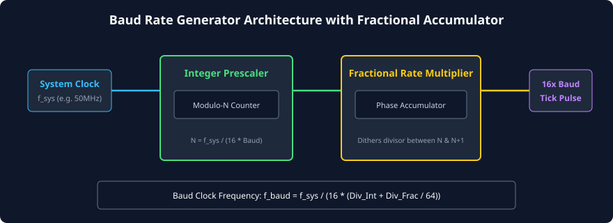
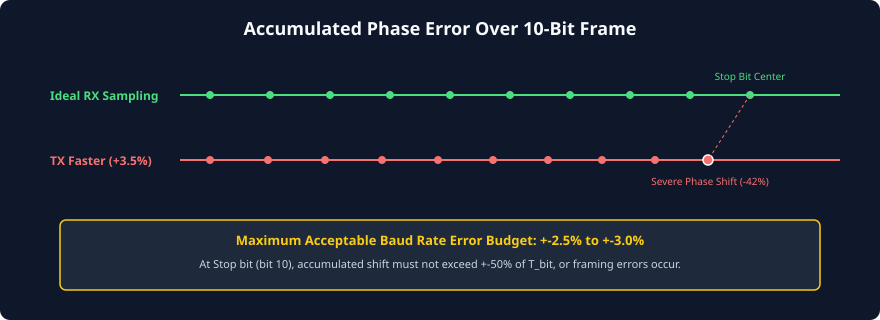

# Baud Rate Generation and Clock Dividers

### Learning Objectives
- Differentiate between **Baud Rate** (symbol rate) and **Bit Rate** (gross bit throughput).
- Survey industry-standard baud rates from legacy teleprinters (9600 bps) to modern high-speed transceivers (3+ Mbps).
- Master the mathematical formulas governing integer clock prescaling for UART baud rate generation.
- Calculate baud rate quantization errors and evaluate percentage mismatch.
- Understand the physical basis of the **$\pm 2.5\%$ to $\pm 3.0\%$ Maximum Tolerable Error Budget** over a 10-bit frame.
- Analyze **Fractional Baud Rate Generators (Rate Multipliers)** that eliminate quantization error in modern SoCs.

---

## Baud Rate vs. Bit Rate

In serial communications, the terms *baud rate* and *bit rate* are frequently used interchangeably, but they represent distinct physical concepts:

- **Baud Rate (\(B\)):** The number of physical signaling events (symbol transitions or line state changes) per second. Unit: Baud (symbols/sec).
- **Bit Rate (\(R_{bit}\)):** The total number of binary information bits (0s and 1s) transmitted per second. Unit: bits per second (bps).

In binary UART signaling, each symbol on the wire represents exactly **one binary bit** (either Logic 0 or Logic 1, 1 bit per symbol). Therefore, for standard binary UART:

$$\text{Baud Rate (Baud)} = \text{Gross Bit Rate (bps)}$$

*(Note: In multi-level modulation schemes such as PAM-4 or QAM used in Ethernet or Wi-Fi, multiple bits are encoded into a single symbol, making the bit rate significantly higher than the baud rate).*

---

## Industry-Standard Baud Rates

Over decades of telecom and microprocessor development, crystal oscillator frequencies and UART controllers standardized on binary multiples of 300 baud:

| Baud Rate (bps) | Bit Duration (\(T_{bit}\)) | 10-Bit Frame Time | Historical Context & Modern Application |
|:---:|:---:|:---:|---|
| **9,600** | $104.167\ \mu\text{s}$ | $1.042\text{ ms}$ | Industrial sensors, Modbus RTU, GPS NMEA receivers |
| **19,200** | $52.083\ \mu\text{s}$ | $520.8\ \mu\text{s}$ | Legacy microcontrollers, dial-up telecom modems |
| **38,400** | $26.042\ \mu\text{s}$ | $260.4\ \mu\text{s}$ | Avionics instruments, GPS high-rate telemetry |
| **57,600** | $17.361\ \mu\text{s}$ | $173.6\ \mu\text{s}$ | Early high-speed PC serial ports |
| **115,200** | $8.681\ \mu\text{s}$ | $86.81\ \mu\text{s}$ | **De facto standard** for bootloader and debug consoles |
| **230,400** | $4.340\ \mu\text{s}$ | $43.40\ \mu\text{s}$ | High-speed microcontroller debugging, Bluetooth HC-05 |
| **460,800** | $2.170\ \mu\text{s}$ | $21.70\ \mu\text{s}$ | High-throughput sensor hubs, IMUs |
| **921,600** | $1.085\ \mu\text{s}$ | $10.85\ \mu\text{s}$ | Near-Megabaud firmware flash loaders |
| **1,000,000+** | $< 1.000\ \mu\text{s}$ | $< 10.0\ \mu\text{s}$ | Modern SoC inter-chip links, high-speed Bluetooth LE HCI |

---

## Baud Rate Generator (BRG) Hardware Architecture

Because the receiver needs multiple clock samples across each incoming bit to find its center, standard UART controllers operate an internal **16x oversampling clock**. 

For every single bit period ($T_{bit}$), the Baud Rate Generator must produce exactly **16 clock tick pulses**.

### The Classical Integer Divisor Formula
Given an incoming system bus clock frequency (\(f_{sys}\)) and a desired nominal baud rate (\(B_{target}\)):

$$\text{Divisor} = \frac{f_{sys}}{16 \times B_{target}}$$

In classic UART architectures (like the industry-standard **National Semiconductor 16550**), the divisor must be a whole **integer** stored across two 8-bit registers:
- `DLL` (Divisor Latch LSB)
- `DLM` (Divisor Latch MSB)
$$\text{Divisor}_{\text{integer}} = (\text{DLM} \ll 8) \mid \text{DLL} = \left\lfloor \frac{f_{sys}}{16 \times B_{target}} + 0.5 \right\rfloor$$

### Calculating Actual Generated Baud Rate
Because the integer divider truncates or rounds fractional values, the actual generated baud rate (\(B_{actual}\)) is:

$$B_{actual} = \frac{f_{sys}}{16 \times \text{Divisor}_{\text{integer}}}$$

---

## Baud Rate Quantization Error Analysis

The discrepancy between the target baud rate and the actual hardware-generated baud rate is the **Quantization Error**:

$$\% \text{ Error} = \frac{|B_{actual} - B_{target}|}{B_{target}} \times 100\%$$

### Concrete Example: 50 MHz System Clock targeting 115,200 Baud
Let an FPGA SoC run from an on-chip PLL clock of $f_{sys} = 50.0\text{ MHz} = 50,000,000\text{ Hz}$. We wish to generate 115,200 baud.

1. **Calculate Ideal Divisor:**
   $$\text{Divisor}_{\text{ideal}} = \frac{50,000,000}{16 \times 115,200} = \frac{50,000,000}{1,843,200} \approx 27.1267$$

2. **Select Nearest Integer Divisor:**
   $$\text{Divisor}_{\text{integer}} = 27$$

3. **Calculate Actual Baud Rate Produced:**
   $$B_{actual} = \frac{50,000,000}{16 \times 27} = \frac{50,000,000}{432} \approx 115,740.74\text{ bps}$$

4. **Calculate Percentage Mismatch:**
   $$\% \text{ Error} = \frac{|115,740.74 - 115,200|}{115,200} \times 100\% = \frac{540.74}{115,200} \times 100\% \approx \mathbf{+0.469\%}$$

Because $+0.469\%$ is well below the standard tolerance limit of $\pm 2.5\%$, this 50 MHz clock is completely acceptable for 115,200 baud communication.

---

## The Maximum Tolerable Baud Rate Error Budget ($\pm 2.5\%$)

Why does the industry enforce a strict **$\pm 2.5\%$ to $\pm 3.0\%$ error threshold** on UART baud rates?

### The Physical Derivation:
1. **Synchronization Point:** The receiver resets its phase counter to zero at the falling edge of the **Start bit** (Bit 0).
2. **Cumulative Drift:** The receiver does not resynchronize again for the entire duration of the frame. Any mismatch in clock frequencies causes the receiver's sampling strobe to progressively drift away from the center of each bit.
3. **Worst-Case Vulnerability (The Stop Bit):** The final bit of a standard 10-bit frame is the **Stop bit** (Bit 9). By Bit 9, the cumulative phase error has accumulated over **9.5 bit periods**:
   $$\text{Total Phase Drift} = 9.5 \times T_{bit} \times (\% \text{ Error})$$
4. **Boundary of Error:** The receiver samples the Stop bit at its expected center ($0.5 \times T_{bit}$). If the accumulated clock drift exceeds half a bit period ($\pm 0.5 \times T_{bit}$), the receiver will sample the *wrong adjacent bit* or fall into the transition slew region, triggering a fatal **Framing Error (FE)**!

### Mathematical Budget:
$$9.5 \times \Delta_{\text{error}} < 0.5 \implies \Delta_{\text{error}} < \frac{0.5}{9.5} \approx 5.26\%$$

Dividing this theoretical limit equally between the transmitter's oscillator drift ($\pm 2.5\%$) and the receiver's oscillator drift ($\pm 2.5\%$), we obtain the universal engineering rule:

$$\mathbf{\text{Maximum Single-Device Baud Rate Error} \le \pm 2.5\%}$$

If the frequency mismatch exceeds $3.0\%$, reliable communication is statistically impossible across temperature and voltage variations.

---

## Fractional Baud Rate Generation

When the system clock cannot divide evenly into standard baud rates (e.g., using a 12 MHz USB clock or 13 MHz GSM clock to generate 115,200 baud), an integer divider creates unacceptable errors:
$$\text{At } 12\text{ MHz: Divisor} = \frac{12,000,000}{16 \times 115,200} \approx 6.51 \implies \text{Integer 7 produces } 107,142\text{ baud } (\mathbf{-7.0\% \text{ Error! FE Fatal!}})$$

To solve this, modern UARTs (such as those in Arm Cortex-M STM32, NXP LPC, and Xilinx Zynq SoCs) implement **Fractional Baud Rate Generators**:

### The Fractional Rate Multiplier Mechanics:
1. The divisor is represented as a fixed-point number with an integer component and a fractional component:
   $$\text{Divisor} = \text{DIV\_INT} + \frac{\text{DIV\_FRAC}}{M}$$
   *(where \(M\) is typically 16, 32, or 64).*
2. A hardware **phase accumulator** dynamically alternates the integer divider between \(N\) and \(N+1\) on consecutive clock periods:
   - For example, if the ideal divisor is $6.50$, the hardware divides by $6$ for one period, then divides by $7$ for the next period.
3. The average clock frequency over time precisely matches the ideal fractional divisor, reducing quantization error to **less than $\pm 0.1\%$**!

---

## Special "Baud-Friendly" Crystal Oscillators

In legacy PCB designs without fractional rate multipliers, engineers specifically avoided round-number crystals (like 10.000 MHz or 20.000 MHz). Instead, they designed boards using **magic baud-friendly crystal frequencies**:

| Crystal Frequency | Calculation for 115,200 Baud | Resulting Integer Divisor | Actual Baud Rate | Quantization Error |
|:---:|:---:|:---:|:---:|:---:|
| **$1.8432\text{ MHz}$** | $1,843,200 / (16 \times 115,200)$ | **1** | $115,200\text{ bps}$ | **$0.000\%$ (Exact)** |
| **$3.6864\text{ MHz}$** | $3,686,400 / (16 \times 115,200)$ | **2** | $115,200\text{ bps}$ | **$0.000\%$ (Exact)** |
| **$7.3728\text{ MHz}$** | $7,372,800 / (16 \times 115,200)$ | **4** | $115,200\text{ bps}$ | **$0.000\%$ (Exact)** |
| **$11.0592\text{ MHz}$**| $11,059,200 / (16 \times 115,200)$| **6** | $115,200\text{ bps}$ | **$0.000\%$ (Exact)** |
| **$14.7456\text{ MHz}$**| $14,745,600 / (16 \times 115,200)$| **8** | $115,200\text{ bps}$ | **$0.000\%$ (Exact)** |
| **$18.4320\text{ MHz}$**| $18,432,000 / (16 \times 115,200)$| **10**| $115,200\text{ bps}$ | **$0.000\%$ (Exact)** |

Because these frequencies are exact integer multiples of $1.8432\text{ MHz}$, they produce **zero error** across all standard baud rates from 300 up to 921,600 bps.

---

## Chapter Summary

- In binary UART, **Baud Rate equals gross bit rate (bps)** because each physical symbol conveys exactly 1 bit.
- The **Baud Rate Generator** produces a 16x oversampling clock tick: $\text{Divisor} = f_{sys} / (16 \times B)$.
- The cumulative phase drift between transmitter and receiver must not exceed half a bit period over a 10-bit frame, establishing the strict **$\pm 2.5\%$ maximum baud rate error budget**.
- **Fractional Baud Rate Generators** dither the division ratio between $N$ and $N+1$, allowing non-standard system clocks to achieve negligible error.
- "Magic" crystal frequencies (such as **$11.0592\text{ MHz}$** and **$18.432\text{ MHz}$**) yield mathematically zero error for all standard baud rates.

---

## Review Questions

### Question 1
Calculate the integer divisor and percentage baud rate error when attempting to generate 57,600 baud from a 48 MHz system clock.

<b>View Answer</b>

1. Ideal Divisor:
   $$\text{Div}_{\text{ideal}} = \frac{48,000,000}{16 \times 57,600} = \frac{48,000,000}{921,600} \approx 52.0833$$
2. Integer Divisor:
   $$\text{Div}_{\text{int}} = 52$$
3. Actual Baud Rate:
   $$B_{actual} = \frac{48,000,000}{16 \times 52} = \frac{48,000,000}{832} \approx 57,692.31\text{ bps}$$
4. Percentage Error:
   $$\% \text{ Error} = \frac{|57,692.31 - 57,600|}{57,600} \times 100\% = \frac{92.31}{57,600} \times 100\% \approx \mathbf{+0.160\%}$$
Result: Divisor = 52, Error = $+0.16\%$, which is well within the acceptable budget.

### Question 2
Why does cumulative clock phase error have its most severe impact on the Stop bit rather than on the earlier data bits?

<b>View Answer</b>

The receiver resynchronizes its internal bit-timing clock only once per frame—at the falling edge of the Start bit. Because there are no clock edges to resynchronize against during the rest of the frame, the phase difference between the transmitter's clock and receiver's clock compounds linearly with each elapsed bit. By the time the Stop bit is sampled (at $t \approx 9.5 \times T_{bit}$), the total accumulated timing error is at its absolute maximum, making the Stop bit the most prone to being sampled outside its valid data window.

### Question 3
Explain how a 6-bit fractional baud rate accumulator works in a microcontroller UART core.

<b>View Answer</b>

A 6-bit fractional accumulator represents fractions in steps of $1/64$ ($2^6 = 64$). For every generated baud tick, the programmed 6-bit fractional value (`DIV_FRAC`) is added to an internal 6-bit accumulator register. Whenever the accumulator overflows its 6-bit range ($\ge 64$), the hardware extends the current clock division cycle by one system clock period (dividing by $N+1$ instead of $N$) and retains the remainder in the accumulator. Over 64 cycles, exactly `DIV_FRAC` cycles are stretched, precisely achieving the desired fractional division ratio on average.

### Question 4
Why is an internal clock of $16\times$ baud rate standard in UART controllers rather than simply generating a $1\times$ clock at the baud frequency?

<b>View Answer</b>

A $1\times$ clock would only allow the receiver to sample once per bit period with no ability to detect when the bit actually began. A $16\times$ clock allows the receiver to oversample the incoming asynchronous line. When an idle-to-active falling edge occurs, the receiver can detect it within $1/16\text{th}$ of a bit period, reset its internal counter, and count exactly 8 ticks to locate the 50% geometric center of the bit for optimal noise immunity.

---

##### Copyright (c) 2026 squared-studio

