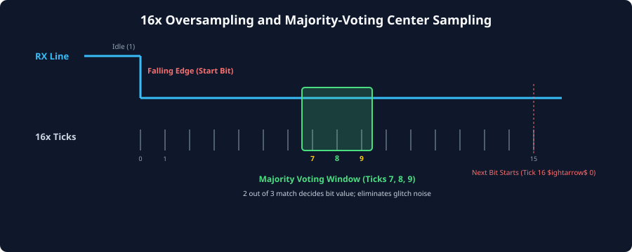
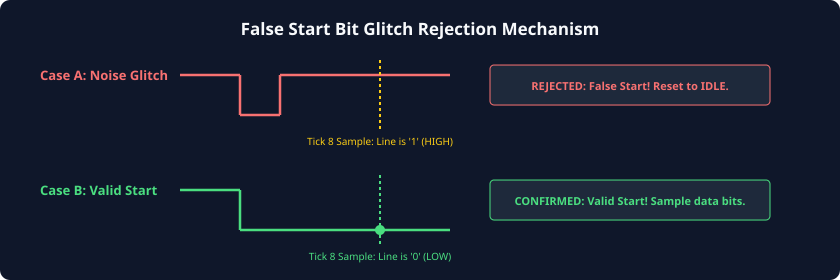

# Receiver Clock Recovery and Oversampling

### Learning Objectives

- Master the fundamental challenge of asynchronous serial reception: clock recovery without a reference clock wire.
- Prevent digital metastability on the external RX pin using multi-stage flip-flop synchronizers.
- Analyze the classical **16x oversampling architecture** and understand when 8x or 4x modes are employed.
- Dissect the **False Start Bit Glitch Filter** that prevents line noise from crashing the receiver.
- Apply **3-Sample Majority Voting** (samples 7, 8, 9) for high-noise-margin center sampling.
- Trace the internal receiver phase-tracking counter across all bits of a packet frame.

---

## The Asynchronous Clock Recovery Challenge

In synchronous protocols (such as SPI or PCIe), the clock is either provided on a dedicated physical wire or embedded into the data stream via Run-Length-Limited transition coding (e.g., 8b/10b encoding with Phase-Locked Loop CDR).

In UART, however:

- **No clock wire exists.**
- **No transitions are guaranteed during data payload** (e.g., transmitting `0x00` results in a flat, unmoving Logic 0 line for 9 consecutive bit periods).
- The receiver's local clock oscillator runs with an unknown, arbitrary phase offset and slight frequency mismatch relative to the transmitter's oscillator.

To reconstruct the bitstream without corruption, the receiver must extract clock timing dynamically using **oversampling clock recovery**.

---

## Metastability and Input Synchronization

Before an external serial signal can be processed by internal digital logic, it must be synchronized to the receiver's local clock domain.

Because external pin transitions can occur at any arbitrary picosecond relative to the receiver's local clock edge:

- Sampling the raw physical `UART_RX` pin directly with internal control registers would violate setup ($t_{su}$) or hold ($t_h$) timing.
- This creates **metastability**, where internal flip-flops enter an indeterminate voltage state, producing spurious clock glitches and unpredictable state transitions.

```
External Asynchronous RX Pin
           |
           v
      +---------+      rx_sync1     +---------+      rx_sync2 (Clean)
----->| D     Q |------------------>| D     Q |---------------------> To UART RX Core
      |         |                   |         |
CLK ->|>        |             CLK ->|>        |
      +---------+                   +---------+
   [Stage 1: Captures Pin]        [Stage 2: Resolves Metastability]
```

### The Two-Stage Synchronizer:

All robust UART receivers route the incoming `UART_RX` line through a **two-stage (or three-stage) flip-flop synchronizer**. The Mean Time Between Failures (MTBF) of a two-stage synchronizer at typical UART frequencies exceeds thousands of years, guaranteeing clean, deterministic digital transitions.

---

## The 16x Oversampling Architecture

The universal industry standard for UART clock recovery is **16x oversampling**:

- For every expected nominal bit period ($T_{bit}$), the receiver's internal timer runs at **16 times the baud rate frequency**:
  $$f_{\text{oversample}} = 16 \times \text{Baud Rate}$$
- Each bit period is subdivided into **16 discrete time slices (Ticks 0 through 15)**.



### Why 16x?

- Dividing each bit into 16 slices yields a timing resolution of:
  $$\text{Resolution} = \frac{T_{bit}}{16} = 6.25\% \text{ of } T_{bit}$$
- This fine granularity allows the receiver to locate the exact leading edge of a packet with an initial phase quantization error of at most $\pm 3.125\%$, leaving maximum timing margin to absorb oscillator frequency drift over the remainder of the frame.

---

## Start Bit Detection and False-Start Glitch Filtering

The start of a frame is indicated by a falling edge on the RX line (from idle Logic 1 to Logic 0). However, in electrically noisy environments (such as automotive wiring or industrial motors), brief voltage spikes or electromagnetic interference (EMI) can pull the line LOW momentarily.

If the receiver immediately assumed every falling edge was a valid Start bit, a 20-nanosecond noise spike would cause the UART to attempt to sample 8 data bits of non-existent data, desynchronizing the receiver and dropping the real upcoming packet!



### The Glitch Filter Verification Algorithm:

1. **Edge Detection:** While in the `IDLE` state, the receiver monitors the synchronized RX line. When a transition from `1` to `0` is detected, the receiver starts its internal **modulo-16 tick counter** at `0`.
2. **Mid-Bit Sample Check (Tick 7 / 8):** The receiver counts up to **Tick 7 or 8** (the calculated geometric center of the Start bit).
3. **Validation Decision:**
   - **Case A (Spurious Glitch):** The line has returned HIGH (`1`). The hardware recognizes that the pulse was merely a transient noise spike! The receiver immediately discards the trigger, resets its counter, and returns to the `IDLE` state without disturbing software or setting error flags.
   - **Case B (Valid Start Bit):** The line is confirmed to still be LOW (`0`). The receiver locks its synchronization, treats this as the true Start bit, and prepares to sample the data bits.

---

## Majority-Voting Center Sampling (3-Sample Filtering)

Once the Start bit is validated, the receiver must sample the subsequent data payload, parity, and stop bits.

Even within a valid bit, power supply ripple or inductive ground bounce can induce momentary glitches. To guarantee maximum noise immunity, modern UART receivers do not rely on a single instantaneous sample. Instead, they implement **3-Sample Majority Voting**:

```
        |<------------------------- 1 Bit Period (16 Ticks) ------------------------->|
Ticks:  [ 0 | 1 | 2 | 3 | 4 | 5 | 6 | 7 | 8 | 9 | 10 | 11 | 12 | 13 | 14 | 15 ]
                                      ^   ^   ^
                                      |   |   |
                                  [Sample 1, 2, 3]
                                          |
                                          v
                                 [ Majority Voter ]
                                (2-out-of-3 Decision)
```

### The Voting Rule:

During each bit period, the receiver records the line state at **Tick 7, Tick 8, and Tick 9**:

$$\text{Bit Value} = \text{Majority}(\text{Sample}_7, \ \text{Sample}_8, \ \text{Sample}_9)$$

- If all three samples are `1` $\implies$ Decided bit = **`1`**
- If two samples are `1` and one is `0` (glitch suppressed) $\implies$ Decided bit = **`1`**
- If two samples are `0` and one is `1` (glitch suppressed) $\implies$ Decided bit = **`0`**
- If all three samples are `0` $\implies$ Decided bit = **`0`**

### Noise Immunity Benefit:

By taking the majority vote across the center three ticks (covering $18.75\%$ of the central bit envelope), any transient spike shorter than one tick duration ($< 0.0625 \times T_{bit}$) is completely filtered out without corrupting the sampled data!

---

## Cycle-by-Cycle Receiver State Tracking

The following table details the exact operation of the receiver's tick counter and state machine throughout a complete **8-N-1** frame:

| Relative Time / State     | Tick Counter | Hardware Action / Signal Verification                                                     |
| ------------------------- | :----------: | ----------------------------------------------------------------------------------------- |
| **IDLE**                  |   Stopped    | Line is at MARK (`1`). Awaiting falling edge.                                             |
| **START Bit** (Detection) |     `0`      | Falling edge detected. Modulo-16 tick counter begins incrementing.                        |
| **START Bit** (Center)    |  `7, 8, 9`   | Samples line. Line must be `0` (Validated). Counter rolls over at `15` $\rightarrow$ `0`. |
| **Data Bit 0 ($D_0$)**    |  `7, 8, 9`   | Majority vote taken. Value shifted into SIPO bit 0.                                       |
| **Data Bit 1 ($D_1$)**    |  `7, 8, 9`   | Majority vote taken. Value shifted into SIPO bit 1.                                       |
| **Data Bits 2 - 6**       |  `7, 8, 9`   | Sequential center sampling of bits $D_2$ through $D_6$.                                   |
| **Data Bit 7 ($D_7$)**    |  `7, 8, 9`   | Majority vote taken. Final data bit shifted into SIPO bit 7.                              |
| **STOP Bit**              |  `7, 8, 9`   | Majority vote taken. **Line must be `1`**. If `0`, assert Framing Error (`FE`).           |
| **Frame Completion**      |     `15`     | SIPO parallel byte pushed to RX FIFO. Assert `RX_READY` IRQ. Return to `IDLE`.            |

---

## High-Speed Oversampling: 8x and 4x Modes

While 16x oversampling provides optimal jitter margin, it imposes an upper frequency limit based on the maximum clock frequency of the UART IP block:

$$B_{\max} = \frac{f_{sys\_max}}{16}$$

For example, on a low-power IoT SoC with an internal peripheral bus running at 16 MHz, 16x oversampling limits the maximum baud rate to:
$$B_{\max} = \frac{16,000,000}{16} = 1.0\text{ Mbps}$$

To achieve multi-megabit speeds (e.g., 3 Mbps or 4 Mbps for high-speed Bluetooth or optical links), modern UART architectures (such as Arm PrimeCell UART PL011 and STM32 USART) offer **programmable oversampling modes**:

| Oversampling Mode | Ticks per Bit |    Sampling Point(s)     | Maximum Baud Rate Capability | Clock Drift Tolerance  |
| :---------------: | :-----------: | :----------------------: | :--------------------------: | :--------------------: |
| **16x (Default)** |      16       | Ticks 7, 8, 9 (Majority) |        $f_{sys} / 16$        |   High ($\pm 2.5\%$)   |
|    **8x Mode**    |       8       | Ticks 3, 4, 5 (Majority) | **$f_{sys} / 8$ (2x Speed)** | Moderate ($\pm 1.5\%$) |
|    **4x Mode**    |       4       |  Tick 2 (Single Point)   | **$f_{sys} / 4$ (4x Speed)** |  Strict ($\pm 0.8\%$)  |

In **8x mode**, the peripheral doubles its maximum achievable baud rate on the same system clock, at the cost of requiring tighter crystal oscillator tolerances between endpoints.

---

## Chapter Summary

- Asynchronous serial reception requires **clock recovery** from data transitions because no reference clock line is transmitted.
- External asynchronous inputs must pass through a **two-stage synchronizer** to prevent digital metastability.
- The **16x oversampling architecture** divides each bit period into 16 discrete ticks, allowing high-resolution phase alignment.
- A **False Start Bit Glitch Filter** verifies that the line is still LOW at Tick 8; if the line has returned HIGH, the noise pulse is rejected.
- **3-Sample Majority Voting** at Ticks 7, 8, and 9 ensures that short noise glitches during the stable center of a bit do not flip data bits.
- **8x oversampling mode** enables higher baud rates on frequency-constrained microcontrollers at the expense of clock drift margin.

---

## Review Questions

### Question 1

What failure occurs if an unshielded UART receiver does not implement a false-start bit glitch filter?

<details>
<summary><b>View Answer</b></summary>
Without a glitch filter, any transient noise spike (such as an ESD event or motor inductive kick) that pulls the idle line LOW for even a fraction of a microsecond will be interpreted as the beginning of a Start bit. The receiver will lock onto this false trigger, spend the next 9 bit periods sampling random line noise, construct a corrupt garbage byte, and typically flag a Framing Error when the Stop bit isn't found. If a genuine packet arrives while the receiver is busy processing this phantom frame, the real data packet will be dropped!
</details>

### Question 2

In 16x oversampling, why are samples taken at Ticks 7, 8, and 9 rather than Ticks 0, 1, and 2?

<details>
<summary><b>View Answer</b></summary>
Ticks 0, 1, and 2 occur immediately at the start of a bit period, where the physical line may still be slewing (rising or falling) due to cable capacitance and driver resistance. Sampling during transitions risks severe signal integrity errors and metastability. Ticks 7, 8, and 9 represent the exact 50% geometric midpoint of the bit interval—the widest, most settled point of the "eye opening"—where noise margins are at their absolute maximum.
</details>

### Question 3

An incoming data bit has the following oversampled values at Ticks 7, 8, and 9: `Sample[7] = 1`, `Sample[8] = 0`, `Sample[9] = 1`. What bit value is recorded by a majority-voting receiver?

<details>
<summary><b>View Answer</b></summary>
The receiver evaluates the majority: two out of the three samples are `1` (Tick 7 and Tick 9), while only one sample is `0` (likely a momentary negative noise spike). The majority voter outputs **`1`**, successfully recovering the correct bit and rejecting the noise glitch.
</details>

### Question 4

Under what conditions would a SoC designer choose 8x oversampling over standard 16x oversampling?

<details>
<summary><b>View Answer</b></summary>
A designer selects 8x oversampling when the peripheral bus clock frequency is relatively low, but the application demands high communication speeds (e.g., achieving 2 Mbps on a 16 MHz bus clock, where $16\text{ MHz} / 16 = 1.0\text{ Mbps}$ would be too slow). 8x oversampling is only viable when both communication endpoints utilize highly accurate, low-drift crystal oscillators ($< 1\%$ frequency error).
</details>

---

##### Copyright (c) 2026 squared-studio
