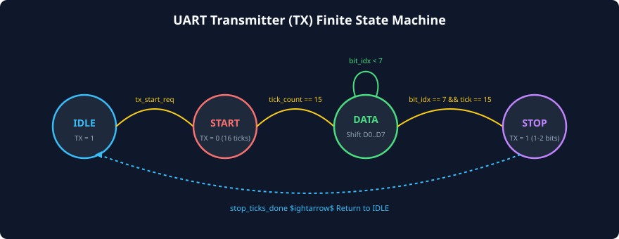
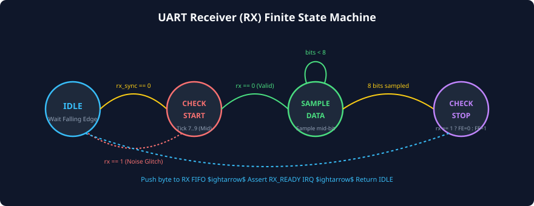

# Transmitter and Receiver State Machines

### Learning Objectives
- Master the internal architecture and state transitions of the **UART Transmitter (TX) Finite State Machine**.
- Master the internal architecture and state transitions of the **UART Receiver (RX) Finite State Machine**.
- Analyze the control interactions between the **Tick Counter** (modulo-16 baud timing) and the **Bit Counter** (payload indexing).
- Understand the mechanics of **PISO (Parallel-In Serial-Out)** serialization and **SIPO (Serial-In Parallel-Out)** deserialization.
- Trace the hardware timing of **Double-Buffering** (THR $\rightarrow$ TSR and RSR $\rightarrow$ RBR) to maintain zero-gap back-to-back streaming.

---

## The Transmitter (TX) Finite State Machine

The UART Transmitter is responsible for taking a parallel byte from the CPU or TX FIFO, framing it with the requisite Start, Parity, and Stop bits, and shifting it onto the physical `UART_TX` pin one bit per $T_{bit}$ period.



### State Definitions:
1. **`TX_IDLE`:**
   - The transmitter holds the `TX` pin steadily at **Logic 1 (MARK)**.
   - The hardware monitors the `tx_start_req` signal (asserted when software writes to the Transmitter Holding Register or when the TX FIFO is non-empty).
   - Once a byte is available, the parallel byte is loaded into the internal Transmitter Shift Register (TSR), and the FSM transitions to `TX_START`.

2. **`TX_START`:**
   - The transmitter drives the `TX` pin to **Logic 0 (SPACE)**.
   - The internal modulo-16 tick counter counts 16 baud ticks (the duration of $T_{bit}$).
   - When the counter reaches 15, the tick counter resets, and the FSM transitions to `TX_DATA`.

3. **`TX_DATA`:**
   - The transmitter outputs the current least-significant bit of the shift register (`TSR[0]`) onto the `TX` pin.
   - For every 16 baud ticks, the shift register performs a right-shift (`TSR = TSR >> 1`), and an internal **Bit Counter** increments (`bit_idx = bit_idx + 1`).
   - If `bit_idx < Word_Length - 1`, the FSM remains in `TX_DATA`.
   - Once all data bits (typically 8) are transmitted:
     - If Parity is enabled $\implies$ Transitions to `TX_PARITY`.
     - If Parity is disabled $\implies$ Transitions to `TX_STOP`.

4. **`TX_PARITY`:**
   - The transmitter outputs the calculated parity bit (Even, Odd, Mark, or Space).
   - Holds the pin for 16 baud ticks.
   - When the tick counter reaches 15, the FSM transitions to `TX_STOP`.

5. **`TX_STOP`:**
   - The transmitter drives the `TX` pin to **Logic 1 (MARK)**.
   - Holds the pin HIGH for the configured stop bit duration:
     - 16 ticks for 1 Stop bit.
     - 24 ticks for 1.5 Stop bits.
     - 32 ticks for 2 Stop bits.
   - If a new byte is already waiting in the TX buffer $\implies$ Transitions directly to `TX_START` without idle gap!
   - If no byte is waiting $\implies$ Transitions to `TX_IDLE`.

---

## Double-Buffering Mechanics in the Transmitter

To achieve continuous, maximum-throughput serial transmission without inter-character idle bubbles, the transmitter implements **Double-Buffering**:

```
CPU / DMA Bus Write
        |
        v
 +---------------+
 |      THR      |   <-- Transmitter Holding Register (Software accessible)
 +---------------+
        |  (Instant parallel transfer when TSR becomes empty)
        v
 +---------------+
 |      TSR      |   <-- Transmitter Shift Register (Internal hardware only)
 +---------------+
        |  (Serial shifting: 1 bit every 16 baud ticks)
        v
    UART_TX Pin
```

### The Double-Buffering Sequence:
1. **Byte 1 Written:** Software writes Byte 1 to `THR`. Because `TSR` is currently empty, hardware immediately transfers Byte 1 in parallel from `THR` into `TSR` within a single clock cycle.
2. **Transmission Begins:** `TSR` begins shifting Byte 1 onto the wire. The hardware sets the status flag `THRE = 1` (**Transmitter Holding Register Empty**), signaling to the CPU that `THR` is free.
3. **Byte 2 Written:** Software immediately writes Byte 2 into `THR` while Byte 1 is still being shifted out of `TSR` on the physical pin!
4. **Zero-Gap Handover:** Exactly as the Stop bit of Byte 1 completes, hardware immediately transfers Byte 2 from `THR` into `TSR` and immediately drives the Start bit of Byte 2.
5. **Result:** The transmission line achieves **100% duty cycle** with zero dead cycles between characters.

---

## The Receiver (RX) Finite State Machine

The UART Receiver FSM operates in reverse: it monitors an asynchronous single-wire input, samples the incoming bits at their 50% geometric midpoint, and reassembles them into a parallel byte.



### State Definitions:
1. **`RX_IDLE`:**
   - The receiver monitors the synchronized `UART_RX` input.
   - The line is expected to sit at Logic 1.
   - As long as `rx == 1`, the FSM remains in `RX_IDLE`.
   - When a falling edge is detected (`rx == 0`), the tick counter is cleared to `0`, and the FSM transitions to `RX_CHECK_START`.

2. **`RX_CHECK_START`:**
   - The tick counter increments on every oversampling clock pulse.
   - At **Ticks 7, 8, and 9**, the majority-voting circuit samples the line.
   - If the majority vote is `1` $\implies$ A transient noise glitch occurred! The FSM aborts immediately and returns to `RX_IDLE`.
   - If the majority vote is `0` $\implies$ Valid Start bit confirmed! The tick counter counts until tick `15`, clears to `0`, and the FSM transitions to `RX_SAMPLE_DATA`.

3. **`RX_SAMPLE_DATA`:**
   - The FSM tracks the incoming data payload.
   - For each bit, the tick counter counts from `0` to `15`.
   - At **Ticks 7, 8, and 9**, the majority voter samples the line and shifts the resulting bit into the **Receiver Shift Register (RSR)** at the most significant bit position (`RSR = {sampled_bit, RSR[7:1]}`).
   - An internal **Bit Counter** increments.
   - When all configured data bits (5 to 8 bits) have been sampled:
     - If Parity is enabled $\implies$ Transitions to `RX_CHECK_PARITY`.
     - If Parity is disabled $\implies$ Transitions to `RX_CHECK_STOP`.

4. **`RX_CHECK_PARITY`:**
   - The receiver samples the parity bit at Ticks 7, 8, and 9.
   - It compares the received parity bit against the locally calculated parity across the received payload bits.
   - If they do not match, the hardware asserts the **Parity Error (`PE`)** status flag.
   - Transitions to `RX_CHECK_STOP`.

5. **`RX_CHECK_STOP`:**
   - The receiver samples the stop bit at Ticks 7, 8, and 9.
   - The stop bit **must be Logic 1**.
   - If the line is `0` at mid-bit $\implies$ Hardware asserts the **Framing Error (`FE`)** status flag.
   - At Tick 15:
     - The assembled byte from `RSR` (along with error status flags) is transferred in parallel into the **Receiver Buffer Register (RBR)** or pushed into the RX FIFO.
     - The hardware asserts the **Data Ready (`DR`)** status flag and triggers a CPU interrupt (`RX_READY_IRQ`).
     - FSM transitions back to `RX_IDLE` to await the next packet.

---

## Double-Buffering Mechanics in the Receiver

Just like the transmitter, the receiver utilizes **Double-Buffering** to prevent data loss while software services interrupts:

```
    UART_RX Pin
        |  (Serial shifting: 1 bit every 16 baud ticks)
        v
 +---------------+
 |      RSR      |   <-- Receiver Shift Register (Internal hardware only)
 +---------------+
        |  (Instant parallel transfer upon Stop bit validation)
        v
 +---------------+
 |      RBR      |   <-- Receiver Buffer Register (Software reads via bus)
 +---------------+
        |
        v
  CPU / DMA Bus Read
```

### Protection Against Data Loss:
1. When Byte 1 finishes arriving, it is transferred in a single clock cycle from `RSR` into `RBR`. Hardware sets `DR = 1` (Data Ready) and interrupts the CPU.
2. Software now has the **entire duration of the NEXT frame** ($T_{frame} \approx 87\ \mu\text{s}$ at 115,200 baud) to read `RBR` while Byte 2 is being shifted into `RSR` bit-by-bit.
3. If software reads `RBR` before Byte 2 completes, `DR` is cleared, and zero data is lost.
4. If software fails to read `RBR` by the time Byte 2 finishes, the arrival of Byte 2 overwrites or drops data, triggering an **Overrun Error (`OE`)**.

---

## State Machine Timing Interaction Matrix

The following table summarizes the control registers and timing triggers governing each FSM state:

| Subsystem | State | Input Trigger to Enter | Primary Hardware Action | Exit Trigger |
|---|---|---|---|---|
| **TX** | `TX_IDLE` | Reset or Stop bit complete | Drive `TX = 1` | `tx_start_req == 1` |
| **TX** | `TX_START` | Byte loaded into TSR | Drive `TX = 0` | `tick_cnt == 15` |
| **TX** | `TX_DATA` | Start bit complete | Drive `TSR[0]`, shift right | `bit_cnt == N-1 && tick_cnt == 15` |
| **TX** | `TX_PARITY`| Final data bit complete | Drive Parity bit | `tick_cnt == 15` |
| **TX** | `TX_STOP` | Data/Parity complete | Drive `TX = 1` | `stop_ticks == Stop_Config` |
| **RX** | `RX_IDLE` | Reset or Frame complete | Monitor line for falling edge | `rx_sync == 0` |
| **RX** | `RX_CHECK_START` | Falling edge detected | Verify `rx == 0` at Ticks 7,8,9 | `tick_cnt == 15` (if valid) |
| **RX** | `RX_SAMPLE_DATA` | Start bit verified | Majority vote, shift into RSR | `bit_cnt == N-1 && tick_cnt == 15` |
| **RX** | `RX_CHECK_PARITY`| Final data bit sampled | Compare parity bit | `tick_cnt == 15` |
| **RX** | `RX_CHECK_STOP` | Data/Parity complete | Verify `rx == 1` at Ticks 7,8,9 | `tick_cnt == 15` $\rightarrow$ Push RBR |

---

## Chapter Summary

- The **TX FSM** orchestrates serialization across `IDLE`, `START`, `DATA`, `PARITY`, and `STOP` states using a modulo-16 tick counter and bit index counter.
- **Transmitter double-buffering** (`THR` $\rightarrow$ `TSR`) allows back-to-back streaming without idle gaps between frames.
- The **RX FSM** detects the Start bit falling edge, filters glitches at Tick 8, and samples each bit at the 50% midpoint using **3-sample majority voting**.
- **Receiver double-buffering** (`RSR` $\rightarrow$ `RBR`) grants the CPU one full frame period to read the received byte before an Overrun Error occurs.
- If the Stop bit is sampled as `0` instead of `1`, the RX FSM flags a **Framing Error**; if calculated parity differs from received parity, it flags a **Parity Error**.

---

## Review Questions

### Question 1
What is the purpose of the Transmitter Holding Register Empty (`THRE`) status flag, and when exactly is it asserted?
<details>
<summary><b>View Answer</b></summary>
The `THRE` flag indicates to software (or DMA) that the Transmitter Holding Register (`THR`) is empty and ready to accept a new byte. It is asserted the exact moment hardware transfers the byte currently in `THR` into the Transmitter Shift Register (`TSR`). Because `TSR` is now busy serializing the byte onto the pin, `THR` is free to receive the next byte immediately.
</details>

### Question 2
Explain the exact sequence of events that occurs when the RX FSM detects a falling edge on the `UART_RX` pin that turns out to be a 50-nanosecond noise glitch.
<details>
<summary><b>View Answer</b></summary>
1. The falling edge causes the RX FSM to transition from `RX_IDLE` to `RX_CHECK_START`, resetting the modulo-16 tick counter to `0`.
2. The tick counter counts up to Ticks 7, 8, and 9 (the middle of the expected Start bit).
3. At Ticks 7, 8, and 9, the majority-voting circuit samples the line. Because the noise glitch was only 50 ns long, the line has already bounced back up to Logic 1.
4. The majority voter detects a `1` instead of the expected `0`.
5. The FSM identifies the trigger as a false start (noise spike), aborts the frame, resets its counters, and returns immediately to `RX_IDLE` without setting error flags or notifying software.
</details>

### Question 3
How much time does software have to service a received byte before an Overrun Error occurs on a UART link operating at 115,200 baud with 8-N-1 framing?
<details>
<summary><b>View Answer</b></summary>
Because the receiver is double-buffered (with `RSR` shifting incoming data while `RBR` holds the previously completed byte), software has the **entire duration of the subsequent 10-bit frame** to read `RBR`:
$$T_{\text{service\_budget}} = 10 \times T_{bit} = \frac{10}{115,200\text{ bps}} \approx \mathbf{86.81\ \mu\text{s}}$$
If the CPU takes longer than $86.81\ \mu\text{s}$ to read `RBR`, the subsequent byte finishes shifting into `RSR` and attempts to overwrite `RBR`, asserting the Overrun Error (`OE`) flag.
</details>

### Question 4
Why does the transmitter shift register (TSR) shift data out LSB first rather than MSB first?
<details>
<summary><b>View Answer</b></summary>
Shifting LSB first aligns with the standard UART frame definition. The hardware right-shifts the register (`TSR = TSR >> 1`) on every 16th baud tick, continuously driving bit `TSR[0]` onto the physical pin. This simple single-direction shift structure requires minimal silicon multiplexing logic.
</details>

---

##### Copyright (c) 2026 squared-studio

