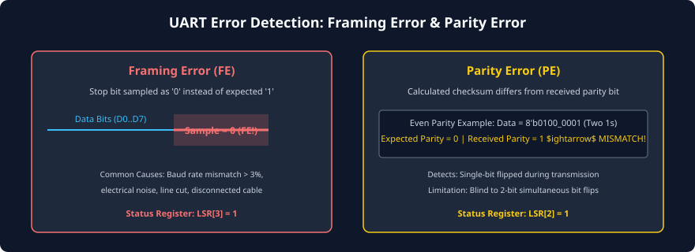
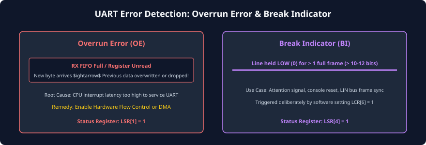

# Error Detection and Handling

### Learning Objectives

- Master the physical and architectural root causes of the four core UART error conditions: **Framing Error (FE)**, **Parity Error (PE)**, **Overrun Error (OE)**, and **Break Indicator (BI)**.
- Analyze the status reporting mechanism in the standard **Line Status Register (LSR)**.
- Understand how error flags are associated with specific bytes in hardware FIFO queues.
- Trace hardware interrupt generation upon receiver error events.
- Implement software recovery routines to flush corrupted buffers, clear hardware flags, and restore line synchronization.

---

## The Four Core UART Error Conditions

Because asynchronous serial communication relies on unclocked, single-wire transmission across potentially long, noisy cables, the receiver must continuously validate frame integrity.

The standard UART specification defines four primary hardware error conditions:



---

## Detailed Analysis of Error Types

### Framing Error (FE)

- **Definition:** Occurs when the receiver samples the physical line during the expected **Stop bit interval** and observes a **Logic 0 (SPACE)** instead of the mandatory **Logic 1 (MARK)**.
- **Physical Causes:**
  1. **Baud Rate Mismatch:** If the transmitter and receiver clocks differ by more than $\pm 2.5\%$, the accumulated timing error causes the receiver to sample the Stop bit either too early (sampling the MSB or Parity bit) or too late (sampling the NEXT character's Start bit).
  2. **Electrical Line Noise:** A negative voltage glitch on the cable during the Stop bit period flips the sample from 1 to 0.
  3. **Data Bit Length Mismatch:** The transmitter was configured for 8 data bits while the receiver was configured for 7 data bits.
  4. **Unplugged / Severed Cable:** If a cable is unplugged while receiving, floating inputs pulled LOW will trigger a framing error.
- **Hardware Action:** The receiver sets the `FE` bit in the Line Status Register (`LSR[3] = 1`). The corrupted character is still pushed into the RX FIFO or RBR so software can inspect the erroneous byte.

### Parity Error (PE)

- **Definition:** Occurs when parity checking is enabled, and the received parity bit does not match the parity mathematically recalculated across the received data bits.
- **Physical Causes:**
  - An electromagnetic noise pulse flipped an odd number of bits (typically a single bit) during transmission across the wire.
  - Configuration mismatch (e.g., transmitter is configured for Even parity while the receiver is configured for Odd parity).
- **Detection Power & Limitations:**
  - **Single-bit flip:** Guaranteed $100\%$ detection.
  - **Two-bit simultaneous flip:** **Undetected!** If two bits flip simultaneously (e.g., `0` $\rightarrow$ `1` and `1` $\rightarrow$ `0`), the overall even/odd parity count remains unchanged. Parity cannot detect multi-bit even errors.
- **Hardware Action:** The receiver sets `LSR[2] = 1` and attaches the error flag to the received byte in the RX FIFO.



### Overrun Error (OE)

- **Definition:** Occurs when a newly assembled character in the Receiver Shift Register (RSR) is ready to be transferred into the Receiver Buffer Register (RBR) or RX FIFO, but the buffer is **already full and has not been read by software**.
- **Physical Consequences (Data Loss!):**
  - In most UART implementations, the existing byte in `RBR` is **preserved**, and the newly arrived incoming byte is **discarded (dropped)**.
  - In other designs, the new byte overwrites the old unread byte. In either case, **unrecoverable data loss has occurred**.
- **Root Cause:** Excessive CPU interrupt latency or operating system scheduling delays. The CPU failed to service the UART interrupt before the next serial character completed its 10-bit arrival.
- **Remedy:** Increase RX FIFO depth, enable **Hardware Flow Control (RTS/CTS)**, or use **Direct Memory Access (DMA)**.
- **Hardware Action:** The receiver asserts `LSR[1] = 1`.

### Break Indicator (BI)

- **Definition:** Occurs when the incoming `UART_RX` line is held continuously in the **SPACE (Logic 0)** state for longer than an entire frame period (typically $> 10$ to $12$ consecutive bit periods).
- **Physical Meaning & Use Cases:**
  1. **Deliberate Attention Signal:** In telecom and networking equipment (e.g., Cisco routers), sending a serial "Break" by holding TX LOW for 250 ms forces the remote target into firmware recovery mode or ROM monitor prompt.
  2. **LIN Bus Protocol:** In automotive Local Interconnect Network (LIN) buses, every message begins with a 13-bit LOW "Sync Break" field to wake up slave ECUs.
  3. **Hardware Cable Fault:** A severed cable or short-circuit to ground will assert `BI`.
- **Hardware Action:** The receiver sets `LSR[4] = 1`, pushes a dummy `0x00` byte into the FIFO, and halts further reception until the line returns HIGH (MARK) for at least one bit period.

---

## Register Mapping: The Line Status Register (LSR)

In industry-standard 16550-compatible UART controllers, errors are reported via the read-only **Line Status Register (LSR)** at memory-mapped offset `0x05`:

| Bit Index | Flag Mnemonic | Name                          | Detailed Architectural Description                                                              |
| :-------: | :-----------: | ----------------------------- | ----------------------------------------------------------------------------------------------- |
| `LSR[0]`  |    **DR**     | Data Ready                    | `1` = At least one valid unread byte is present in RBR or RX FIFO.                              |
| `LSR[1]`  |    **OE**     | Overrun Error                 | `1` = Data loss occurred due to unread buffer overflow. Cleared on read.                        |
| `LSR[2]`  |    **PE**     | Parity Error                  | `1` = Received parity bit did not match calculated parity.                                      |
| `LSR[3]`  |    **FE**     | Framing Error                 | `1` = Stop bit was sampled as `0` instead of `1`.                                               |
| `LSR[4]`  |    **BI**     | Break Indicator               | `1` = Line was held LOW for longer than a full frame period.                                    |
| `LSR[5]`  |   **THRE**    | Transmitter Holding Reg Empty | `1` = THR is empty; software can write the next outbound byte.                                  |
| `LSR[6]`  |   **TEMT**    | Transmitter Empty             | `1` = Both THR and TSR are empty; serial line is completely idle.                               |
| `LSR[7]`  | **FIFO_ERR**  | Error in RX FIFO              | `1` = At least one byte currently queued in the RX FIFO has an active PE, FE, or BI error flag. |

---

## Error Association in Hardware FIFO Queues

In modern UARTs with multi-byte FIFOs (such as 16-byte or 64-byte queues), multiple characters sit queued waiting for CPU readout.

How does software know which specific byte in the FIFO suffered a Framing Error or Parity Error?

```
                     +---------------------------------------+
RX FIFO Memory Word: | Bit 10: BI | Bit 9: FE | Bit 8: PE    |  <-- 3 Error Bits
                     +---------------------------------------+
                     | Bits [7:0]: 8-bit Data Payload (RDATA)|  <-- 8 Data Bits
                     +---------------------------------------+
                                        |
                 (11-Bit Wide Circular FIFO Storage Array)
```

### The 11-Bit FIFO Architecture:

- The RX FIFO is not merely 8 bits wide; it is **11 bits wide** per entry!
- Bits `[7:0]` store the received data character.
- Bits `[10:8]` store the status flags (`BI`, `FE`, `PE`) associated with that exact character.
- **Top-of-FIFO Reporting:** When software reads the `LSR`, the error bits `PE`, `FE`, and `BI` reflect the status of the byte **currently sitting at the top of the FIFO (the byte about to be read next from RBR)**.
- This ensures that if Byte 1 is error-free, Byte 2 has a parity error, and Byte 3 is error-free:
  - Reading Byte 1 reports `LSR[2] = 0`.
  - When Byte 2 moves to the read head, reading `LSR` reports `LSR[2] = 1`.
  - When Byte 3 moves to the read head, `LSR[2]` automatically clears back to `0`.

---

## Software Error Recovery Flow

When a UART error occurs in an embedded system, the device driver must execute a structured recovery sequence to avoid hanging the CPU or corrupting protocol state:

```
[ UART Receiver Error Interrupt (LSR Interrupt) ]
                       |
                       v
            Read Line Status Register (LSR)
                       |
         +-------------+-------------+
         |                           |
   LSR[1] == 1 (OE)            LSR[3] or LSR[2] == 1 (FE/PE)
         |                           |
         v                           v
  Log Overrun Fault           Read and Discard Corrupted Byte
  (Buffer overflow)           from RBR / RX FIFO
         |                           |
         v                           v
  Check FIFO Watermarks       Verify Protocol Frame Checksum
  Enable RTS Flow Control     Request Packet Retransmission
         |                           |
         +-------------+-------------+
                       |
                       v
         Line Synchronization Restored
```

### Key Recovery Steps:

1. **Clear Error Flags:** Reading the `LSR` automatically clears the `OE`, `PE`, `FE`, and `BI` status flags in hardware.
2. **Flush Corrupted Data:** If a Framing Error or Break condition is detected, the receiver may have lost bit alignment. Software should read and discard the corrupted byte from `RBR` to prevent application software from interpreting noise as commands.
3. **Upper-Layer Checksums (CRC):** Because single-bit parity cannot detect 2-bit errors, mission-critical communications (such as Modbus RTU or aerospace telemetry) always append a 16-bit or 32-bit **Cyclic Redundancy Check (CRC)** to the payload. If a packet has a CRC mismatch, the entire packet is rejected and retransmitted.

---

## Chapter Summary

- **Framing Error (`FE`):** Triggered when the Stop bit is sampled as `0`, typically caused by baud rate mismatch exceeding $\pm 2.5\%$, line noise, or disconnected cables.
- **Parity Error (`PE`):** Detects single-bit transmission corruption; blind to 2-bit simultaneous bit flips.
- **Overrun Error (`OE`):** Occurs when the CPU fails to service the RX buffer before the next character arrives, resulting in permanent data loss.
- **Break Indicator (`BI`):** Line held LOW for longer than a full frame, used as a system reset signal or console attention trigger.
- The **16550 Line Status Register (`LSR`)** reports errors at offset `0x05`; in FIFO mode, errors are stored alongside each byte in an 11-bit wide FIFO array.

---

## Review Questions

### Question 1

A serial terminal connected to an embedded Linux board is displaying random garbled characters (e.g., `~?`). When inspecting the UART Line Status Register, `LSR[3]` (Framing Error) is continuously set. What is the most likely root cause?

<details>
<summary><b>View Answer</b></summary>
The most likely root cause is a **Baud Rate Mismatch**. If the board is transmitting at 115,200 baud but the terminal emulator is configured for 9600 baud (or vice versa), the receiver's bit sampling clock will completely misalign with the incoming waveform, causing the Stop bit to be sampled when the line is LOW, triggering continuous Framing Errors and garbled text. Another common cause is mismatched data bit lengths (e.g., 7 bits vs. 8 bits).
</details>

### Question 2

Explain why a 2-bit bit-flip error cannot be detected by standard UART Even or Odd parity checking.

<details>
<summary><b>View Answer</b></summary>
Parity checking is a single-bit parity (modulo-2) reduction:
- If a single bit flips from $0 \rightarrow 1$ (or $1 \rightarrow 0$), the total count of 1s changes by $\pm 1$, changing from even to odd (or odd to even). The parity check immediately fails.
- If two bits flip simultaneously (e.g., two 0s flip to 1s, two 1s flip to 0s, or one 0 becomes 1 while one 1 becomes 0), the total count of 1s changes by $+2$, $-2$, or $0$.
Because adding or subtracting an even number leaves the parity unchanged, the recalculated parity matches the original parity bit perfectly, leaving the two-bit error completely undetected.
</details>

### Question 3

How does an 11-bit wide RX FIFO prevent a software driver from mistakenly discarding good bytes when an error occurs in the middle of a multi-byte stream?

<details>
<summary><b>View Answer</b></summary>
In an 11-bit wide FIFO, each entry stores 8 data bits plus 3 individual error status flags (`PE`, `FE`, `BI`). The hardware only reflects the error flags of the byte **currently at the head of the FIFO** into the Line Status Register (`LSR`). When software reads the FIFO byte-by-byte, valid bytes precede the corrupted byte with `LSR[3:2] = 00`. When the corrupted byte reaches the read pointer, `LSR` flags the specific error for that byte alone. Subsequent valid bytes in the FIFO retain their clean status.
</details>

### Question 4

What distinguishes a Framing Error from a Break Condition?

<details>
<summary><b>View Answer</b></summary>
Both involve observing a Logic 0 when Logic 1 was expected. However:
- A **Framing Error** occurs when the line is LOW specifically during the single Stop bit period ($1 \times T_{bit}$), but the line subsequently returns HIGH or exhibits normal bit transitions.
- A **Break Condition** occurs when the line is held continuously at Logic 0 for an **extended duration longer than an entire packet frame** (typically $\ge 10$ to $12$ consecutive bit periods).
</details>

---

##### Copyright (c) 2026 squared-studio
