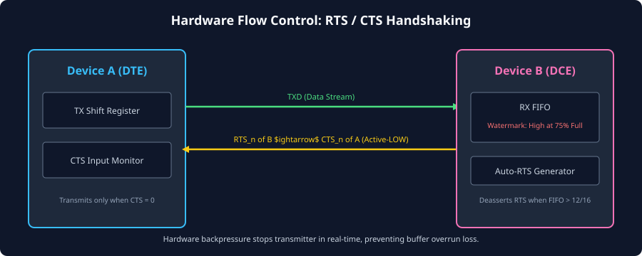
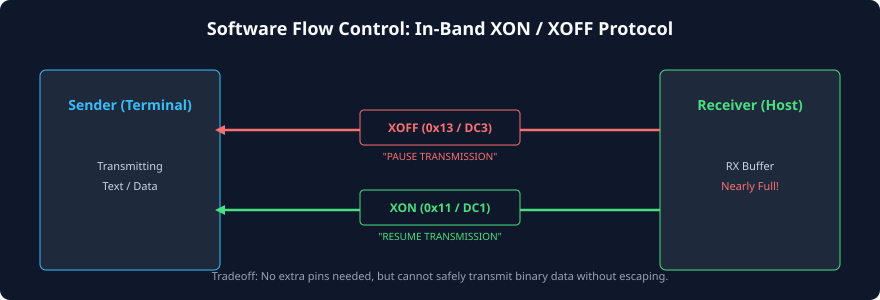

# Flow Control: Hardware and Software

### Learning Objectives

- Understand the physical necessity of flow control to eliminate buffer overruns between mismatched sender and receiver processing speeds.
- Master the operation of **Hardware Flow Control** using the **RTS (Request to Send)** and **CTS (Clear to Send)** handshake lines.
- Distinguish between **DTE (Data Terminal Equipment)** and **DCE (Data Communication Equipment)** pin naming conventions.
- Analyze **Auto-RTS / Auto-CTS** hardware FIFO watermark engines in modern UART controllers.
- Explore **Software Flow Control (In-Band XON / XOFF)** and identify its limitations with binary data.
- Compare hardware and software flow control across pin count, latency, throughput, and transparency metrics.

---

## Why Flow Control is Necessary

In an asynchronous communication link, the transmitter can stream bytes at the maximum physical bandwidth of the baud rate. For example, at 921,600 baud, a new byte arrives every **$10.85\ \mu\text{s}$**.

However, the receiving device must process this data. If the receiver:

1. Is busy executing a high-priority interrupt handler,
2. Is performing a slow flash memory erase cycle, or
3. Has its operating system task scheduler delayed,

its internal RX FIFO will quickly fill to capacity. Once the FIFO is full, any subsequent byte arriving from the transmitter will be dropped, triggering a fatal **Overrun Error (`OE`)**.

**Flow control** provides a feedback mechanism (backpressure) that allows the receiving device to instruct the transmitting device: _"Pause transmission immediately; my internal buffers are nearly full!"_ Once the receiver processes the backlog, it signals: _"Resume transmission; buffer space is available."_

---

## Hardware Flow Control: RTS and CTS

Hardware flow control utilizes dedicated, out-of-band physical wires running alongside the data lines. The two primary handshake signals are:

- **`RTS#` (Request to Send):** Driven as an **output by the receiver** to indicate whether it has available buffer space to accept incoming data.
- **`CTS#` (Clear to Send):** Sampled as an **input by the transmitter**. The transmitter is only permitted to transmit a new character when `CTS#` is asserted.

_(Note: The `#` suffix or `_n` denotes that these signals are historically active-LOW)._



### The DTE to DCE Wiring Architecture:

In historical telecom terminology:

- **DTE (Data Terminal Equipment):** The host computer or terminal (e.g., PC or CPU).
- **DCE (Data Communication Equipment):** The modem or peripheral (e.g., Cellular modem or Bluetooth module).

| Signal Name | Direction at DTE | Direction at DCE  | Null-Modem (DTE-to-DTE) Interconnection      |
| ----------- | :--------------: | :---------------: | -------------------------------------------- |
| **`TXD`**   |      Output      |       Input       | Connects to `RXD` of remote device           |
| **`RXD`**   |      Input       |      Output       | Connects to `TXD` of remote device           |
| **`RTS#`**  |      Output      | Input (or Output) | **Cross-connected to remote `CTS#` input!**  |
| **`CTS#`**  |      Input       | Output (or Input) | **Cross-connected to remote `RTS#` output!** |

> [!IMPORTANT]
> In modern microcontrollers and SoCs communicating peer-to-peer (Null-Modem configuration), **`RTS` is an output indicating "Ready to Receive" (Ready for Data)**, and must be wired directly to the remote device's **`CTS` input**!

---

## Auto-RTS and Auto-CTS Hardware Engines

In early microcontrollers, software had to manually monitor FIFO watermarks and toggle GPIO pins to control RTS. However, at high baud rates, software cannot react fast enough to prevent overflows.

Modern UARTs (such as the 16550A and ARM PL011) implement autonomous **Auto-RTS** and **Auto-CTS** hardware engines:

### Auto-RTS Operation (Receiver Side)

- The UART hardware monitors the fill level of the RX FIFO.
- **High Watermark Trigger (e.g., FIFO 75% Full):** When the number of bytes in the RX FIFO reaches the programmed threshold (e.g., 12 bytes in a 16-byte FIFO), hardware **automatically deasserts `RTS#` (drives it HIGH)** with zero CPU intervention!
- **Headroom Margin:** The remaining 4 empty FIFO slots absorb any "in-flight" bytes that the transmitter was already in the middle of sending when RTS was deasserted.
- **Low Watermark Trigger (e.g., FIFO 25% Full):** As the CPU reads bytes out of the FIFO and the count drops below the lower threshold (e.g., $\le 4$ bytes), hardware automatically re-asserts `RTS#` (drives it LOW) to resume data flow.

### Auto-CTS Operation (Transmitter Side)

- Before the transmitter loads a new byte from `THR` into the shift register (`TSR`), it checks the state of its `CTS#` input pin.
- If `CTS#` is asserted (LOW) $\implies$ The transmitter transmits the next character.
- If `CTS#` is deasserted (HIGH) $\implies$ The transmitter immediately pauses! It finishes shifting the current in-flight bitstream, but **refuses to launch the next Start bit**, holding the TX line in the idle MARK state until `CTS#` goes LOW again.

---

## Software Flow Control: In-Band XON / XOFF

When physical cabling is constrained to only two wires (`TXD` and `RXD` plus Ground), dedicated RTS/CTS wires cannot be used.

**Software flow control** implements backpressure **in-band** by transmitting standard ASCII control characters over the existing serial data stream:



### The XON / XOFF Protocol Characters:

- **`XOFF` (Transmit Off):** ASCII character `0x13` (Control-S / `DC3`, Device Control 3).
  - Sent by the receiver to the sender when the receiver's buffer is nearly full.
  - Upon receiving `XOFF`, the sender immediately suspends data transmission.
- **`XON` (Transmit On):** ASCII character `0x11` (Control-Q / `DC1`, Device Control 1).
  - Sent by the receiver when buffer space becomes available.
  - Upon receiving `XON`, the sender resumes transmission.

### Critical Limitations of Software Flow Control:

1. **Binary Data Corruption (Transparency Issue):** If the application transmits raw binary data (such as compiled machine code, images, or compressed firmware binaries), any payload byte that happens to have the numerical value `0x13` will be misinterpreted by the sender as an `XOFF` command! The transmitter will freeze permanently waiting for an `XON` that never arrives.
   - _Workaround:_ Binary data must be encoded into pure ASCII (e.g., Base64, Intel HEX, or byte-stuffing escaping), adding $33\%$ to $100\%$ protocol bandwidth overhead.
2. **High Latency & Buffer Overrun Risk:** An `XOFF` byte must travel down the return serial link, be sampled, and be decoded by software. If the sender is streaming at high baud rates, several bytes may already be in flight or queued in hardware FIFOs before the sender can halt, easily causing buffer overruns unless very deep buffers are provisioned.

---

## Comparison Matrix: Hardware vs. Software Flow Control

| Feature                      | Hardware Flow Control (RTS / CTS)                | Software Flow Control (XON / XOFF)                     |
| ---------------------------- | ------------------------------------------------ | ------------------------------------------------------ |
| **Dedicated Physical Pins**  | **Yes** (Requires 2 extra pins: RTS, CTS)        | **No** (Zero extra pins; uses TXD and RXD)             |
| **Response Latency**         | **Instantaneous** (Single-cycle hardware gate)   | Slow (Subject to return line baud rate and decode)     |
| **Binary Data Transparency** | **100% Transparent** (Transmits any binary byte) | **Non-transparent** (Conflicts with `0x11` and `0x13`) |
| **CPU Overhead**             | **Zero** (When using Auto-RTS / Auto-CTS)        | High (CPU must inspect every incoming character)       |
| **Maximum Safe Baud Rate**   | Multi-Megabaud (1 to 4+ Mbps)                    | Typically limited to $\le 19,200\text{ bps}$           |
| **Cable Wiring Complexity**  | 4 to 5 wires (TX, RX, RTS, CTS, GND)             | 3 wires (TX, RX, GND)                                  |

---

## Legacy Modem Control Signals: DTR, DSR, DCD, RI

In full RS-232 telecommunication systems, four additional hardware handshake signals were used to manage dial-up telephone modems:

```
[ Host DTE ]                                                [ Modem DCE ]
   DTR (Data Terminal Ready) ------> Indicates DTE is alive ------> DSR (Data Set Ready)
   DSR (Data Set Ready) <------- Indicates Modem is powered <------ DTR
   DCD (Data Carrier Detect) <-- Carrier detected on phone line <-- DCD
   RI  (Ring Indicator) <------- Telephone line is ringing <------- RI
```

- **`DTR` (Data Terminal Ready):** Driven by the PC to indicate that the serial port is open and ready.
- **`DSR` (Data Set Ready):** Driven by the modem to indicate it is powered on and connected.
- **`DCD` (Data Carrier Detect):** Asserted by the modem when a remote connection carrier frequency is established.
- **`RI` (Ring Indicator):** Pulses when an incoming telephone call is ringing the modem.

In modern embedded systems, these lines are rarely wired for modem dialing, but `DTR` is famously used in **Arduino boards** to automatically pulse the microcontroller's `RESET` pin to trigger the bootloader during code flashing over USB-UART chips (FTDI / CH340).

---

## Chapter Summary

- Flow control prevents **Overrun Errors** by providing backpressure when receiver buffers fill faster than software can drain them.
- **Hardware Flow Control (RTS/CTS)** uses dedicated wires; the transmitter pauses transmission whenever its `CTS#` input is deasserted.
- **Auto-RTS / Auto-CTS** handles backpressure entirely in hardware at configured FIFO watermarks, eliminating CPU intervention.
- **Software Flow Control (XON/XOFF)** uses in-band control characters (`0x11` and `0x13`), requiring no extra pins but conflicting with raw binary data transmission.
- Hardware flow control is mandatory for reliable high-speed serial communication ($> 115,200\text{ baud}$).

---

## Review Questions

### Question 1

In a peer-to-peer embedded system connecting two microcontrollers, how must the RTS and CTS pins be wired between Device A and Device B?

<details>
<summary><b>View Answer</b></summary>
The signals must be cross-connected:
- `Device A RTS` (output) must connect to `Device B CTS` (input).
- `Device B RTS` (output) must connect to `Device A CTS` (input).  
Because each device asserts its `RTS` output to announce that its own receiver buffer is ready for data, that signal must feed directly into the remote partner's `CTS` input to authorize transmission.
</details>

### Question 2

Why must an Auto-RTS engine deassert `RTS#` at a FIFO watermark threshold (e.g., 12 out of 16 bytes) rather than waiting until the FIFO is 100% full (16 out of 16 bytes)?

<details>
<summary><b>View Answer</b></summary>
Because transmission cannot stop instantaneously. When the receiver deasserts `RTS#`, the transmitter may already be in the middle of serializing an in-flight byte, and the remote UART's internal holding register may already contain another byte that will be transmitted. Setting the watermark at 12 bytes provides a **4-byte safety margin (headroom)** to absorb these in-flight characters without overflowing the FIFO. If the receiver waited until the FIFO was 100% full, the in-flight bytes would immediately cause an Overrun Error.
</details>

### Question 3

An engineer attempts to send a compressed `.zip` file over a serial terminal using software flow control (XON/XOFF) and reports that the transmission hangs indefinitely after sending a few kilobytes. Explain what happened.

<details>
<summary><b>View Answer</b></summary>
A compressed `.zip` file contains arbitrary binary data. Eventually, the compressed binary stream will naturally contain a byte with the numerical value `0x13`. When this byte passes through the serial link, the transmitting terminal's software flow control parser intercepts the `0x13` byte, misinterprets it as an in-band `XOFF` command from the receiver, and pauses transmission. Because the receiver never sent an `XOFF` and has no intention of sending an `XON` (`0x11`), the transmitter hangs permanently waiting for an unfreeze signal.
</details>

### Question 4

How does the `DTR` line facilitate automatic firmware flashing in development boards like the Arduino Uno?

<details>
<summary><b>View Answer</b></summary>
On the Arduino Uno, the USB-to-UART bridge chip connects its `DTR` output through a series capacitor to the ATmega microcontroller's active-LOW `RESET` pin. When the host computer's flashing tool (e.g., `avrdude`) opens the virtual COM port, the operating system asserts `DTR`. The falling transition on `DTR` couples through the capacitor, generating a brief negative reset pulse that reboots the microcontroller directly into its serial bootloader just as the computer begins uploading the new firmware binary.
</details>

---

##### Copyright (c) 2026 squared-studio
