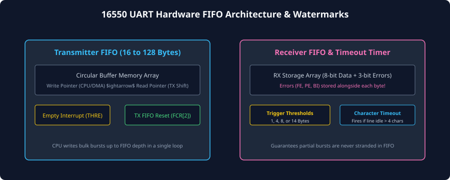
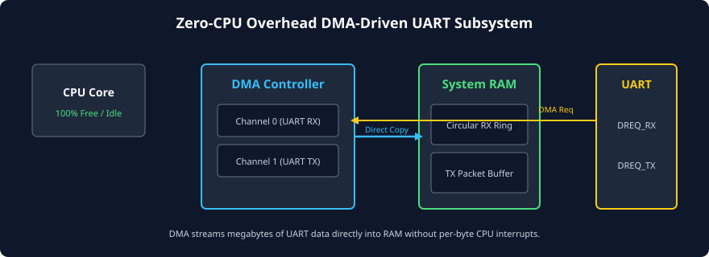

# FIFO Buffering, DMA, and Interrupt Architecture

### Learning Objectives

- Quantify the severe CPU interrupt overhead caused by legacy non-FIFO UARTs at high baud rates.
- Master the internal architecture of **16550-compatible Hardware FIFO Queues** (TX and RX FIFOs).
- Configure programmable **FIFO Trigger Levels (Interrupt Watermarks)** to balance interrupt frequency against latency.
- Analyze the critical role of the **Receiver Character Timeout Interrupt** in preventing stranded partial data frames.
- Design high-throughput, **Zero-CPU Overhead DMA Subsystems** using circular ring buffers.
- Compare CPU-driven interrupt architectures with DMA-driven streaming.

---

## The CPU Overhead Problem in Legacy UARTs

In early 8250 UARTs, the receiver and transmitter had **zero FIFO buffers**—only single-byte holding registers (`RBR` and `THR`).

Every single incoming byte generated a dedicated hardware interrupt to the CPU:

```
At 115,200 Baud (11,520 Bytes/sec):
Interrupt Period = 1 / 11,520 = 86.8 microseconds per interrupt!

At 921,600 Baud (92,160 Bytes/sec):
Interrupt Period = 1 / 92,160 = 10.85 microseconds per interrupt!
```

### The Interrupt Latency Crisis:

1. In a multi-tasking operating system (like Linux or RTOS), taking an interrupt requires:
   - Saving CPU registers to the stack (context save),
   - Executing the Interrupt Service Routine (ISR),
   - Reading the single byte from `RBR`,
   - Clearing interrupt flags,
   - Restoring CPU registers (context restore).
2. If this context switch overhead takes $5\ \mu\text{s}$, servicing a 921,600 baud UART would consume **$50\%$ of the entire CPU's processing bandwidth just servicing serial interrupts**!
3. If an interrupt was delayed by just $11\ \mu\text{s}$, the next character arrived, causing an **Overrun Error (`OE`)** and dropping data.

To solve this, the **National Semiconductor 16550 UART** introduced on-chip **Hardware First-In, First-Out (FIFO) Buffers**.

---

## 16550 Hardware FIFO Architecture

Modern UART controller IPs integrate dedicated circular memory buffers for both transmission and reception:



### Transmitter FIFO (TX FIFO)

- Capacity: Typically **16, 32, 64, or 128 bytes**.
- When software wants to transmit a packet, it writes up to the full FIFO capacity in a fast, tight loop.
- The hardware TX engine autonomously pops bytes out of the FIFO and serializes them onto the pin.
- **THRE Interrupt:** The CPU is only interrupted when the TX FIFO becomes empty (or falls below a programmable low watermark).

### Receiver FIFO (RX FIFO)

- Capacity: Matches TX FIFO depth (e.g., 16 to 128 bytes).
- Stores incoming assembled data bytes alongside their 3 associated error flags (`FE`, `PE`, `BI`).
- The CPU is not interrupted on every single byte. Instead, interrupts are held until the number of queued bytes crosses a **Programmable Trigger Level**.

---

## Programmable FIFO Trigger Levels (Watermarks)

The 16550 **FIFO Control Register (FCR)** allows software to program the RX interrupt trigger threshold via bits `FCR[7:6]`:

| `FCR[7:6]`  | 16-Byte FIFO Trigger Level | 64-Byte FIFO Equivalent | Architectural Tradeoff                                                 |
| :---------: | :------------------------: | :---------------------: | ---------------------------------------------------------------------- |
| **`2'b00`** |         **1 Byte**         |         1 Byte          | Low latency; identical to legacy non-FIFO mode. High CPU load.         |
| **`2'b01`** |        **4 Bytes**         |        16 Bytes         | Moderate interrupt reduction.                                          |
| **`2'b10`** |        **8 Bytes**         |        32 Bytes         | Balanced throughput and latency for typical terminal workloads.        |
| **`2'b11`** |        **14 Bytes**        |        56 Bytes         | **Maximum throughput.** Reduces CPU interrupt frequency by $14\times$! |

When the RX FIFO reaches the programmed threshold (e.g., 14 bytes), the UART asserts the **Received Data Available Interrupt (`RDA`)**. The CPU responds by executing a single ISR that reads all 14 bytes out in a burst, amortizing the context switch cost across the entire batch!

---

## The Receiver Character Timeout Interrupt

While high trigger levels (like 14 bytes) maximize throughput during continuous streaming, they introduce a catastrophic flaw for interactive or short-packet communication:

### The "Stranded Byte" Dilemma:

Suppose an operator types a 4-letter command (`"help"`) into a serial terminal:

- The 4 bytes (`'h'`, `'e'`, `'l'`, `'p'`) arrive and enter the RX FIFO.
- Because the trigger level is set to **14 bytes**, the FIFO depth is only 4!
- **The trigger threshold is never reached!**
- The CPU is never interrupted, and the 4 bytes sit stranded inside the FIFO forever. The application never sees the command!

### The Solution: The Character Timeout Timer

To resolve this, the 16550 specification incorporates an internal **Character Timeout Timer**:

```
                       [ Incoming Serial Line ]
                                  |
                                  v
              Did a byte arrive or FIFO get read?
                        /               \
                     YES                 NO
                     /                     \
       Reset Timeout Timer to 0        Increment Timer on Baud Clocks
                                            |
                               Is Timer == 4 Character Times?
                                      (e.g., 40 bit periods)
                                            |
                                           YES
                                            |
                                            v
                                 [ Assert CHARACTER TIMEOUT ]
                                 [     INTERRUPT (CTI)      ]
```

### The Timeout Rule:

If:

1. There is **at least one byte** sitting in the RX FIFO, **AND**
2. The trigger threshold has **not** been reached, **AND**
3. No new serial character has arrived on the RX pin for **4 consecutive character periods** (approximately 40 bit times),

the hardware asserts the **Character Timeout Interrupt (CTI)**!
The CPU immediately awakens, checks the Line Status Register, drains the stranded bytes out of the FIFO, and processes the short packet without delay.

---

## Zero-CPU Overhead DMA Subsystems

For high-speed protocols streaming megabytes of data (such as firmware updates, Bluetooth audio streams, or Wi-Fi packets), even FIFO interrupts consume too much CPU processing power.

The ultimate architectural solution is **Direct Memory Access (DMA)**:



### Hardware Operation of a DMA-Driven UART:

1. **DMA Channel Configuration:** Software configures the system DMA controller with:
   - Target Peripheral Address (UART `RBR` or `THR`),
   - Destination Memory Address (System RAM Circular Ring Buffer),
   - Transfer Byte Count (e.g., 4096 bytes).
2. **Hardware Handshaking:**
   - Whenever the UART RX FIFO contains data, the UART core asserts a hardware request line: **`DREQ_RX`**.
   - The DMA controller arbitrates for the system bus, reads the byte directly from `RBR`, and writes it into System RAM over the high-speed system interconnect.
   - The DMA controller asserts a hardware acknowledge line: **`DACK_RX`**, clearing the UART request.
3. **Zero CPU Overhead:** The entire 4096-byte transfer takes place with **zero CPU cycles**! The CPU core can sleep in a low-power state or execute user application tasks.
4. **Completion Interrupt:** Only when the entire 4KB block has been safely deposited in RAM does the DMA controller trigger a single completion interrupt to the CPU.

---

## Comparison: Polling vs. Interrupts vs. DMA

| Architecture Metric     | Polling (Status Polling)                      | Interrupt-Driven (with FIFO)               | DMA-Driven Streaming                                    |
| ----------------------- | --------------------------------------------- | ------------------------------------------ | ------------------------------------------------------- |
| **CPU Utilization**     | **100% busy-wait** (CPU cannot do other work) | Low to Moderate (Context switch per burst) | **Near 0%** (CPU involved only at block boundaries)     |
| **Max Safe Baud Rate**  | Low (< 57,600 bps)                            | High (Up to 460,800 bps)                   | **Ultra-High (3+ Mbps)**                                |
| **Overrun Error Risk**  | High (Any task delay causes OE)               | Low (Protected by FIFO trigger margin)     | **Zero** (Dedicated bus master hardware)                |
| **Hardware Complexity** | Minimal (Zero extra hardware)                 | Moderate (16550 FIFO registers)            | High (Requires system DMA controller & bus arbitration) |
| **Typical Use Case**    | Boot ROM, bare-metal bringup                  | Interactive terminal consoles              | Audio streaming, firmware flashing, high-rate telemetry |

---

## Chapter Summary

- Non-FIFO UARTs overwhelm the CPU with an interrupt on every single byte, causing high CPU load and high risk of Overrun Errors.
- **Hardware FIFOs (16550 architecture)** store 16 to 128 bytes, allowing block-level data transfers.
- **Programmable Trigger Levels** allow software to batch interrupts (e.g., interrupt only when 14 bytes accumulate).
- The **Character Timeout Interrupt (CTI)** fires when data sits in the FIFO without reaching the threshold for 4 character times, completely preventing stranded packet latency.
- **DMA Subsystems** bypass the CPU entirely, streaming high-speed serial data directly between the UART and System RAM.

---

## Review Questions

### Question 1

Why does a legacy non-FIFO UART running at 460,800 baud pose a severe risk of data corruption in an RTOS environment?

<details>
<summary><b>View Answer</b></summary>
At 460,800 baud with 8-N-1 framing, a new byte arrives every:
$$T_{\text{byte}} = \frac{10}{460,800} \approx 21.7\ \mu\text{s}$$
In a non-FIFO UART, the CPU has only a single-byte buffer (`RBR`). If an RTOS task disables interrupts to execute a critical section for longer than $21.7\ \mu\text{s}$, the subsequent incoming byte will arrive, find `RBR` unread, and trigger an **Overrun Error (`OE`)**, resulting in permanent data loss.
</details>

### Question 2

Explain the purpose of the 16550 Character Timeout Interrupt (CTI). Under what exact conditions does it fire?

<details>
<summary><b>View Answer</b></summary>
The Character Timeout Interrupt prevents "stranded bytes" when an incoming message is shorter than the configured FIFO trigger threshold. It fires when:
1. There is at least one unread byte in the RX FIFO,
2. The FIFO fill level is below the programmed trigger threshold (e.g., 4 bytes present when threshold is 14), and
3. No new start bit has been detected on the serial RX line for at least **4 character times** (approximately 40 bit durations).
</details>

### Question 3

How does Direct Memory Access (DMA) eliminate CPU context switch overhead during high-speed UART communication?

<details>
<summary><b>View Answer</b></summary>
In a DMA-driven architecture, the UART hardware directly triggers a DMA channel via a hardware handshake line (`DREQ`) whenever data is available. The DMA controller acts as an independent bus master, transferring data directly from the UART register into a memory buffer in RAM across the system crossbar. The CPU is completely bypassed and does not incur any interrupt context switches until an entire multi-kilobyte buffer has been transferred, reducing CPU utilization from 50%+ down to near 0%.
</details>

### Question 4

In a 16550 UART, how does software clear the Character Timeout Interrupt?

<details>
<summary><b>View Answer</b></summary>
Software clears the Character Timeout Interrupt simply by **reading a byte from the Receiver Buffer Register (RBR)**. Alternatively, reading the Interrupt Identification Register (IIR) or clearing the RX FIFO via the FIFO Control Register (FCR) will clear the pending timeout interrupt condition.
</details>

---

##### Copyright (c) 2026 squared-studio
