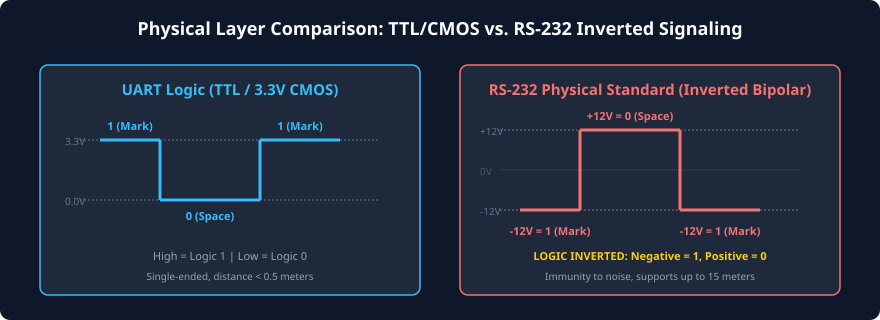
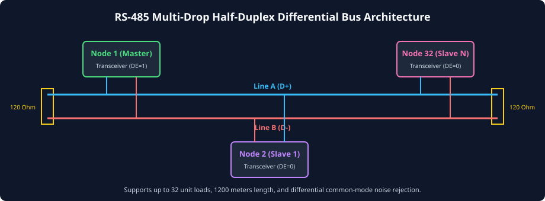

# Physical Layer Standards: RS-232, RS-422, and RS-485

### Learning Objectives

- Distinguish between **logic-level UART signaling** (TTL/CMOS) and **external physical transmission standards**.
- Master the electrical characteristics of **RS-232**: Inverted bipolar voltage levels, charge-pump transceivers, and distance constraints.
- Analyze **RS-422** differential multidrop transmission for long-distance, high-noise environments.
- Master **RS-485** multipoint half-duplex bus architecture, transceiver direction switching (Driver Enable / `DE`), and bus turnaround timing.
- Understand the physical role of **$120\ \Omega$ characteristic impedance termination** and **failsafe bus biasing networks**.
- Compare the physical specifications of TTL UART, RS-232, RS-422, and RS-485.

---

## Logic-Level UART vs. Physical Layer Standards

A fundamental point of confusion for beginners is the difference between **UART** and **RS-232 / RS-485**:

- **UART is a protocol and controller architecture:** It defines the packet frame format (Start bit, 8 data bits, Parity, Stop bit), the state machines, oversampling, and baud rate generation. Inside an IC or FPGA, a UART operates using standard digital CMOS/TTL logic levels:
  - Logic 1 = $V_{DD}$ (3.3V, 1.8V, or 5.0V)
  - Logic 0 = $0.0\text{V}$ (Ground)
- **RS-232, RS-422, and RS-485 are physical layer electrical standards:** They define the actual voltages, cable impedances, connector pinouts, and physical drivers used to transmit those exact same UART bits over long copper cables through harsh environments.

A physical **transceiver chip** (such as the MAX232 for RS-232 or the MAX485 for RS-485) sits between the digital UART controller and the external cable, translating logic levels to physical standard levels and vice versa.

---

## The RS-232 Standard (EIA/TIA-232)

Introduced in 1960 by the Electronic Industries Association, **RS-232** is the classic serial interface of personal computers and telecom terminals.



### Inverted Bipolar Voltage Levels

RS-232 uses **bipolar, inverted signaling** with a wide noise margin:

|         Logic State         |            UART TTL / CMOS Level            |                     RS-232 Physical Cable Voltage                      |
| :-------------------------: | :-----------------------------------------: | :--------------------------------------------------------------------: |
|  **MARK (Logic 1 / Idle)**  |      $+3.3\text{V} \ / \ +5.0\text{V}$      | **$-3.0\text{V} \text{ to } -15.0\text{V}$ (Typically $-12\text{V}$)** |
| **SPACE (Logic 0 / Start)** |           $0.0\text{V}$ (Ground)            | **$+3.0\text{V} \text{ to } +15.0\text{V}$ (Typically $+12\text{V}$)** |
|   **Invalid / Deadband**    | Indeterminate ($1.0\text{V} - 2.0\text{V}$) |              **$-3.0\text{V} \text{ to } +3.0\text{V}$**               |

> [!WARNING]
> RS-232 is **LOGIC INVERTED**: A negative voltage represents a Logic 1 (MARK), and a positive voltage represents a Logic 0 (SPACE)! Connecting an RS-232 $\pm 12\text{V}$ cable directly to a 3.3V microcontroller UART pin will instantly destroy the microcontroller silicon!

### Slew Rate and Distance Limitations

- **Single-Ended Signaling:** RS-232 signals travel over a single wire referenced to a shared common ground (`GND`). Any ground potential difference between two distant buildings creates severe common-mode voltage offsets.
- **Slew Rate Control:** To prevent capacitive cross-talk to adjacent wires, RS-232 drivers intentionally limit output slew rates to $\le 30\text{ V/}\mu\text{s}$.
- **Distance Limit:** Because single-ended lines accumulate capacitive load (maximum allowed load is $2500\text{ pF}$), RS-232 is physically restricted to distances of **$\le 15\text{ meters}$ ($\approx 50\text{ feet}$)**.

---

## The RS-422 Standard (Differential Multidrop)

To overcome the distance and noise vulnerabilities of single-ended RS-232, **RS-422** introduced **differential balanced signaling**:

```
Transmitter Node                      Receiver Node
 +---------+   Line A (Non-Inverting)   +---------+
 | Driver  |--------------------------->| Receiver|
 |    TX   |   Line B (Inverting)       |    RX   |
 +---------+--------------------------->+---------+
```

### The Differential Advantage:

- Instead of referencing the signal to Ground, RS-422 transmits the signal across a twisted pair of wires: **Line A ($V_A$)** and **Line B ($V_B$)**.
- The receiver measures only the **differential voltage difference**:
  $$V_{diff} = V_A - V_B$$
  - Logic 1 (MARK): $V_A - V_B < -0.2\text{V}$
  - Logic 0 (SPACE): $V_A - V_B > +0.2\text{V}$
- **Common-Mode Noise Rejection:** Any external electromagnetic interference (e.g., from high-voltage motors) couples equally into both tightly twisted wires. When the receiver subtracts $V_A - V_B$, the induced noise voltage cancels out mathematically!
- **Performance:** Supports cable lengths up to **1,200 meters (4,000 feet)** and data rates up to **10 Mbps**.
- **Topology:** Single-transmitter, multi-drop (up to 10 receivers on one bus).

---

## The RS-485 Standard (Differential Multipoint Bus)

While RS-422 allows only a single master transmitter, **RS-485 (TIA/EIA-485)** extends differential signaling to full **Multi-Point Party-Line networks**:



### Key Features of RS-485:

1. **Multi-Master / Multipoint:** Up to **32 standard unit loads** (or up to 128/256 modern high-impedance transceivers) can share the exact same two wires!
2. **Half-Duplex Operation:** All nodes share the `A` and `B` differential pair. Only one node is permitted to transmit at any given instant.
3. **Wide Common-Mode Voltage Window:** Transceivers tolerate common-mode ground differences from **$-7\text{V}$ to $+12\text{V}$**, making it ideal for distributed industrial factories.

### Transceiver Control: Driver Enable (`DE`) and Receiver Enable (`RE#`)

A standard RS-485 transceiver (like the MAX485) features two direction-control pins:

- **`DE` (Driver Enable):** When HIGH, enables the differential transmitter onto the bus. When LOW, places driver outputs in a high-impedance (tri-state / high-Z) floating state.
- **`RE#` (Receiver Enable, Active-LOW):** When LOW, connects the differential line to the UART RX pin.

```
UART Controller Pins                 RS-485 Transceiver Chip
 +-------------------+               +-------------------+
 | UART_TX ----------|-------------->| DI (Driver In)    |
 | UART_RTS (DE_ctrl)|------------+->| DE (Driver Enable)|
 |                   |            |  |                   |====> Bus Line A (D+)
 |                   |            +->| /RE (Rcvr Enable) |====> Bus Line B (D-)
 | UART_RX <---------|---------------+ RO (Receiver Out) |
 +-------------------+               +-------------------+
```

### The Bus Turnaround Invariant:

When an RS-485 node finishes transmitting a message, it must **deassert `DE` to release the bus** so other nodes can reply.

- **Crucial Timing Rule:** Software must verify that the UART Transmitter Shift Register is **completely empty (`TEMT = 1`)**—not just that the holding register is empty (`THRE = 1`)—before pulling `DE` LOW!
- Deasserting `DE` too early will cut off the final Stop bit in mid-transmission, corrupting the packet for all listeners.

---

## Bus Termination and Failsafe Biasing

### Transmission Line Termination ($120\ \Omega$)

At high baud rates or across long cables, high-frequency signal edges propagate down the wire as electromagnetic waves:

- If the ends of the cable are left open-circuit (high impedance), the signal energy bounces off the cable end, creating **signal reflections** that distort the bitstream and cause severe framing errors.
- **The Rule:** Parallel termination resistors equal to the characteristic impedance of the twisted-pair cable (**$120\ \Omega$**) must be placed across Lines A and B at the **two physical extreme ends of the bus**.
- Intermediate nodes along the bus must **never** include termination resistors.

### Failsafe Bus Biasing Network

When all nodes on an RS-485 bus are in receive mode (all `DE = 0`), no active driver is driving the lines. The differential lines float to $0.0\text{V}$ ($V_A - V_B = 0$).

Because the RS-485 receiver threshold is between $-200\text{mV}$ and $+200\text{mV}$, an undriven $0\text{V}$ line sits inside the indeterminate deadband! Thermal noise or EMI will cause the receiver's output to oscillate between 0 and 1, injecting phantom garbage characters into the UART.

```
       +5V (Pull-up)
         |
        [R_pullup (e.g., 560 to 1k Ohm)]
         |
Line A --+------------------+
                            |
                         [120 Ohm Termination]
                            |
Line B --+------------------+
         |
        [R_pulldown (e.g., 560 to 1k Ohm)]
         |
        GND
```

### The Solution:

A **failsafe resistor network** pulls Line A toward $V_{CC}$ and Line B toward Ground. When all drivers are tri-stated, the failsafe network forces:
$$V_A - V_B \ge +200\text{ mV}$$
This holds the bus solidly in the **MARK (Logic 1 / Idle)** state, preventing false start bits and phantom noise reception.

---

## Comprehensive Physical Standards Comparison Matrix

| Physical Specification    |      Logic TTL / CMOS       |                  RS-232                  |          RS-422           |                  RS-485                  |
| ------------------------- | :-------------------------: | :--------------------------------------: | :-----------------------: | :--------------------------------------: |
| **Line Signaling Type**   |        Single-Ended         |               Single-Ended               |     **Differential**      |             **Differential**             |
| **Max Physical Distance** |    $< 0.3\text{ meters}$    |            $15\text{ meters}$            | **$1,200\text{ meters}$** |        **$1,200\text{ meters}$**         |
| **Max Data Throughput**   |         Multi-Mbps          |       $\approx 115.2\text{ kbps}$        |   **$10\text{ Mbps}$**    |           **$10\text{ Mbps}$**           |
| **Operational Mode**      |         Full-Duplex         |               Full-Duplex                |   Full-Duplex (4-wire)    | **Half-Duplex (2-wire) / Full (4-wire)** |
| **Number of Drivers**     |          1 Driver           |                 1 Driver                 |         1 Driver          |      **Up to 32 (or 256) Drivers**       |
| **Number of Receivers**   |         1 Receiver          |                1 Receiver                |    Up to 10 Receivers     |     **Up to 32 (or 256) Receivers**      |
| **Mark Level (Logic 1)**  | $+3.3\text{V} / +5\text{V}$ | **$-3\text{V} \text{ to } -15\text{V}$** |        $V_A < V_B$        |             **$V_A < V_B$**              |
| **Space Level (Logic 0)** |      $0\text{V}$ (GND)      | **$+3\text{V} \text{ to } +15\text{V}$** |        $V_A > V_B$        |             **$V_A > V_B$**              |
| **Line Termination**      |            None             |                   None                   | $120\ \Omega$ (at RX end) |  **$120\ \Omega$ (both physical ends)**  |

---

## Chapter Summary

- **UART** defines the digital framing protocol; **RS-232**, **RS-422**, and **RS-485** define the external physical layer electrical standards.
- **RS-232** uses single-ended, inverted bipolar voltages ($-12\text{V}$ for 1, $+12\text{V}$ for 0), restricted to short distances ($\le 15\text{m}$).
- **RS-422 and RS-485** use **differential signaling** over twisted-pair cables, rejecting common-mode noise and spanning distances up to **1,200 meters**.
- **RS-485** supports multi-drop party lines with up to 32 unit loads; nodes control bus access using Driver Enable (`DE`).
- Software must verify the **Transmitter Empty (`TEMT = 1`)** status before releasing `DE` during bus turnaround.
- **$120\ \Omega$ termination resistors** eliminate transmission line reflections, while **failsafe biasing networks** prevent noise when the bus is idle.

---

## Review Questions

### Question 1

Why does directly connecting a microcontroller's 3.3V UART TX/RX pins to an RS-232 port cause permanent hardware damage?

<details>
<summary><b>View Answer</b></summary>
RS-232 physical signal lines swing between $-15\text{V}$ and $+15\text{V}$ (typically $\pm 12\text{V}$). Standard microcontroller CMOS/TTL pins are designed to tolerate voltages strictly within $0.0\text{V}$ to $+3.3\text{V}$ (or $+5.0\text{V}$ for 5V-tolerant pins). Connecting $-12\text{V}$ or $+12\text{V}$ directly to an unshielded microcontroller pin will forward-bias the internal ESD protection diodes, causing catastrophic latch-up and silicon junction burnout. A level-translating transceiver (such as a MAX3232) must always be inserted between them.
</details>

### Question 2

Explain why an RS-485 differential receiver can successfully recover data even when severe electrical noise from a high-power industrial motor couples onto the cable.

<details>
<summary><b>View Answer</b></summary>
RS-485 transmits data across a balanced twisted pair of wires (Lines A and B). Because the wires are physically twisted together in close proximity, any external electromagnetic interference (EMI) couples into both wires identically, shifting both $V_A$ and $V_B$ by the exact same noise voltage ($V_{\text{noise}}$). Because the differential receiver measures only the difference between the two wires:
$$V_{\text{measured}} = (V_A + V_{\text{noise}}) - (V_B + V_{\text{noise}}) = V_A - V_B$$
The noise voltage cancels out completely via Common-Mode Rejection, leaving the underlying data signal clean and undistorted.
</details>

### Question 3

In an RS-485 half-duplex system, what software bug occurs if the microcontroller deasserts the Driver Enable (`DE`) pin upon seeing `THRE = 1` (Transmitter Holding Register Empty) instead of waiting for `TEMT = 1` (Transmitter Empty)?

<details>
<summary><b>View Answer</b></summary>
`THRE = 1` indicates that the Transmitter Holding Register is empty because the final byte was successfully transferred into the Transmitter Shift Register (TSR). However, the shift register is **still actively serializing that byte onto the physical wire**! If software deasserts `DE` the instant `THRE` goes high, the RS-485 transceiver's driver outputs are immediately placed in high-impedance (tri-state) mode, truncating the transmission in mid-frame. The remote receiver will receive only a partial byte, corrupting the final Stop bit and triggering a Framing Error. Software must wait until `TEMT = 1` (indicating that TSR has completed shifting the final Stop bit) before releasing `DE`.
</details>

### Question 4

Where must $120\ \Omega$ termination resistors be placed on an RS-485 multi-drop network with 16 connected nodes?

<details>
<summary><b>View Answer</b></summary>
Termination resistors must be placed **only at the two physical extreme ends of the main transmission cable trunk** (one $120\ \Omega$ resistor at the first physical node, and one $120\ \Omega$ resistor at the last physical node). The remaining 14 intermediate nodes must not have termination resistors enabled. Placing termination resistors at intermediate nodes would reduce the overall parallel bus impedance far below $60\ \Omega$, severely overloading the transceiver output drivers and degrading signal voltage swings.
</details>

---

##### Copyright (c) 2026 squared-studio
