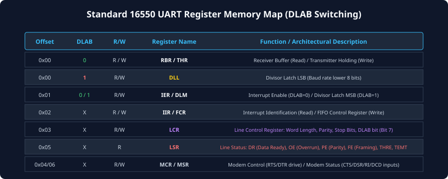
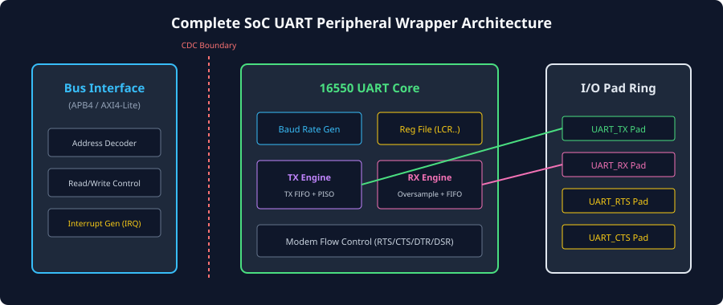

# SoC Integration, APB/AXI Peripheral Wrapping, and Modern Extensions

### Learning Objectives

- Master the integration of a UART controller core into modern System-on-Chip (SoC) interconnects (AMBA APB4 and AXI4-Lite).
- Navigate the complete **Standard 16550 UART Register Memory Map** and decode all control and status registers.
- Understand the historical **Divisor Latch Access Bit (DLAB)** bank-switching mechanism.
- Resolve asynchronous **Clock Domain Crossing (CDC)** boundaries between high-speed system bus clocks and low-speed UART baud generators.
- Explore modern architectural extensions: **Automatic Baud Rate Detection (Autobaud)**, **LIN Bus Framing**, and **IrDA Pulse Modulation**.

---

## The Standard 16550 UART Register Map

The National Semiconductor 16550 (and its modern successors like the 16550A/D) remains the universal software-standard register interface for UART peripherals across PC chipsets, microcontrollers, and SoC platforms (such as the Arm PL011 or Synopsys DesignWare APB UART).

### The DLAB Bank-Switching Mechanism

In early PC architectures (such as the IBM PC/AT with the Intel 8086), I/O address space was scarce. The UART was allocated only **8 byte-wide address offsets** (`0x00` through `0x07`).

However, the UART had more registers than available address offsets! To solve this, the designers introduced the **Divisor Latch Access Bit (DLAB)**, located at bit 7 of the Line Control Register (`LCR[7]`):

- **When `DLAB = 0` (Normal Operating Mode):**
  - Offset `0x00` maps to **`RBR`** (Receiver Buffer on read) and **`THR`** (Transmitter Holding on write).
  - Offset `0x01` maps to **`IER`** (Interrupt Enable Register).
- **When `DLAB = 1` (Baud Rate Configuration Mode):**
  - Offset `0x00` maps to **`DLL`** (Divisor Latch LSB).
  - Offset `0x01` maps to **`DLM`** (Divisor Latch MSB).

To configure the baud rate, software sets `LCR[7] = 1`, writes the 16-bit integer divisor into `DLL` and `DLM`, and then clears `LCR[7] = 0` to resume normal data transfers.

---

## Comprehensive Register Reference

The following table details the standard 16550 register bank accessible across byte offsets `0x00` through `0x07`:

| Offset | DLAB State | Read / Write | Register Name                                 | Primary Functional Responsibility                                                                                                                                                                                                       |
| :----: | :--------: | :----------: | --------------------------------------------- | --------------------------------------------------------------------------------------------------------------------------------------------------------------------------------------------------------------------------------------- |
| `0x00` |    `0`     |   **Read**   | **`RBR`** (Receiver Buffer Register)          | Reads the oldest received byte from the RX FIFO.                                                                                                                                                                                        |
| `0x00` |    `0`     |  **Write**   | **`THR`** (Transmitter Holding Register)      | Enqueues a new outbound byte into the TX FIFO.                                                                                                                                                                                          |
| `0x00` |    `1`     |  **R / W**   | **`DLL`** (Divisor Latch LSB)                 | Lower 8 bits of the 16-bit baud rate clock divisor.                                                                                                                                                                                     |
| `0x01` |    `0`     |  **R / W**   | **`IER`** (Interrupt Enable Register)         | Bit 0: RX Data Available Bit 1: TX Holding Empty Bit 2: Receiver Line Status (Errors) Bit 3: Modem Status change                                                                                                               |
| `0x01` |    `1`     |  **R / W**   | **`DLM`** (Divisor Latch MSB)                 | Upper 8 bits of the 16-bit baud rate clock divisor.                                                                                                                                                                                     |
| `0x02` |    `X`     |   **Read**   | **`IIR`** (Interrupt Identification Register) | Decodes pending interrupt priority and source. `Bits[3:1]`: Interrupt ID (`011`=LSR Error, `010`=RX Data, `110`=Character Timeout, `001`=THRE, `000`=Modem).                                                                         |
| `0x02` |    `X`     |  **Write**   | **`FCR`** (FIFO Control Register)             | Bit 0: Enable FIFOs Bit 1: Clear RX FIFO Bit 2: Clear TX FIFO `Bits[7:6]`: RX Trigger Threshold (1, 4, 8, 14 bytes).                                                                                                           |
| `0x03` |    `X`     |  **R / W**   | **`LCR`** (Line Control Register)             | `Bits[1:0]`: Word length (5, 6, 7, 8 bits) Bit 2: Stop bits (0=1 stop, 1=2 stop) Bit 3: Parity Enable `Bits[5:4]`: Parity Mode (Even/Odd/Mark/Space) Bit 6: Set Break Line Bit 7: **DLAB Bit**.                          |
| `0x04` |    `X`     |  **R / W**   | **`MCR`** (Modem Control Register)            | Bit 1: Drive `RTS` output Bit 0: Drive `DTR` output Bit 4: Loopback Diagnostic Test Mode.                                                                                                                                         |
| `0x05` |    `X`     |   **Read**   | **`LSR`** (Line Status Register)              | Bit 0: Data Ready (`DR`) Bit 1: Overrun Error (`OE`) Bit 2: Parity Error (`PE`) Bit 3: Framing Error (`FE`) Bit 4: Break Indicator (`BI`) Bit 5: `THRE` Bit 6: Transmitter Empty (`TEMT`) Bit 7: Error in RX FIFO. |
| `0x06` |    `X`     |   **Read**   | **`MSR`** (Modem Status Register)             | Reports current levels and edge changes on CTS, DSR, RI, and DCD inputs.                                                                                                                                                                |
| `0x07` |    `X`     |  **R / W**   | **`SCR`** (Scratchpad Register)               | 8-bit general-purpose temporary storage byte; zero hardware side-effects.                                                                                                                                                               |

---

## SoC Peripheral Wrapper Architecture

In modern SoC platforms, the standalone UART core must be wrapped inside a bus slave interface to attach to the system interconnect:

### Hardware Sub-Blocks of the SoC Wrapper:

1. **Bus Slave Adapter (APB4 or AXI4-Lite):**
   - Decodes slave select (`PSEL`), address phase (`PENABLE`), and read/write control (`PWRITE`).
   - Translates 32-bit bus transactions down to 8-bit UART register accesses.
2. **Clock Domain Crossing (CDC) Logic:**
   - The system bus operates at high speed (e.g., `PCLK = 200 MHz`).
   - The UART baud rate generator may run on an independent low-speed reference clock (e.g., `UART_CLK = 14.7456 MHz`).
   - Control register strobes and FIFO read/write pulses cross this boundary using **pulse synchronizers** or **dual-clock asynchronous FIFOs** with Gray-code pointers.
3. **Interrupt Generator:**
   - Combines the internal interrupt sources (RX Data Available, Line Errors, Character Timeout, TX Empty) into a single level-sensitive interrupt line (`UART_IRQ`) routed to the system Interrupt Controller (e.g., Arm GIC or NVIC).
4. **I/O Pad Ring Conditioning:**
   - Schmitt-trigger buffers on `UART_RX` to reject slow-transition noise.
   - Slew-rate-controlled output drivers on `UART_TX`.
   - Programmable internal pull-up resistors to keep the line at Logic 1 (MARK) if left unconnected.

---

## Modern UART Extensions

Beyond the classic 16550 standard, modern microcontrollers and automotive SoCs incorporate specialized hardware extensions:

### Automatic Baud Rate Detection (Autobaud)

In plug-and-play systems, a slave device may not know the master's baud rate in advance.

- **The Autobaud Protocol:** The master transmits a standardized training character: the ASCII character `'U'` (`0x55` = `8'b0101_0101`).
- **Physical Waveform:** Because `'U'` alternates 0 and 1 on every bit, the UART line produces a continuous square wave of 1-bit pulses:
  `[START=0]` $\rightarrow$ `1` $\rightarrow$ `0` $\rightarrow$ `1` $\rightarrow$ `0` $\rightarrow$ `1` $\rightarrow$ `0` $\rightarrow$ `1` $\rightarrow$ `0` $\rightarrow$ `[STOP=1]`.
- **Hardware Measurement:** The slave's hardware autobaud counter measures the exact number of system clock cycles between the falling edge of the Start bit and the rising edge of bit $D_0$.
- The slave calculates the exact divisor automatically and configures its own Baud Rate Generator without software intervention!

### LIN Bus (Local Interconnect Network)

Widely used in automotive door locks, mirrors, and climate controls:

- Uses a single-wire 12V physical transceiver at 19,200 baud.
- **Sync Break:** Every master frame begins by forcing the line LOW for at least **13 bit periods** (a deliberate Break Condition).
- **Sync Field:** Followed immediately by an Autobaud byte `0x55` to allow slave microcontrollers running on low-cost internal RC oscillators to calibrate their clocks dynamically!

### IrDA (Infrared Data Association) Modulation

Used for wireless infrared data links:

- Standard UART NRZ (Non-Return-to-Zero) signals are unsuitable for battery-powered optical LEDs because keeping an LED continuously ON consumes excessive power.
- **IrDA Pulse Modulation:** Translates every Logic 0 into a very short optical light pulse lasting only **$3/16\text{ths}$ of a bit duration** ($1.63\ \mu\text{s}$ at 115,200 baud).
- Logic 1 (Idle) is represented by the LED remaining completely dark (OFF), slashing optical power consumption by over $80\%$.

---

## Comprehensive Summary of the UART Protocol Series

| Architectural Dimension | Key Architectural Takeaway                                                                                                                                                                  |
| ----------------------- | ------------------------------------------------------------------------------------------------------------------------------------------------------------------------------------------- |
| **Transmission Model**  | Point-to-point, asynchronous serial communication without a shared clock wire.                                                                                                              |
| **Line Signaling**      | Idle state is strictly **MARK (Logic 1)**; Start bit is a **falling edge (Logic 0)**; Stop bit is **Logic 1**.                                                                              |
| **Data Framing**        | Transmitted **LSB-first** (5 to 8 bits), optional Parity, and 1 to 2 Stop bits.                                                                                                             |
| **Timing Tolerance**    | Receiver oversamples at **16x baud rate**; total clock frequency mismatch must remain within **$\pm 2.5\%$**.                                                                               |
| **Center Sampling**     | **3-Sample Majority Voting** at Ticks 7, 8, and 9 rejects transient noise spikes.                                                                                                           |
| **Error Reporting**     | Four core errors: **Framing Error (`FE`)**, **Parity Error (`PE`)**, **Overrun Error (`OE`)**, and **Break Indicator (`BI`)**.                                                              |
| **Flow Control**        | **Hardware (RTS/CTS)** provides real-time, transparent backpressure; **Software (XON/XOFF)** uses in-band ASCII codes.                                                                      |
| **Buffering & DMA**     | **16550 FIFOs** with programmable triggers batch interrupts; **Character Timeout Timers** prevent stranded bytes; **DMA** achieves zero-CPU offload.                                        |
| **Physical Standards**  | Logic TTL/CMOS ($3.3\text{V}$) $\rightarrow$ **RS-232** (bipolar $\pm 12\text{V}$) $\rightarrow$ **RS-485** (differential multipoint up to $1,200\text{m}$ with $120\ \Omega$ termination). |
| **SoC Integration**     | Memory-mapped **16550 register file**, DLAB bank switching, and asynchronous Clock Domain Crossing bridges.                                                                                 |

---

## Review Questions

### Question 1

Explain why the Divisor Latch Access Bit (DLAB) was created, and how software toggles it to configure the UART baud rate.

<b>View Answer</b>

The DLAB bit was introduced to overcome the severe 8-byte I/O address offset constraint of the original IBM PC architecture. By toggling `LCR[7]` (the DLAB bit), offsets `0x00` and `0x01` are bank-switched:
- When `DLAB = 0`, writing to offset `0x00` writes to the Transmitter Holding Register (`THR`), and reading offset `0x00` reads the Receiver Buffer Register (`RBR`).
- When `DLAB = 1`, offset `0x00` maps to the Divisor Latch LSB (`DLL`), and offset `0x01` maps to the Divisor Latch MSB (`DLM`).  
Software sets `LCR[7] = 1`, writes the integer divisor into `DLL` and `DLM`, and then clears `LCR[7] = 0` to return the UART to normal operational mode.

### Question 2

Why is the ASCII character `'U'` (`0x55`) universally chosen as the calibration character for Automatic Baud Rate Detection?

<b>View Answer</b>

The character `'U'` in binary is `8'b0101_0101`. When transmitted over UART (with a Start bit of `0`, 8 data bits LSB-first, and a Stop bit of `1`), the physical line produces an alternating bit pattern:
`[0, 1, 0, 1, 0, 1, 0, 1, 0, 1]`.  
This generates a continuous, symmetrical square wave where every single bit period contains a transition edge. A hardware counter can measure the exact clock cycle duration between any two consecutive edges with zero ambiguity, allowing the receiver to determine the transmitter's baud rate with high precision.

### Question 3

In a mixed-signal SoC where the system bus clock is 150 MHz and the UART baud rate generator runs on an independent 14.7456 MHz crystal oscillator, what design precautions must be implemented at the register interface?

<b>View Answer</b>

Because the system bus clock (`PCLK`) and the UART baud clock (`UART_CLK`) are completely asynchronous, direct combinatorial or flip-flop connections across them will cause setup/hold violations and metastability. The wrapper must implement **Clock Domain Crossing (CDC) synchronizers**:
1. Control register writes (such as baud rate divisors or line control settings) must be captured in registers in the bus domain and passed through multi-flop handshaking synchronizers or level synchronizers to the UART clock domain.
2. Status flags and interrupt signals moving from the UART core to the bus domain must pass through two-stage flip-flop synchronizers.
3. FIFO read and write pointers must be synchronized across domains using dual-clock asynchronous FIFOs with Gray-coded address pointers.

### Question 4

How does IrDA (Infrared) modulation modify standard UART NRZ waveforms to conserve battery power in handheld devices?

<b>View Answer</b>

In standard UART Non-Return-to-Zero (NRZ) signaling, a Logic 0 is held continuously for the entire bit duration ($T_{bit}$). In an optical infrared link, driving an LED for the full bit period would rapidly drain battery power and generate excess heat. IrDA modulation converts each Logic 0 into a very narrow optical pulse lasting only **$3/16\text{ths}$ of a bit period** ($18.75\%$ duty cycle, or a fixed $1.63\ \mu\text{s}$ pulse). Logic 1 (the idle state) keeps the LED completely dark (OFF). This slashes optical power consumption by over $80\%$ while maintaining complete timing compatibility.

---

##### Copyright (c) 2026 squared-studio
