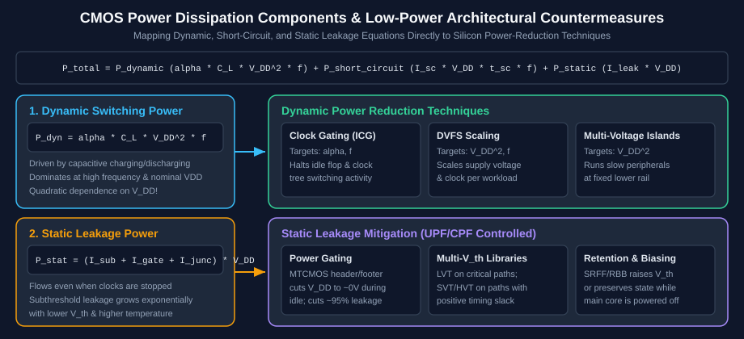
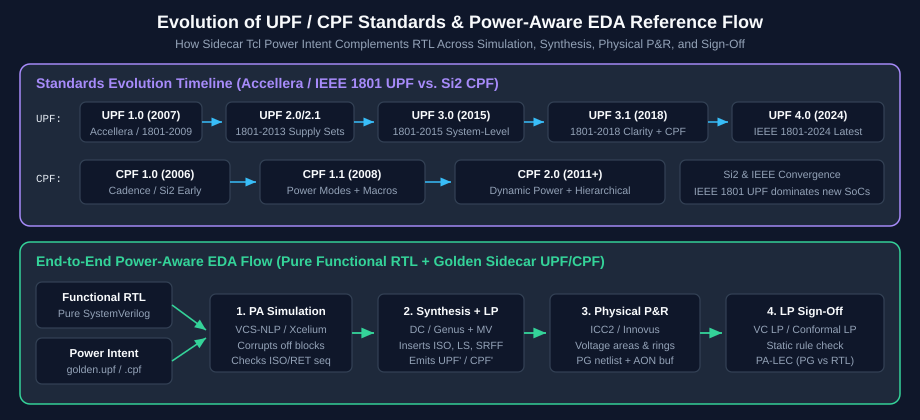

# Low-Power SoC Design and Power Intent Foundations

Modern Systems-on-Chip (SoCs) for mobile devices, edge AI accelerators, automotive controllers, and hyperscale data centers operate under severe thermal and energy budgets. As CMOS technology scaled into deep-submicron nodes below 28nm down to 3nm FinFET and Gate-All-Around (GAA) nanosheet processes, transistor switching speed rose dramatically—but static leakage currents escalated exponentially. Today, keeping all blocks on a 10-billion-transistor die continuously powered at nominal voltage causes thermal runaway and drains battery capacity in minutes.

Low-power silicon engineering solves this crisis without polluting functional Register-Transfer Level (RTL) code with technology-specific power cells. Instead, designers capture **power intent** in a sidecar specification using **IEEE 1801 Unified Power Format (UPF)** or **Si2 Common Power Format (CPF)**.

---

## Learning Goals

After completing this chapter, you should be able to:

- Decompose total CMOS power into dynamic switching, short-circuit, and static leakage components and link each term to a hardware mitigation technique.
- Contrast architectural low-power techniques including clock gating, multi-threshold ($V_{th}$) optimization, multi-voltage islands, DVFS, and coarse-grain power gating.
- Explain why functional RTL remains independent of power intent and how UPF/CPF acts as a golden sidecar contract across the ASIC flow.
- Trace the historical evolution and industry convergence of Accellera/IEEE 1801 UPF (1.0 through 4.0) and Si2 CPF (1.0 through 2.0).
- Map every stage of an end-to-end power-aware EDA flow from RTL simulation through physical P&R and Power-Aware Logic Equivalence Checking (PA-LEC).

---

## CMOS Power Dissipation Physics and Trade-Offs

Every power optimization command in UPF or CPF targets one or more physical terms in the fundamental CMOS power equation:

$$P_{\text{total}} = P_{\text{dynamic}} + P_{\text{short\_circuit}} + P_{\text{static}}$$

### 1. Dynamic Switching Power

Dynamic power is consumed when load capacitances $C_L$ charge from $0 \to V_{DD}$ and discharge to $V_{SS}$ during logic transitions:

$$P_{\text{dynamic}} = \alpha \cdot C_L \cdot V_{DD}^2 \cdot f$$

Where:
- **$\alpha$ (Switching Activity Factor):** Average fraction of clock cycles during which a node switches ($0 \le \alpha \le 1$; typically $0.05$ to $0.20$ for datapath logic, $1.0$ for un-gated clocks).
- **$C_L$ (Switched Capacitance):** Total parasitic gate, diffusion, and interconnect capacitance driven by logic gates.
- **$V_{DD}$ (Supply Voltage):** Rail voltage. Because $P_{\text{dynamic}}$ scales quadratically with $V_{DD}^2$, reducing supply voltage by 20% yields a **36% dynamic power reduction** (at the cost of slower transistor drive current and lower $f_{\max}$).
- **$f$ (Operating Frequency):** Clock rate in Hertz.

### 2. Short-Circuit Power

During finite input signal rise/fall transitions ($t_r, t_f$), both pull-up PMOS and pull-down NMOS networks conduct briefly at the same time when $V_{tn} < V_{\text{in}} < V_{DD} - |V_{tp}|$, forming a transient direct path from $V_{DD}$ to $V_{SS}$:

$$P_{\text{short\_circuit}} = I_{\text{sc\_mean}} \cdot V_{DD} \cdot t_{\text{sc}} \cdot f$$

Crucially, if a powered-off block drives an intermediate floating voltage ($\approx V_{DD}/2$) into a powered-on receiver, this transient short circuit becomes **permanent DC crowbar current**, risking silicon electromigration or thermal failure—precisely why isolation cells (Chapter 5) are mandatory.

### 3. Static Leakage Power

Even when all clocks stop ($f = 0$), modern FinFET/nanosheet devices dissipate static current:

$$P_{\text{static}} = \left(I_{\text{sub}} + I_{\text{gate}} + I_{\text{junc}}\right) \cdot V_{DD}$$

Subthreshold leakage $I_{\text{sub}}$ rises **exponentially** as threshold voltage $V_{th}$ shrinks or die temperature rises. In advanced nodes, idle leakage often exceeds 30%–50% of total chip power unless unused subsystems are physically disconnected via power gating.

---

## Architectural Low-Power Techniques

Low-power design employs a layered hierarchy of techniques, progressing from transparent RTL/synthesis optimizations to complex multi-rail UPF/CPF architectures:

| Technique | Primary Target | Leakage Savings | Timing / Area Impact | Requires UPF / CPF? |
| :--- | :--- | :---: | :--- | :---: |
| **Integrated Clock Gating (ICG)** | $\alpha, f$ (dynamic) | None | Minimal area; slight clock skew | Optional (synthesis handles RTL `if (en)`) |
| **Multi-$V_{th}$ Cell Swapping** | $I_{\text{sub}}$ (static) | Moderate (20–40%) | Zero area overhead; uses slower HVT on non-critical paths | Optional |
| **Multi-Voltage (Multi-Vdd / MV)** | $V_{DD}^2$ (dynamic) | Moderate | Level shifters needed across voltage islands | **Yes** |
| **DVFS (Voltage + Frequency Scaling)** | $V_{DD}^2 \cdot f$ | High | Complex PST corners, PLL/PMIC lock latency, ELS cells | **Yes** |
| **Coarse-Grain Power Gating (MTCMOS)** | $P_{\text{static}} \to 0$ | **Very High (90%+)** | Power switches, isolation, SRFF retention, PMC wakeup latency | **Yes** |
| **Adaptive Body Biasing (ABB / RBB)** | $V_{th}$ tuning | High (RBB in sleep) | N-well/P-well bias taps (`nwell`/`pwell` nets) | **Yes** |

> [!IMPORTANT]
> **Why Clock Gating Alone Fails in Sub-28nm SoCs:** Stopping a domain's clock eliminates dynamic switching ($\alpha \to 0$), yet millions of powered transistors remain connected to $V_{DD}$ and continue burning static leakage current continuously. Only **power gating** disconnects the supply rail to eliminate static leakage.

---

## Sidecar Power Intent Philosophy

Early low-power designs hardcoded power switches, isolation clamps, and retention registers directly inside Verilog RTL using vendor-specific structural macros. That approach quickly proved unmaintainable:

1. **Simulation Blindness:** Behavioral Verilog has no concept of turned-off power rails (`VDD = 0V`); registers silently keep stale values during power-off in RTL simulation.
2. **IP Portability Destruction:** Hardcoding Synopsys or TSMC power cell names inside soft CPU/DSP RTL prevents migrating the IP across process nodes, voltage plans, or EDA vendors.
3. **Verification Disconnect:** Any mismatch between manual RTL clamp logic and physical synthesis scripts creates catastrophic gate-level failures.

UPF and CPF establish a strict **separation of concerns**:

- **RTL (`*.sv`, `*.v`)** describes pure **functional behavior**, clocks, resets, and memory/register architecture.
- **Power Intent (`*.upf` or `*.cpf`)** is an external Tcl-based specification overlaying domains, supply rails, legal states, isolation policies, level shifters, and state retention onto the RTL hierarchy.

> [!NOTE]
> The only power-related signals normally present in functional RTL are the **control signals** generated by an Always-On Power Management Controller (PMC)—such as `cpu_iso_en`, `cpu_pwr_en`, `cpu_save`, and `cpu_restore`—because hardware sequencing logic must control them cycle-by-cycle.

---

## History of UPF and CPF and EDA Flow

In 2006–2007, two competing power-intent specifications emerged in the semiconductor ecosystem:

| Milestone | Year | Standard Body | Major Technical Contributions |
| :--- | :---: | :--- | :--- |
| **CPF 1.0 / 1.1** | 2006–2008 | Si2 (Cadence) | First unified low-power format introducing `create_power_domain`, nominal conditions, power modes, and macro modeling |
| **UPF 1.0 (IEEE 1801-2009)** | 2007 / 2009 | Accellera / IEEE | Established port/net supply modeling, PST (`create_pst`), isolation, level shifters, and retention strategies |
| **CPF 2.0** | 2011 | Si2 | Enhanced DVFS, dynamic power states, hierarchical macro composition, and back-bias support |
| **UPF 2.0 / 2.1 (IEEE 1801-2013)** | 2009 / 2013 | IEEE | Introduced abstract **Supply Sets** (`create_supply_set`), `add_power_state`, `simstate`, and clean IP bottom-up reuse |
| **UPF 3.0 / 3.1 (IEEE 1801-2018)** | 2015 / 2018 | IEEE | Added system-level power modeling, UPF information model (`query_upf`), and refined CPF-compatible semantics |
| **UPF 4.0 (IEEE 1801-2024)** | 2024 | IEEE | Unified heterogeneous multi-die / chiplet (3D-IC) power intent and formal verification semantics |

### Comparing UPF and CPF in Modern Practice

Both formats express nearly identical silicon intent, yet IEEE 1801 UPF (specifically **UPF 2.1 / 3.1**) has become the dominant standard for new multi-vendor SoC designs because it enforces a cleaner separation between **logical power intent** (`set_isolation`, `set_retention`) and **physical cell mapping** (`map_isolation_cell`, `map_retention_cell`). Si2 CPF remains heavily deployed in legacy Cadence-centric flows (Genus, Innovus, Xcelium, Conformal LP).

---

## End-to-End Low-Power Verification and Implementation Lifecycle

1. **Power Architecture Specification:** Architects partition the SoC into Always-On (`PD_TOP`), Switchable (`PD_CPU`, `PD_DMA`), and DVFS (`PD_GPU`) domains and define legal system power modes.
2. **Golden RTL + Golden UPF Creation:** Designers write synthesizable SystemVerilog RTL alongside a hand-authored `golden.upf` containing only abstract supply sets, domain boundaries, state tables, and ISO/LS/RET strategies (no physical cell library names yet).
3. **Static Low-Power Linting:** Tools (e.g., Synopsys VC LP, Cadence Conformal LP) statically verify structural completeness at RTL + UPF before running long simulations.
4. **Power-Aware RTL Simulation (PA-Sim):** Simulators (VCS-NLP, Xcelium, Questa PA) dynamically inject `X` corruption when a domain shuts down, model behavioral isolation clamping and retention save/restore, and check PMC control sequencing via SVA.
5. **Low-Power Synthesis (`UPF'`) and P&R (`UPF''`):** Synthesis (Design Compiler / Genus) reads `golden.upf` plus implementation mapping files (`map_*`), physically instantiates isolation gates, level shifters, and SRFFs, and outputs updated `UPF'` reflecting inserted cells. Place-and-route (ICC2 / Innovus) builds physical voltage areas, MTCMOS switch grids, and Always-On feedthrough repeaters, writing out the PG netlist and final `UPF''`.
6. **Sign-Off PA-LEC and Gate-Level Simulation:** Power-Aware Logic Equivalence Checking (Formality / Conformal) proves the Power-Ground (PG) netlist plus `UPF''` is mathematically equivalent to Golden RTL plus `golden.upf`.

---

## Best Practices and Common Pitfalls

- **Keep Physical Cell Names Out of Golden RTL UPF:** Always separate architectural intent (`set_isolation`, `set_level_shifter`) from library-specific mapping commands (`map_isolation_cell`, `map_power_switch`) in an implementation UPF overlay file so golden UPF works across both RTL simulation and multiple foundry nodes.
- **Target UPF 2.1/3.1 Supply Sets:** Avoid writing legacy UPF 1.0 supply net boilerplate in new IP blocks; Supply Sets keep soft IP portable and make SoC-level rail association effortless.
- **Verify Before Synthesis:** Never wait until gate-level netlist sign-off to discover missing isolation or inverted enable polarity—run static LP checks and PA-Sim directly on RTL + UPF during block development.
- **Remember Every Control Signal Origin:** A common beginner mistake is driving `iso_en` or `save` from logic inside the very power domain being turned off. Control signals governing a switchable domain must stay powered while the domain transitions!

---

## Practical Exercises with Solutions

### Exercise 1 Dynamic Power Scaling Math

**Problem:**
A GPU shader cluster operates at nominal $V_{DD} = 1.0\text{V}$ and $f = 1.2\text{GHz}$, consuming $800\text{mW}$ of dynamic power and $200\text{mW}$ of static leakage power ($1.0\text{W}$ total).
1. Under DVFS Eco mode, voltage drops to $0.75\text{V}$ and frequency scales to $0.8\text{GHz}$. Calculate the new dynamic power (assuming $\alpha C_L$ is constant).
2. If instead the cluster is power-gated via MTCMOS header switches cutting static leakage by 95% and halting clock switching ($f = 0$), what is the residual sleep power?

**Solution:**
1. Dynamic power scales with $V_{DD}^2 \cdot f$:
   $$P_{\text{dyn\_eco}} = 800\text{mW} \times \left(\frac{0.75}{1.00}\right)^2 \times \left(\frac{0.80}{1.20}\right) = 800\text{mW} \times 0.5625 \times 0.6667 \approx 300\text{mW}$$
2. When power-gated, $f = 0 \implies P_{\text{dyn}} = 0\text{mW}$, and static leakage drops by 95% (leaving 5% switch leakage):
   $$P_{\text{sleep}} = 0.05 \times 200\text{mW} = 10\text{mW}$$

### Exercise 2 Choosing Low-Power Techniques

**Problem:**
Match each SoC subsystem requirement to the best combination of low-power techniques and state whether UPF/CPF is required:
1. A 32-bit UART peripheral whose registers are idle 99% of the time, but must stay powered to receive async RX start bits immediately.
2. A neural network MAC engine that runs in burst workloads for 5ms and then sits completely idle for 95ms with no state needed across sleeps.
3. A low-latency L2 cache tag array inside a switchable CPU domain that must wake up in microseconds without reloading from DRAM.

**Solution:**
1. **Integrated Clock Gating (ICG) + Multi-$V_{th}$ (HVT):** Keeps the block powered without power-gating latency while eliminating dynamic clock-tree power and trimming static leakage. UPF/CPF is optional unless placed on a lower fixed $V_{DD}$ island.
2. **Coarse-Grain Power Gating + Output Isolation (`set_isolation`):** Zero state is required across sleep, so no SRFF retention is needed—shutting off the supply cuts 95%+ leakage while boundary isolation prevents floating `X` propagation. **UPF/CPF required.**
3. **Dual-Rail SRAM Retention (`VDDA` at retention voltage, `VDDP` switched off) + Light/Deep Sleep pins:** Preserves cache array contents at reduced leakage while collapsing peripheral sense-amp leakage. **UPF/CPF required.**

### Exercise 3 Identifying Sidecar Files in a Flow

**Problem:**
Inspect a synthesis/verification directory containing `cpu_core.sv`, `pmc.sv`, `soc_golden.upf`, and `tsmc3nm_impl_map.upf`. Which files belong in **Power-Aware RTL Simulation**, and which belong in **Synthesis (`DC / Genus`)**?

**Solution:**
- **Power-Aware RTL Simulation:** Uses `cpu_core.sv`, `pmc.sv`, and `soc_golden.upf`. Behavioral PA simulation models corruption, isolation, and retention directly from abstract golden UPF without needing foundry cell names from `tsmc3nm_impl_map.upf`.
- **Synthesis:** Uses `cpu_core.sv`, `pmc.sv`, `soc_golden.upf`, **and** `tsmc3nm_impl_map.upf` (plus target `.db`/`.lib` multi-voltage cell libraries) so the compiler maps abstract UPF strategies to physical silicon standard cells.

##### Copyright (c) 2026 squared-studio
