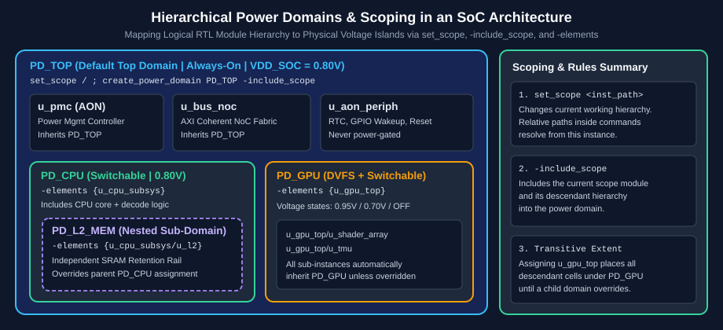
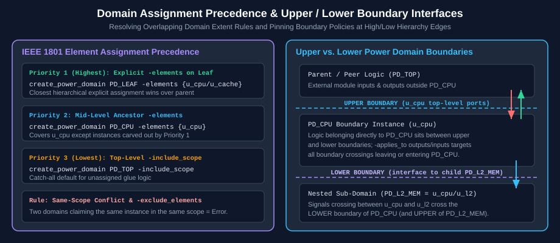

# Power Domains, Hierarchy Scopes, and Precedence Rules

Before defining a single supply wire, switch, or isolation cell, a power intent engineer must partition the design hierarchy into **Power Domains**. A power domain is a logical grouping of design instances (modules, cells, or memory blocks) that share a common primary power and ground supply strategy and transition together through power states. Getting domain boundaries and hierarchical scoping rules wrong is the number-one source of silent intent bugs in SoC power integration.

---

## Learning Goals

After completing this chapter, you should be able to:

- Define a power domain in both IEEE 1801 UPF (`create_power_domain`) and Si2 CPF (`create_power_domain`).
- Navigate and bind relative vs. absolute design paths cleanly using `set_scope` and hierarchical wildcards.
- Explain transitive domain inheritance (`-elements`), `-include_scope`, and explicit exclusion via `-exclude_elements`.
- Resolve overlapping domain assignments accurately using IEEE 1801 closest-scope and explicit-element precedence rules.
- Distinguish upper domain boundaries from lower domain boundaries when specifying boundary strategies.

---

## Anatomy of a Power Domain and Hierarchy Scoping

In an SoC, functional RTL follows a modular hardware hierarchy (e.g., `soc_top/u_cpu_cluster/u_core0/u_alu`). A power domain groups arbitrary subtrees of that logical hierarchy onto the same physical voltage island—even if the instances live in different parts of the RTL source tree.



### Setting Working Scope in UPF

In IEEE 1801 UPF, `set_scope` sets the current hierarchical working directory for all subsequent UPF commands (analogous to `cd` in Unix):

```tcl
# Set working scope to top of design
set_scope /

# Switch scope down into CPU cluster for local commands
set_scope u_cpu_subsys

# Refer to u_cpu_subsys/u_l2 directly because current scope is u_cpu_subsys
create_power_domain PD_L2_MEM -elements {u_l2}

# Return explicitly to root scope
set_scope /
```

> [!TIP]
> Always reset `set_scope /` (or use `load_upf -scope ...`) cleanly between IP sections. A lingering `set_scope` from an earlier sourced block silently breaks relative instance paths downstream!

---

## Creating Power Domains in UPF vs CPF

### IEEE 1801 UPF Syntax

The workhorse command `create_power_domain` creates a domain in the current scope:

```tcl
# 1. Top-Level Default Always-On Domain (-include_scope covers current module + unassigned children)
set_scope /
create_power_domain PD_TOP -include_scope \
    -supply {primary SS_AON}

# 2. Switchable CPU Subsystem (excludes L2 SRAM sub-instance)
create_power_domain PD_CPU \
    -elements {u_cpu_subsys} \
    -exclude_elements {u_cpu_subsys/u_l2} \
    -supply {primary SS_CPU_SW}

# 3. Dedicated Nested Sub-Domain for L2 Cache Retention
create_power_domain PD_L2_MEM \
    -elements {u_cpu_subsys/u_l2} \
    -supply {primary SS_L2_RET}

# 4. Combining Physically Separated IPs into One Domain
create_power_domain PD_MEDIA \
    -elements {u_isp_top u_video_enc u_dma_media} \
    -supply {primary SS_MEDIA_SW}
```

#### Key Options of `create_power_domain`

| Option | Behavior | Typical Usage |
| :--- | :--- | :--- |
| `-include_scope` | Includes the instance of the current `set_scope` and all its descendants unless overridden | Used once per scope/IP to create its base catch-all domain (`PD_TOP`) |
| `-elements {list}` | Explicitly assigns listed sub-instances and their sub-hierarchies to this domain | Standard way to carve out switchable CPU, GPU, and DSP domains |
| `-exclude_elements {list}` | Exempts specific sub-instances from this domain's extent so they fall back to ancestor/sibling assignment | Carving out an Always-On register slice inside a switchable IP |
| `-supply {handle set}` | Associates a supply set handle (UPF 2.1/3.1) such as `{primary SS_CPU}` | Modern portable rail binding |
| `-update` | Modifies an already-created power domain incrementally | Top-level SoC overrides adding SoC glue modules to an IP domain |

### Si2 CPF Syntax

In Si2 CPF, the top-level domain uses `-default`, while sub-domains specify `-instances`:

```tcl
# Default Top-Level Always-On Domain in CPF
create_power_domain -name PD_TOP -default

# Switchable CPU Domain
create_power_domain -name PD_CPU \
    -instances {u_cpu_subsys} \
    -shutoff_condition {!u_pmc/cpu_pwr_en}

# Nested Sub-Domain for L2 Retention
create_power_domain -name PD_L2_MEM \
    -instances {u_cpu_subsys/u_l2} \
    -base_domains {PD_CPU} \
    -shutoff_condition {!u_pmc/l2_pwr_en}
```

Notice how CPF embeds `-shutoff_condition` directly inside `create_power_domain`, whereas IEEE 1801 UPF separates domain extent (`create_power_domain`) from switching behavior (`create_power_switch` / `add_power_state`).

---

## Transitive Extent and Assignment Precedence Rules

When multiple `create_power_domain` commands overlap across a module hierarchy, IEEE 1801 resolves every leaf cell's membership deterministically using **precedence rules**:



### The Four Core Precedence Rules

1. **Transitive Extent:** Assigning `u_cpu_subsys` to `PD_CPU` automatically places `u_cpu_subsys/u_alu`, `u_cpu_subsys/u_dec`, and all deeper descendants into `PD_CPU`.
2. **Closest Scope / Deeper Explicit Element Wins:** If `PD_TOP` uses `-include_scope` at `/`, `PD_CPU` specifies `-elements {u_cpu_subsys}`, and `PD_L2_MEM` specifies `-elements {u_cpu_subsys/u_l2}`, then `u_l2` belongs to `PD_L2_MEM`, the rest of `u_cpu_subsys` belongs to `PD_CPU`, and everything else at `/` belongs to `PD_TOP`.
3. **Explicit `-elements` Beats `-include_scope` in Same Scope:** Within the same scope, an explicit `-elements` list always takes precedence over a `-include_scope` default domain.
4. **Same-Hierarchy Conflict Is Illegal:** Assigning the exact same instance twice in explicit `-elements` lists of two different domains in the same scope triggers an immediate UPF elaboration error.

> [!CAUTION]
> **Watch Out for `-exclude_elements` Fallback:** When you exclude `u_cpu_subsys/u_wake_timer` from `PD_CPU` via `-exclude_elements`, that excluded instance does **not** remain domainless—it reverts to the next enclosing ancestor domain (such as `PD_TOP`). If there is no enclosing `-include_scope` domain, static LP checkers flag an **unassigned instance** error.

---

## Upper and Lower Domain Boundaries

When applying isolation cells or level shifters (`set_isolation`, `set_level_shifter`), UPF must know *which physical wires* cross the domain interface. A domain's boundary has two distinct surfaces:

- **Upper Domain Boundary (`upper_domain_boundary`):** Interfaces between the **outer module ports** of the domain's extent instances and parent/peer external logic (e.g., `u_cpu_subsys` communicating outward to `u_bus_noc` in `PD_TOP`).
- **Lower Domain Boundary (`lower_domain_boundary`):** Interfaces between logic inside a parent domain and a **nested child domain** enclosed inside it (e.g., `u_cpu_subsys` logic in `PD_CPU` communicating downward with `u_cpu_subsys/u_l2` in `PD_L2_MEM`).

```tcl
# Target both upper boundaries (out to NoC) and lower boundaries (down to L2 child domain)
set_isolation ISO_CPU_ALL \
    -domain PD_CPU \
    -applies_to outputs \
    -applies_to_boundary both \
    -clamp_value 0 \
    -isolation_signal u_pmc/cpu_iso_en \
    -location parent
```

By default, UPF sets `-applies_to_boundary lower` or `both` depending on UPF version and command context—checking explicit `-applies_to_boundary` flags avoids accidentally skipping lower nested boundaries or over-constraining internal wires!

---

## Atomic and Composite Domains in Hierarchical UPF

In UPF 2.1+, **Composite Domains** (`create_composite_domain`) allow an SoC integrator to fuse multiple smaller IP sub-domains into a single physical voltage region:

```tcl
# Unify two block-level always-on domains from different IPs into one SoC voltage island
create_composite_domain PD_SOC_AON \
    -subdomains {u_uart/PD_UART_AON u_gpio/PD_GPIO_AON} \
    -supply {primary SS_SOC_AON}
```

Unlike regular power domains created directly over RTL instances, a composite domain inherits its elements strictly from the union of its member subdomains, eliminating redundant isolation/level-shifter checks between IPs that end up sharing the exact same silicon supply grid.

---

## Best Practices and Common Pitfalls

- **Use `PD_TOP -include_scope` First:** Establish the top-level default domain immediately at root scope so no glue logic, clock buffer, or reset synchronizer falls into an unassigned state.
- **Avoid Splitting Leaf Standard Cells Across Domains Randomly:** Group cleanly along natural RTL module boundaries (`-elements {u_inst}`). Pin-level or individual register-level domain carving severely complicates physical floorplanning and voltage-area routing in P&R.
- **Carve Always-On Logic Out Explicitly:** If a switchable module houses an Always-On wakeup FIFO or power-status CSR block, refactor that logic into a clean sub-module in RTL first (e.g., `u_aon_regs`), then assign it cleanly to the AON domain via `-exclude_elements`.
- **Beware Floating Hierarchical Wildcards:** Wildcards like `-elements {u_cpu/*}` match only direct children at one level rather than `u_cpu` ports themselves—meaning port-level boundary attributes and upper boundaries can mismatch compared to `-elements {u_cpu}`.

---

## Practical Exercises with Solutions

### Exercise 1 Tracing Effective Domain Membership

**Problem:**
Given the following UPF fragment on hierarchy `top -> {u_noc, u_gpu -> {u_core, u_ram, u_dbg}}`, determine the final domain for every instance:

```tcl
set_scope /
create_power_domain PD_AON -include_scope
create_power_domain PD_GPU -elements {u_gpu} -exclude_elements {u_gpu/u_dbg}
create_power_domain PD_RAM -elements {u_gpu/u_ram}
```

**Solution:**
- `top` and `top/u_noc`: **`PD_AON`** (via `-include_scope`).
- `top/u_gpu` and `top/u_gpu/u_core`: **`PD_GPU`** (explicit `-elements {u_gpu}` overrides `PD_AON`).
- `top/u_gpu/u_ram`: **`PD_RAM`** (most specific child domain overrides `PD_GPU`).
- `top/u_gpu/u_dbg`: **`PD_AON`** (`-exclude_elements` removes `u_dbg` from `PD_GPU`, so it reverts to its enclosing parent domain `PD_AON`).

### Exercise 2 Fixing a `set_scope` Hierarchy Mistake

**Problem:**
Spot the bug in the UPF script below and rewrite it cleanly:

```tcl
set_scope /u_soc
create_power_domain PD_TOP -include_scope
set_scope u_dsp
create_power_domain PD_DSP -include_scope
create_power_domain PD_DMA -elements {u_dma} ;# Intent: /u_soc/u_dma sibling of u_dsp!
```

**Solution:**
**Bug:** Because `set_scope` is still at `/u_soc/u_dsp`, `create_power_domain PD_DMA -elements {u_dma}` looks for `/u_soc/u_dsp/u_dma` instead of sibling `/u_soc/u_dma`, causing an instance-not-found elaboration failure!
**Fix:** Return to the parent scope before declaring sibling domain `PD_DMA`:

```tcl
set_scope /u_soc
create_power_domain PD_TOP -include_scope
create_power_domain PD_DMA -elements {u_dma}

set_scope u_dsp
create_power_domain PD_DSP -include_scope
set_scope /u_soc
```

### Exercise 3 Identifying Boundary Direction

**Problem:**
Inside `PD_CPU` (`u_cpu`), there is a nested sub-domain `PD_L2` (`u_cpu/u_l2`). When `PD_CPU` drives a read-enable signal into `u_cpu/u_l2`, is this crossing an **upper** or **lower** boundary of `PD_CPU`? What about from the perspective of `PD_L2`?

**Solution:**
- From **`PD_CPU`'s perspective:** It is a **`lower_domain_boundary`** crossing (interface down into an enclosed sub-domain).
- From **`PD_L2`'s perspective:** It is an **`upper_domain_boundary`** crossing (signal arriving at `u_cpu/u_l2`'s top-level input port from its enclosing parent).

##### Copyright (c) 2026 squared-studio
