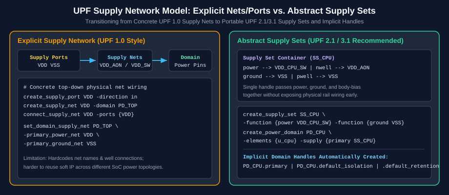
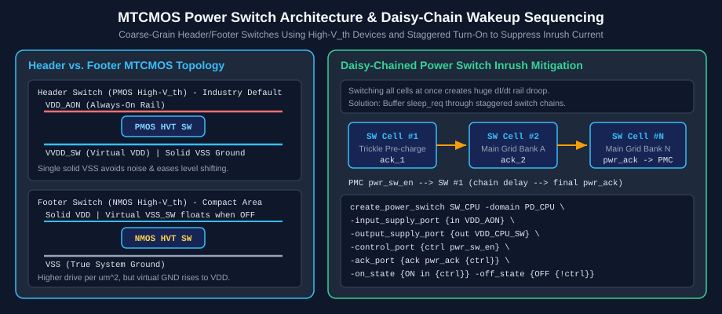

# Supply Nets, Supply Ports, Supply Sets, and Power Switches

Once logic modules are partitioned into Power Domains, those domains must receive power and ground rails—either directly from chip pins/bump pads or conditionally through on-die **MTCMOS power switches**. Understanding how IEEE 1801 represents supply networks—from explicit UPF 1.0 nets and ports to modern UPF 2.1/3.1 **Supply Sets**—is essential for building clean, reusable low-power SoCs.

---

## Learning Goals

After completing this chapter, you should be able to:

- Wire physical supply hierarchies using `create_supply_port`, `create_supply_net`, `connect_supply_net`, and `set_domain_supply_net`.
- Model portable rail bundles with UPF 2.1+ `create_supply_set` (`power`, `ground`, `nwell`, `pwell`) and `associate_supply_set`.
- Leverage automatically synthesized domain handles such as `PD.primary`, `PD.default_isolation`, and `PD.default_retention`.
- Design MTCMOS header and footer power switches using `create_power_switch` with `-on_state`, `-off_state`, and `-ack_port`.
- Explain why power switch daisy-chaining and trickle switches prevent massive inrush $dI/dt$ rail droop during domain wakeup.

---

## Supply Network Fundamentals

A power intent supply network is a pure abstraction of the chip's power delivery grid (PDN). Unlike Verilog nets carrying logic signals (`0`, `1`, `X`, `Z`), **supply nets** carry electrical voltage states (`OFF`, `FULL_ON 0.80`, `PARTIAL_ON`, `UNDETERMINED`).



### Concrete UPF 1.0 Supply Wiring

In early UPF 1.0, designers explicitly declared every supply port, net, and connection down the hierarchy:

```tcl
# 1. Declare top-level power & ground ports
create_supply_port VDD_AON -direction in
create_supply_port VSS     -direction in

# 2. Declare logical supply nets inside PD_TOP
create_supply_net VDD_AON    -domain PD_TOP
create_supply_net VDD_CPU_SW -domain PD_CPU
create_supply_net VSS        -domain PD_TOP
create_supply_net VSS        -domain PD_CPU -reuse  ;# Share global ground!

# 3. Connect ports to top-level supply nets
connect_supply_net VDD_AON -ports {VDD_AON}
connect_supply_net VSS     -ports {VSS}

# 4. Bind primary rails onto each Power Domain
set_domain_supply_net PD_TOP \
    -primary_power_net  VDD_AON \
    -primary_ground_net VSS

set_domain_supply_net PD_CPU \
    -primary_power_net  VDD_CPU_SW \
    -primary_ground_net VSS
```

> [!WARNING]
> **The `-reuse` Trap:** In UPF 1.0, calling `create_supply_net VSS -domain PD_CPU` *without* `-reuse` creates a brand-new isolated ground net visible only inside `PD_CPU`, disconnecting it from top-level `VSS`! Always pass `-reuse` when connecting an existing ancestor supply net into another domain, or better yet, adopt **Supply Sets**.

---

## UPF 2.1+ Supply Sets and Implicit Handles

Introduced in IEEE 1801-2009/2013, a **Supply Set** encapsulates related electrical functions (`power`, `ground`, `nwell`, `pwell`, `deepnwell`, `deeppwell`) inside a single abstract object. Supply sets eliminate repetitive per-domain `-reuse` declarations and keep IP UPF decoupled from physical wire names.

### Defining and Associating Supply Sets

```tcl
# Create abstract Supply Sets at top or IP level
create_supply_set SS_AON
create_supply_set SS_CPU_SW
create_supply_set SS_GPU_DVFS -function {power} -function {ground} -function {nwell}

# Bind physical supply nets onto Supply Set functions
create_supply_set SS_AON -update \
    -function {power  VDD_AON} \
    -function {ground VSS}

create_supply_set SS_CPU_SW -update \
    -function {power  VDD_CPU_SW} \
    -function {ground VSS}

# Attach directly inside create_power_domain
create_power_domain PD_TOP -include_scope -supply {primary SS_AON}
create_power_domain PD_CPU -elements {u_cpu} -supply {primary SS_CPU_SW}
```

### Automatic Implicit Supply Handles on Power Domains

Whenever `create_power_domain PD` runs in UPF 2.1+, IEEE 1801 automatically creates standard handle aliases that you can reference immediately—even before physical supply nets exist:

- **`PD.primary`:** Primary power and ground supply set powering the standard logic in `PD`.
- **`PD.default_isolation`:** Default backup/AON supply set automatically associated with isolation strategies inside `PD` (typically inherited from parent domain `PD_TOP.primary`).
- **`PD.default_retention`:** Default always-on supply set for state retention balloon latches inside `PD`.

```tcl
# Bottom-up portable IP: associate an SoC supply set onto an IP's internal domain handle!
associate_supply_set SS_AON -handle PD_CPU.default_isolation
associate_supply_set SS_AON -handle PD_CPU.default_retention
```

### Body Biasing with `nwell` and `pwell` Functions

In FDSOI and deep-submicron FinFET nodes utilizing Reverse Body Bias (RBB) or Forward Body Bias (FBB) to tune transistor $V_{th}$, supply sets capture well ties cleanly:

```tcl
create_supply_set SS_CPU_BB \
    -function {power  VDD_CPU_SW} \
    -function {ground VSS} \
    -function {nwell  VNW_BIAS} \
    -function {pwell  VPW_BIAS}
```

Static LP checkers verify that cells inside a domain receive well-bias voltages consistent with forward/reverse diode rules (preventing latch-up).

---

## Power Switches (MTCMOS)

To physically disconnect a domain's supply rail during idle states without shutting off external package pins, engineers insert **Multi-Threshold CMOS (MTCMOS) Power Switches**. Standard logic inside the switchable island uses fast low/standard-$V_{th}$ (LVT/SVT) transistors, while the power switch itself is built from thick/high-$V_{th}$ (HVT) transistors that exhibit minimal leakage when switched off.



### Header Switch vs. Footer Switch Trade-Offs

| Characteristic | Header Switch (PMOS HVT) | Footer Switch (NMOS HVT) |
| :--- | :--- | :--- |
| **Cut Rail** | Cuts $V_{DD}$ (`VDD_AON` $\to$ `VDD_SW`); solid `VSS` | Cuts $V_{SS}$ (`VSS_SW` $\to$ `VSS`); solid `VDD` |
| **Virtual Rail Behavior When OFF** | `VDD_SW` discharges toward `0V` (`VSS`) | `VSS_SW` floats up toward `VDD` |
| **Silicon Area Efficiency** | Larger (~2–2.5x area) due to lower hole mobility $\mu_p$ | Smaller (~1x area) due to higher electron mobility $\mu_n$ |
| **Clamp / Level-Shifter Ease** | **Easy:** Common solid `VSS` across entire die | **Harder:** Virtual ground shift breaks standard clamps |
| **Industry Usage** | **Preferred (~90%+ of SoCs)** | Rare / specialized legacy memories or Analog macros |

### Declaring a Power Switch in UPF and CPF

#### IEEE 1801 UPF (`create_power_switch`)

```tcl
create_power_switch SW_CPU \
    -domain PD_CPU \
    -input_supply_port  {in_sup  VDD_AON} \
    -output_supply_port {out_sup VDD_CPU_SW} \
    -control_port       {ctrl    u_pmc/cpu_pwr_sw_en} \
    -ack_port           {ack     u_pmc/cpu_pwr_sw_ack {ctrl}} \
    -on_state           {SW_ON  in_sup {ctrl}} \
    -off_state          {SW_OFF {!ctrl}} \
    -error_state        {SW_ERR {1'b0}}
```

Notice the Boolean expression inside `-on_state`: `ctrl` being `1` connects `in_sup` (`VDD_AON`) to `out_sup` (`VDD_CPU_SW`). Notice also `-ack_port {ack u_pmc/cpu_pwr_sw_ack {ctrl}}`—in simulation, this tells the virtual switch model how to drive the acknowledgment net back to the PMC (`cpu_pwr_sw_ack = ctrl` after turn-on delay)!

#### Si2 CPF (`create_power_switch_rule`)

```tcl
create_power_switch_rule \
    -name SW_CPU_RULE \
    -domain PD_CPU \
    -external_power_net VDD_AON

update_power_switch_rule \
    -name SW_CPU_RULE \
    -enable_condition_1 {u_pmc/cpu_pwr_sw_en} \
    -acknowledge_receiver {u_pmc/cpu_pwr_sw_ack} \
    -cells {HDR_HVT_X16}
```

### Inrush Current Mitigation via Staggered Daisy-Chaining

When a large CPU cluster with nanofarads of decoupling and gate capacitance wakes from $0\text{V}$, turning on thousands of parallel HVT switch cells in a single picosecond causes a massive spike in $dI/dt$:

$$V_{\text{droop}} = L_{\text{pkg}} \cdot \frac{dI}{dt} + I_{\text{inrush}} \cdot R_{\text{grid}}$$

That inductive rail droop can crash neighboring active CPU cores or corrupt SRAMs! To prevent rail collapse:

1. **Dual-Stage (Trickle + Main) Switches:** A small **trickle** chain gently pre-charges `VDD_CPU_SW` up to $\sim 80\%$ of $V_{DD}$ before a second **main** switch stage closes for full drive current.
2. **Daisy-Chain Turn-On:** Each physical power switch macro cell has a buffered `sleep_in` $\to$ `sleep_out` pin wired serially across the chip floorplan, staggering turn-on sequentially over dozens of nanoseconds until the final tail cell drives `pwr_ack = 1` back to the PMC.

---

## Best Practices and Common Pitfalls

- **Check Switch Polarity Carefully:** Many foundry header cells have **active-low** enable pins (`NSLEEP` or `SLEEP_N` where `0` = ON, `1` = OFF), whereas PMCs often generate **active-high** `pwr_en`. Double-check your `-on_state` Boolean sense (`{!ctrl}` vs `{ctrl}`) against the Liberty `.lib` `switch_function`!
- **Never Leave Supply Nets Unbound:** In simulation, an unbound supply net initializes as `UNDETERMINED`, keeping blocks perpetually corrupted (`X`) even though your PMC toggles `pwr_en = 1`.
- **Keep AON Control Driven by Always-On Domain:** `create_power_switch -control_port` must originate from an Always-On supply net (`SS_AON`), otherwise when `PD_CPU` powers off, the switch's own control pin turns into `X` and can never wake back up!
- **Use Header Switches Unless Physical Specs Mandate Footer:** Standard cell libraries overwhelmingly provide mature isolation clamps referenced to solid ground (`VSS`).

---

## Practical Exercises with Solutions

### Exercise 1 Writing a Supply Set UPF Setup

**Problem:**
Rewrite the following UPF 1.0 supply net declarations into clean UPF 2.1 Supply Set syntax for an SoC with Always-On `PD_TOP` (`VDD=0.80V`, `VSS=0V`) and switchable `PD_DSP` (`VDD_DSP_SW`, `VSS`):

```tcl
create_supply_net VDD -domain PD_TOP
create_supply_net VSS -domain PD_TOP
create_supply_net VDD_DSP_SW -domain PD_DSP
create_supply_net VSS -domain PD_DSP -reuse
set_domain_supply_net PD_TOP -primary_power_net VDD -primary_ground_net VSS
set_domain_supply_net PD_DSP -primary_power_net VDD_DSP_SW -primary_ground_net VSS
```

**Solution:**

```tcl
create_supply_set SS_AON -function {power VDD}        -function {ground VSS}
create_supply_set SS_DSP -function {power VDD_DSP_SW} -function {ground VSS}

create_power_domain PD_TOP -include_scope    -supply {primary SS_AON}
create_power_domain PD_DSP -elements {u_dsp} -supply {primary SS_DSP}
```

### Exercise 2 Active-Low Header Switch Debugging

**Problem:**
During power-aware simulation of a foundry header cell whose pin `NSLEEP_N` turns the switch **ON when `0`** and **OFF when `1`**, a designer wrote:

```tcl
create_power_switch SW_ISP -domain PD_ISP \
    -input_supply_port {in VDD} -output_supply_port {out VDD_ISP} \
    -control_port {NSLEEP_N u_pmc/isp_sleep} \
    -on_state {ON in {NSLEEP_N}} -off_state {OFF {!NSLEEP_N}}
```

During boot, `u_pmc/isp_sleep = 0` (requesting awake), yet `PD_ISP` turns into all `'X'`! Explain why and fix it.

**Solution:**
Because `-on_state` was given `{NSLEEP_N}` instead of `{!NSLEEP_N}`, the UPF behavioral switch turned `VDD_ISP` **OFF** when `isp_sleep == 0`! Fix the polarity expressions to match the hardware pin sense:

```tcl
create_power_switch SW_ISP -domain PD_ISP \
    -input_supply_port {in VDD} -output_supply_port {out VDD_ISP} \
    -control_port {NSLEEP_N u_pmc/isp_sleep} \
    -ack_port {NSLEEP_ACK u_pmc/isp_ack {!NSLEEP_N}} \
    -on_state {ON in {!NSLEEP_N}} -off_state {OFF {NSLEEP_N}}
```

### Exercise 3 Inrush Droop Analysis

**Problem:**
Why does an RTL simulation of `create_power_switch` show `PD_CPU` turning ON instantaneously, while physical silicon requires a staggered daisy-chain acknowledgment delay?

**Solution:**
Behavioral UPF simulation models switches as ideal voltage toggles (`OFF -> FULL_ON` immediately or after a fixed delay) without modeling package inductance $L_{\text{pkg}}$ or power-grid capacitance $C_{\text{grid}}$. In real silicon, simultaneous closure of thousands of MTCMOS headers creates huge $L \cdot dI/dt$ voltage droop on `VDD_AON`, risking brownout in adjacent active cores unless switch turn-on is staggered sequentially through a daisy chain.

##### Copyright (c) 2026 squared-studio
