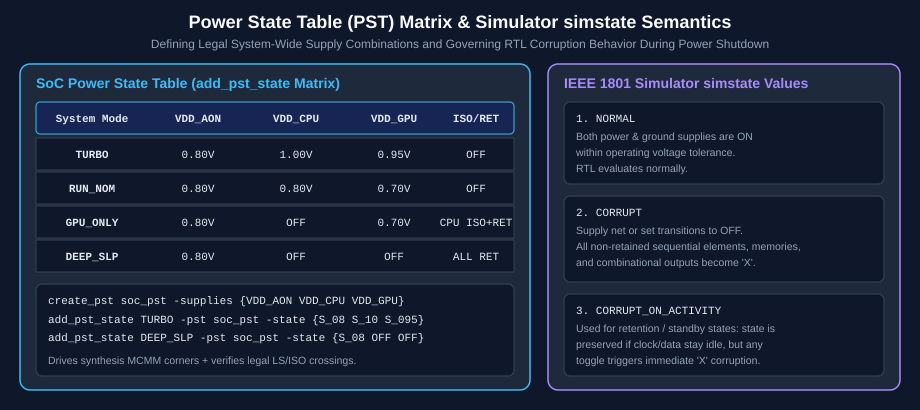
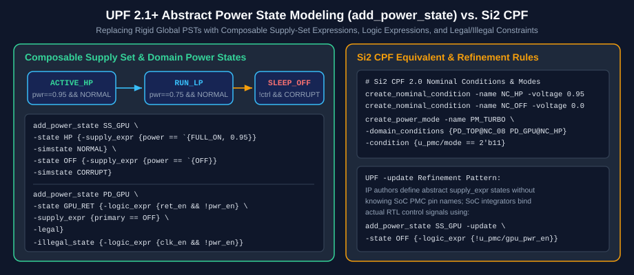

# Power State Tables (PST) and Abstract State Modeling

A multi-voltage SoC can theoretically enter dozens of supply-rail voltage combinations, yet only a small subset are valid operational modes defined by the system architect. Without an explicit specification of which voltage combinations can coexist, synthesis tools cannot optimize timing across legal multi-corner scenarios, and static checkers cannot verify whether level shifters or isolation cells are necessary between two blocks.

IEEE 1801 models legal voltage combinations in two complementary generations: the classic **Power State Table (PST)** (`create_pst`, `add_pst_state` from UPF 1.0) and modern **composable abstract power states** (`add_power_state` from UPF 2.1/3.1).

---

## Learning Goals

After completing this chapter, you should be able to:

- Define supply port operating voltages and off states using `add_port_state`.
- Construct a complete Power State Table (`create_pst` and `add_pst_state`) for a multi-domain DVFS and power-gated SoC.
- Distinguish the three IEEE 1801 `simstate` semantics (`NORMAL`, `CORRUPT`, and `CORRUPT_ON_ACTIVITY`).
- Write composable UPF 2.1/3.1 states using `add_power_state` with `-supply_expr`, `-logic_expr`, `-legal`, and `-illegal_state`.
- Express equivalent multi-mode operating conditions in Si2 CPF (`create_nominal_condition` and `create_power_mode`).

---

## Power State Tables (UPF 1.0 Style)

A **Power State Table (PST)** acts as a truth table whose columns represent physical supply nets or supply ports and whose rows enumerate every legal system operating mode.



### Step 1 Declare Port States (`add_port_state`)

Before constructing a PST, every participating supply port (or switch output supply port) must declare its legal discrete states:

```tcl
# Primary Always-On Supply Port (Single Nominal Voltage)
add_port_state VDD_AON -state {S_08  0.80}

# Switch Output Supply Port for CPU (ON at 0.80V or 1.00V, or OFF)
add_port_state SW_CPU/out_sup \
    -state {S_10  1.00} \
    -state {S_08  0.80} \
    -state {OFF   off}

# Switch Output Supply Port for GPU (DVFS 0.95V / 0.70V / OFF)
add_port_state SW_GPU/out_sup \
    -state {S_095 0.95} \
    -state {S_070 0.70} \
    -state {OFF   off}
```

> [!NOTE]
> Always bind `-state` entries to the **switch output supply port** (`SW_CPU/out_sup`) rather than the upstream `VDD_AON` input rail when tracking switched domains, so the PST reflects what the domain actually experiences after gating!

### Step 2 Assemble the System PST (`create_pst` & `add_pst_state`)

```tcl
create_pst SOC_PST -supplies {VDD_AON SW_CPU/out_sup SW_GPU/out_sup}

add_pst_state TURBO     -pst SOC_PST -state {S_08  S_10  S_095}
add_pst_state NOMINAL   -pst SOC_PST -state {S_08  S_08  S_070}
add_pst_state CPU_ONLY  -pst SOC_PST -state {S_08  S_08  OFF}
add_pst_state GPU_ONLY  -pst SOC_PST -state {S_08  OFF   S_070}
add_pst_state DEEP_SLP  -pst SOC_PST -state {S_08  OFF   OFF}
```

### How EDA Tools Consume the PST

1. **Level Shifter Inference:** Comparing Column 2 (`SW_CPU/out_sup`) and Column 3 (`SW_GPU/out_sup`):
   - In `TURBO`, CPU = $1.00\text{V}$ and GPU = $0.95\text{V}$ ($\text{CPU} > \text{GPU}$).
   - In `NOMINAL`, CPU = $0.80\text{V}$ and GPU = $0.70\text{V}$ ($\text{CPU} > \text{GPU}$).
   - Suppose another mode existed where CPU = $0.70\text{V}$ and GPU = $0.95\text{V}$: now bidirectional voltage inversion occurs across states, forcing the tool to insert **`both`-direction (`low_to_high` + `high_to_low`)** level shifters!
2. **Isolation Necessity:** Whenever Domain A has `OFF` in a row where Domain B is `ON` (e.g., `GPU_ONLY`: CPU=`OFF`, AON=`0.80V`), static LP tools flag every un-isolated `PD_CPU -> PD_TOP` crossing as a mandatory violation.
3. **Multi-Corner Timing (MCMM):** Synthesis and STA extract operating voltage scenarios directly from each PST row.

---

## Simulator simstate Semantics

IEEE 1801 defines three fundamental simulation states controlling how power-aware simulators evaluate RTL registers, combinational gates, and memories inside a domain:

| `simstate` | Electrical Trigger | Simulator RTL Behavior | Typical Use Case |
| :--- | :--- | :--- | :--- |
| **`NORMAL`** | Power and ground supplies both `FULL_ON` | Normal Verilog/SV functional evaluation | Active, Nominal, or Turbo mode |
| **`CORRUPT`** | Either power or ground supply is `OFF` or `UNDETERMINED` | All non-retained FFs, latches, and nets turn to `'X'` | Deep power-gated shutdown |
| **`CORRUPT_ON_ACTIVITY`** | Partial voltage / Standby retention state (`PARTIAL_ON`) | Holds current value while inputs/clock are completely idle; injects `'X'` immediately if **any** input, reset, or clock pin toggles! | Standby / Retention mode verifying clock-gating hygiene |

> [!TIP]
> Testing `CORRUPT_ON_ACTIVITY` during verification is a powerful trick: if an RTL bug leaks a spurious clock pulse or glitches an un-gated asynchronous reset while an SRAM is in retention standby, the simulator immediately poisons the memory array with `'X'`!

---

## Abstract State Modeling (add_power_state in UPF 2.1+)

Classic `create_pst` tables suffer from two major scalability limits in large SoCs:
1. Adding a new IP domain forces edits to the central top-level PST matrix (poor IP encapsulation).
2. A flat PST only records supply voltages—it cannot express relationships involving logical control signals (like retention `save`/`restore` or isolation `iso_en`) or mark illegal modes.

UPF 2.1/3.1 replaces centralized PSTs with distributed, composable **`add_power_state`** objects defined directly on individual Supply Sets or Power Domains:



### Supply Set Power States

```tcl
# Define modular supply-level states directly on Supply Set SS_GPU
add_power_state SS_GPU \
    -state GPU_HP   {-supply_expr {power == `{FULL_ON, 0.95} && ground == `{FULL_ON, 0.0}} \
                     -simstate NORMAL} \
    -state GPU_LP   {-supply_expr {power == `{FULL_ON, 0.70} && ground == `{FULL_ON, 0.0}} \
                     -simstate NORMAL} \
    -state GPU_OFF  {-supply_expr {power == `{OFF}} \
                     -simstate CORRUPT}
```

### Domain-Level States with Logic Expressions and Constraints

Power domains can combine `primary` supply expressions with Boolean RTL `-logic_expr` conditions and `-illegal_state` assertions:

```tcl
add_power_state PD_GPU \
    -state ACTIVE     {-supply_expr {primary == FULL_ON} -logic_expr {!gpu_iso_en} -legal} \
    -state RETENTION  {-supply_expr {primary == OFF}     -logic_expr {gpu_iso_en && ret_save} -legal} \
    -illegal_state    {BAD_UNISOLATED -supply_expr {primary == OFF} -logic_expr {!gpu_iso_en}}
```

During Power-Aware Simulation, whenever `PD_GPU` enters an `-illegal_state` (such as `primary == OFF` while `gpu_iso_en == 0`), the simulator automatically fires a runtime UPF error with the exact timestamp!

### Incremental `-update` for SoC Integration

Soft IP authors can ship an abstract UPF specifying `-supply_expr` states without knowing the SoC's PMC signal names. Later, the SoC integrator binds real RTL control pins cleanly with `-update`:

```tcl
# Inside IP UPF:
add_power_state SS_IP -state OFF {-supply_expr {power == `{OFF}} -simstate CORRUPT}

# Later inside SoC Top UPF:
add_power_state u_ip/SS_IP -update \
    -state OFF {-logic_expr {!u_pmc/ip_pwr_en}}
```

---

## Nominal Conditions and Power Modes in Si2 CPF

Si2 CPF models the exact same concept via **Nominal Conditions** (voltage + state) bound into named **Power Modes**:

```tcl
# 1. Declare nominal voltage conditions
create_nominal_condition -name NC_08  -voltage 0.80 -state on
create_nominal_condition -name NC_10  -voltage 1.00 -state on
create_nominal_condition -name NC_OFF -voltage 0.00 -state off

# 2. Compose system-wide Power Modes (analogous to PST rows + logic_expr)
create_power_mode -name PM_TURBO \
    -domain_conditions {PD_TOP@NC_08 PD_CPU@NC_10 PD_GPU@NC_08} \
    -condition {u_pmc/mode == 2'b11} -default

create_power_mode -name PM_SLEEP \
    -domain_conditions {PD_TOP@NC_08 PD_CPU@NC_OFF PD_GPU@NC_OFF} \
    -condition {u_pmc/mode == 2'b00}
```

---

## Best Practices and Common Pitfalls

- **Include Every Valid Operating Corner in the PST / State Model:** Omitting an intermediate transition state (e.g., forgetting a state where CPU is already $0.80\text{V}$ while GPU scales dynamically from $0.70\text{V} \leftrightarrow 0.95\text{V}$) can trick synthesis into leaving out a needed level shifter or picking the wrong `-rule` (`low_to_high` vs `both`).
- **Distinguish `OFF` vs `PARTIAL_ON` Carefully:** Use `OFF` with `CORRUPT` for power-gated domains whose rails collapse to $0\text{V}$, and use `PARTIAL_ON` with `CORRUPT_ON_ACTIVITY` for retention arrays biased at standby retention voltage (e.g. $0.55\text{V}$).
- **Prefer Explicit `-illegal_state` Rules:** Adding explicit illegal combinations (`!iso_en && primary == OFF`) turns passive UPF files into active runtime and formal protocol monitors.
- **Avoid Mixing Conflicting PST and `add_power_state` Tables:** While IEEE 1801 tools often translate legacy `create_pst` tables internally into supply states, verify your EDA tool's compatibility guidelines before mixing both styles on the same domain.

---

## Practical Exercises with Solutions

### Exercise 1 Building a Dual-DVFS Power State Table

**Problem:**
An AI subsystem has `VDD_AON` (fixed $0.80\text{V}$), `SW_NPU/out` ($0.65\text{V}$, $0.90\text{V}$, or `OFF`), and `SW_CPU/out` ($0.80\text{V}$ or `OFF`). Valid modes are:
- `ALL_FAST`: AON=$0.80\text{V}$, NPU=$0.90\text{V}$, CPU=$0.80\text{V}$
- `NPU_ECO`: AON=$0.80\text{V}$, NPU=$0.65\text{V}$, CPU=$0.80\text{V}$
- `NPU_SLEEP`: AON=$0.80\text{V}$, NPU=`OFF`, CPU=$0.80\text{V}$

Write the UPF `add_port_state`, `create_pst`, and `add_pst_state` commands. Then determine what level-shifter `-rule` (`low_to_high`, `high_to_low`, or `both`) is required from **NPU $\to$ CPU**!

**Solution:**

```tcl
add_port_state VDD_AON    -state {S_080 0.80}
add_port_state SW_NPU/out -state {S_090 0.90} -state {S_065 0.65} -state {OFF off}
add_port_state SW_CPU/out -state {S_080 0.80} -state {OFF off}

create_pst AI_PST -supplies {VDD_AON SW_NPU/out SW_CPU/out}
add_pst_state ALL_FAST  -pst AI_PST -state {S_080 S_090 S_080}
add_pst_state NPU_ECO   -pst AI_PST -state {S_080 S_065 S_080}
add_pst_state NPU_SLEEP -pst AI_PST -state {S_080 OFF   S_080}
```

From **NPU $\to$ CPU**:
- In `ALL_FAST`: $0.90\text{V} \to 0.80\text{V}$ (High-to-Low)
- In `NPU_ECO`: $0.65\text{V} \to 0.80\text{V}$ (Low-to-High)
Because NPU can be both **higher** and **lower** than CPU across legal system states, the crossing requires **`-rule both`** (along with isolation because NPU goes `OFF` while CPU stays `ON`, i.e., an ELS or `both`-type LS + ISO)!

### Exercise 2 Detecting `CORRUPT_ON_ACTIVITY` Bugs

**Problem:**
A verification engineer marks an L2 SRAM's deep-sleep state with `-simstate CORRUPT_ON_ACTIVITY` when `deep_sleep == 1` and `VDDA = 0.55V`. Halfway through sleep, a simulation error reports `CORRUPT_ON_ACTIVITY violation on u_l2/CLK`. What happened in the RTL?

**Solution:**
Although `u_l2` was supposed to be idle in retention (`VDDA = 0.55V`), its clock net `u_l2/CLK` (or another input like `CS_N` / `WEN`) toggled—either because clock gating was missing, fired late, or an active master sent an un-isolated glitch onto the SRAM bus. Under `CORRUPT_ON_ACTIVITY`, any activity while in partial standby poisons the SRAM contents to `'X'`, exposing the sequencing bug immediately!

### Exercise 3 Translating CPF Modes to UPF 2.1 `add_power_state`

**Problem:**
Express the behavior of `create_power_mode -name PM_LOW -domain_conditions {PD_CORE@NC_07}` using UPF 2.1 `add_power_state` with an explicit `-supply_expr` and `-simstate`.

**Solution:**

```tcl
add_power_state SS_CORE \
    -state LOW {-supply_expr {power == `{FULL_ON, 0.70} && ground == `{FULL_ON, 0.0}} \
                -simstate NORMAL}
```

##### Copyright (c) 2026 squared-studio
