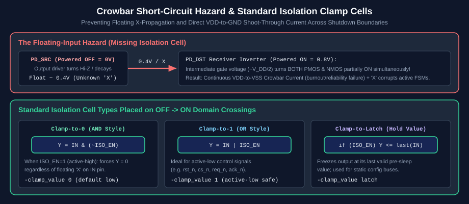
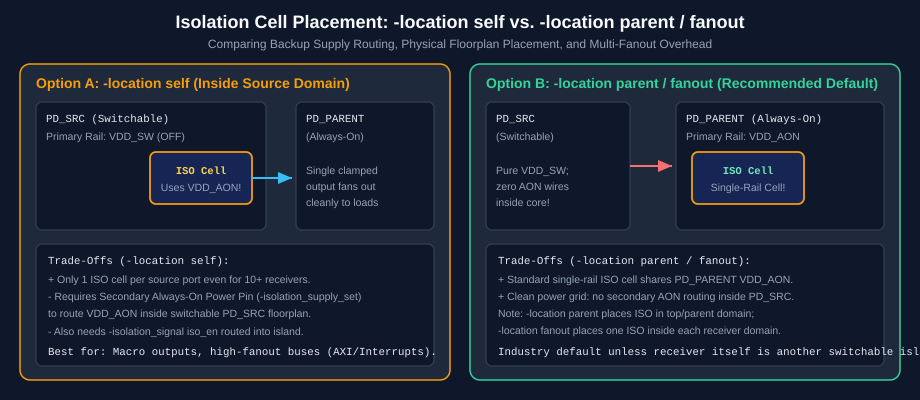

# Isolation Strategies and Domain Interface Protection

Whenever a switchable power domain shuts down while a downstream receiving domain remains powered ON, every wire crossing that boundary becomes an electrical and logical hazard. As the powered-off drivers lose charge, their output nodes float to indeterminate mid-rail voltages ($0.2\text{V}$–$0.5\text{V}$), unleashing continuous DC crowbar shoot-through current and unknown `'X'` corruption inside active receivers. **Isolation strategies** insert specialized clamp cells along domain exits to guarantee known, clean logic levels throughout shutdown.

---

## Learning Goals

After completing this chapter, you should be able to:

- Explain the electrical crowbar short-circuit mechanism and functional `'X'` propagation triggered when an un-isolated powered-off output feeds an active receiver.
- Select the appropriate isolation clamp cell (`0`, `1`, or `latch`) based on interface signal polarity and protocol requirements.
- Specify complete isolation strategies in IEEE 1801 UPF (`set_isolation`, `map_isolation_cell`) and Si2 CPF (`create_isolation_rule`).
- Compare `-location self` against `-location parent` and `-location fanout` in terms of secondary power-rail routing, fanout count, and P&R congestion.
- Handle exception ports (`-elements`, `-exclude_elements`, `-diff_supply_only`) for mixed active-high/active-low buses and bidirectional `inout` ports.

---

## The Crowbar Current Hazard and Clamp Cells

When `VDD_SRC` discharges toward $0\text{V}$, its output transistors lose gate drive and settle in high-impedance subthreshold drift. Downstream CMOS receivers powered at `VDD_DST = 0.80V` interpret that intermediate gate voltage near $V_{DD}/2$ as turning **both** pull-up PMOS and pull-down NMOS devices simultaneously ON.



This creates two catastrophic failures:
1. **Static DC Crowbar Current:** Milliamps per un-isolated pin leak continuously from `VDD_DST` straight through to `VSS`, violating sleep power budgets and risking metal electromigration.
2. **Logical `'X'` Avalanche:** Downstream active FIFOs, AXI crossbar arbiters, or interrupt controllers sample `'X'` (or random `0`/`1` oscillations), permanently wedging the system.

### The Three Isolation Cell Families

| Clamp Type | Behavioral Equation (Active-High `ISO_EN`) | Hardware Gate Primitive | Ideal Signals to Protect |
| :--- | :--- | :--- | :--- |
| **Clamp-to-0 (`0`)** | $Y = IN \cdot \overline{ISO\_EN}$ | Dedicated 2-input AND clamp (`ISO_LO`) | Active-high valid/request (`awvalid`, `irq`, `wr_en`), data buses (`wdata`) |
| **Clamp-to-1 (`1`)** | $Y = IN + ISO\_EN$ | Dedicated 2-input OR clamp (`ISO_HI`) | Active-low control pins (`cs_n`, `rst_n`, `req_n`, `ack_n`) |
| **Clamp-to-Latch (`latch`)** | `if (ISO_EN) Y <= last_Y` | Retention-style gated latch (`ISO_LATCH`) | Configuration/ID straps or static mode buses that must freeze pre-sleep value |

> [!CAUTION]
> **Never Use Regular Standard-Cell `AND` / `OR` Gates for Isolation!** Standard logic gates are not characterized for floating input pins (`X` at `IN`) and allow synthesis optimizers to swap pins or restructure Boolean cones (`A & 1 == A`, optimizing the clamp away or letting crowbar current leak through the first input transistor!). Always map isolation onto **foundry-qualified special ISO cells** characterized with `-isolation_sense` and an Always-On rail.

---

## Specifying Isolation in UPF and CPF

### IEEE 1801 UPF (`set_isolation` + `map_isolation_cell`)

In modern UPF 2.1/3.1, **`set_isolation`** consolidates signal targeting, clamp value, sense, enable signal, and physical location into a single self-contained strategy (legacy UPF 1.0 split enable controls into a separate `set_isolation_control` command):

```tcl
# 1. Default Clamp-0 rule for active-high outputs exiting PD_CPU
set_isolation ISO_CPU_DEFAULT \
    -domain PD_CPU \
    -isolation_supply_set SS_AON \
    -clamp_value 0 \
    -applies_to outputs \
    -isolation_signal u_pmc/cpu_iso_en \
    -isolation_sense high \
    -location parent

# 2. Override Clamp-1 rule specifically for active-low AXI/IRQ ports
set_isolation ISO_CPU_ONE \
    -domain PD_CPU \
    -isolation_supply_set SS_AON \
    -elements {u_cpu/axi_arvalid_n u_cpu/dbg_req_n u_cpu/sram_cs_n} \
    -clamp_value 1 \
    -isolation_signal u_pmc/cpu_iso_en \
    -isolation_sense high \
    -location parent

# 3. Exclude signals going to domains that are ALWAYS off whenever PD_CPU is off
#    or constrain insertion only across actual supply differences:
#    -diff_supply_only true
```

In the physical implementation UPF file, map abstract strategies to foundry standard cells:

```tcl
map_isolation_cell ISO_CPU_DEFAULT \
    -domain PD_CPU \
    -lib_cells {ISOLOD1BWP16P90}

map_isolation_cell ISO_CPU_ONE \
    -domain PD_CPU \
    -lib_cells {ISOHID1BWP16P90}
```

### Legacy UPF 1.0 Two-Command Split Syntax

When reading older IP blocks, you will frequently see two linked commands sharing the same `isolation_name`:

```tcl
set_isolation ISO_DMA_OUT -domain PD_DMA -clamp_value 0 -applies_to outputs
set_isolation_control ISO_DMA_OUT -domain PD_DMA \
    -isolation_signal u_pmc/dma_iso_en \
    -isolation_sense high \
    -location parent
```

### Si2 CPF Syntax (`create_isolation_rule` + `update_isolation_rules`)

```tcl
create_isolation_rule -name IR_CPU_0 \
    -from PD_CPU \
    -to PD_TOP \
    -isolation_condition {u_pmc/cpu_iso_en} \
    -isolation_output low \
    -exclude {u_cpu/axi_arvalid_n u_cpu/sram_cs_n}

update_isolation_rules -names IR_CPU_0 \
    -location parent \
    -within_hierarchy u_soc \
    -cells {ISOLOD1BWP16P90}
```

---

## Isolation Location Self vs Parent vs Fanout

Choosing **where** in the physical floorplan the isolation cell resides critically impacts secondary power-grid routing and cell area.



| Parameter | `-location self` | `-location parent` | `-location fanout` |
| :--- | :--- | :--- | :--- |
| **Physical Domain Residence** | Placed **inside** switchable source `PD_SRC` | Placed in enclosing **parent** (`PD_TOP`) outside `PD_SRC` | Placed inside **each downstream receiver** domain (`PD_DST`) |
| **Power Supply Requirement** | **Dual-Rail / Backup AON Supply:** Needs secondary `VDD_AON` stripe routed into `PD_SRC`! | Single-Rail `VDD_PARENT` (if parent is AON) | Single-Rail `VDD_DST` (no backup rail needed!) |
| **Multi-Receiver Fanout** | **1 cell total** at source port | 1 cell at boundary (if receivers share parent) | **N cells** (one per receiving domain branch) |
| **Control Signal Routing** | Must route `iso_en` *into* `PD_SRC` | `iso_en` stays outside in AON parent | `iso_en` routed to each receiver island |
| **Best Application** | Hard macros, large fanout buses where duplicate cells cost too much | **Standard default for switchable cores feeding Always-On SoC fabric** | When parent domain can also power off or when peer domains differ in $V_{DD}$ |

> [!IMPORTANT]
> **`-location self` Hidden Trap:** If you use `-location self` inside `PD_CPU` without ensuring `-isolation_supply_set` resolves to an **Always-On** rail (`VDD_AON`), the isolation cell itself will lose power when `PD_CPU` turns off! Static LP checkers immediately report an `ISO_SUPPLY_OFF` error.

---

## Tricky Boundary Cases

### 1. Clocks Crossing Out of a Switchable Domain
If a switchable IP generates an output clock (e.g., `spi_sclk_out`) feeding another active domain, isolate that clock cleanly to `0` (`-clamp_value 0` matching idle CPOL) *after* clean glitch-free clock gating, or place the clock divider outside in `PD_TOP`.

### 2. Always-On Domain Talking to Switchable Domain (`ON -> OFF`)
Do signals traveling **from** an Always-On block **into** a Powered-Off block need isolation?
- **Logically (`X`-wise):** Usually **No**—the receiver is powered OFF (`VDD_DST = 0V`), so an active `VDD_AON = 0.8V` driver cannot corrupt anything inside an inactive sink.
- **Physically (Leakage / ESD):** **Careful!** Driving $0.80\text{V}$ into an unpowered cell's input gate oxide is normally safe for thin-oxide FETs referenced to shared `VSS`, **unless** the receiver includes ESD clamp diodes to `VDD_SW` (e.g., hard I/O pads or certain SRAM peripheral pins) which would forward-bias and leak milliamps into the sleeping rail! In those cases, add `-applies_to inputs` isolation on the `ON -> OFF` port.

### 3. Signals Between Two Co-Switched Domains
If `PD_DMA` and `PD_CRYPTO` always share the same power switch and PST state (they turn OFF/ON together), inserting isolation between them wastes area and timing slack. Use `-no_isolation` or `-diff_supply_only true` (or specify exact `-sink` / `-source` supply sets) so synthesis skips redundant clamps.

### 4. Bidirectional `inout` Ports
An `inout` port requires directional awareness or separate pre-pad output isolation (`-applies_to outputs`) combined with transceiver `oe_n` clamping so an off domain never contends onto a shared bidirectional bus.

---

## Best Practices and Common Pitfalls

- **Never Isolate Reset to Active Assertion Accidentally:** Choose `-clamp_value` carefully on reset outputs (`1` for `rst_n`, `0` for `rst`). Clamping an active-low `rst_n` to `0` holds the downstream active subsystem permanently in reset whenever the upstream core sleeps!
- **Verify `-isolation_sense` Matches Hardware Polarity:** Forgetting `-isolation_sense low` on an active-low `iso_n` enable means the domain gets clamped *while awake* and un-clamped *while asleep*—an instant functional and electrical failure.
- **Check Control Driver Supply:** Both `iso_en` and its buffer chain (including inverters introduced during synthesis!) must be powered by an Always-On supply set active whenever either source or sink needs protection.
- **Audit Redundant Isolation via `-name_prefix`:** Give every `set_isolation` rule a descriptive name (`ISO_CPU_ZERO`, `ISO_CPU_ONE`) so synthesis cell instance names stay traceable during gate-level STA and ECO debug.

---

## Practical Exercises with Solutions

### Exercise 1 Selecting Clamp Values for Mixed Protocol Signals

**Problem:**
Switchable `PD_NPU` drives four outputs to Always-On `PD_TOP`:
1. `npu_irq` (active-high interrupt to GIC)
2. `npu_axi_arvalid` (AXI active-high read valid)
3. `npu_sram_cen` (active-low SRAM chip enable)
4. `npu_boot_mode[1:0]` (must preserve last programmed value across sleep)

Choose the exact `-clamp_value` for each signal and write the UPF `set_isolation` commands assuming active-high `u_pmc/npu_iso_en`.

**Solution:**
- `npu_irq`, `npu_axi_arvalid`: **`0`** (so sleeping NPU never fires false interrupts or phantom AXI requests).
- `npu_sram_cen`: **`1`** (keeps active-low chip-enable deasserted so sleeping NPU outputs do not accidentally trigger SRAM accesses).
- `npu_boot_mode[1:0]`: **`latch`** (holds last valid value).

```tcl
set_isolation ISO_NPU_0 -domain PD_NPU -isolation_supply_set SS_AON \
    -elements {u_npu/npu_irq u_npu/npu_axi_arvalid} \
    -clamp_value 0 -isolation_signal u_pmc/npu_iso_en -isolation_sense high -location parent

set_isolation ISO_NPU_1 -domain PD_NPU -isolation_supply_set SS_AON \
    -elements {u_npu/npu_sram_cen} \
    -clamp_value 1 -isolation_signal u_pmc/npu_iso_en -isolation_sense high -location parent

set_isolation ISO_NPU_LATCH -domain PD_NPU -isolation_supply_set SS_AON \
    -elements {u_npu/npu_boot_mode} \
    -clamp_value latch -isolation_signal u_pmc/npu_iso_en -isolation_sense high -location parent
```

### Exercise 2 Debugging `-location self` Static Check Error

**Problem:**
A designer adds `set_isolation ISO_DSP -domain PD_DSP -clamp_value 0 -applies_to outputs -isolation_signal u_pmc/dsp_iso -location self`, omitting `-isolation_supply_set`. Static checker VC LP flags `ISO_SUPPLY_NOT_AON`. Why did it fail, and what are the two valid fixes?

**Solution:**
Without `-isolation_supply_set` (or binding `PD_DSP.default_isolation` to `SS_AON`), placing an isolation cell `-location self` defaults its supply to `PD_DSP.primary` (`VDD_DSP_SW`), which shuts off during sleep—making the isolation cell powerless!
**Two valid fixes:**
1. Move placement outside to `-location parent` (where `PD_TOP` provides `SS_AON` naturally), **or**
2. Keep `-location self` and add `-isolation_supply_set SS_AON` (plus physically route `VDD_AON` secondary rails to those boundary cells in `PD_DSP`).

### Exercise 3 Avoiding Duplicate Isolation on High-Fanout Nets

**Problem:**
`PD_CPU` outputs `cpu_halt_status`, which fans out to 4 separate Always-On subsystems (`PD_GIC`, `PD_DEBUG`, `PD_TIMER`, `PD_TRACE`). Comparing `-location parent` vs `-location fanout`, how many isolation cells are inserted by each option?

**Solution:**
- **`-location fanout`**: Inserts **4** isolation cells (one inside each receiving domain leaf/branch).
- **`-location parent`**: Inserts **1** isolation cell in the common enclosing parent domain (`PD_TOP`) right outside `PD_CPU` before the net forks to the 4 receivers—saving 75% cell area and loading!

##### Copyright (c) 2026 squared-studio
