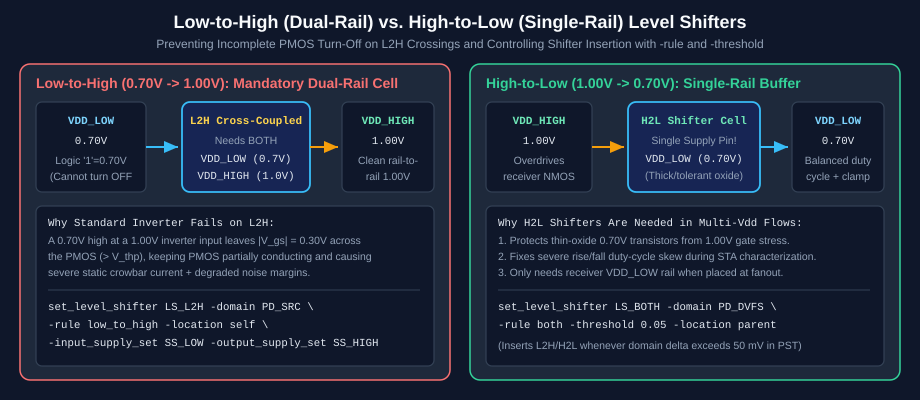
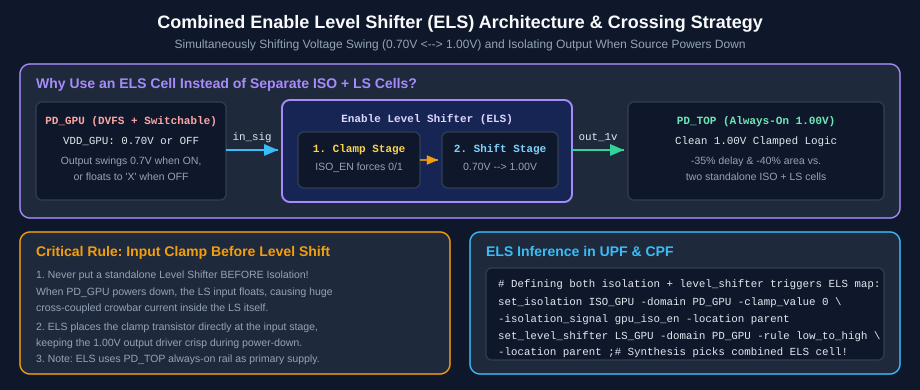

# Voltage Level Shifters and Enable Level Shifters (ELS)

In multi-voltage (Multi-Vdd) and Dynamic Voltage and Frequency Scaling (DVFS) SoCs, adjacent hardware blocks routinely operate at different supply voltages—for instance, a $0.70\text{V}$ ultra-low-power sensor engine communicating with a $1.00\text{V}$ Turbo CPU cluster. Driving signals directly across mismatched voltage rails degrades noise margins, skews duty cycles, risks thin-oxide breakdown, and triggers severe static crowbar leakage. **Level Shifters (LS)** and **Enable Level Shifters (ELS)** safely translate voltage swings across domain crossings.

---

## Learning Goals

After completing this chapter, you should be able to:

- Explain the transistor-level failure mechanism when a low-voltage driver ($0.70\text{V}$) feeds a high-voltage CMOS receiver ($1.00\text{V}$), and why High-to-Low crossings still require single-rail buffering.
- Contrast Low-to-High (dual-rail cross-coupled), High-to-Low (single-rail), and Bidirectional (`both`) level shifter cells.
- Write IEEE 1801 UPF (`set_level_shifter`, `map_level_shifter_cell`) and Si2 CPF (`create_level_shifter_rule`) strategies using `-rule`, `-threshold`, and `-location`.
- Explain how **Enable Level Shifters (ELS)** combine isolation clamping and voltage level translation into one fast, compact boundary cell—and why input clamping must precede voltage shifting.

---

## Electrical Physics of Voltage-Domain Crossings

Every Multi-Vdd crossing falls into one of two electrical directions (or both dynamically under DVFS):



### 1. Low-to-High (L2H) Crossings ($V_{DDL} \to V_{DDH}$)

Suppose a driver at $V_{DDL} = 0.70\text{V}$ outputs a logic `'1'` ($0.70\text{V}$) directly into a receiver powered by $V_{DDH} = 1.00\text{V}$ whose PMOS threshold magnitude is $|V_{thp}| = 0.25\text{V}$:
- The PMOS source sits at $V_{DDH} = 1.00\text{V}$, while its gate receives $V_{in} = 0.70\text{V}$.
- Thus $|V_{gs\_p}| = 1.00\text{V} - 0.70\text{V} = 0.30\text{V} > |V_{thp}| = 0.25\text{V}$!
- The pull-up PMOS **never turns completely OFF**, while the NMOS pulls hard toward `VSS`, causing constant static crowbar current, reduced $V_{OL}$ margin, and skewed rise/fall propagation delays!

**Solution:** A **dual-rail cross-coupled Differential Cascode Voltage Switch (DCVS) Level Shifter** that takes **both** `VDD_LOW` (for the input buffer stage) and `VDD_HIGH` (for the regenerative cross-coupled output pull-up stage), cleanly restoring a rail-to-rail $0\text{V} \leftrightarrow 1.00\text{V}$ swing with zero static crowbar leakage.

### 2. High-to-Low (H2L) Crossings ($V_{DDH} \to V_{DDL}$)

Driving $1.00\text{V}$ into a $0.70\text{V}$ receiver fully turns OFF the PMOS (`|V_gs| = 0V` — no crowbar current). Why then do ASIC flows still insert **High-to-Low Level Shifters**?

1. **Rise/Fall Duty-Cycle Distortion:** A $1.00\text{V}$ input trips a $0.35\text{V}$-midpoint inverter almost immediately on the rising edge, creating severe rise vs. fall skew.
2. **Gate-Oxide Overdrive Reliability (TDDB):** Applying $1.00\text{V}$ onto an ultra-thin low-$V_{DD}$ transistor gate accelerates Time-Dependent Dielectric Breakdown unless buffered through an H2L cell built with **tolerant/medium-oxide** input devices.
3. **STA Library Characterization:** Standard `.lib` timing tables are characterized only where input pin swing equals the cell's own rail; H2L cells explicitly contain cross-voltage multi-rail timing arcs.

Crucially, an H2L level shifter needs only a **single power rail** (`VDD_LOW`)—making placement inside the receiving domain (`-location parent` or `-location fanout`) free of secondary power-grid routing!

### Comparing L2H, H2L, and Bidirectional (`both`) Shifters

| Parameter | Low-to-High (L2H) | High-to-Low (H2L) | Bidirectional / DVFS (`both`) |
| :--- | :--- | :--- | :--- |
| **Voltage Crossing** | $V_{DDL} \to V_{DDH}$ | $V_{DDH} \to V_{DDL}$ | Dynamically flips ($V_A > V_B$ and $V_A < V_B$) |
| **Power Pin Count** | **Dual-Rail** (`VDDL` + `VDDH`) | **Single-Rail** (`VDDL`) | **Dual-Rail** (`VDDA` + `VDDB`) |
| **Preferred `-location`** | `self` or `parent` (must access both rails) | `parent` / `fanout` (shares receiver `VDDL`) | `parent` (common access to both islands) |
| **Physical Area Overhead** | Medium–Large | Small (buffer-sized) | Largest (supports full swing in either direction) |

---

## Specifying Level Shifters in UPF and CPF

EDA tools consult the **Power State Table (PST)** or `add_power_state` definitions to decide automatically whether two communicating domains ever differ in voltage by more than `-threshold`.

### IEEE 1801 UPF (`set_level_shifter` + `map_level_shifter_cell`)

```tcl
# Insert bidirectional level shifters on all crossings leaving or entering PD_GPU
set_level_shifter LS_GPU_DVFS \
    -domain PD_GPU \
    -applies_to both \
    -rule both \
    -threshold 0.05 \
    -input_supply_set  SS_GPU \
    -output_supply_set SS_AON \
    -location parent

# Targeted Low-to-High rule for outputs from fixed 0.70V sensor hub to 0.90V NoC
set_level_shifter LS_SENSOR_OUT \
    -domain PD_SENSOR \
    -applies_to outputs \
    -rule low_to_high \
    -location self

# Override to skip unnecessary level shifters on specific debug buses
set_level_shifter LS_SKIP_DBG \
    -domain PD_GPU \
    -elements {u_gpu/dbg_tp} \
    -no_shift
```

#### Physical Mapping (`map_level_shifter_cell`)

```tcl
map_level_shifter_cell LS_GPU_DVFS \
    -domain PD_GPU \
    -lib_cells {LVLHL_X2BWP LVLLH_X2BWP LVLBOTH_X2BWP}
```

#### Key Options of `set_level_shifter`

- **`-rule`:** `low_to_high` (insert only if `src < dst`), `high_to_low` (insert only if `src > dst`), or `both` (insert whenever `|src - dst| > threshold` across legal PST states).
- **`-threshold <volts>`:** Voltage tolerance (e.g., `0.05` = $50\text{mV}$). Prevents inserting redundant shifters when two rails differ trivially (e.g., $0.80\text{V}$ vs $0.82\text{V}$ IR-margin variations).
- **`-no_shift`:** Explicitly suppresses shifter insertion on selected boundary signals or equal-voltage domain pairs.
- **`-force_shift`:** Forces shifter insertion even when static PST voltages appear equal (useful if independent package regulators drift in phase).

### Si2 CPF (`create_level_shifter_rule` + `update_level_shifter_rules`)

```tcl
create_level_shifter_rule -name LSR_GPU_BOTH \
    -from PD_GPU -to PD_TOP

update_level_shifter_rules -names LSR_GPU_BOTH \
    -location parent \
    -within_hierarchy u_soc \
    -cells {LVLBOTH_X2BWP}
```

---

## Combined Enable Level Shifters (ELS)

What happens when a domain (`PD_GPU`) is **both** DVFS-scaled ($0.70\text{V} \leftrightarrow 0.95\text{V}$) **and** power-gated (`OFF`)? Signals leaving `PD_GPU` toward Always-On `PD_TOP` ($0.85\text{V}$) need **both** isolation clamping and voltage level shifting!



### Why Input Clamping Must Always Come First

Suppose a designer mistakenly places a standalone L2H Level Shifter *before* an Isolation Cell (`PD_GPU -> LS -> ISO -> PD_TOP`):
- When `PD_GPU` shuts down (`VDD_GPU = 0V`), the input to the Level Shifter floats!
- Inside the L2H shifter, its input stage and cross-coupled keeper latch have no valid reference, driving massive shoot-through current inside the dual-rail shifter *even though the downstream ISO gate clamps the output*.

By contrast, an **Enable Level Shifter (ELS)** merges clamping directly into the front-end input stage of the level shifter circuit:
1. When `ISO_EN == 1`, internal pull-down/pull-up clamp devices immediately kill the floating input before it reaches the cross-coupled level-translation stage.
2. When `ISO_EN == 0`, the single integrated cell shifts and drives the output in one gate delay instead of two!

### Inference Rules for ELS

You do **not** need a special `set_els` command in UPF! Whenever both **`set_isolation`** and **`set_level_shifter`** apply to the **same domain boundary port** with compatible locations (typically `-location parent` or `-location fanout`) and a matching combined ELS cell exists in the target Liberty `.lib` (or `map_isolation_cell` / `use_interface_cell` specifies an ELS library cell), synthesis (`Design Compiler` / `Genus`) automatically infers the single combined **ELS cell**, saving $\sim 35\%$ delay and $\sim 40\%$ area!

```tcl
# Defining both ISO + LS on PD_GPU outputs at -location parent lets synthesis map ELS
set_isolation ISO_GPU \
    -domain PD_GPU -applies_to outputs -clamp_value 0 \
    -isolation_signal u_pmc/gpu_iso_en -isolation_sense high -location parent

set_level_shifter LS_GPU \
    -domain PD_GPU -applies_to outputs -rule both -location parent

# Explicitly bind an ELS cell via map_isolation_cell / use_interface_cell if required
use_interface_cell ELS_GPU_MAP \
    -strategy {ISO_GPU LS_GPU} \
    -domain PD_GPU \
    -lib_cells {ELS_LH_CLAMP0_X2}
```

---

## Best Practices and Common Pitfalls

- **Never Place Dual-Rail L2H Shifters Inside an Unprotected Island Without Secondary Routing:** If `-location self` is used for an L2H shifter, verify the implementation flow routes the receiver's higher `VDD_HIGH` rail physically as a secondary power pin into the `PD_SRC` voltage area.
- **Keep `-rule both` Conservative on DVFS Blocks:** Using `-rule both` across domains whose PST includes both $V_{\text{src}} < V_{\text{dst}}$ and $V_{\text{src}} > V_{\text{dst}}$ ensures tools don't pick a unidirectional H2L shifter that fails electrically in Eco mode.
- **Guard Asynchronous Clocks & Resets Crossing Voltage Domains:** If a clock or async reset crosses between $0.70\text{V}$ and $1.00\text{V}$ domains, verify both duty-cycle symmetry and whether ELS/LS cells belong in the clock-tree synthesis (CTS) don't-touch list with symmetric cell delays.
- **Check Supply Pin Order on Dual-Rail ELS Cells:** In an ELS crossing from switchable `PD_GPU` ($0.7\text{V}$/`OFF`) to AON `PD_TOP` ($0.9\text{V}$), the ELS output and clamp circuitry **must** stay powered by `VDD_TOP` (Always-On) so turning off `VDD_GPU` never shuts off the clamp stage itself!

---

## Practical Exercises with Solutions

### Exercise 1 Determining Level Shifter Direction Across Modes

**Problem:**
Domain `PD_SENSOR` runs at $0.65\text{V}$ (Standby) or $0.90\text{V}$ (Burst), while receiving domain `PD_NOC` always stays at $0.80\text{V}$.
1. What level shifter `-rule` is required for `PD_SENSOR -> PD_NOC` signals?
2. What level shifter `-rule` is required if `PD_SENSOR` only ever ran at $0.65\text{V}$ vs `PD_NOC` at $0.80\text{V}$?

**Solution:**
1. Across the two modes, `PD_SENSOR` transitions from $0.65\text{V} < 0.80\text{V}$ (L2H) to $0.90\text{V} > 0.80\text{V}$ (H2L). Therefore `-rule both` is mandatory!
2. If `PD_SENSOR` were fixed at $0.65\text{V}$, `0.65V -> 0.80V` is strictly Low-to-High, so `-rule low_to_high` suffices.

### Exercise 2 Fixing a Missing ELS Power-Off Failure

**Problem:**
A verification run on an SoC with DVFS + power-gated `PD_VIDEO` shows `'X'` leaking through a dual-rail L2H level shifter `U_LS_VID` out into `PD_TOP` right after `VDD_VIDEO` switches off, even though an isolation cell was also declared at `-location parent`. What ordering error occurred during P&R/UPF setup, and how does an ELS fix it?

**Solution:**
The flow placed `U_LS_VID` **upstream** of the isolation cell (inside or before clamping), so `VDD_VIDEO = 0V` collapsed the L2H shifter's input rail and corrupted its output—and physically created crowbar current inside `U_LS_VID`.
**Fix:** Bind the isolation and level shifter strategies at `-location parent` using an **Enable Level Shifter (ELS)** (`use_interface_cell -strategy {ISO_VID LS_VID}`) powered by `SS_AON` (`VDD_TOP`), which clamps the floating signal *inside* the ELS input stage prior to level shifting.

### Exercise 3 Evaluating `-threshold` Impact

**Problem:**
In an SoC, `PD_A` operates at $0.80\text{V}$ and `PD_B` operates at $0.78\text{V}$. With `set_level_shifter ... -threshold 0.05`, does synthesis insert a level shifter between `PD_A` and `PD_B`? Why?

**Solution:**
No! Because $|0.80\text{V} - 0.78\text{V}| = 0.02\text{V} < 0.05\text{V}$ (`-threshold 0.05`), the voltage difference falls within the $50\text{mV}$ tolerance margin, so the synthesis/LP tool omits unnecessary level shifters along that boundary.

##### Copyright (c) 2026 squared-studio
